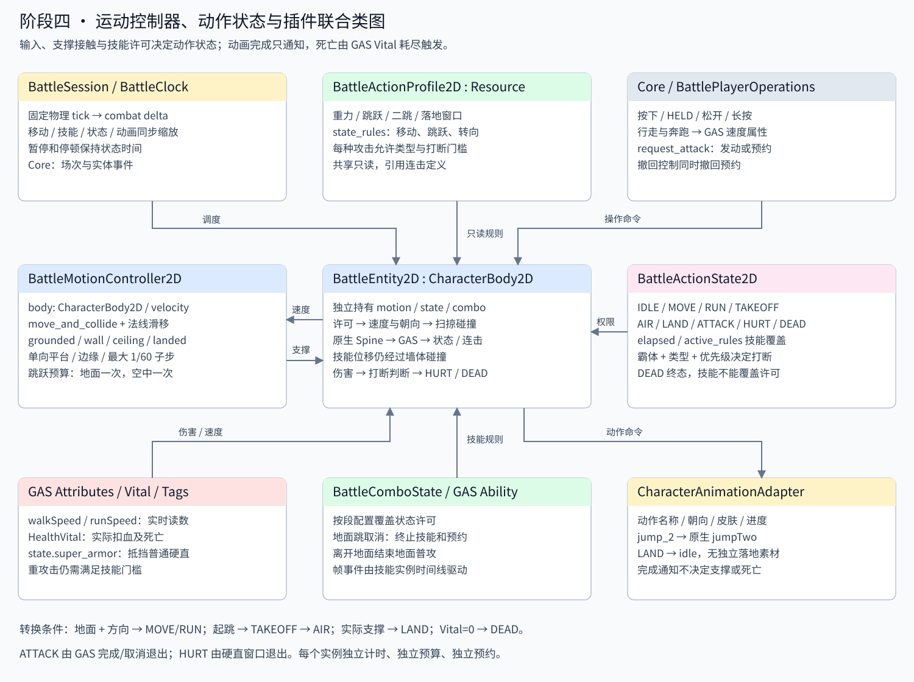
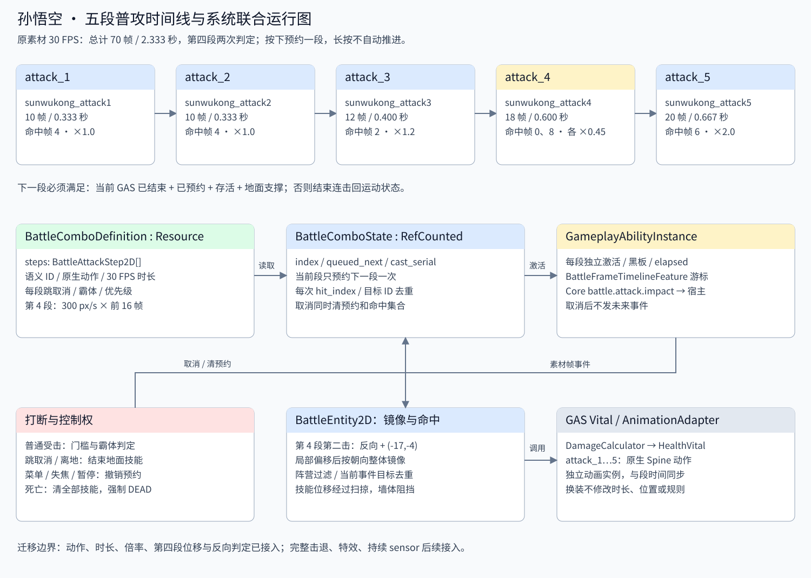
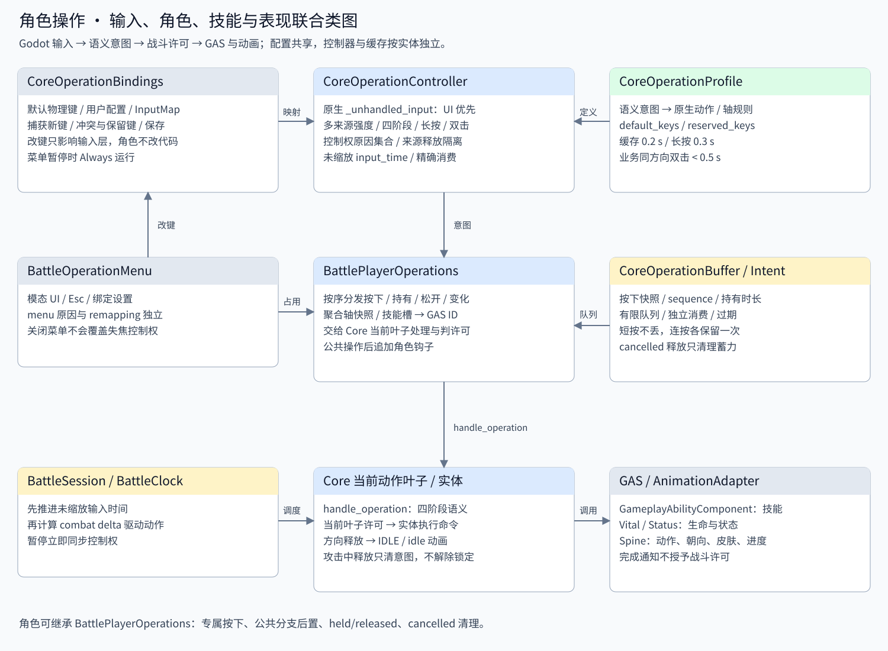
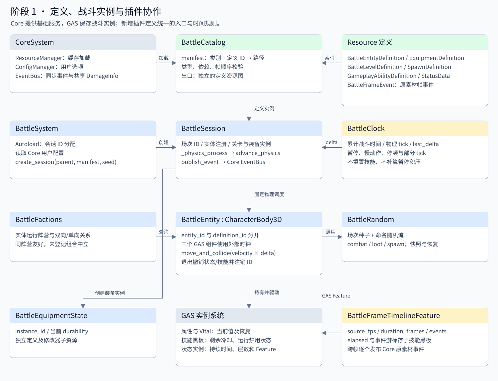
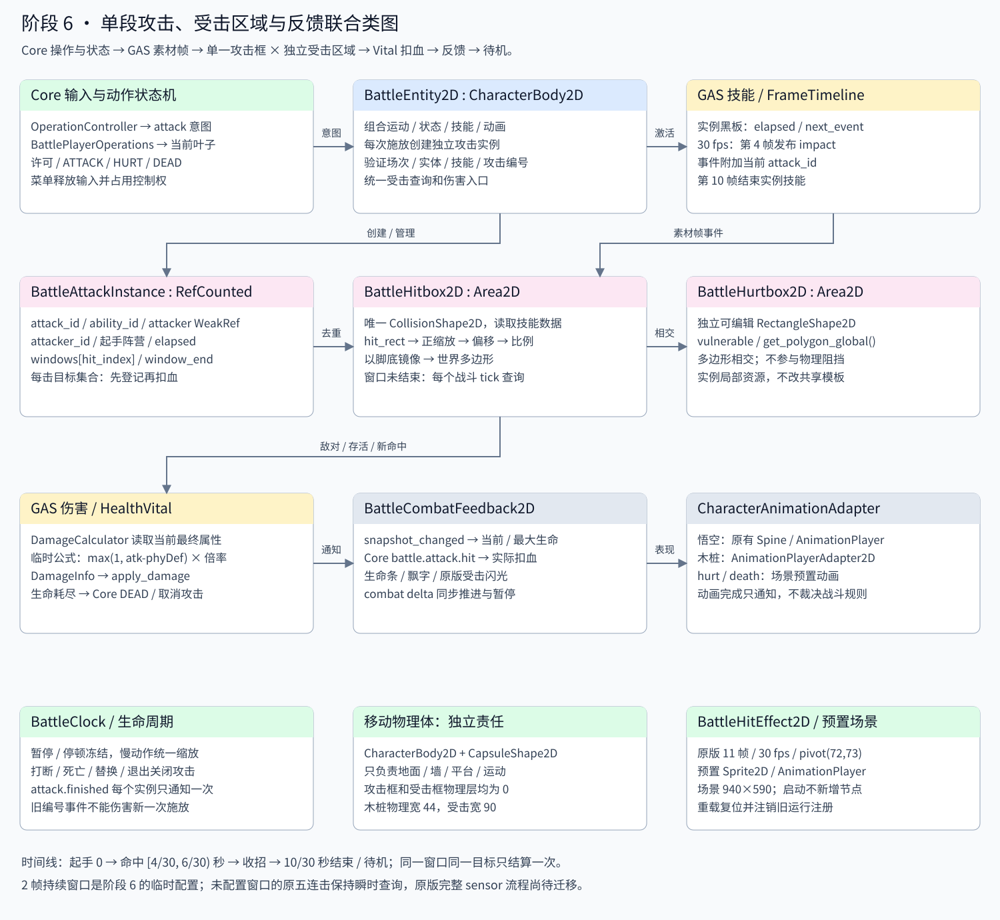
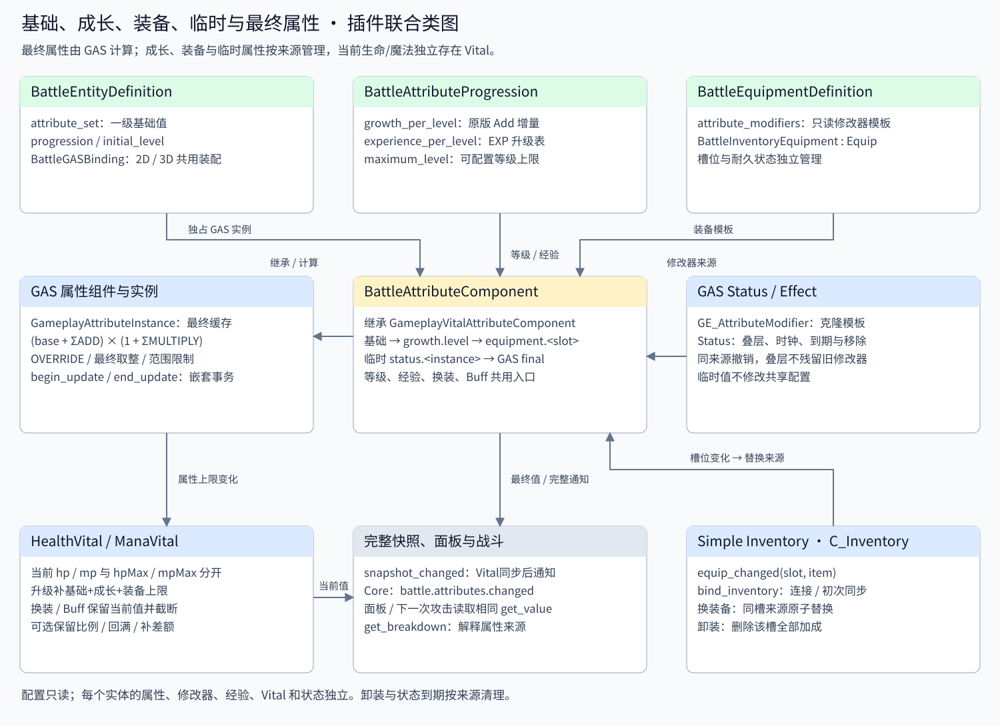
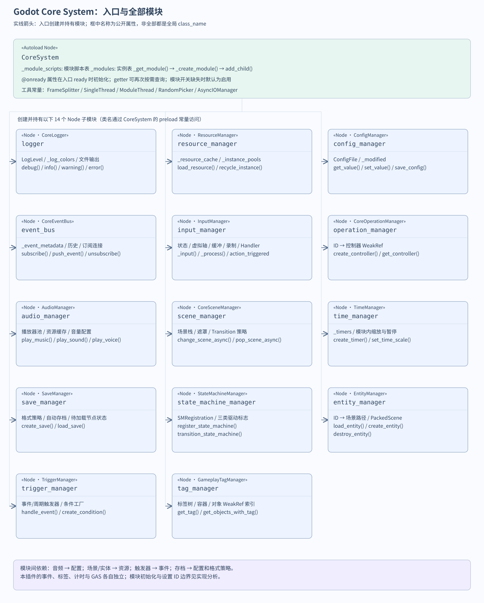

# 造梦西游 Godot 项目

F5 运行正式入口 [碧玉径](game/levels/biyujing.tscn)。需要带 **Spine 4.3 模块**的 Godot，当前验证版本为项目使用的 Godot 4.7.2。

已接入[原版音效、关卡/Boss背景音乐及声音设置](addons/battle_foundation/audio/README.md)：悟空动作、命中、拾取、升级、强化及胜负声音复用Core音频插件。底部「设置」或Esc可分别调节音乐与音效音量、静音，并保存偏好；音频组件预置于公共战斗表现层。补给成功拾取显示原版绿色回血/蓝色回魔跳字，数值为实际整数恢复量。

阶段14已接入怪物掉落、原版灵魂飞行与经验升级；装备实例独立保存UID、强化、随机属性与附加属性，背包提供强化/洗练成本确认，套装数量变化统一重算GAS，外观独立切换。怪物播完死亡动作后隐藏并停止碰撞。[配置、原版依据与操作说明](data/loot/README.md)。

- 所有现有关卡怪物（剑舞、驭兽使、复苏容器、玉石琵琶精）已统一使用 Spine；原逐帧素材转换为附件时间轴，保留注册点、层序、30FPS动作时长及特效。不是重新绘制肢体骨骼。[怪物动画与导入](data/monsters/README.md)。
- 新角色/怪物使用 [预置组件基础模板](data/templates/README.md)，通过继承场景替换动画、属性、技能和AI；生命、冷却和状态各实例独立。
- 背包使用原版方正粗圆字体、三态关闭/衣柜按钮、圆形分页、经验填充、装备栏文字及原战斗力数字，保留真实装备/出售/扩容入口。[背包实现范围](data/ui/README.md#背包截图修复)。
- 新增 [造梦西游1资料](docs/reference/zaomeng1/README.md) 和 [关卡配置](docs/reference/zaomeng1/levels.json)。这是用户提供的 **zmISAV VTest 修改版**；源SWF保持不变，不覆盖上古天地玩法。
- 正式入口在 `game/`，业务定义与可编辑场景在 `data/`，素材在 `assets/`，插件在 `addons/`，回归检查在 `tests/suites/`，被检查引用的测试场景在 `tests/fixtures/`，离线工具在 `tools/`。未引用的阶段1旧演示已移除；移除未引用的Core/摄像机插件示例，保留GAS验收依赖的示例。迁移记录见 [project_layout.json](docs/project_layout.json)。

验证命令与测试目录说明见 [tests/README.md](tests/README.md)。以下保留各阶段实现、调参与插件分析说明。

当前战斗HUD新增六个原版底部点击入口和顶部关卡计时。怪物按各自原阈值处理保护，Boss保护动作与两秒无敌/免疫减益Buff独立计时；悟空跑攻结束回待机，重新按方向后继续移动。[实现范围与配置入口](data/ui/combat-hud.md)。

战斗面板已按原版截图修正：红/蓝/黄填充位于黑色条底上方，技能快捷键回到图标右下角，恢复Q/E标识，空无双盘隐藏常驻“空格”，缺魔采用原灰度。状态图标读取真实GAS状态，控件均预置；GPU像素检查和56项HUD验收通过。[布局、源码依据与截图](data/ui/README.md#截图对照修复)。

首关新增原版角色 HP/MP/EXP、技能图标/冷却遮罩和浮动提示，B 打开原版四分类背包，支持真实换装/外观同步、整理、锁定、确认出售和按原材料扩容。已修复 Boss 石墙注册点、技能播报、空保护条，接入原版 59 帧斩败与 36 帧发光出口。怪物离线转换为 Spine 附件时间轴，通过预置 AnimationPlayer 编排语义动作与判定。[节点配置、原版依据及实现范围](data/ui/README.md)、[新增装备](data/inventory/README.md)。无双怒气已接入；原版联网背包模块的当前范围见文档。

Boss栏已按原版挂在画面顶部中央，第一关显示“玉石琵琶精”，使用原名字体、三条生命计数、火抗降低/土抗提高图标及保护条。剑舞、驭兽使和复苏容器接入原25帧出场动画。清屏后进入区域右侧半屏即可平滑移镜，无需走到边缘；延迟出生仍锁定。[原版依据、可编辑节点和调参入口](addons/battle_foundation/boss/original-presentation.md)。

首关镜头使用Phantom Camera和原30FPS的0.2系数平滑跟随，过区保留当前画面。进入战斗区域后左右镜头均锁定，延迟波次期间也不解锁；区域完整清理后恢复双向跟随。进入下一战斗区域时平滑抵达固定画面并再次锁定，未通关区域右边界仍受限；跳跃遵守原地图高度裁剪，暂停/慢动作/停顿统一消费BattleClock。所有镜头组件和锚点预置。[原版依据、配置及验收](addons/battle_foundation/camera/README.md)。

第一关已接入原版碧玉径远景、宫殿中景、201帧动态云层、连续地板与近景遮挡。五个区域共用一张10944×1216的连续地图；美术、碰撞、出生点和门均在编辑器预置，区域推进只解锁镜头与刷怪。[地图与视觉模板、复用步骤](addons/battle_foundation/level/map-template.md)、[整图场景](data/levels/biyujing/progression/map.tscn)、[美术编辑场景](data/levels/biyujing/progression/visual.tscn)。F5直接运行完整关卡。

阶段13已形成首个可玩关卡：F5运行 [碧玉径](game/levels/biyujing.tscn)，悟空经过五区域、32只普通怪物及复苏容器，最后挑战玉石琵琶精并确认出口通关。Boss接入原版三技能、五枚扇形音符、成形后持续5秒的实体石墙、原版技能播报、三层血条/保护条、BGM及命中/胜负声音；使用现有Core状态机/事件/音量总线与GAS属性/技能/伤害系统，所有组件及技能对象节点预置。支持其他Boss配置血量阶段、机关前置、预警和GAS时间轴召唤；普通玉石琵琶精原版无阶段/召唤，主线保持原配置。[Boss编辑入口](data/monsters/jushi_lingjun/README.md)、[系统实现及原版范围](addons/battle_foundation/boss/README.md)、[SVG类图与时序](addons/battle_foundation/docs/boss.svg)。真实初始悟空（等级1、生命275、攻击26）仅用五连击打通34个目标，剩余生命55。

阶段12已接入 [碧玉径关卡](game/levels/biyujing.tscn)，F5运行。按原始TMX配置五区域、九波次、十八出生计划：进入触发、延迟/间隔生成、出生完毕依赖、指定出生点全死依赖统一使用战斗时钟。第一波全死但第二波尚未出现时仍锁门；全部计划、目标及额外条件满足后才解锁出口和镜头。末区击破复苏容器，第25源帧生成玉石琵琶精；击败后在出口按W/↑确认，死亡统计、开门、胜利均去重。[配置入口](data/levels/biyujing/progression/README.md)、[实现与原版范围](addons/battle_foundation/level/README.md)、[联合类图](addons/battle_foundation/docs/level-progression.svg)。地图碰撞/出生点/出口和原版分层美术均预置，五区域沿同一张连续地图推进；Boss现已接入阶段13三技能与专属行为。

悟空普通无双表现已接入 Core 空格意图与 GAS 状态：周身 `#FF3000` 红色辉光按原版30 FPS脉动，每0.2秒捕获人物残影，1秒线性淡出。第一关与五技能演示通过命中获取无双值，满10000后按空格释放，15秒持续消耗；原版满值火焰/空格提示、1秒缓动消耗条、移速+30%、伤害增幅+30%、暴击属性增加释放时的20%+72以及起手1秒霸体均已接入。节点预置、固定快照池，支持移动、转身、换装、暂停、停顿及死亡清理。[原版依据、配置和验收](data/effects/wushuang/README.md)。

悟空移动已统一2倍战斗坐标：行走420、跑步600世界像素/秒，对应原版210/300。第一关五连击、跑攻、跳攻改用原版逐段受击速度和时长，第三段保留拉回，第四段两击分别覆盖冲量；不再套用阶段9验收用的倒地与击退配置。[速度调整入口](data/animation/sunwukong-config.md)、[原版击退参数与实测距离](data/battle2d/original_reactions/README.md)。

悟空转职前的 **升龙斩（Y）、烈焰闪（U）、火眼金睛（I）、烈焰风暴（O）**，以及 **火魔斩（L）** 已按原版接入。打开 [五技能演示](tests/fixtures/wukong_skills_demo.tscn) 按 F6，W/S 调整火眼金睛，烈焰风暴期间再按 O 追加重劈；J 仍使用五连击。MP/CD 等级表、原版 AB、技能状态、独立砸地与特效时序复用现有插件，所有视觉节点预置，继续共用一个攻击框。[原版依据、技能参数及编辑步骤](data/skills/sunwukong/README.md)、[联合类图](addons/battle_foundation/docs/wukong-basic-skills.svg)。

阶段 11 已接入普通怪物与可扩展 AI。按 F6 运行 [碧玉径小怪场景](tests/fixtures/first_level_demo.tscn)：32 个编辑器预置小怪（16 剑舞、16 驭兽使）使用原版属性、动作图集、攻击特效与逐帧 AB 判定；近战追击、远程出手退步、巡逻、返回活动范围和跳跃共用 Core 操作意图及动作规则，伤害、Buff、死亡与独立冷却复用 GAS。支持调整每种怪物的行为策略、低生命逃离和目标选择。[配置与新增怪物步骤](data/monsters/README.md)、[AI实现与原版范围](addons/battle_foundation/ai/README.md)、[联合类图](addons/battle_foundation/docs/monster-ai.svg)。此场景保留为预置小怪AI验收；区域刷怪、地图碰撞与Boss通关流程使用上方阶段12场景。

阶段 10 已接入 GAS Buff、被动与 Core 战斗触发。打开 [Buff 测试场景](tests/fixtures/buff_demo.tscn) 按 F6 运行，选择悟空或木桩后施加加攻、减速、眩晕、持续伤害、护盾、无敌、霸体、反伤与吸血；“被动组合”演示释放、命中、受击、生命阈值和击杀触发。支持独立实例、叠层、刷新、覆盖、周期补算、死亡/离场清理；眩晕进入 Core STUN，吸血按原版盾前伤害计算，反伤不重复触发普通命中被动。[配置与原版依据](addons/battle_foundation/combat/buffs-triggers.md)、[资源目录](data/buffs/README.md)、[联合类图](addons/battle_foundation/docs/buffs-triggers.svg)。

伤害跳字、怪物血条、保护条和通用受击闪光集中在 `BattleSession/BattlePresentation`，全场共用一个跳字对象池；悟空和木桩场景已移除公共反馈节点。[节点归属与编辑说明](addons/battle_foundation/presentation/README.md)。

悟空属性可直接在角色的 **GameplayVitalAttributeComponent → Scene Attributes → Base Values** 中修改，**Initial Level Override** 编辑初始等级；保存后重新运行即可用于面板、成长与战斗。原版伤害样例的攻击100也已移到组件配置，不再由启动脚本覆盖。[编辑步骤与基础/最终值说明](data/battle2d/character-components.md#直接编辑悟空属性)。

角色组件已统一预置到角色场景：GAS 属性/Vital、技能、状态、动作状态、运动、连击、受击、保护、伤害规则、背包与输入控制器均可在场景树中查看；初始化只绑定已有节点。复用场景结构、玩家控制权与新角色接入见 [角色组件说明](data/battle2d/character-components.md)。

孙悟空已接入原版跑攻、跳攻动画与独立 Core 状态：跑步或空中按 J 发动对应攻击。第四段新增可配置的 [8,16) 素材帧转身窗，窗口内新按反方向仅转身一次，身体与特效翻转、当前位移方向保留，第五段沿新朝向释放。动作、技能、转身参数及实际渲染见 [跑攻、跳攻与第四段转身](data/battle2d/wukong-context-attacks.md)。

游戏内怪物头顶血条已替换为原版62×6背景及60×4生命贴图：出生隐藏、受伤显现、0.6秒残血补间、2秒自动隐藏、最低4%显示及死亡隐藏。伤害跳字使用共享图集、有界节点池及原版连续Quad.easeOut Tween曲线采样，保持原轨迹、时长、随机规则与命中数量。实际GPU压力测试每战斗秒生成3600条、同时约3180条时，完整帧P95约12.59ms；单帧骤增5000条仍有峰值。配置、预热与实测边界见 [跳字高并发性能](data/effects/damage-number-performance.md)。原版边界、时间规则、编辑入口与实测范围见 [原版血条与跳字说明](data/effects/monster-health-bar.md)。

阶段 9 已实现独立受击反应与保护条。F6 运行 [受击与保护演示](tests/fixtures/hit_reaction_demo.tscn)：连按 J 五连击观察硬直、击退、击飞、落地倒地与起身；目标模式可切换普通、霸体、无敌和免伤但允许动作反应。左上输入框分别编辑东皇太一 25000、商羊 35000 的保护满值；同目标同技能跨施放累计命中，触发后重置计数。物理经过墙体/平台扫掠，受击停顿统一冻结战斗时钟。配置与实现见 [阶段9详细说明](addons/battle_foundation/combat/hit-reaction-protection.md) 和 [原版保护数据](data/protection/README.md)，自动验收 199 项及 13 套既有回归通过。

训练木桩已按悟空的猴脸、棕帽金箍与黄色护衣重绘为 SVG，并加入预置 AnimationPlayer 受伤动画：身体倾斜、压缩、回弹与表情变化，底座保持固定。连续命中会重新播放，暂停与慢动作跟随战斗时钟；打开 [木桩场景](data/battle2d/dummy/wooden_dummy.tscn) 即可编辑和预览，详见 [木桩外观与动画说明](data/battle2d/dummy/README.md)。

孙悟空五段普攻已接入项目现有 Spine 攻击特效，按原版 30 FPS 的第 4、4、2、0/8、6 帧播放。节点与时间轴保存在 [visual 场景](data/animation/sunwukong_visual.tscn)，可直接编辑和预览；左右镜像、取消、暂停与慢动作同步。跳跃高度、行走/奔跑速度、重力及不同测试场景的配置入口见 [孙悟空特效与运动调参](data/animation/sunwukong-config.md)。

阶段 8 已接入原版伤害流程：命中/闪避、暴击/韧性、幸运/守护、技能等级与附伤、抗性、增减伤、真实伤害、护盾及后置回调。F6 运行 [原版伤害预置场景](tests/fixtures/original_damage_demo.tscn)，连按 J 使用孙悟空五连击（第四段两次命中），点击“样例”切换八种结算；普通、暴击、真实伤害和闪避使用原版贴图跳字，连续命中的数字分别存在。所有面板数值显示整数，概率沿用原版220级EXP参数。结果区分计算伤害、护盾吸收和实际扣血。详见 [跳字编辑与原版逻辑](data/effects/README.md)、[公式与扩展说明](addons/battle_foundation/combat/original-damage.md)、[原版数据](data/damage/README.md) 和 [联合类图](addons/battle_foundation/docs/original-damage.svg)。

阶段 7 已接入现有 GAS 技能时间轴：[三段技能预置场景](tests/fixtures/skill_timeline_demo.tscn) 按 F6 运行，J 释放三段，后摇前再次按 J 派生，支持独立倍率/附伤/击退/浮空、持续间隔与次数、消耗冷却和取消清理。所有攻击段复用一个判定框，117项验收通过。实现、编辑方法、时序与边界见 [阶段7说明](addons/battle_foundation/combat/skill-timeline.md) 和 [联合类图](addons/battle_foundation/docs/skill-timeline.svg)。三段数值为验收配置，原五连击与单段场景保留，伤害默认已升级到阶段8原版策略。

孙悟空 [表现场景](data/animation/sunwukong_visual.tscn) 通过主 AnimationPlayer 预览二十二个动作，所有技能统一使用一个 AttackHitbox / CollisionShape2D，判定范围读取当前 GAS 技能数据。修改技能事件或攻击段的 hit_rect、缩放和偏移即可调整预览与实际命中。[编辑步骤、新角色接入与类图](data/animation/README.md)。

使用带原生 Spine 模块的 Godot 4.7 或更新版本打开 `project.godot`，按 F5 运行碧玉径完整关卡，或按 F6 运行所选示例。插件综合演示仍可单独运行 `tests/fixtures/plugin_showcase.tscn`。

Windows 编辑器若偶发 `Failed to create Windows OS window`、`Failed to create sub window` 或 `INVALID_WINDOW_ID`，先保存并关闭编辑器，再通过 [单窗口启动脚本](tools/open_editor_single_window.ps1) 打开本项目：

```powershell
powershell -ExecutionPolicy Bypass -File .\tools\open_editor_single_window.ps1
# 首次打开或更换电脑时，指定支持 Spine 的 Godot：
powershell -ExecutionPolicy Bypass -File .\tools\open_editor_single_window.ps1 -Godot 'D:\路径\Spine-Godot.exe'
```

脚本读取本项目上次使用的 Godot 路径，并传入 `--editor --single-window`，让编辑器弹窗和提示嵌入主窗口，减少 Windows 子窗口创建。默认不修改全局设置，也不关闭正在运行的编辑器。**普通启动仍会使用原有多窗口设置**；要持续应用此规避措施，请先保存并关闭所有使用该引擎的编辑器，然后执行：

```powershell
powershell -ExecutionPolicy Bypass -File .\tools\open_editor_single_window.ps1 -PersistSingleWindow
# 只保存设置、不打开编辑器：在上面的命令后添加 -ConfigureOnly
```

此选项通过 [Godot 设置脚本](tools/window_mode_helper/configure_editor_window_mode.gd) 持久化当前版本的 `interface/editor/display/single_window_mode=true`，影响使用同一用户设置文件的其他项目；首次修改前，在设置文件旁保留 `.before-single-window.bak` 备份。配置进程使用独立辅助工程，不会加载游戏插件；辅助工程的自检插件只在显式验证参数下运行。Windows GUI 版 Godot 通过等待进程退出确认保存完成。若发现同一引擎仍有编辑器进程，脚本会停止并提示保存关闭，不会强制结束进程。也可在“编辑器设置”搜索 `single_window_mode`，手动开启并重启；恢复多窗口只需关闭该开关并重启，不建议整份还原备份覆盖之后的其他设置。单窗口模式会限制浮动面板；按当前 [官方设置文档](https://docs.godotengine.org/en/latest/classes/class_editorsettings.html#class-editorsettings-property-interface-editor-display-single-window-mode)，游戏嵌入也会停用，F5/F6 在独立游戏窗口运行。

2026-10-08 排查时：最新游戏日志没有窗口错误，Panku 用户配置的 `enable_os_window=false`，编辑器单窗口设置为 `false`，运行中的编辑器命令也没有 `--single-window`。这些证据更倾向于编辑器原生弹窗路径，而非游戏战斗代码，但仍不能证明底层失败原因。`Config file 'user://config.cfg' not found` 是使用默认配置的提示，不是这组窗口错误。

验证入口 [verify_editor_window_mode.gd](tools/window_mode_helper/verify_editor_window_mode.gd) 通过正常编辑器插件生命周期执行，不替换编辑器主循环；验证持久化设置时不传 `--single-window`，反复显示/隐藏嵌入弹窗后自动退出。请关闭日常编辑器或使用隔离用户配置再运行验证，避免并行写编辑器设置：

```powershell
& 'D:\路径\Spine-Godot.exe' --path .\tools\window_mode_helper --editor --quit-after 1200 -- --verify-window-mode
```

2026-10-08 已通过同一自编译引擎、同一 NVIDIA/D3D12 后端的 30 次弹窗显示/隐藏验证，无错误；主场景运行 180 帧正常退出，无窗口错误；原版伤害测试通过 90 项检查。游戏场景仍有现存的资源 UID 回退路径警告，与这组 Windows 子窗口错误无关，未在本次调整中修改。当前用户的 Godot 4.7 编辑器单窗口设置已保存为 `true` 并保留原设置备份；这是对失败创建子窗口路径的规避，不是已证明并修复了底层 Windows/引擎故障。

这是针对窗口创建路径的规避措施，尚未确定这台电脑上偶发错误的根因。[同类 Windows 窗口失败报告](https://github.com/godotengine/godot/issues/74152) 和 [已合并的 Windows 图标泄漏修复](https://github.com/godotengine/godot/pull/114525) 可供对照；仅凭 `INVALID_WINDOW_ID` 不能断定为图标泄漏、显卡问题或某个插件故障。2026-10-07 检查时游戏日志没有该组错误，编辑器 GDI 数量为 115，未发现当时已耗尽的证据。

当前包含以下六套插件：

- `gameplay_abiltiy_system`：技能、行为树、属性、生命/法力、状态、标签、投射物、区域效果和 Cue。演示包含伤害、治疗、冷却、无敌过滤和状态叠加。
- `simple_inventory`：背包、装备槽、筛选、整理和道具提示。
- `panku_console`：交互控制台；演示环境支持 `demo.damage()`、`demo.heal()`、`demo.add_status()` 和 `demo.reset_demo()`。
- `zylann.debug_draw`：3D 线框、坐标轴及调试文字。
- `godot_core_system-0.0.4`：新增基础框架，包含 14 个模块：日志、资源、音频、事件、输入、操作意图、配置、场景、时间、存档、状态机、实体、触发器和标签。
- `battle_foundation`：基于 Core + GAS 的阶段一战斗基础，提供配置索引、实体运行 ID、阵营、随机流、固定物理时钟和原素材帧事件。

业务层的角色配置、属性加点、天赋、装备接入、业务伤害公式及 HUD 已从 `scripts/`、`data/`、`ui/` 移除。插件示例使用 `addons/gameplay_abiltiy_system/examples/example_data.gd` 中的独立数据，插件 UI 素材也放在插件内部。

效果修改接口改为插件内的 `GameplayEffectModifier`，保留技能筛选和上下文参数组合功能；不再依赖业务层的 `TalentEffectModifier`。技能系统的近战调试绘制会动态查找 `DebugDraw`，未启用它时跳过绘制。

技能系统、核心系统、战斗基础、背包及控制台已启用。项目配置包含运行所需的自动加载单例；`DebugDraw` 是单文件工具，通过自动加载启用。

验证主要功能：

```powershell
& '<Godot 可执行文件路径>' --headless --path . res://tests/suites/verify_plugins.tscn
```

原有四个技能系统示例也可单独运行。清理前的插件、业务文件和项目配置保存在 `.cleanup-backup/before-plugin-cleanup-*.zip`，该目录通过 `.gdignore` 排除在 Godot 导入之外。

## 阶段 4：移动、跳跃、动作状态与五段普攻

已在现有 Battle Foundation 中增加独立运动控制器、状态权限表和连击运行实例，复用 Core 输入/事件与 GAS 属性/Vital/技能。完成待机、行走、奔跑、起跳、空中、落地、受击、死亡；支持重力、墙体、顶头、单向平台、二段跳和朝向限制。死亡优先于霸体与技能规则，动画完成只通知动作系统。

动作状态已接入插件的 Core `BaseStateMachine` / `BaseState`，十七种状态（含受击反应、跑攻与跳攻）在 Core 中进入、退出及转换，按实体登记到 StateMachineManager；旧语义入口读取当前 Core 叶子。管理器关闭默认驱动，状态仍统一接收战斗 delta；重生和离树注销机器。接入结构、查询 API 及生命周期见 [状态机说明](addons/battle_foundation/movement/README.md#动作状态接入-core-插件状态机) 和 [Core 状态机类图](addons/battle_foundation/docs/action-state-machine.svg)，验收入口为 [verify_wukong_state_machine.tscn](tests/suites/verify_wukong_state_machine.tscn)。

孙悟空普通攻击使用 `sunwukong_attack1` 至 `sunwukong_attack5`，保留原素材 30 FPS 的段时长、六次命中事件、伤害倍率，以及第四段前移和第二击偏移。攻击范围使用从原版素材提取的五组 ABRect；负显示缩放不反转碰撞框，朝向按脚底整体镜像。连按 J 在当前段预约下一段，长按不自动连击；地面连击锁行走与常规转向，可按 K 跳取消；第四段额外允许窗口内一次反向转身。第四段位移经过碰撞，不穿墙。

操作意图按顺序交给 Core 动作机当前叶子，覆盖按下、持有、松开和强度变化；方向松开后状态与动画返回待机，攻击期间释放方向不会打断攻击。菜单与失焦同步释放移动状态。已移除 Core 包内三个失效的历史示例入口及专用子场景，保留可运行示例；插件验收对资源编译失败返回失败码。

打开 [平台场景](tests/fixtures/wukong_platform_demo.tscn) 按 F6，A/D 行走、Shift/同方向双击奔跑、K 二段跳、J 地面五段普攻或跑攻/跳攻。面板显示支撑、跳跃预算及连击预约；Esc 菜单会清预约。完整条件表、原版来源、扩展 API 和迁移边界见 [阶段四 README](addons/battle_foundation/movement/README.md)。





验收 [verify_stage_four.tscn](tests/suites/verify_stage_four.tscn) 已通过 222 项真实碰撞、平台、跳跃、连击、原版攻击边界、打断、时钟和输入检查；145 项输入检查、903 项动画检查及 46 项 Core 状态机检查通过。插件资源、阶段一、属性、Core 事件回归均通过。这是阶段4时的验收记录；后续阶段6—8已接入命中窗口、原版受击特效与通用伤害公式，完整保护阈值及各职业专属逻辑仍需后续移植。

## 可扩展角色操作控制器

已复用 Core operation_manager 建立完整输入通道，并接入孙悟空平台场景。移动、跳跃、普攻、五个技能槽、法宝、无双、翅膀技能、奥义、道具、宠物与坐骑均使用语义意图；角色通过公共分支及专属钩子消费，按键改变不需要修改角色代码。

支持按下/持续持有/松开/强度变化、一次长按阈值、同帧短按缓存、连按逐次消费、原版 0.5 秒内同方向双击、按键重映射与配置持久化。输入使用未缩放时间，实际战斗使用 BattleClock；UI 优先消费，菜单/失焦/暂停/改键/控制者切换分别占用控制权，取消释放不会发动技能。

在 [平台场景](tests/fixtures/wukong_platform_demo.tscn) 按 F6 运行，Esc 打开操作设置；默认 K 二段跳、J 五段普攻、H 法宝、空格无双。其余操作已提供完整意图和技能槽/角色扩展入口，未配置时报告 UNAVAILABLE。详见 [操作控制器 README](addons/battle_foundation/input/README.md) 与 [业务输入定义](data/controls/README.md)。



[控制权与输入时间图](addons/battle_foundation/docs/operation-control.svg) 解释缓存、暂停及失焦恢复。自动验收运行 `res://tests/suites/verify_player_operations.tscn`，覆盖 133 项真实输入/UI/GAS/平台及重映射检查；原有动画、战斗基础、属性和 Core 事件回归均保留。

## 孙悟空：独立动画适配与横版平台

已接入现有 `assets/skelton/char/sunwukong` Spine 资源，提供动作名称播放、朝向、组合皮肤/装备、播放进度和骨骼挂点。待机、移动、跳跃、受击、死亡、普攻及奔跑/下降保留原版 30 fps 时长。战斗状态独立管理攻击许可、受击锁定和死亡，动画完成通过 Core 发送通知。

打开 [wukong_platform_demo.tscn](tests/fixtures/wukong_platform_demo.tscn)，使用现有带 Spine 模块的 Godot 引擎按 F6 运行：A/D 移动，K 跳跃，J 攻击，Esc 设置按键，F1 受击，F2 死亡，F4 重生，1/2 换套装/武器，F9/F10/F11 暂停/慢动作/停顿。场景包含左右靶子、平台和墙体；绿色十字为脚底，金色点为可见武器挂点，攻击时显示镜像判定框。

完整设计、SVG 类图、原点/镜像图、API、操作和验收见 [动画适配层 README](addons/battle_foundation/animation/README.md)；角色 `孙悟空` / 技能 `sunwukong_attack1` 的业务资源与原版来源见 [data/battle2d](data/battle2d/README.md)。


```powershell
& '<带 Spine 模块的 Godot 路径>' --headless --path . res://tests/suites/verify_wukong_animation.tscn
```

验收覆盖原生动作、全部 206 个皮肤的时长/进度/位置保持、左右第 4 帧攻击、状态与动画分离、统一时钟和真实平台碰撞。二段跳与五段连击已由阶段四接入；平台运动参数用于测试，原版完整运动单位、技能特效和装备数值加成后续接入。

## 阶段 1：项目基础、配置与战斗时钟

新增 [Battle Foundation 插件与接入文档](addons/battle_foundation/README.md)，复用 Core 的配置/资源/事件模块和 GAS 的属性/Vital/技能/状态实例。业务 [data/battle](data/battle/README.md) 分别保存角色、技能、怪物、装备、关卡及状态定义；当前生命、冷却、Buff、装备耐久和关卡实体集合均保存在独立运行实例。新增插件已启用并注册 BattleSystem，属性仍使用原版 ID。



运行 [stage_one_demo.tscn](tests/suites/verify_stage_one.tscn)（F6）可查看两个同配置角色的独立生命/冷却/状态，操作暂停、恢复、0.5× 慢动作与受击停顿。移动和碰撞使用 60 Hz 固定物理更新；GAS 统一接收战斗 delta。素材帧使用可配置真实帧率，示例 30 fps 的第 12 帧在技能时间 0.4 秒触发，跨过多个事件时依次补发。

```powershell
& '<Godot 可执行文件路径>' --headless --path . res://tests/suites/verify_stage_one.tscn
```

[验收脚本](tests/suites/verify_stage_one.gd) 覆盖双实体隔离、索引校验、Core 战斗事件、实体 ID/阵营、随机流/快照、素材帧、BTWait 战斗时间、实际固定物理调度与碰撞、暂停连续恢复、慢动作和受击停顿，失败返回非零退出码。样例配置用于接口验收，未冒充原版实体数值。

## 阶段 6：单段普攻与最小战斗闭环

阶段 6 已完成 [单段普攻与最小战斗闭环](addons/battle_foundation/combat/README.md)：Core 输入与动作状态 → GAS 命中窗口 → 独立受击区域 → 属性伤害/HealthVital 扣血 → 生命条与飘字 → 待机。每次施放保存攻击者、阵营、攻击编号和窗口命中集合，持续重叠只结算一次；单一攻击框继续读取技能数据并随朝向镜像。

打开 [single_attack_demo.tscn](tests/fixtures/single_attack_demo.tscn) 按 F6。画面采用原版 **940×590**，保持宽高比；角色、木桩、地形、摄像机、HUD、GAS 组件、输入控制器、完整菜单和特效均预置在场景中，启动时不创建节点。J 单段普攻，按钮可测试打中/打空/击杀并重载场景。已导出 [原版受击特效](assets/effects/hurt_effect_all/README.md)，11 帧、30 FPS，保留注册点和透明结尾，支持编辑器 AnimationPlayer 预览与统一暂停。64 项闭环/预置场景/特效验收及 8 项重载检查通过，已检查实际 D3D12 画面。Esc 菜单支持改键并阻断攻击，独立配置不改变原五连击。



## 业务共享基础属性

已接入 [基础、成长、装备、临时和最终属性计算链](addons/battle_foundation/attributes/README.md)：GAS 管理最终值、Vital 和 Buff，Simple Inventory 装备槽事件替换来源，Core 发布完整属性通知。生命、魔法、攻击、防御、等级和经验在 [悟空平台场景](tests/fixtures/wukong_platform_demo.tscn) 提供即时面板及测试按钮；升级、GM 调等级、换装和 Buff 共用属性入口。



升级按原版补充基础、成长及装备形成的生命/魔法上限；换装、Buff 和基础调整保留当前值，上限降低立即截断。当前值保存在独立 Vital。孙悟空逐级成长和 EXP 表已导入，[属性链验收](tests/suites/verify_attribute_pipeline.tscn) 检查通知、面板/真实伤害、卸装清理和两只同类怪物隔离。人物不显示问题已修复，保留编辑后的二段跳组合时间轴。

新增 [data/attribute](data/attribute/README.md)，依据 Speculum-4399-master 中的上古天帝篇本地配置和客户端源码创建 28 个 GAS 属性定义、5 个通用属性集及生命/魔法 Vital 模板。覆盖攻击、防御、生命/魔法上限、回血/回魔、命闪暴韧幸守、八系抗性、移动/跳跃及耐久/保护阈值。暴击和幸运保留评分语义，抗性和跳跃保留合法负数；共享模板使用中性初始值，各实体的具体数值与成长由业务另行配置。

全部 28 个属性 ID 和资源文件名采用原版字段名，例如 `atk`、`phyDef`、`hpMax`、`mpMax`、`critical`、`lucky`；属性集、Vital 依赖和 GAS 默认读数接口已同步。使用 `res://data/attribute/sets/entity_base_attributes.tres` 初始化完整属性，或按需组合分类集。接入方式、原字段映射和公式边界见目录 README；运行 `res://tests/suites/verify_base_attributes.tscn` 验证资源、Vital 联动、修改器和实体隔离。插件自身的示例仍使用插件内部数据。

## 新增 CoreSystem 插件分析

详细实现见 [CoreSystem 完整分析](addons/godot_core_system-0.0.4/docs/implementation-analysis.md)，涵盖全部模块、策略、工具与示例，以及初始化顺序、模块开关、事件负载、输入意图、状态切换、存档格式、对象池和资源清理。[全部脚本索引](addons/godot_core_system-0.0.4/docs/source-index.md) 列出每个脚本的接口与信号。



还有 [输入与状态机类图](addons/godot_core_system-0.0.4/docs/core-input-state.svg)、[存档与 IO 类图](addons/godot_core_system-0.0.4/docs/core-persistence.svg) 和 [与技能系统的联合接入图](addons/godot_core_system-0.0.4/docs/core-gas-integration.svg)。GAS 全部总线事件已直接使用 `CoreSystem.event_bus`，旧事件单例已移除；两套标签仍独立，TimeManager 的缩放也只影响自身计时器。输入、存档等接入方案及现有接口限制见分析文档。

## GAS 事件迁移到 CoreSystem

启用 CoreSystem 插件及其 `event_bus` 模块；项目将 CoreSystem 排在 GAS 自动加载服务之前。技能学习/遗忘/激活/完成/取消、状态添加/移除、受伤前/后和技能栏点击共 10 类事件，统一通过 `CoreSystem.event_bus.push_event(name, [context], true)` 同步发布。Core 按名订阅的回调收到一个 Dictionary，事件名和原有字段保持一致。

状态组件在入树时连接 Core 的 `event_pushed(name, payload)`，离树时退订，再次入树恢复；只处理含单个 Dictionary 的负载，因此保留任意自定义事件名。状态处理发生在 Core 按名订阅的优先级回调之前；两者都在 `push_event()` 返回前完成，减伤继续修改同一个 DamageInfo，再由 HealthVital 扣血。本次保留原有全局广播语义，宿主仍应明确目标过滤；组件、属性和黑板的本地信号继续按原接口工作。

```powershell
# 验证 GAS 全部资源及事件迁移：失败返回非零退出码
& '<Godot 可执行文件路径>' --headless --path . res://tests/suites/verify_core_events.tscn
```

[事件回归场景](tests/suites/verify_core_events.tscn) 检查全部 10 类事件、Core 按名订阅与历史、同步和完全减伤、死亡、自定义事件、多个组件的退订/重入、技能冷却、状态叠加/标签以及背包装备。测试脚本见 [verify_core_events.gd](tests/suites/verify_core_events.gd)。

## 插件重复系统与取舍

重复功能的取舍见 [插件重复系统对比](docs/plugin-overlap-analysis.md)：逐项比较标签、事件、输入、时间、状态/行为树、触发器、装备属性、配置、日志、资源池和模块管理的实际优缺点，并给出保留与联合接入顺序。战斗数据以 GAS 为主，角色输入优先考虑 Core OperationController；状态机、控制台及调试绘制按用途协作。

## 脚本折叠分区

项目内所有 GDScript（包括六套插件及示例）使用 `#region` / `#endregion`，按类型、配置、信号、生命周期、公共接口与内部实现等实际结构折叠；原有分区保留。文档工具及 Shader 使用相应注释分区。分区只添加注释，不调整代码执行顺序；备份位于 `.cleanup-backup/script-regions-*.json`。

```powershell
# 检查所有脚本的分区完整性
node tools/add_script_regions.mjs --check
# 补充以后新引入脚本的分区
node tools/add_script_regions.mjs
# 重建 CoreSystem 文档图与源码索引
node tools/generate_core_docs.mjs
```

## 技能系统全部模块与联合运行

技能系统采用“配置 → 实例 → 行为树 → 效果”的执行结构。`GameplayAbilityComponent` 创建并逐帧更新 `GameplayAbilityInstance`；行为树动作选目标、提交冷却/消耗、克隆并应用 `GameplayEffect`。`GameplayStatusInstance` 负责持续时间、叠加和周期/事件触发，`GameplayCue` 负责表现。


效果按“过滤器 → 阻止/必需标签 → 子类逻辑 → Cue → 递归子效果”的顺序执行。过滤失败立即结束；状态的周期效果也会重新进入这条流程。效果执行使用深复制的模板，但同次调用中的上下文字典仍被共享。


完整分析见 [技能系统插件 README](addons/gameplay_abiltiy_system/README.md)；它覆盖插件全部模块及当前实现限制，而不只覆盖技能组件。[全部源码与资源索引](addons/gameplay_abiltiy_system/docs/source-index.md) 列出每个脚本的基类、导出字段、公开方法及信号，也包括 UI、示例、场景、Shader 和素材。

| 系统 | 独立类图 |
| --- | --- |
| 技能定义与全部模板 | [定义类图](addons/gameplay_abiltiy_system/docs/ability-definitions.svg) |
| 技能 Feature、冷却与消耗 | [Feature 类图](addons/gameplay_abiltiy_system/docs/ability-features.svg) |
| 行为树与全部基础节点 | [行为树类图](addons/gameplay_abiltiy_system/docs/behavior-tree.svg) |
| 全部技能动作节点 | [动作类图](addons/gameplay_abiltiy_system/docs/ability-actions.svg) |
| 属性、等级成长与修改器 | [属性类图](addons/gameplay_abiltiy_system/docs/attribute-system.svg) |
| Vital、生命/法力与伤害策略 | [Vital 类图](addons/gameplay_abiltiy_system/docs/vital-system.svg) |
| 状态、周期/事件 Feature 与策略 | [状态类图](addons/gameplay_abiltiy_system/docs/status-system.svg) |
| 全部 Effect 与上下文修改器 | [Effect 类图](addons/gameplay_abiltiy_system/docs/effect-system.svg) |
| 目标、预览、命中检测 | [目标类图](addons/gameplay_abiltiy_system/docs/targeting-system.svg) |
| 投射物与策略 | [投射物类图](addons/gameplay_abiltiy_system/docs/projectile-system.svg) |
| 魔法场与区域载荷 | [魔法场类图](addons/gameplay_abiltiy_system/docs/magic-field-system.svg) |
| 标签、过滤器、事件与自动加载 | [服务类图](addons/gameplay_abiltiy_system/docs/services-system.svg) |
| Cue 与视觉组件 | [Cue 类图](addons/gameplay_abiltiy_system/docs/cue-system.svg) |
| UI 与调试面板 | [UI 类图](addons/gameplay_abiltiy_system/docs/ui-system.svg) |

Vital 组件继承属性组件，属性信号影响 Vital 上限；状态的进入、周期和事件效果统一进入 Effect。投射物/魔法场命中后施加状态，伤害 Effect 通过策略读取属性，再交给 HealthVital 同步触发减伤事件并扣值；状态移除会按来源清理修改器、标签及自己的 Cue。


联合流程图用可配置的“防御增益 → 攻击 → 事件减伤 → 到期清理”数值例子解释交互。当前“燃烧演示”只演示叠加、标签和计时；配置周期效果后才会产生持续伤害。README 同时指出事件目标隔离、消耗返回值、魔法场初始化/清理等未完整实现的路径。

在项目根目录重建全部 19 张 SVG 和源码索引：

```powershell
node addons/gameplay_abiltiy_system/docs/generate_diagrams.mjs
```
