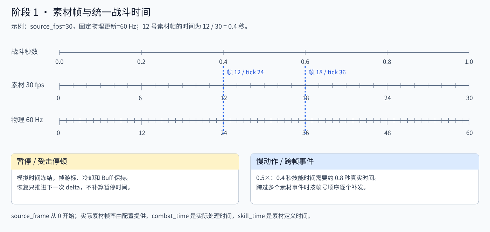

# Battle Foundation · 战斗基础、动画与操作控制

新增[公共战斗音频与声音设置](audio/README.md)：预置Music与32个音效槽位绑定Core分类总线，原版动作/命中/拾取/升级/强化/胜负声音及TMX音乐触发区统一接入。设置分别调节音乐与音效音量、静音并保存；补给成功拾取使用共享原版数字图集显示实际回血/回魔整数。

新增 [原版战斗 HUD、斩败、发光出口和背包](../../data/ui/README.md)：共享 BattleOriginalHUD/StageFeedback 接 Core 事件、GAS 快照及技能实例；原图集动画预置，背包使用扩展 Simple Inventory，换装属性与 Spine 外观统一通知，提示使用独立 UI 时钟。F5 首关按 B 查看；[验收](../../tests/suites/verify_original_battle_ui.tscn)。

[原版Boss栏、怪物出场和清屏后提前移镜](boss/original-presentation.md)已接入F5首关，可在预置场景和区域配置调整。

新增 [原版镜头跟随与Phantom Camera接入](camera/README.md)：预置CameraRig/Host/PCam，原版源帧插值与过区左边界约束，唯一战斗时钟、会话隔离和连续地图视差。普通过区不瞬移、不切换地图场景。[验收](../../tests/suites/verify_camera_follow.tscn)。

新增 [可复用连续地图模板与原版首关美术](level/map-template.md)：地图/视觉继承场景预置远、中、地面及近景，原生Parallax2D按可见左上角滚动，云动画统一消费BattleClock。碧玉径五区域共用同一地图，保留原碰撞/刷怪/出口；支持编辑贴图、拼接、视差与遮挡。[验收](../../tests/suites/verify_map_visual.tscn)。

阶段13新增 [Boss行为、阶段与公共表现](boss/README.md)：普通玉石琵琶精三技能按原素材帧执行，预置扇形音符/实体石墙，复用Core/GAS/伤害与受击，加入原版横幅、三层血条、保护、BGM/命中声和镜头反馈。通用配置另支持阶段阈值/机关条件/召唤及一次性回收。F5碧玉径已经可用实际初始悟空完整击败Boss并通关。[Boss配置](../../data/monsters/jushi_lingjun/README.md)、[类图与时序](docs/boss.svg)、[验收](../../tests/suites/verify_boss.tscn)。

阶段12新增 [关卡实例、区域、出生计划与通关](level/README.md)，复用现有Core定义索引/事件、BattleClock、GAS/Vital和怪物AI。碧玉径按原TMX导入五区域与完整必要出生依赖，独立跟踪计划生成与目标死亡，完成条件、出口、镜头和胜利统一管理。[配置](../../data/levels/biyujing/progression/README.md)、[联合类图](docs/level-progression.svg)、[验收](../../tests/suites/verify_level_progression.tscn)。F5入口改为新关卡，旧阶段11场景继续作为AI验收。

普通无双表现复用 Core 空格意图和 GAS 状态，新增无动作状态技能 `BattleStatusActivationFeature`、预置 `BattleWushuangEffect2D` 及原生姿态快照 `BattleSpinePoseMirror2D`。红光与残影独立于动作播放器，固定池消费战斗时钟，支持实例隔离与死亡/离场清理；预置 `BattleWushuangController` 协调 GAS rage Vital、释放实例怒气预算与增益；满10000释放，15秒消耗，原版伤害/移速/暴击及起手霸体同步撤销，满值HUD播放原15帧火焰和6帧空格提示，怒气条采用原1秒QuadOut缓动。[原版依据与配置](../../data/effects/wushuang/README.md)。

新增 [悟空转职前四技能与火魔斩](../../data/characters/sunwukong/skills/README.md)：原版 MP/CD 等级表、空中限制、原素材 AB、精确重复命中、射线转向、冲刺扫掠、风暴追加重劈、独立砸地与 3 帧视觉尾部。通过现有 Core/GAS/Spine 接入，没有第二套技能或判定系统。[五技能演示](../../game/levels/biyujing.tscn)、[联合类图](docs/wukong-basic-skills.svg)、[验收](../../tests/README.md)。新增 BattleSkillManaCost / BattleSkillCooldownFeature 为本次技能等级快照读取原版消耗与冷却，不修改共享配置。

阶段 11 新增 [普通怪物与AI](ai/README.md)：编辑器预置两类碧玉径小怪，复用Core操作意图/动作状态、GAS技能与独立冷却、属性/Vital、Buff、受击和死亡。AI配置通过Policy/TargetSelector扩展；原版图集由AnimationPlayer播放，兽形攻击支持同段逐帧AB判定。F6独立AI入口为 [first_level_demo.tscn](../../game/levels/biyujing.tscn)；[怪物配置与新增步骤](../../data/monsters/README.md)。

阶段 10 新增 [Buff、被动与战斗触发](combat/buffs-triggers.md)，复用并重构 GAS Status/Effect/PassiveStatusFeature，接入 Core STUN、标签引用计数、统一周期时钟、原版吸血/反伤与死亡/离场清理。打开 tests/fixtures/buff_demo.tscn 按F6验收，节点与控件预置，全部定义位于业务 data/buffs。

角色的 GAS、动作、运动、连击、受击、保护与输入组件已预置到角色 PackedScene，运行时只绑定并初始化。节点树、生命周期及迁移入口见 [角色组件说明](../../data/characters/sunwukong/components.md)。

阶段 9 新增 [受击、击退、浮空与独立保护条](combat/hit-reaction-protection.md)：HP 与动作分离，霸体受伤倍率、无敌效果策略可配置，真实 Core 叶子管理击飞/下落/落地/倒地/起身；保护满值读取各 Boss protectPoint 或显式覆盖，同目标同技能累计并在触发后重置。演示 [hit_reaction_demo.tscn](../../game/levels/biyujing.tscn)，自动验收 199 项及 13 套既有回归通过。

阶段 8 使用 GAS 策略 + Attribute/Vital/Status/Effect + Core 事件完成原版通用伤害链；等级评分沿用原版EXP，界面统一整数。原版盾后补1、真实伤害与吸血顺序、角色回调和结果字段见 [详细说明](combat/original-damage.md)。

原版伤害样例已恢复五连击，并接入125张原版数字贴图（含回血和回魔）、闪避/真实伤害随机偏移及共享对象池曲线驱动上飘淡出；普通与真实伤害分开生成实例。窗口放大后的重复拉伸已修复。预览、源码依据与验收见 [跳字说明](../../data/effects/README.md)。

阶段 7 见 [技能时间轴、连招与多段攻击](combat/skill-timeline.md)：扩展现有 BattleFrameTimelineFeature，新增攻击段/派生/位移资源，每次施放独立保存命中次数与下次命中时间；接入 GAS Cost/Cooldown、Status/Effect、Core 状态反应和预置对象回收。[三段演示](../../game/levels/biyujing.tscn)、[验收](../../tests/README.md)、[联合类图](docs/skill-timeline.svg)。

阶段 6 见 [单段普攻与战斗闭环](combat/README.md)：复用 Core/GAS，将物理体、受击区域和单一攻击框分开，加入每次施放独立的攻击实例与窗口去重、木桩、生命条和实际扣血飘字。交互入口 [single_attack_demo.tscn](../../game/levels/biyujing.tscn)，自动验收 [verify_single_attack.tscn](../../tests/README.md)，结构与时序见 [联合类图](docs/single-attack-runtime.svg)。

单段测试采用原版 940×590，已搭建全部节点；BattleSession 支持 scene_manifest_path，BattleEntity2D 支持 scene_definition_id / category / session_path，GAS 与操作系统复用预置组件和控制器。原版普通受击的 11 帧动画通过 [BattleHitEffect2D](presentation/battle_hit_effect_2d.gd) 和场景预置 AnimationPlayer 接入，时钟仍统一。配置与重置流程见战斗 README。

属性阶段见 [属性计算链说明](attributes/README.md)：复用 GAS 最终属性/Vital/Status/Effect、Simple Inventory 装备槽和 Core 通知，统一基础、成长、装备、临时来源。面板与伤害读取相同最终值；提供 [联合类图](docs/attribute-pipeline.svg) 和 [场景验收](../../tests/README.md)。

本插件在 CoreSystem 与 GAS 之上建立项目的战斗基础入口，依赖 Godot 4.7+。Core 继续负责资源缓存、用户配置与事件总线；GAS 继续负责属性、Vital、技能、冷却、状态和效果。新增代码负责定义索引、运行实体编号、阵营、会话随机流、固定物理战斗时钟及原素材帧事件。

运行 [交互演示](../../tests/README.md)：在 Godot 中打开场景，按 F6。A 与 B 使用同一角色定义；按钮可施放技能、添加减伤状态、暂停/恢复、切换慢动作、触发受击停顿及重新生成实例。界面同时显示生命、独立冷却、状态剩余时间和素材帧事件。

运行 [验收场景](../../tests/README.md)：

```powershell
& '<Godot 可执行文件路径>' --headless --path . res://tests/suites/verify_stage_one.tscn
```

失败返回非零退出码。验收包含真实固定物理更新和墙体碰撞，不依赖目测或仅检查资源是否存在。

在项目根目录执行 `node tools/generate_battle_docs.mjs` 可重建战斗基础、动画、操作、运动/连击、Core 状态机、攻击范围、属性链及单段攻击的 SVG。


新增 [独立动画适配层](animation/README.md)，封装现有原生 Spine 运行时，接入孙悟空基础动作、组合换装、骨骼挂点和播放进度；[横版平台场景](../../game/levels/biyujing.tscn) 复用统一战斗时钟、Core 事件和 GAS 运行实例。动画完成只通知，攻击许可、受击锁定及死亡由独立战斗状态管理。

动画节点预置于 [独立表现场景](../../data/characters/sunwukong/animation/sunwukong_visual.tscn)，参考 godot-spine-example 的主/原生 AnimationPlayer 结构。编辑器可拖动十四个动作时间轴，所有技能统一更新一个 CollisionShape2D；预览与实际命中均读取技能事件的矩形、正缩放和偏移。[编辑技能判定与新角色扩展](../../data/characters/sunwukong/animation/README.md)。

新增 [可扩展角色操作控制器](input/README.md)，复用 CoreOperationController 并补齐阶段、长按、双击、可消费缓存与真实改键。BattlePlayerOperations 提供公共操作、槽位配置和角色钩子，BattleOperationMenu 管理模态输入与设置。输入时间与战斗时间分开，菜单/失焦/暂停/死亡等控制权互不覆盖。平台场景按 Esc 设置键位，验收入口为 [verify_player_operations.tscn](../../tests/README.md)。


阶段四新增 [运动、状态与五段普攻](movement/README.md)：独立扫掠运动控制器管理重力、平台、墙/顶、二段跳与落地预算；Core 当前叶子消费操作意图并按状态表管理移动/跳跃/转向、攻击种类、霸体与打断门槛。五段 GAS 技能按原素材时间线运行，当前段只预约一段，第四段位移经碰撞，第二击保留显示缩放与偏移。判定使用原素材五组 ABRect，不使用 AI 选敌范围。自动验收 [verify_stage_four.tscn](../../tests/README.md) 通过 222 项检查。


动作状态使用 Core `BaseStateMachine` / `BaseState` 实现；每实体登记真实机器和十八个独立叶子（原九种 + 阶段9六种 + 跑攻/跳攻 + Buff眩晕），保持单一 combat delta。`BattleActionState2D` 是语义兼容入口，查询 Core 当前叶子，不再维护另一份状态。继承、生命周期、死亡守卫和注销说明见 [动作状态机接入](movement/README.md#动作状态接入-core-插件状态机)；验收入口 [verify_wukong_state_machine.tscn](../../tests/README.md)。

## 为什么需要补充插件

| 已有能力 | 复用方式 | 本插件补齐的部分 |
| --- | --- | --- |
| Core ResourceManager | 读取和缓存 `.tres` | 业务 ID/类型索引、引用校验、独立资源图出口 |
| Core ConfigManager | 读取 `user://config.cfg` 用户选项 | 与角色/技能等定义配置分离；读取 `[battle] time_scale` |
| Core EntityManager | 保留场景加载和对象池用途 | 每次生成分配运行 ID，不把场景资源 ID 当成实体实例 ID |
| Core EventBus | 全部战斗事件仍在 `CoreSystem.event_bus` 同步发布 | battle_id、来源/目标实体 ID、序号及战斗时间上下文 |
| Core TimeManager | 保留基础服务的命名计时器 | 固定物理战斗时钟；统一驱动 GAS 实例，避免全局技能 Timer 冲突 |
| GAS 属性/Vital/技能/状态 | 原有实例、黑板、Feature、策略与效果继续使用 | 外部时钟入口、实例禁用状态、按宿主过滤事件和素材帧 Feature |
| Core RandomPicker | 保留通用随机选取工具 | 场次种子、战斗/掉落等独立随机流以及状态快照 |

没有新增第二套事件总线或技能、属性、Buff 实现。


## 定义与运行状态分开

Godot 加载资源时会复用缓存中的同一对象，场景内置 Resource 也可能被多个场景实例共享。因此业务不能把当前生命、当前冷却等运行状态写回加载的定义资源。[Godot Resources 文档](https://docs.godotengine.org/en/stable/tutorials/scripting/resources.html)

| 定义类别 | 保存的配置 | 保存运行状态的位置 |
| --- | --- | --- |
| characters / monsters | `BattleEntityDefinition`：definition_id、默认阵营、场景、属性集、Vital 模板、初始技能/状态 ID | `BattleEntity`：entity_id、当前阵营、velocity；GAS 属性实例和 Vital 保存当前数值 |
| skills | 原生 `GameplayAbilityDefinition`；`CooldownFeature.cooldown_duration` 和素材帧定义 | `GameplayAbilityInstance`、独立黑板：剩余冷却、激活/禁用状态、技能累计时间、下一个帧事件 |
| statuses | 原生 `GameplayStatusData`：持续时间、最大层数、策略与效果 | `GameplayStatusInstance`：remaining_duration、stacks、Feature storage |
| equipment | `BattleEquipmentDefinition`：槽位、最大耐久、GAS 属性修改器模板 | `BattleEquipmentState`：instance_id、当前 durability |
| levels | `BattleLevelDefinition`：场景和出生定义 | `BattleSession`：当前关卡 ID、场景实例、生成实体集合、时钟与随机状态 |

角色和怪物共用实体定义结构，索引类别分别登记；技能和状态直接使用 GAS 定义类型。装备阶段 1 只建立定义与实例状态，装备槽、背包和装备属性结算继续留给后续业务接入 `simple_inventory`。

`BattleCatalog` 内部保存 Core 缓存的定义，外部只通过 `instantiate_definition()` 获取独立副本。使用 `duplicate_deep(Resource.DEEP_DUPLICATE_ALL)`，同时复制外部属性/Vital/技能 `.tres` 子资源；实体定义的 PackedScene 和动画配置中的 Spine 数据显式设置 NEVER_DUPLICATE，作为只读模板共享，节点和姿态通过 instantiate/SpineSprite 独立创建。单纯 `duplicate(true)` 对非本地子资源的共享不能保证隔离。[Godot Resource 复制语义](https://docs.godotengine.org/en/stable/classes/class_resource.html#class-resource-method-duplicate-deep)

资源副本仍只保存本实例的配置，运行数据继续放在 GAS 实例、Entity、EquipmentState 和 Session。源资源及 Core 缓存不会被战斗更新修改。所有属性 ID 沿用 [业务原版属性](../../data/attribute/README.md)，例如 `atk`、`phyDef`、`hpMax`、`critical`、`lucky`。

## 配置读取和资源索引

业务入口是 [manifest.json](../../data/levels/biyujing/progression/README.md)，`version=1`，`definitions` 下每个类别使用 ID → `res://` 资源路径字典。定义文件位于 [data/battle](../../data/levels/biyujing/progression/README.md)。项目设置 `battle_foundation/manifest_path` 指向默认索引；插件不硬编码业务资源路径。

`BattleCatalog.load_manifest()` 检查 JSON 格式、版本、类别、路径存在性、资源类型、索引 ID 与资源 ID、属性/Vital 依赖、实体技能/状态引用、关卡出生引用和素材帧顺序。全部通过才替换当前索引；失败可读取 `last_error`，上一份有效索引保留。新增资源后必须登记索引，不依赖导出包中运行时扫描目录。

用户选项由 Core ConfigManager 管理。例如 `CoreSystem.config_manager.set_value("battle", "time_scale", 0.5)` 并按需 `save_config()`；新建会话会读取此值，未配置时默认 1.0。修改该选项不会更改角色或技能定义。正在运行的会话使用 `session.set_time_scale()`，避免隐式影响其它战斗。

## 接入示例

```gdscript
var session: BattleSession

func _ready() -> void:
    # 空索引路径使用项目 battle_foundation/manifest_path；4399 是本场种子。
    session = BattleSystem.create_session(self, "", 4399)
    if session == null:
        return
    var first := session.spawn_entity("characters", &"sample_hero", Vector3(-2, 0, 0))
    var second := session.spawn_entity("characters", &"sample_hero", Vector3(2, 0, 0))
    first.velocity = Vector3(2, 0, 0)
    first.try_activate_skill(&"sample_attack")
    second.apply_status_definition(&"sample_guard")
    session.set_paused(true)
    session.set_paused(false)
    session.set_time_scale(0.5)
    session.request_hit_stop(0.1)

func _exit_tree() -> void:
    if is_instance_valid(session):
        session.clear_battle()
```

`start_level(&"sample_arena")` 会实例化关卡场景并按出生表生成角色和怪物。实体场景根节点必须继承 `BattleEntity`；[示例实体场景](../../data/levels/biyujing/progression/README.md) 带 CapsuleShape3D，使用固定物理更新中的 `move_and_collide(velocity * combat_delta)` 进行位移和碰撞。当前示例提供水平位移入口，重力、跳跃和完整移动控制器属于后续角色业务。

组件由 BattleEntity 创建，不能再在同一实体场景里重复放置这三个 GAS 组件。宿主需要扩展时继承 BattleEntity，通过现有 getter 查询属性、技能和状态组件。

销毁使用 `despawn_entity(entity_id)`；立即注销 ID、撤销状态和技能效果，随后 queue_free。外部直接移除/销毁实体也会在离树时清理并注销。`clear_battle()` 清理本场实体及关卡，保留递增编号和战斗时间；新战斗应新建 Session。

## 实体 ID、阵营与事件

`definition_id` 是资源配置 ID；`entity_id` 是场次前缀 + 递增实体序号。两个实体可引用相同 definition_id，但 entity_id 必定不同；销毁后不复用。装备编号使用单独的 `equipment` 命名空间。`BattleSystem` 为各会话生成不同 battle_id；手动调用 Session.configure 时由调用者保证场次 ID 唯一。

阵营在运行实体上保存。默认同阵营友好、player/enemy 敌对、其它未知组合中立；neutral 默认中立。使用 `session.factions.set_relation()` 定义双向或单向关系。阵营关系提供查询入口，不会偷偷改写 GAS 标签或现有目标策略。

`session.publish_event(name, source, target, payload)` 在 Core 总线发送单个 Dictionary，统一补充以下保留字段：

| 字段 | 含义 |
| --- | --- |
| battle_id | 事件所属战斗 |
| sequence | 本场事件的递增序号 |
| physics_tick | 本场已处理的非暂停物理 tick 号，与素材帧号不同 |
| combat_time | 当前累计战斗秒数 |
| source_entity_id / target_entity_id | 来源/目标运行 ID，可为空 |
| entity | 目标实体；无目标时为来源实体 |

GAS 原有事件名保持不变；本场实体的事件另发布为 `battle.gas.<原事件名>`，例如 `battle.gas.damage_received`。桥接保留同一个 DamageInfo，事件仍是同步回调，不能同时订阅两个名字执行同一减伤逻辑。实体出生、销毁、暂停、缩放、关卡开始和素材帧使用 `battle.*` 事件名。

HealthVital 的伤害事件新增 `entity=owner_entity`，便于识别受伤目标。BattleEntity 的 StatusComponent 开启宿主事件过滤，只接收本实体事件或显式广播给本场的事件；另一个实体的减伤 Buff 不会修改本次伤害。普通 GAS 示例默认仍保留全局广播语义。

```gdscript
func _ready() -> void:
    CoreSystem.event_bus.subscribe("battle.skill.marker", _on_marker)

func _on_marker(context: Dictionary) -> void:
    if context.battle_id != session.battle_id:
        return
    print(context.source_entity_id, context.source_frame, context.skill_time)

func _exit_tree() -> void:
    CoreSystem.event_bus.unsubscribe("battle.skill.marker", _on_marker)
```

每次订阅都应在宿主退出时退订。Session 的 GAS 桥接和 GAS 状态组件在离树时自动退订，重入时重新连接。

## 时间规则

物理更新频率为项目的 60 Hz 默认值；移动和碰撞只由 Session 的 `_physics_process()` 驱动。GAS 三个组件设置 `externally_driven=true`，各自 `_process()` 不再推进实例，Session 每个物理 tick 只调用一次 `advance_simulation(combat_delta)`，避免渲染帧率改变战斗速度。

| 操作 | 移动/碰撞位移、技能/BT、冷却、Buff、生命/魔法恢复 | 受击停顿剩余时间 | UI |
| --- | --- | --- | --- |
| 正常 | 使用本场战斗 delta | 未缩放时间 | 正常刷新 |
| `set_paused(true)` | 全部冻结，禁止新技能启动 | 冻结 | 可操作恢复按钮 |
| SceneTree.paused | 全部冻结，Always 模式的 Session 也主动检查暂停 | 冻结 | 由 UI 自己的 process_mode 决定 |
| `set_time_scale(0.5)` | 统一半速；0 表示冻结模拟 | 按未缩放秒消耗 | 不受本场缩放影响 |
| `request_hit_stop(t)` | 全部冻结；本场已有技能进度保持 | 按未缩放秒消耗；重叠取更长剩余时间 | 正常刷新 |

一个 tick 中途停顿到期时，只把剩余时间交给模拟。例如未缩放 tick 为 0.15 秒、停顿剩余 0.1 秒、缩放 0.5，则战斗只推进 0.025 秒。恢复时不补算暂停期间的真实时间，不重置技能、Buff 或冷却。

本插件不设置 `Engine.time_scale`。正常使用本场 `set_time_scale()`；自动物理入口对已有全局缩放除回一次，随后应用本场缩放。若全局 Engine.time_scale=0，无法获得正常物理 delta，此时也不会推进本场。Core TimeManager、控制台、音频和其它插件的计时仍保留自身语义。

GAS `BTWait` 已改为累计传入 delta，消除真实毫秒时钟绕过战斗暂停的问题。GAS standalone 场景默认 `externally_driven=false`，仍按自己的 `_process()` 工作。本阶段统一了实体技能/冷却/Buff/Vital 与基础位移；之后引入自主运行的投射物、魔法场或 Cue 时，需要把其模拟计时接到本场时钟，不能继续使用独立 SceneTreeTimer 当作战斗时间。

## 原素材帧语义

`BattleFrameTimelineFeature` 是 GAS Feature，配置包含 `source_fps`、`duration_frames` 和有序 `BattleFrameEvent[]`。累计时间、下一事件索引写入技能实例黑板，Feature Resource 不保存运行状态。

示例素材频率为 30 fps、持续 30 帧：`source_frame=12` 对应 0.4 秒，18 对应 0.6 秒。在正常 60 Hz 物理更新中，12 约对应第 24 个物理 tick；换成 120 Hz 时约对应第 48 个 tick，素材时间仍是 0.4 秒。



帧号使用从 0 开始的约定；导入从 1 开始的素材表时先归一化，再保留原表字段作溯源。30 fps 只是示例，实际素材频率必须填写真实值，不能默认把原版帧号当成 Godot tick。

每次更新依次触发所有已经跨过的事件；同帧按配置顺序，每次激活仅触发一次；帧 0 在首个逻辑 tick 触发。暂停保持进度，取消技能停止后续事件，重新激活重新建立事件游标。`skill_time` 是素材事件的精确配置时间，`combat_time` 是该事件被固定物理 tick 实际处理的时间，两者用途不同。持续时间到达时结束技能。

现有 GAS 行为树依旧可提交冷却、消耗和效果；示例用 `CommitCooldown → BTWait` 配合素材帧 Feature。不要在同一技能里再放一个会提前完成的短行为树，否则 GAS 会提前结束技能。本阶段帧事件发布到 Core，演示在第 12 帧执行伤害，未自动导入原版整套动作和技能表。

## 随机数入口

通过 `session.random.random_float()`、`random_int()`、`roll()` 调用。每个命名流在第一次使用时由场次种子与流名建立专用 RandomNumberGenerator。默认 `combat` 用于战斗；传 `loot`、`spawn` 等名字即可隔离不同用途的随机消费。BattleEntity 宿主的 GAS 随机状态选取会使用本场 `combat` 流。

`snapshot()` / `restore()` 保存种子与各流 state，可在同一引擎版本和同样调用顺序下复现序列；状态使用 Variant Dictionary，避免 JSON 浮点损失 64 位 state。Godot 并不承诺跨引擎版本保持随机算法兼容。[RandomNumberGenerator 文档](https://docs.godotengine.org/en/stable/classes/class_randomnumbergenerator.html)

## 脚本索引与验收范围

| 脚本 | 职责 |
| --- | --- |
| [BattleSystem](runtime/battle_system.gd) | Autoload：场次 ID、Core 用户选项、创建会话 |
| [BattleSession](runtime/battle_session.gd) | 固定物理调度、实体注册/销毁、关卡/装备实例、Core 事件 |
| [BattleCatalog](runtime/battle_catalog.gd) | 原子加载索引、定义/依赖校验、独立定义资源图 |
| [BattleClock](runtime/BattleClock.cs) | 累计时间、暂停、缩放、停顿和部分 tick |
| [BattleEntity](runtime/battle_entity.gd) | CharacterBody3D、运行标识与阵营、GAS 三组件、清理 |
| [BattleFactions](runtime/BattleFactions.cs) | 阵营关系查询 |
| [BattleRandom](runtime/BattleRandom.cs) | 独立命名流、随机状态快照 |
| [BattleEquipmentState](runtime/BattleEquipmentState.cs) | 装备 ID 和当前耐久 |
| [BattleEntityDefinition](definitions/BattleEntityDefinition.cs) | 角色/怪物定义 |
| [BattleEquipmentDefinition](definitions/BattleEquipmentDefinition.cs) | 装备定义和修改器模板 |
| [BattleLevelDefinition](definitions/battle_level_definition.gd) | 关卡定义 |
| [BattleSpawnDefinition](definitions/BattleSpawnDefinition.cs) | 出生定义 |
| [BattleFrameEvent](definitions/BattleFrameEvent.cs) | 原素材帧、事件名和配置负载 |
| [BattleFrameTimelineFeature](gas/battle_frame_timeline_feature.gd) | GAS 素材帧更新与 Core 事件发布 |
| [BattleGASBinding](runtime/battle_gas_binding.gd) | 2D/3D 实体共用 GAS 装配和清理 |
| [BattleEntity2D](runtime/battle_entity_2d.gd) | 横版碰撞、动作命令、GAS 战斗入口、原版攻击镜像 |
| [BattleActionState2D](runtime/battle_action_state_2d.gd) | 状态语义入口，委托 Core 当前叶子及注册生命周期 |
| [BattleActionStateMachine2D](runtime/battle_action_state_machine_2d.gd) | Core BaseStateMachine 子类、九状态、更新上下文及死亡终态守卫 |
| [BattleActionLeafState2D](runtime/battle_action_leaf_state_2d.gd) | Core BaseState 子类、进入/退出、状态计时与转换条件、权限 |
| [BattleActionProfile2D](definitions/battle_action_profile_2d.gd) | 战斗规则时间、原攻击区域及平台样例运动配置 |
| [BattleMotionController2D](runtime/BattleMotionController2D.cs) | 速度、扫掠碰撞、地面/墙/顶、跳跃预算 |
| [BattleComboDefinition](definitions/BattleComboDefinition.cs) / [BattleAttackStep2D](definitions/BattleAttackStep2D.cs) | 只读分段技能、时长、权限与位移配置 |
| [BattleComboState](runtime/BattleComboState.cs) | 独立连击段号、下一段预约与施放序号 |
| [BattleAttackInstance](runtime/battle_attack_instance.gd) | 攻击编号、攻击者/阵营、持续窗口与每击目标去重 |
| [BattleHurtbox2D](movement/battle_hurtbox_2d.gd) | 与移动物理体分开的可编辑受击区域 |
| [BattlePresentation2D](presentation/battle_presentation_2d.gd) | 公共战斗表现：集中分发命中反馈、全场跳字对象池与统一时钟；[配置说明](presentation/README.md) |
| [BattleCombatFeedback2D](presentation/battle_combat_feedback_2d.gd) | 战斗场景中每个目标的血条、保护条与受击反馈视图 |
| [CharacterAnimationProfile](animation/CharacterAnimationProfile.cs) | 只读动作映射、皮肤、脚底偏移和语义挂点 |
| [CharacterAnimationAdapter](animation/character_animation_adapter.gd) | 独立抽象动画接口及通知，无战斗规则 |
| [SpineAnimationAdapter](animation/spine_animation_adapter.gd) | 原生 Spine 手动播放、组合皮肤、镜像、挂点和调试查询 |
| [plugin.gd](plugin.gd) | 编辑器启用/禁用注册 Autoload |

[verify_stage_one.gd](../../tests/README.md) 验证：六类定义加载、无效索引不破坏旧索引、深层子资源隔离、双角色生命/冷却/禁用/Buff 计时与层数隔离、同步减伤目标过滤、场次事件、随机流与快照、暂停/恢复、SceneTree 暂停、慢动作、停顿及部分 tick、素材帧补发、BTWait 模拟时间、实际固定物理调度/墙体碰撞、关卡出生和销毁 ID 不复用。

本阶段的业务资源全部是接口验收样例，不代表原版角色、怪物、技能、装备或关卡的实际初始数值。原版属性共享定义继续保留，后续实体表导入可替换这些样例资源，无需改变插件接口。
