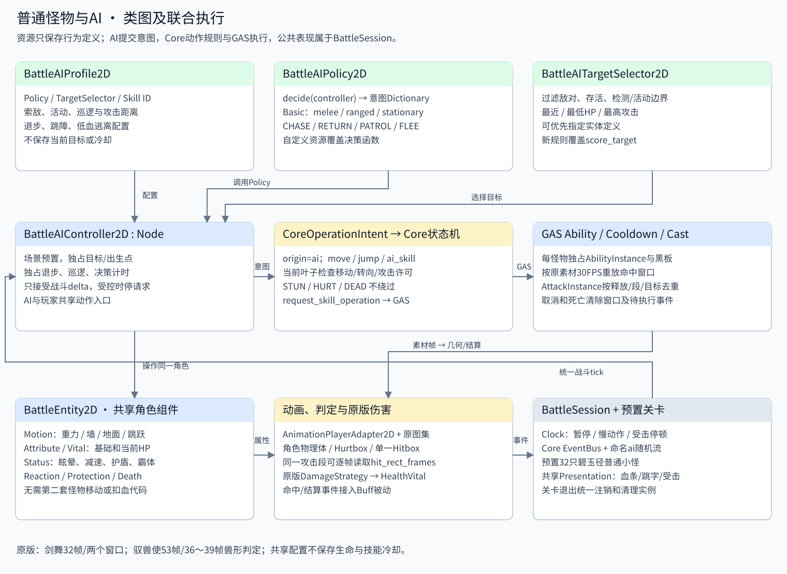

# 普通怪物AI与战斗联合

本模块扩展现有 battle_foundation 插件。怪物仍是 `BattleEntity2D`，复用 Core 状态机、GAS 属性/Vital/技能/状态、移动扫掠、受击、保护和原版伤害策略。AI 是场景中的 `AIController` 节点，不创建第二套生命、动作或冷却。



## 一次攻击的执行顺序

1. `BattleSession.advance_physics` 得到暂停/慢动作/停顿后的战斗 delta，逐实体更新。AI 与输入组件在运动前提交意图，随后统一推进运动、技能时间轴、状态、属性和动作状态。
2. AI 按可配置决策间隔筛选敌对、存活、在检测和活动范围内的目标；每实例保存目标、出生点、返回标记、退步/巡逻计时。资源保存配置和决策函数。
3. Policy 返回移动轴、朝向、跳跃或技能请求。Controller 将移动/跳跃转换为 `CoreOperationIntent(origin=ai)`，技能也经 `ai_skill` 意图及技能槽映射进入当前 Core 叶子，调用同一个 `request_skill_operation`。朝向仍检查状态的 `turn` 权限。
4. Core 当前状态决定许可，GAS检查技能已学习、宿主存活/控制、冷却及消耗；成功后创建独占 `BattleAttackInstance`。实际提交时才启动 CooldownFeature；后续决策不会每帧预约攻击。
5. `BattleFrameTimelineFeature` 按原版30FPS依次重放跨帧事件。单个攻击框从技能攻击段读取原 AB 几何；`hit_rect_frames` 允许同一段逐帧变化，保留“释放ID/段/目标”的命中去重。
6. 命中通过统一阵营、Hurtbox、DamageCalculator、原版策略和 HealthVital；反应/保护/Buff/被动仍走现有入口，Core事件驱动全场共享血条、受击特效和跳字。
7. 技能完成回到动作状态规定的移动/待机，AI 决定退步或等待冷却。眩晕、受击、倒地等不允许移动的状态会清空移动与新请求；死亡最高优先级取消技能，旧窗口和待执行事件失效，不再请求攻击。离场通过原来的会话注销与组件清理。

## 原版行为与数据

| 类型 | 原依据 | 当前接入 |
| --- | --- | --- |
| 剑舞 | Monster10101、Resource11101、MAi10011 | 索敌追击、skill1、随机选择攻击后退步1～2秒；近战策略 |
| 驭兽使 | Monster10201、Resource11102、MAi10012 | skill1、攻击后退步1秒；远程策略，可配置最小距离 |
| 出手节奏 | Behavior111005 / GetAttCDConNode：5秒 | 迁移至每个 GAS 技能实例的 CooldownFeature=5；原 Skill.cd=0 保存为元数据 |
| 巡逻/追踪 | Behavior201、205 / Patrol、Seek | 无目标巡逻、丢失目标返回活动范围 |
| 退步 | Behavior207001002、234 | 移动意图执行，碰撞由共用运动控制器处理 |
| 跳障、低血逃离、目标评分 | 平台场景可扩展策略 | 可配置功能，默认低血逃离关闭；不宣称逐节点照搬原 AI 树 |

原版 `.as` 依据位于参考仓库：`com/wdcgame/engine/ai/actions/AttackAI.as`、`AwayAI.as`、`WallBackHitWallAI.as`、`nodes/GetAttCDConNode.as`、`model/ManResourceVO.as`、`textures/TextureAtlas.as`、`display/SpriteRender.as`。相关 MAi 树去掉循环 parent 引用后完整保存到项目的原配置快照。5秒门槛从首次成功发起算起；GAS采用既有技能提交时点。暂停/慢动作依照本项目战斗时钟，默认不消耗真实墙钟。

| 技能 | 原动作时长 | 原AB命中窗口（0起算，半开） | 同目标结算 |
| --- | --- | --- | --- |
| `jianwu_skill1` / 原2000200 | 32帧 | skill1_1：[4,14)；skill1_2：[20,28) | 每段至多1次，最多2次 |
| `yushoushi_skill1` / 原2000100 | 53帧 | skill1_1：[36,40)，四帧四份几何 | 同段至多1次 |

兽形攻击的原参数 `type=2, shootSpeed=0, followParent=false, linkParentState=true`。当前使用原序列帧在锁定动作中展开，判定不假造为飞行箭弹；取消动作会清除特效。当前攻击默认禁止位移、转向；如未来允许施放期间移动并要求独立世界弹道，应通过预置的时间轴对象扩展实现，不直接让非跟随特效绑着角色移动。

## 扩展接口与边界

- `BattleAIProfile2D`：只读每类配置。
- `BattleAITargetSelector2D`：枚举策略或覆盖评分；始终过滤友方、死亡和越界目标。
- `BattleAIPolicy2D`：共享决策函数，返回意图，不改位置/生命/动作。
- `BattleBasicAIPolicy2D`：近战、远程、固定炮台；巡逻、返回、跳障、逃离。
- `BattleAIController2D`：每个实体独占运行状态，监听/调试可读取 `state`、`target`、`successful_casts`。

检测默认每0.1战斗秒进行；物理、技能与Buff仍每个战斗tick推进。暂停、停顿、控制结束会保留或重置适当的决策节拍；移动轴通过真实属性 walkSpeed 使用减速效果。目标评分目前是扫描当前会话实体，复杂场景可以替换为分区查询；本阶段验证32只小怪，没有给出“任意数量无性能开销”的承诺。跳跃采用矮墙/高度差启发式，不包含导航网格或跨复杂悬崖寻路。

`BattleSession.register_scene_level` 注册已经在编辑器搭好的关卡，绑定既有清理生命周期；可复用 `BattleLevelDefinition.scene`。实际首关测试场景没有在启动时创建怪物组件、地形或反馈视图。运行时需要出生新怪时，可使用既有 `spawn_entity_2d` 实例化完整预置场景；GAS和AI运行状态仍各自独立。

配置步骤与原关卡完整实体范围见 [怪物资源说明](../../../data/monsters/README.md)。

## 自动与实际画面验收

```powershell
& tools/verify_stage_eight.ps1 -Godot D:/UserData/Downloads/godot/version/godot-4.3-4.7.2-stable.exe -Suites @('monster_ai')
```

`examples/verify_monster_ai.tscn` 在真实预置首关场景验证原版身份/数值、32只怪物、无启动新增节点、自主近战两段与远程单段、跨帧事件、镜像、独立冷却、独立属性、眩晕取消前摇、死亡停攻、暂停/慢动作、返回/巡逻/跳障/逃离和目标评分。回归工具默认包含此套及前十阶段测试。原生D3D12渲染已检查原图集、脚底位置、兽形攻击、受击和伤害跳字。
