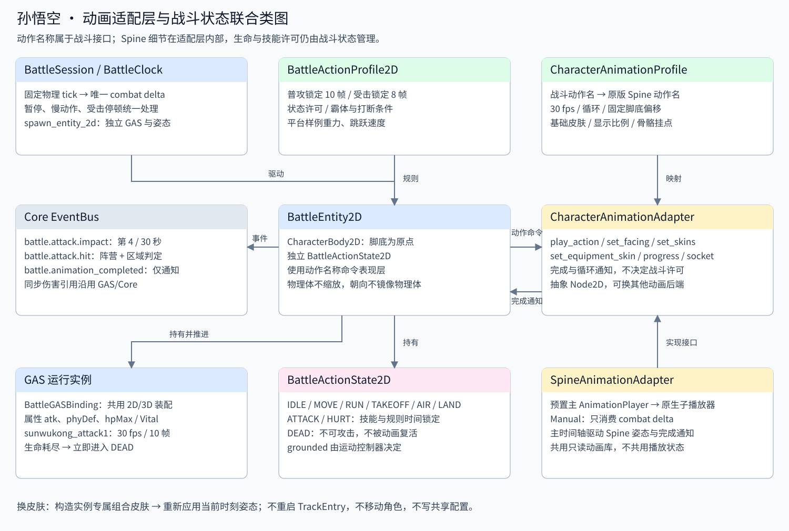
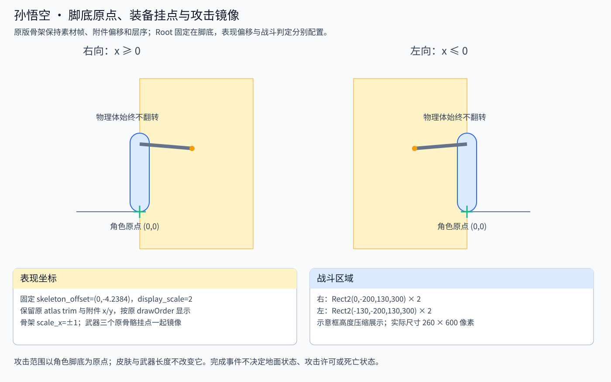
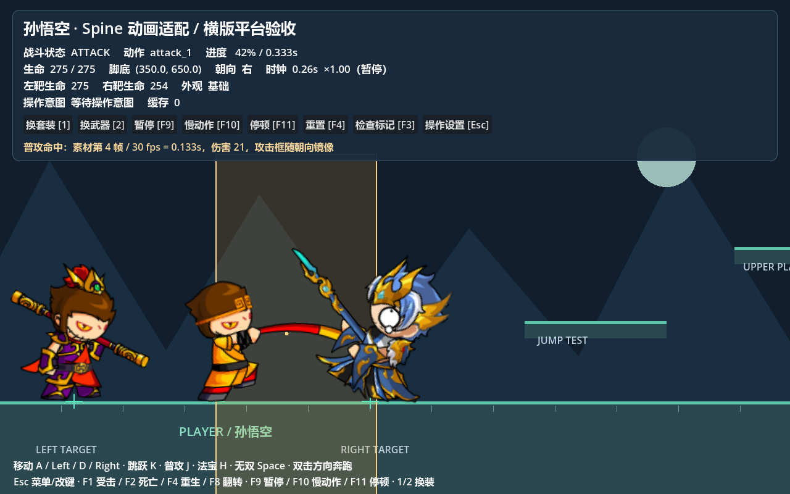

# 孙悟空动画适配层

独立表现接口 [CharacterAnimationAdapter](character_animation_adapter.gd) 面向动作名称；[SpineAnimationAdapter](spine_animation_adapter.gd) 控制场景预置的主 AnimationPlayer，经原生 SpineAnimationTrack 子播放器驱动 SpineSprite，并封装组合皮肤与挂点。战斗层保存生命、技能实例和动作状态，表现层保存动作、朝向、皮肤与播放时间。两者使用同一场战斗的 delta，职责分别管理。

打开 [sunwukong_visual.tscn](../../../data/animation/sunwukong_visual.tscn)，选择主 AnimationPlayer 即可预览十四个动作。所有技能复用一个 BattleHitbox2D + CollisionShape2D，编辑器按动作和时间读取技能事件，运行时按技能 ID 和命中序号读取实体 GAS 定义。调整范围时修改技能数据的 hit_rect、缩放与偏移。[编辑步骤、节点结构、新角色接入和验证说明](../../../data/animation/README.md)。

运行 [横版平台场景](../../../examples/wukong_platform_demo.tscn)：在编辑器打开场景后按 F6。测试场景有孙悟空、左右两个不同外观的同配置靶子、地面、两个高度的平台和墙体。当前项目 F5 主场景保持插件演示。

需要 **带 Spine 模块的 Godot**。本机使用 `godot-4.3-4.7.2-stable.exe`，引擎实际版本为 Godot 4.7.2，自带 Spine 4.3 运行时。角色骨架版本为 4.3.23。普通未编译 Spine 模块的 Godot 没有 SpineSprite 等类，不能运行这组场景。无需另加 GDExtension 或下载重复骨架；这些类型由现有引擎提供。[Spine Godot 官方文档](https://esotericsoftware.com/spine-godot)



## 原版动作与来源

资源实际目录是 `assets/skelton/char/sunwukong`。修正 `sunwukong_spinedata.tres` 的 atlas/skel 引用到该目录；原始 `wukong.skel`、`wukong.atlas`、`wukong.png` 保持原文件内容。数据映射在 [sunwukong_profile.tres](../../../data/animation/sunwukong_profile.tres)，业务角色和技能在 [data/battle2d](../../../data/battle2d/README.md)。

本地原版依据来自 Speculum-4399-master 的孙悟空注册点修正版 Spine JSON、DragonBones 原动作帧数、Role/Skill 配置和客户端 CharEntity 的 `shootFrame × (1 / Fps)` 公式。文件路径及 SHA-256 保存于 [source_mapping.json](../../../data/battle2d/source_mapping.json)，运行时不依赖那个项目。

| 战斗动作名 | Spine 原动作 | 原版帧数 / 30 fps | 时长（秒） | 播放方式 |
| --- | --- | --- | --- | --- |
| idle | idle | 35 | 1.166667 | 循环 |
| move | walk | 25 | 0.833333 | 循环 |
| run | runNormal | 16 | 0.533333 | 循环 |
| jump | jumpNormal | 20 | 0.666667 | 单次 |
| fall | jumpDown | 17 | 0.566667 | 单次 |
| hurt | hurtStand | 8 | 0.266667 | 单次 |
| death | dead | 31 | 1.033333 | 单次，保持终帧 |
| attack_1 | attack1 | 10 | 0.333333 | 单次 |
| attack_2 | attack2 | 10 | 0.333333 | 单次 |
| attack_3 | attack3 | 12 | 0.400000 | 单次 |
| attack_4 | attack4 | 18 | 0.600000 | 单次 |
| attack_5 | attack5 | 20 | 0.666667 | 单次 |
| jump_2 | jumpTwo | 8 | 0.266667 | 单次 |
| land | idle | 35 | 1.166667 | 单次；战斗 LAND 窗口另定 |

骨架保留全部44个原动作，主 AnimationPlayer 保存14个语义动作；原素材没有独立落地动画，land 使用 idle。初始时长取自 SpineAnimation，编辑器可编排多个原生 clip 并修改主时间轴长度；当前 jump_2 已编辑为 jumpTwo → jumpDown，长度0.3秒。初始化检查有效时长与原生绑定，保留组合动作；不再强制语义时长等于单个原素材。播放时间和进度读取主播放器，子 clip 使用各自关键帧的局部时间。表中为素材基准时长，不重新采样到60帧。单次完成保持终帧，是否待机由战斗状态决定。运动权限见 [阶段四](../movement/README.md)。

## 对外接口

| 接口 | 行为 |
| --- | --- |
| `play_action(action, restart=false)` | 通过映射播放动作；重复发送同动作不重启，显式 restart 则从头开始 |
| `set_facing(+1 / -1)`、`get_facing()` | 正数向右、负数向左；0 忽略，翻转不改变播放时间 |
| `set_skin(name)` | 基础皮肤加指定皮肤；传 `基础` 恢复基础外观 |
| `set_skins(names)` | 以基础皮肤打底，依次组合衣服、头盔、套装、武器等附件 |
| `set_equipment_skin(part, name)` | part 为 armor/helmet/weapon/outfit；替换该类别，空名卸下该类别 |
| `get_skin_names()` | 返回当前组合皮肤列表的副本 |
| `advance_animation(delta)` | 手动推进主 AnimationPlayer 并同步 Spine；只接受正的有限 combat delta，不自行 `_process` |
| `get_current_action()` | 返回战斗动作名 |
| `get_action_duration(action)` | 主 AnimationPlayer 语义动作时长，未知动作返回 0 |
| `get_playback_time()` | 当前动画内秒数；循环动作循环内计时，单次动作到末尾后保持 |
| `get_playback_progress()` | 当前时间 / 语义动作时长，范围 0～1 |
| `get_socket_global_transform(socket)` | 原版骨骼挂点的世界变换；未知挂点设置 last_error 并返回适配层变换 |
| `is_socket_active(socket)` | 挂点槽位当前有附件时为 true，便于避免使用隐藏的替代武器槽位 |
| `last_error` | 初始化、动作、皮肤、挂点查询失败的原因 |

实现额外提供 `get_track_time()`（循环累计轨道秒数）、`get_available_skins()`、`get_draw_order()`、`get_slot_attachment_name()` 和 `get_visual_bounds_global()` 供验收与调试。业务规则不读取这些调试查询来判断死亡或施法许可。

信号 `action_started(action)`、`action_completed(action)`、`action_looped(action)`、`appearance_changed(skins)` 用于通知。单次完成由 AnimationPlayer.animation_finished 转发，每次播放仅通知一次；循环边界按主播放器时间与素材时长计算。

```gdscript
# 战斗代码只使用动作接口，不触碰 Spine track 或原槽位名。
var visual: CharacterAnimationAdapter = character.animation
visual.set_facing(-1)
visual.play_action(&"attack_1", true)
visual.set_skins([&"套装/2", &"武器/weapon2"])
var progress := visual.get_playback_progress()
var seconds := visual.get_action_duration(&"attack_1")
if visual.is_socket_active(&"weapon"):
    var grip := visual.get_socket_global_transform(&"weapon").origin
```

在 BattleEntity2D 中已经由 Session 推进 `advance_animation`，业务不要再从 `_process()` 推进一次。脱离战斗使用适配层时，宿主负责提供一个时间入口。

## 脚底、图片注册点、层序、镜像和装备位置



角色 CharacterBody2D 的 `(0,0)` 固定为脚底世界位置，碰撞胶囊高 180、半径 22、中心 `(0,-90)`；显示节点是它的子节点。角色物理体和场景根节点保持 scale=1，翻转只修改 Spine skeleton.scale_x。没有使用负 Node2D.scale 来交换物理体坐标，也不会因换皮肤重新居中角色。

基础皮肤待机起始姿态原生 bounds 的最低点为 y=4.2384，配置固定 `skeleton_offset=(0,-4.2384)`、`display_scale=2`，将其对齐脚底。这个偏移固定使用，跳跃、受击、死亡等动作允许自身骨骼发生原版位移；不按动作包围盒把每一帧强行贴地。不同装备原本就有尺寸差异，也不会按新图片大小移动角色根节点。

现有骨架保留 Flash 注册点转换后的骨骼变换、附件 x/y 与 atlas 裁切偏移。武器 attachment 中的微小偏移是原转换资源的一部分，例如 weapon2 的普通棍附件 `x=-1.55, y=-0.35`；不能按纹理中心重建替代附件。图片由原生 Spine atlas 加载，沿用 premultiplied alpha 设置。

原资源有 35 根骨骼、34 个槽位。各动作自己的附件切换和 drawOrder 驱动前后手、披风、棍子及头部的遮挡。所有皮肤共享这些动作轨道；切换皮肤后重新应用当前时刻姿态，保留当时的层序。适配器使用零动画混合，保留原版离散附件切换，不修改共享数据资源的 default_mix。

| 语义挂点 | 原骨骼 / 槽位 | 用途 |
| --- | --- | --- |
| root | root | 骨架根注册点（带固定表现偏移） |
| foot_left、foot_right | yf_脚1、yf_脚2 | 两个脚部注册点 |
| head | mz_头 | 头部位置 |
| weapon | wq_武器 | 普通武器握持 |
| weapon_alt | wq_武器_0 | 部分帧使用的替代棍槽位 |
| weapon_long | wq_3 | 部分动作的延伸武器槽位 |

武器三套槽位受原动作控制，不是同时显示三根棍子。只有 `is_socket_active` 为 true 的槽位才应该挂额外表现。场景金色点显示当前有附件的武器骨骼挂点；绿色十字是角色脚底。朝向变化后挂点随骨架镜像，碰撞体不变。

皮肤包含 206 个非空项，含基础、衣服、头盔、身体套装和武器；源 JSON 还有一个空 default。套装未包含独立武器，因此以基础皮肤打底，再叠加套装和武器。每个实例使用自己的 SpineSkin，原始皮肤与纹理资源保持只读；在原轨道的当前时间应用组合皮肤，不调用 set_animation，因此换装不改变动作时长、时间、进度或角色位置。组合顺序中后者覆盖重合附件，可显式覆盖某个衣服/头盔部位。

## 战斗状态和播放状态分别管理

[BattleActionState2D](../runtime/battle_action_state_2d.gd) 将 IDLE/MOVE/RUN/TAKEOFF/AIR/LAND/ATTACK/HURT/DEAD 的状态、时间与技能许可查询委托给 [Core 动作状态机](../runtime/battle_action_state_machine_2d.gd) 当前叶子；碰撞确认的 grounded 作为机器更新上下文。九个状态继承 Core BaseState，没有 Spine 依赖。[BattleActionProfile2D](../definitions/battle_action_profile_2d.gd) 保存状态权限表、受击 8 帧等规则时间与五段连击定义；规则不通过动画播放进度判定许可。

- 攻击：存活、地面、IDLE/MOVE/RUN/LAND、未暂停且 GAS 可激活，才进入 ATTACK。五段普攻锁行走与转向，按下预约下一段；当前 GAS 结束才推进。第四段拥有受碰撞约束的技能位移，普攻允许跳取消。直接技能入口也经过约束。
- 受击：HealthVital 扣血后判断霸体、攻击种类及优先级；允许打断才进入 HURT 并取消技能/预约，然后按战斗时钟等待硬直结束。伪造动画完成不能提前解除锁定。
- 死亡：Vital 生命耗尽立刻进入 DEAD、取消技能；死亡动画只是表现。动画完成不会复活，也不会授予攻击或跳跃许可。演示重生通过销毁旧实例并重新生成完成。
- 跳跃：物理碰撞决定 grounded，跳跃/下降动画按速度方向选择；动画播放结束不让空中实体落地。

动画完成经 Core 发布 `battle.animation_completed`，携带 action、battle_id、实体 ID 和战斗时间。动作系统可监听它用于后续表现或记录；当前角色的该回调只通知，不修改上述规则。

每次模拟依次推进物理位移、动画、GAS 技能/状态/Vital、战斗状态计时和下一个动作命令。动作时间与技能素材时间来自同一个 BattleClock，暂停、慢动作和停顿不会让动画与技能计时分离。

第一段素材第 4 帧通过 GAS `BattleFrameTimelineFeature` 在 `4/30≈0.133333` 秒发布 `battle.attack.impact`。五段总共六次命中，帧号、倍率与原版 ABRect 见 [阶段四说明](../movement/README.md)。第一段右向范围为 `Rect2(-114,-104.95,267,99.95)`，按 2 倍转换为 534×199.9 像素，包含角色身后部分；其他段独立配置。第四段第二击 `scaleX=-1` 只改变显示，碰撞框仅添加 `(-17,-4)` 偏移，随后按朝向整体镜像。区域以脚底为原点，不使用武器图片包围盒或 AI `atkRange`；只命中同场敌对实体，同次命中对目标去重。伤害复用 GAS 默认 `max(1, atk-phyDef) × 倍率` 与 HealthVital 同步事件。

## 平台场景操作与验收

| 按键 | 功能 |
| --- | --- |
| A/D 或左右方向键 | 移动 |
| Shift 或双击同方向后按住 | 奔跑 |
| K | 地面起跳 / 空中二段跳 / 普攻跳取消 |
| J | 连按五段普攻，当前段预约下一段 |
| F8 | 原地改变朝向，便于检查镜像 |
| F1 / F2 / F4 | 受击 / 死亡 / 重新生成 |
| 1 / 2 | 循环身体套装 / 武器，可以在攻击中或暂停中换装 |
| F9 / F10 / F11 | 暂停恢复 / 0.25× 慢动作 / 0.2 秒受击停顿 |
| F3 | 开关注册点、武器挂点与攻击框标记 |
| Esc | 操作设置、重映射与恢复默认 |
| H / 空格，Y/U/I/O/L | 法宝 / 无双 / 五技能槽意图，待装配对应技能 |

角色已使用 [独立操作控制器](../input/README.md)，无按键轮询。改键只更新 InputMap 和用户配置；动画与角色代码仍消费动作/操作名称。输入缓存、长按、双击、控制权与技能槽扩展不进入 Spine 适配层。

原版 Role.walkSpeed=210、runSpeed=300 已导入 GAS；jumpSpeed=-178 保存在属性中，平台运动实际读取动作配置的重力 1500、跳跃速度 -620。二段跳、五段连击和原版普攻特效已接入。其他技能特效与完整原版运动单位仍待迁移。换装只改变外观。资源路径、不同样例的覆盖配置和全部调参步骤见 [孙悟空配置说明](../../../data/animation/sunwukong-config.md)。



```powershell
& '<带 Spine 模块的 Godot 路径>' --headless --path . res://examples/verify_wukong_animation.tscn
```

[验收脚本](../../../examples/verify_wukong_animation.gd) 使用真实 Spine 和真实 2D 物理世界，失败返回 1。覆盖八个动作映射/原版时长、全部 206 个皮肤的时间/位置/层序/挂点不变、组合装备与实例隔离、无效输入、单次完成/循环通知、手动时钟不被渲染重复推进、左右命中、4/30 秒时序、伤害/死亡规则与动画分离、暂停/慢动作/停顿、跳到高台和墙体碰撞。另已查看 GPU 实际渲染的六种基础动作、左右朝向和不同外观，检查脚底、注册点、层序和装备位置。

## 配置资源与实例边界

阶段 6 的木桩使用 [AnimationPlayerAdapter2D](animation_player_adapter_2d.gd)，实现同一 CharacterAnimationAdapter 接口，以预置 AnimationPlayer 和 Visual 节点播放 idle/hurt/death，并读取时长与进度。Spine 和非 Spine 实体都由统一 combat delta 驱动；受击/死亡规则仍由 GAS Vital 和 Core 状态裁决。攻击判定现查询独立 Hurtbox，命中记录保存在 BattleAttackInstance；联合说明见 [单段战斗闭环](../combat/README.md)。

`BattleCatalog` 深拷贝属性、Vital、技能等配置资源图；BattleEntityDefinition.scene 设置 NEVER_DUPLICATE，共享只读 PackedScene，再通过 instantiate 创建独立节点。角色场景中的动画配置和动作规则按只读定义使用；AnimationProfile.skeleton_data 同样 NEVER_DUPLICATE，避免深拷贝原生 Spine 数据。

每个角色的 CharacterBody2D、BattleActionState2D、GAS 三组件、技能实例黑板、Vital 当前值、SpineSprite 骨架姿态、TrackEntry 和组合皮肤分别创建。共享资源只存动作和附件定义；运行中不修改 profile、skeleton_data 或原皮肤。角色 A 改生命、播放时间、朝向或外观，不影响角色 B。
