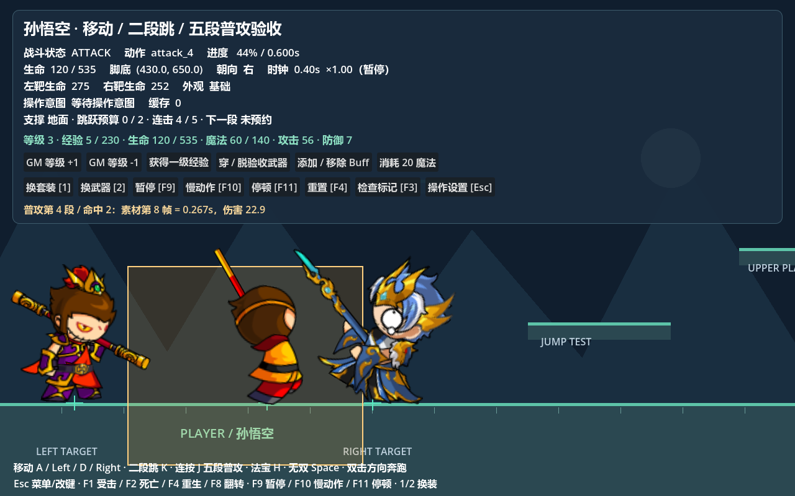

# 属性计算链

`BattleAttributeComponent` 继承现有 GAS `GameplayVitalAttributeComponent`，最终值仍由 `GameplayAttributeInstance` 计算。Core 发布战斗通知，Simple Inventory 管理背包与槽位，GAS Status / Effect 管理 Buff。2D 与 3D 实体通过同一 `BattleGASBinding` 装配。


## 计算层与入口

| 层 | 数据与入口 | 撤销和替换 |
| --- | --- | --- |
| 基础 | 实体 attribute_set；`set_base_value(id, value)` | 修改各实体独占实例，不改资源模板 |
| 成长 | BattleAttributeProgression；`set_level(level)` | growth.level 来源替换为 `(等级−1)×每级增量` |
| 装备 | BattleEquipmentDefinition；`set_equipment(slot, definition)` | equipment.<slot>；同槽先撤销再应用，null 卸装 |
| 临时 | GAS GE_AttributeModifier / Status；`replace_source(source, modifiers)` | 独立状态实例来源；叠层替换、到期/移除撤销 |
| 最终 | `get_value(id)`；`get_snapshot()` | 面板与伤害读取同一份 GAS 最终缓存 |

沿用 GAS 公式：`(基础 + 成长ADD + 装备ADD + 临时ADD) × (1 + 所有MULTIPLY之和)`。0.2 表示20%；各层不分别乘算。OVERRIDE 沿用 GAS 覆盖规则，多项覆盖时第一项优先。`hpMax/mpMax/atk/phyDef` 在全部修改器计算后采用原玩家 Math.round 语义取整，再限制范围；成长中间值保留小数。

`level/exp` 禁止装备和 Buff 修改器写入；等级通过统一入口同步，经验为本等级剩余经验。一次经验奖励可连续升级，每次扣除对应 `upgradeEXP`；满级停止循环，保留剩余经验。孙悟空一级生命275、魔法100、攻击26、防御5，每级增量分别55、20、5.25、1.05，见 [成长资源](../../../data/attribute/progression/sunwukong.tres)。220为 EXP 表覆盖范围，产品等级上限可单独配置，不推定原版 CommonConfig 的值。

`get_breakdown(id)` 返回基础值、成长/装备/临时修改器来源、类型、数值与最终值。修改器模板先复制，按来源清理；不同实体不共享运行修改器和 Vital。

## 当前生命、魔法与上限

当前值仅存在 GAS HealthVital / ManaVital；hpMax / mpMax 是最终上限。快照 hp / mp 只是 Vital 读数，不创建第二份生命状态。

| 修改原因 | 处理规则 |
| --- | --- |
| 经验升级 / GM 调高等级 | 回满基础、成长、装备形成的上限；临时 Buff 上限不参与补充 |
| 换装、卸装、Buff 添加/移除、基础调整 | 保留当前值；上限降低立即截断，不主动补充、不保留比例 |
| GM 降级 | 保留当前值并截断到新上限 |

依据原版 `exports/zmhj_damage_formulas/sources/models/vo/UserVO.as`：451–458行 onUpdateLevel 增加成长并设置 hp=Math.round(hpMax)、mp=Math.round(mpMax)；298行起的 updateItemHandler 修改装备属性，不补当前生命；532行起的 allhpMax/allmpMax 才加入 Buff。因此基础装备上限330、临时 Buff 加200时，升级补到330而不是530。立即截断保证 `0 ≤ 当前值 ≤ 最终上限`；升级不会复活已死亡实体。

Vital 还提供 KEEP_RATIO、FILL、ADD_DELTA 供其他规则选用；本业务默认 KEEP_CURRENT。回血、耗蓝使用 modify_vital 或 vital.set_current_value，不直接写 current_value。

## 插件连接与统一通知

```gdscript
entity.attributes.add_experience(280)
entity.attributes.set_base_value(&"level", 10) # GM 与升级共用成长入口
entity.attributes.set_base_value(&"atk", 40)

entity.attributes.bind_inventory(inventory)
# 物品用 BattleInventoryEquipment，battle_definition 引用装备定义。
inventory.equip_item(item)
inventory.unequip_item(item)
# 无背包的实体也可直接设置/卸下装备。
entity.attributes.set_equipment(&"weapon", definition)
entity.attributes.set_equipment(&"weapon", null)

entity.apply_status_definition(&"attribute_test_buff")
entity.statuses.remove_status(&"attribute_test_buff")
entity.attributes.snapshot_changed.connect(update_attribute_panel)
var final_attack := entity.attributes.get_value(&"atk")
```

GAS begin_update/end_update 支持嵌套事务。成长、换装、多项效果和 Buff 叠层在事务内完成，依赖即时重算，逐属性信号延迟到结束。随后同步 Vital 和升级补充，发布 attributes_recalculated、snapshot_changed 与 Core battle.attributes.changed。面板订阅完整快照，不依赖逐属性信号的先后顺序；独立受伤、回复、耗蓝也即时通知。批量业务可另包事务，开始与结束必须成对调用。

## 平台验收与动画修复

打开 [悟空平台场景](../../../tests/fixtures/wukong_platform_demo.tscn)，新增等级、经验、当前/最大生命魔法、攻击、防御面板，以及 GM 升降级、获得经验、穿脱验收武器、添加/移除8秒 Buff 和耗蓝按钮。1/2键仍只演示 Spine 外观换装；属性验收装备与 Buff 使用测试数值，不冒充原版装备。



```powershell
& '<Godot 可执行文件路径>' --headless --path . res://tests/suites/verify_attribute_pipeline.tscn
```

[验收脚本](../../../tests/suites/verify_attribute_pipeline.gd) 检查连续升级/满级、最终取整、生命策略、背包同槽替换/卸装、Buff叠层/过期、模板及同类怪物隔离、通知、即时面板和实际普攻伤害。

人物不显示已修复：编辑后的 jump_2 主时间轴包含多个 Spine clip，适配器不再以单个原动画时长拒绝整个初始化。预置主 AnimationPlayer 决定动作和时刻，原生辅助播放器按当前关键帧的局部时间驱动骨架。保留已有编辑内容、暂停时间规则和换皮肤时长，实际 GPU 截图确认人物与攻击显示正常。
