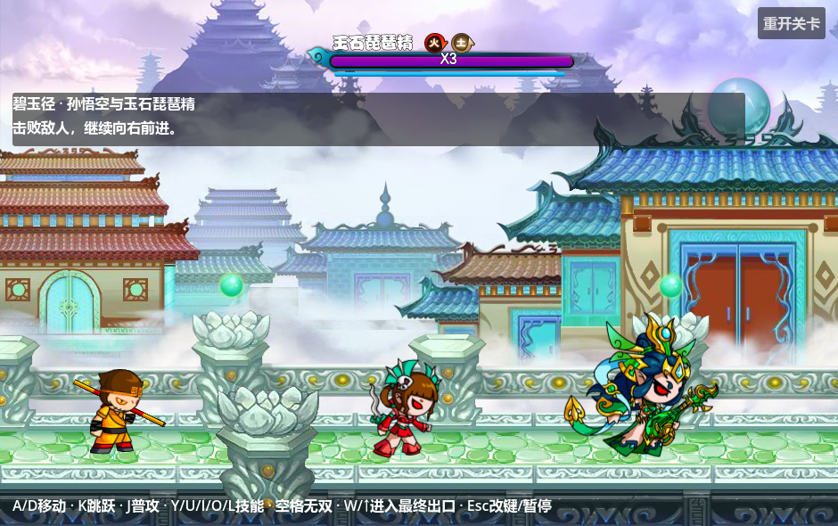
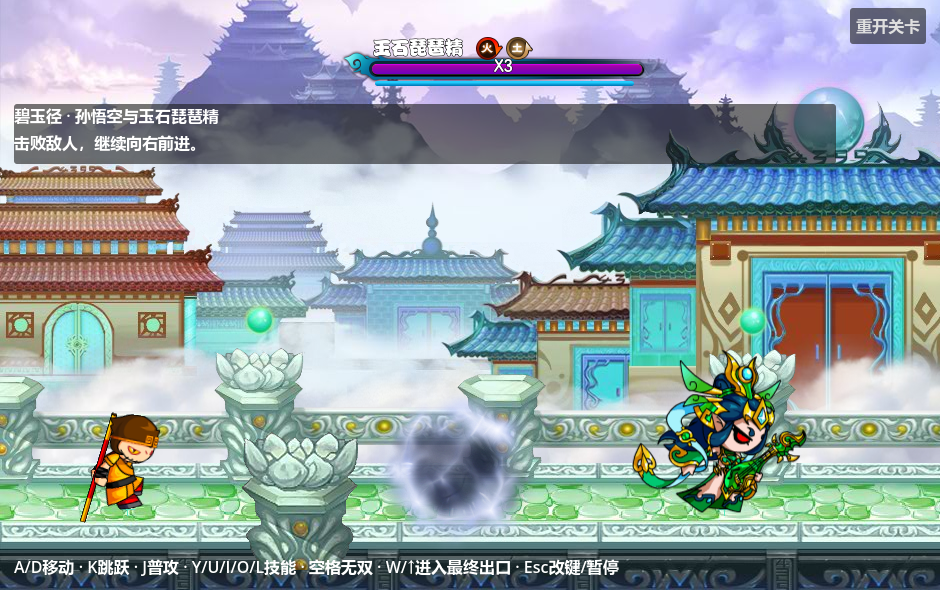

# 原版Boss血条、怪物出场与提前移镜

F5运行碧玉径。第一关Monster/10601的原名称是**玉石琵琶精**，Resource/11106；已修正Boss行为资源、实体资源的显示名称。既有`巨石灵君`定义ID、`jushi_lingjun`目录及技能ID继续作为兼容索引，避免破坏已有配置引用。



## Boss栏

原`BattleTopLayer.showBoss()`把`BossBleed`挂在940×590画面的`(470,36)`。当前预置`BossFeedback/HUD/BossBar`使用水平0.5锚点和顶部36像素，调整窗口时继续位于画面中央。边框、生命条、计数、保护条保留SWF内的负注册点；装饰边框并非左右对称，不能把裁切PNG的中心当作原MovieClip原点。

原名字体来自`font_20260629_1.swf`的方正胖娃，计数字体来自mission中的方正粗圆。名称普通模式白色、困难模式`#ffe00d`、地狱模式`#f700ee`，有黑色描边。普通Boss三条生命使用原`bossbar1/2/3`贴图，条内显示`X3/X2/X1/X0`。生命遮罩0.6秒QuadOut，保护遮罩0.3秒QuadOut；保护为0时保留原空条边框。

原版抗性顺序为光、暗、水、火、木、土、风、雷。零值隐藏，正值使用原`*ResistAdd.png`，负值使用原`*ResistRemove.png`，名称后26像素开始排列，图标中心间隔30像素。当前Boss显示火抗-10、土抗+10。图标从GAS最终属性读取，升级、装备、Buff或GM通过统一属性入口修改后自动更新；悬停可查看整数值。原源码读取配置抗性，当前额外同步运行时属性，避免面板与实际结算不一致。

编辑入口：

| 项目 | 位置 |
| --- | --- |
| 显示名称 | `data/monsters/jushi_lingjun/boss.tres → Display Name`及实体定义的`Display Name` |
| 初始抗性 | 同目录`attributes.tres`，走现有基础/成长/装备/临时/最终计算链 |
| 生命条数 | Boss配置`Health Bar Count`，生命仍由独立Vital管理 |
| 名称颜色 | 公共`BossFeedback → Difficulty`；正常第一关为0 |
| 布局、字号、贴图 | `battle_boss_feedback_2d.tscn → HUD/BossBar`的预置节点 |
| 数字诊断 | `BossFeedback → Show Debug Values`，默认关闭；原HUD不叠加HP/保护数值标签 |

主线的旧调试面板已隐藏，避免遮住原版技能播报。Boss反馈仍属于全场共享的BattlePresentation，角色只提供状态和属性。空保护条使用 mission shape1326 的深蓝底 `texture_under`，青色填充使用 shape1330 的 `texture_progress`；原先把填充盖在空底之上的资源对应已修复。斩败、发光出口和战斗/背包 UI 见 [新说明](../../../data/ui/README.md)。

## 原版怪物出场



`Monster1.start()`检查`showAppear`；大于0时，播放mission的`appearN`，以出生世界坐标为原点，特效结束才调用`super.start()`初始化怪物。当前导入的`appear1`为25帧、30FPS、25/30秒，不循环，注册点`(-92.05,-140)`，每帧199×198像素。世界坐标和素材显示×2，镜头0.5，画面上的尺寸与原素材一致。

剑舞、驭兽使、复苏容器的原值为1；玉石琵琶精为0，不额外播放烟雾。Boss 仍会按原 `BattleTopLayer.showBoss` 播放独立的屏幕 `bossComing`：33 帧、30 FPS、1.1 秒，保留 940×590 下的注册坐标。公共 `BossFeedback/HUD/BossComing` 预置 [boss_coming.tscn](../../../data/effects/boss_coming.tscn)，随 BattleClock 推进，同实例重复绑定不重播，死亡、离场和清关清理。原值保存在实体定义的`metadata/original_show_appear`。关卡出生计划和Boss召唤明确开启出场流程：

```gdscript
session.spawn_entity_2d("monsters", &"剑舞", at, &"", true)
```

最后一个参数`play_appearance=true`读取该实体原配置；默认false用于工具直接生成、伤害样例和独立机制验收。新怪物要使用本特效，在定义资源设置`original_show_appear=1`并通过开启该参数的出生入口生成。

每个反馈场景已预置`MonsterAppearance/Sprite2D/AnimationPlayer`，帧资源和注册点可在[data/effects/monster_appearance.tscn](../../../data/effects/monster_appearance.tscn)预览；运行时不临时拼装组件。演员出生进度归本实体保存，动画由同一战斗tick推进，出场期间暂停行动、隐藏角色图像并关闭角色碰撞。结束后恢复；低帧率跨越结束时间时，剩余delta继续推进正常动作。暂停、慢动作和受击停顿统一遵守BattleClock。死亡、离场、清关会停止动画并清理，不留尾帧。

## 清屏后的提前移镜

前四区域的`Camera Transition Margin`设置为844个世界像素。旧出口96像素，加上向左提前844像素，检测宽度变为940世界像素，也就是当前镜头下的右侧半屏。第一区域范围为`Rect2(1428,0,940,1216)`；例如悟空在x=1800时就能进入下一段镜头过渡，无需走到旧出口x=2272。

触发仍同时要求出生计划全部生成、相关目标全部死亡、区域额外条件满足。仅仅当前没有活怪，或第一波结束但第二波延迟未到，均不解锁。切换后继续由Phantom Camera适配器使用原30FPS的0.2权重平滑跟随，不重置实际镜头中心。最后区域不自动切区，保持Boss/关卡条件和W确认。

编辑`data/levels/biyujing/progression/regions/*.tres → Camera Transition Margin`即可调整；0恢复原先窄出口触发，增加数值可更早移镜，检测范围裁剪在当前区域内。普通区域的`Automatic Exit`控制自动检测，最终区域保持false。该参数只扩大自动区域切换判定；手动最终出口仍使用原`Exit Rect`。

## 来源与验证

贴图、字体、注册点、图标顺序与原源码SHA256见[original_presentation.json](../../../assets/ui/boss/original_presentation.json)。原SWF只读导出，未执行Flash；[导出脚本](../../../tools/import_original_boss_presentation.py)可独立重跑，不重建技能或地图。

[原版表现验收](../../../tests/suites/verify_original_boss_presentation.tscn)检查布局、名称字体、抗性更新、生命保护插值、25帧出场、控制限制、暂停/慢动作/停顿、低帧率、死亡/离场和提前范围。关卡验收实际在x=1800自动切区，同时验证延迟第二波不会提前开门。GPU截图工具验证940×590及窗口变化后的实际HUD和出场动画。
