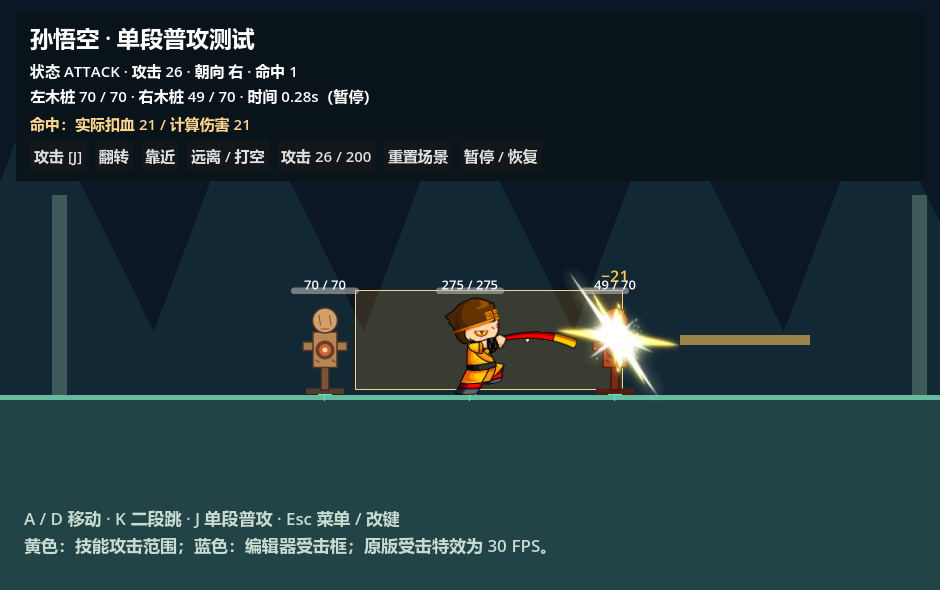
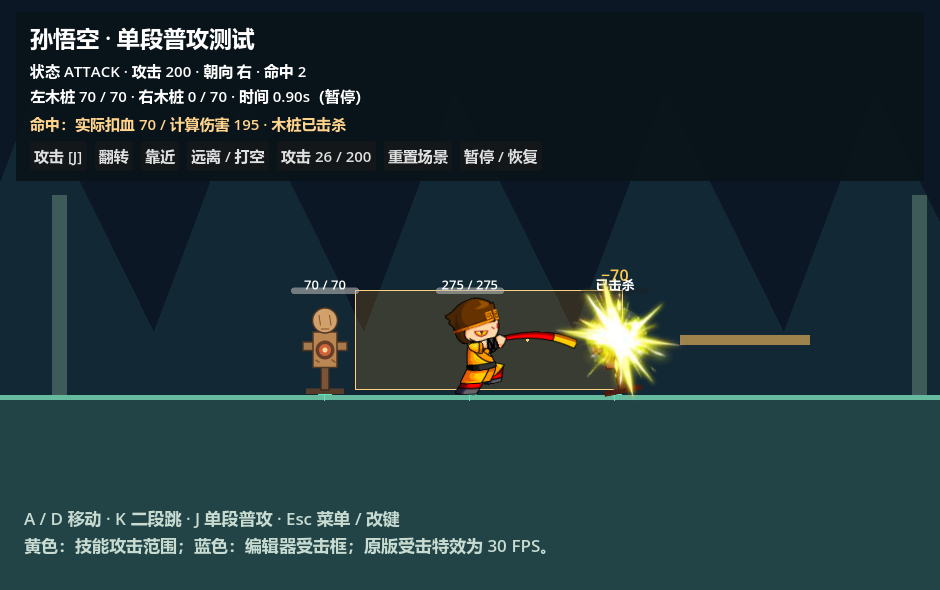

# 阶段 6：单段普攻与最小战斗闭环

阶段 10 新增 [Buff、被动与战斗触发](buffs-triggers.md)，复用并重构 GAS Status/Effect/PassiveStatusFeature，接入 Core STUN、标签引用计数、统一周期时钟、原版吸血/反伤与死亡/离场清理。测试场景为项目当前 F5 入口，节点与控件预置，全部定义位于业务 data/buffs。

阶段 8 使用 GAS 策略 + Attribute/Vital/Status/Effect + Core 事件完成原版通用伤害链；等级评分沿用原版EXP，界面统一整数。原版盾后补1、真实伤害与吸血顺序、角色回调和结果字段见 [详细说明](original-damage.md)。

阶段 7 在此闭环上扩展 [技能时间轴、连招与多段攻击](skill-timeline.md)。新场景使用独立资源，阶段 6 的窗口和场景保持兼容；BattleAttackInstance 的目标记录现包含 count / next_hit_time，hit_count 统计实际次数。分段反应、派生缓存、消耗与冷却、对象和事件取消协议见新文档。

打开 [single_attack_demo.tscn](../../../examples/single_attack_demo.tscn)，使用项目现有带 Spine 模块的 Godot 按 F6。A/D 移动，K 跳跃，J 只施放第一段普攻；长按不自动重复，也不预约连击。Esc 打开菜单与改键。按钮可翻转角色、移动木桩以打空、切换攻击 26/200、重置整个场景及暂停。两侧木桩初始生命 70、防御 5，是明确使用测试数值的敌方实体。

项目视口已改为原版 **940×590**，保持宽高比缩放。依据原版 `games/zmhj-g5/game.json` 的 contentWidth/contentHeight，以及反编译 `Game.as` 的 `drawRect(0,0,940,590)`；基础引擎 GameData 的 640×480 默认值不作为该游戏的有效尺寸。世界沿用现有 2 倍战斗坐标，预置 Camera2D 的 zoom=0.5，让原素材以 1 倍像素显示，命中几何和碰撞单位保持一致。

公共表现的节点归属、配置及新角色接入见 [公共战斗表现](../presentation/README.md)。

## 在编辑器搭建与调整

角色、木桩、摄像机、地面、两侧墙体、单向平台、背景、HUD、操作控制器、GAS 组件、完整菜单及受击特效都在 `.tscn` 中预置。启动前后节点树完全一致；菜单打开时只更新已有 20 行控件。测试脚本不调用 spawn_entity、new/add_child 或 `_draw` 创建场景内容。

```text
SingleAttackDemo
├─ Background / Sky
├─ Camera2D                          预置位置、缩放
├─ BattleSession                     manifest 与随机种子
│  ├─ BattlePresentation             公共战斗表现
│  │  ├─ EntityViews                 每个目标的血条、保护条与受击闪光
│  │  └─ DamageNumbers / Rows        全场共用跳字对象池
│  ├─ Terrain                        Polygon2D 与静态物理地形
│  │  ├─ Ground
│  │  ├─ LeftWall / RightWall
│  │  └─ Platform                    单向平台
│  └─ Actors
│     ├─ SunWukong                   预置角色场景
│     │  ├─ GameplayVitalAttributeComponent / GameplayAbilityComponent / GameplayStatusComponent
│     │  ├─ PlayerOperations / OperationController
│     │  └─ ActionState / MotionController
│     └─ LeftDummy / RightDummy      独立战斗组件
├─ HUD                               预置面板、按钮与帮助
└─ MenuLayer / OperationMenu          预置改键界面
```

直接在场景树中移动角色/木桩、调整地形 CollisionShape2D 或 Polygon2D、修改 Camera2D 和 HUD。实体 Inspector 中的 `scene_definition_id`、`scene_category`、`scene_session_path` 指定定义和所属会话；BattleSession 的 `scene_manifest_path` 和 `scene_seed` 指定场次配置。入树时只给已有节点创建独立运行数据与编号，GAS 装配复用预置组件，输入系统登记预置控制器。资源定义仍只读，当前生命、窗口和技能黑板仍按实例隔离。

重置按钮通过 `reload_current_scene()` 重载整个已保存场景，恢复场景定义的位置、生命和状态，并注销旧 Core 动作机与输入控制器。离线工具 `node tools/build_single_attack_scene.mjs` 可重建基准测试场景与菜单；执行它会覆盖这两份 `.tscn`，日常编辑后应直接保存场景。

复用 Core 操作意图、状态机和事件总线、GAS 技能时间线、最终属性与 HealthVital、Battle Foundation 战斗时钟和单一技能判定框。新增功能放在现有插件中，没有再建立一套技能、伤害或输入系统。





## 类图与联合运行


| 实现 | 职责 |
| --- | --- |
| [BattleEntity2D](../runtime/battle_entity_2d.gd) | 联合输入、Core 动作状态、GAS 技能、攻击实例和命中结算；只查询受击区域 |
| [BattleAttackInstance](../runtime/battle_attack_instance.gd) | 每次施放独立的攻击编号、技能 ID、攻击者弱引用、运行实体 ID、起手阵营、战斗时间、窗口及命中集合 |
| [BattleFrameTimelineFeature](../gas/battle_frame_timeline_feature.gd) | GAS 黑板累计素材时间，发布命中帧，并附加当前攻击编号 |
| [BattleHitbox2D](../movement/battle_hitbox_2d.gd) | 场景中唯一攻击框；从实际技能定义读取矩形、正缩放和偏移，按朝向生成世界多边形 |
| [BattleHurtbox2D](../movement/battle_hurtbox_2d.gd) | 独立 Area2D / RectangleShape2D；提供目标受击多边形，可单独编辑及关闭受击资格 |
| GAS DamageCalculator / HealthVital | 从即时最终属性计算临时伤害，走现有 DamageInfo 和生命扣除、通知、耗尽流程 |
| [BattlePresentation2D](../presentation/battle_presentation_2d.gd) | 会话级订阅 Core 命中事件，分发目标视图，全场数字池按战斗时钟统一推进 |
| [BattleCombatFeedback2D](../presentation/battle_combat_feedback_2d.gd) | 公共 EntityViews 中的目标表现实例；属性快照更新血条，生成共享池跳字并播放受击闪光 |
| [BattleHitEffect2D](../presentation/battle_hit_effect_2d.gd) | 控制预置原版受击 AnimationPlayer，单次播放与战斗时钟同步 |
| [AnimationPlayerAdapter2D](../animation/animation_player_adapter_2d.gd) | 木桩的非 Spine 动画后端；控制场景预置 AnimationPlayer，不参与伤害与状态裁决 |

运行顺序如下：

1. Core 将按键转为 `attack` 意图，当前动作叶子通过 `request_attack()` 检查攻击许可。单段角色配置的 `combo` 为空，只激活 `sunwukong_attack1`。
2. GAS 激活技能，角色创建攻击实例，Core 进入 ATTACK，动画适配器播放 `attack_1`，发布 `battle.attack.started`。
3. 统一战斗 delta 驱动运动、动画和 GAS。素材第 4 帧发送 `battle.attack.impact`；宿主验证场次、来源实体、活动技能与攻击编号，拒绝旧施放事件。
4. 宿主从实际技能定义取得攻击矩形及窗口长度，打开窗口，立即查询一次；窗口未结束的后续固定物理更新继续查询。目标必须存活、可受击、属于敌对阵营，并与独立受击区域相交。
5. **先登记 `hit_index / target_entity_id`，再扣血**，同步伤害回调也不能让同一击重复结算。GAS 计算伤害，HealthVital 扣血；生命耗尽由战斗状态切到 DEAD。
6. `battle.attack.hit` 通知生命条、飘字和演示面板。技能结束关闭攻击实例，Core 在动作锁定结束后恢复 IDLE；有移动意图时恢复对应移动状态。动画完成只发送通知，不决定攻击许可或死亡。

## 时间、窗口与去重

独立 [单段技能资源](../../../data/battle2d/single_attack/attack1.tres) 保留原第一段的动作、范围、第 4 帧命中和 10 帧时长，使用 30 FPS。该验收资源额外设置 **`hit_window_frames = 2`**，这是阶段 6 的临时持续窗口，不代表已还原原版 sensor 的完整生命周期。

| 时段 | 行为 |
| --- | --- |
| 起手至 4/30 秒 | ATTACK 与攻击动画已开始，尚不检测伤害 |
| [4/30, 6/30) 秒 | 命中窗口；开启时查询一次，随后每个战斗物理更新查询，途中进入的目标也可命中 |
| 6/30 至 10/30 秒 | 收招，不再查询；已登记目标保持去重记录 |
| 10/30 秒 | GAS 结束本次技能，关闭攻击实例，解除对应动作锁定 |

每次施放编号为 `<运行实体ID>/attack/<递增序号>`，与共享角色/技能定义 ID 分开。窗口按 `hit_index` 登记，相同命中标记不会重复开启；同一目标在同一窗口只结算一次，新施放创建新集合。五连击的第四段仍有两个独立命中序号，允许各结算一次；连击预约由 BattleComboState 管理，命中集合已统一移到 BattleAttackInstance。

不设置 `hit_window_frames` 时保留一次素材帧查询，现有五连击资源没有改成持续伤害。跨帧时间线会补发到达的标记，窗口开启仍执行一次查询；检测使用当前采样位置，不做高速空间扫掠。

暂停和受击停顿时 delta 为零，窗口、动画、技能和飘字一起冻结；慢动作按相同缩放时间推进。受击打断、跳取消、死亡、下一段替换及实体退出均关闭旧攻击，清空窗口；`battle.attack.finished` 每次实例只发一次。死亡角色不继续检测，也不作为存活目标接受伤害。

## 三种区域的编辑与镜像

```text
角色根节点 : CharacterBody2D
├─ CollisionShape2D                  物理胶囊：地面、墙、平台
├─ Hurtbox : BattleHurtbox2D
│  └─ CollisionShape2D                独立受击矩形
├─ AnimationAdapter
│  ├─ … / AnimationPlayer             预置表现节点
│  └─ AttackHitbox : BattleHitbox2D
│     └─ CollisionShape2D             所有技能共用一个攻击矩形
└─ ProtectionSystem                  独立保护值与保护时间
```

木桩物理体为 44×180 胶囊，受击框为 90×170 矩形；悟空受击框先使用 44×180，保留已有范围边界。受击形状使用 `resource_local_to_scene`，编辑单个运行实例不会污染另一实例或模板。打开 [木桩场景](../../../data/battle2d/dummy/wooden_dummy.tscn) 或 [角色场景](../../../data/battle2d/sunwukong_2d.tscn)，选择 `Hurtbox/CollisionShape2D`，调整尺寸与局部位置；编辑器显示蓝色范围。`vulnerable=false` 可关闭几何受击资格。

攻击/受击 Area2D 的物理监测关闭、层和掩码为 0；形状供 `Geometry2D.intersect_polygons` 查询，不参与阻挡、推挤或物理 overlap 回调。只有 CharacterBody2D 的碰撞体负责移动碰撞。改变物理体的位置不会移动受击区域，改变受击框不会改变角色支撑。

攻击框继续以技能的 `hit_rect`、`hit_scale_x/y`、`hit_offset` 为唯一数据来源，事件参数不能覆盖真实技能几何。先正缩放、偏移和素材单位转换，再绕角色脚底镜像；左向局部 X 为 `-右向矩形.end.x`，宽高不变。保留原第一段 ABRect(-114,-104.95,267,99.95) 及 2 倍场景比例，仍允许其原有后侧覆盖。编辑攻击范围参见 [动画与统一攻击框说明](../../../data/animation/README.md)。

## 临时伤害与反馈约定

当前公式为 `max(1, atk - phyDef) × damage_multiplier`，读取双方当前 GAS 最终属性，沿用 DamageInfo 修改入口。攻击 26 / 防御 5 时计算并实际扣除 21。攻击 200 / 防御 5 时计算 195，但生命 70 的目标实际只损失 70。

`battle.attack.hit` 的 `damage` 表示前后生命差；`calculated_damage` 表示公式请求值，`resolved_damage` 表示 HealthVital 返回值。飘字和面板使用实际生命差，防止过量伤害反馈超过剩余生命。木桩受击变红，死亡播放预置 AnimationPlayer 倒下动作；动画结束不复活、不解锁死亡状态。生命条监听完整属性快照，修改最大生命或受到非本次攻击的伤害也会同步。

木桩和悟空分别使用独立 GAS/Vital 实例，共享 `.tres` 仅保存定义。阶段8已接入原版伤害及数字特效；阶段9已接入 [独立受击与保护](hit-reaction-protection.md)，包含击退/击飞/倒地/起身与每 Boss 保护阈值。本文保留阶段6闭环说明，不表示所有原版 sensor、Boss AI 或职业特例已完成。

## 原版受击特效

已从本地原版 `assets/ui/mission2_20250707_1.swf` 的 AMF3 图集中导出 `hurtEffectAll0000`～`0010`。它不是普通 SWF 时间线，无需执行 Flash。原版 ModelManager 选择 `hurtEffectAll`，HurtEffect 默认 30 FPS、单次播放，ManEntity 按目标朝向镜像 `hitEffOffset.x` 并挂到目标显示节点。孙悟空挂点为 (0,-60)，SkillParam 的 hasHitEffect 默认 true。

素材、每帧 PNG 哈希、原图集裁剪参数及源码证据哈希保存在 [assets/effects/hurt_effect_all](../../../assets/effects/hurt_effect_all/README.md)。原注册点为 (72,73)，画布 151×150；保留重复帧和第 11 帧的透明占位，不缩短 11/30 秒时长。

[hurt_effect_all.tscn](../../../data/effects/hurt_effect_all.tscn) 包含 Sprite2D 与预置 AnimationPlayer 的 texture 轨道。编辑时选择节点，临时打开 HitEffect 的 Visible，拖动播放器 `hit` 时间轴即可预览；运行中只在命中通知到达时播放，完成后隐藏。播放不创建节点，不决定死亡、不重复扣血。素材 offset=(-72,-73)，目标方向只改变挂点 X，特效图像保持原方向。CombatFeedback 的 `hit_effect_unit_scale` 默认 2，独立于木桩 SVG 的显示比例；配合镜头 0.5 恢复原特效像素尺寸。

受击帧动画与技能、飘字使用相同 combat delta，暂停/停顿冻结，慢动作同步；死亡目标仍可完成本次受击表现。后续技能可在命中 payload 设置 `has_hit_effect=false` 禁用普通受击闪光，或在特效节点禁用 enabled。

## 验收

```powershell
& '<带 Spine 模块的 Godot 路径>' --headless --path . res://examples/verify_single_attack.tscn
```

[验收脚本](../../../examples/verify_single_attack.gd) 驱动真实按键入口、GAS 帧事件、2D 物理更新和实际 HealthVital，已通过 **64 项检查**。覆盖原 46 项战斗闭环，另验证 940×590、启动节点树一致、预置 GAS/输入/菜单、摄像机素材比例、原版特效时长/透明结尾/注册点、单次播放、暂停、挂点镜像、连续受击重播及技能关闭闪光。失败返回非零退出码。

`--headless --path . --script res://tools/verify_single_attack_scene.gd` 另通过 8 项完整场景重载、死亡复位、注册注销与菜单控制检查。

五连击 222 项、动画 903 项、输入 145 项、Core 动作机 46 项、属性链 65 项、动画编辑 74 项及真正编辑器预览 212 项回归通过；阶段一、插件、基础属性与 Core 事件验收也通过。命中与击杀截图由项目实际 D3D12 / Forward+ 渲染取得。

原五连击及平台演示继续使用各自 manifest；单段演示使用 [single_attack/manifest.json](../../../data/battle2d/single_attack/manifest.json)，只配置第一段普攻和木桩，不改五段连击资源。所有业务 ID 仍为 `孙悟空`、`sunwukong_attack1`、`木桩`。
