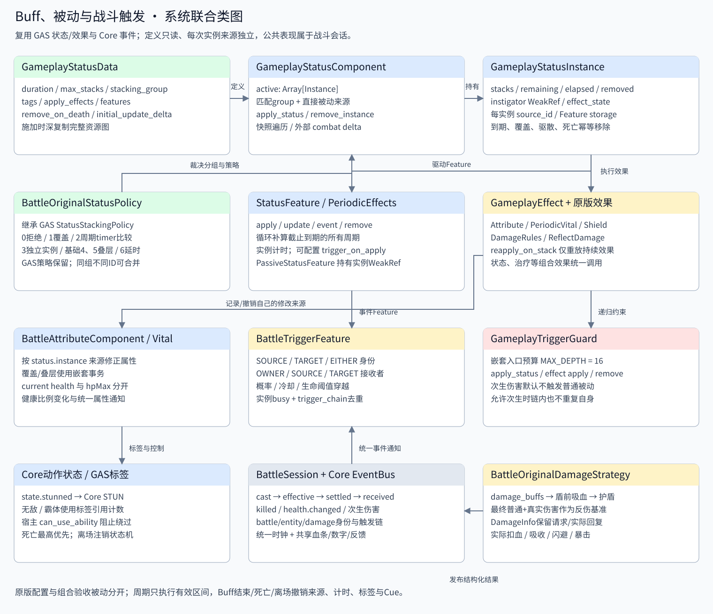

# 阶段 10：Buff、被动与战斗触发

按 F5 运行 [buff_demo.tscn](../../../game/levels/biyujing.tscn)：A/D 移动、K 跳跃、J 五连击，选择悟空/左木桩/右木桩后点击效果按钮。清除 Buff 用于驱散；重置场景恢复生命和所有状态。被动组合固定施加给悟空，是触发接口的验收配置。切换伤害样例会先清理 Buff，再替换样例规则，避免旧状态持有已被脚本清空的来源。

场景继承已有原版伤害和保护场景，940×590。角色、木桩、地形、共享跳字池、血条和全部按钮预置在 tscn 中。Buff 是 GAS 的 Resource 定义和 RefCounted 实例，复用角色已有 GameplayStatusComponent，不额外动态创建角色组件。



## 原版依据及本次范围

离线读取 Speculum-4399-master 的 `exports/zmhj_role_stats/原始配置/Buff.json`，导出九个真实配置；业务 ID 使用语义名称，original_buff_id 和 original_type 仅作为来源元数据。数据副本与 SHA256 保存在 [original_config.json](../../../data/buffs/original_config.json) 和 [source_mapping.json](../../../data/buffs/source_mapping.json)。游戏运行不读取原版仓库。

源码对照：

- `exports/zmhj_character_state_control/sources/com/wdcgame/engine/model/buff/BuffManager.as`：270起按 group+attributeT 匹配，453起替换策略，655起叠层，isImmediate预推进素材帧。
- 同目录 `BuffVO.as`：advanceTime、周期计时和到期、Rest/RestTotalTime。
- `out/zmhj-equip-skill-diag/prefabs/scripts/ManEntity.as`：updateStackBuff、updateBuffVo 中 type8 属性、type5 生命、type21 移速、type262 护盾、type15反伤、type81吸血。
- `exports/zmhj_damage_formulas/sources/prefabs/controls/DamageControl.as`：918起吸血，1756起反伤；沿用阶段8盾后补1、普通/真实分量顺序。
- `out/zmhj-equip-skill-diag/com/wdcgame/engine/model/UserVOBase.as`：612起 updateHP；持续生命效果直接改生命，不走普通攻击防御或护盾。

本阶段实现普通 PvE 基础类型 1/2/5/6/8/15/21/81/262，所选配置采用原版数值、持续时间和替换规则。复杂被动通过可组合的统一触发 Feature 接入。五个 `passive_*` 资源明确标记 test_composition，是组合验收定义，不宣称为孙悟空原版专属被动。PvP/宠物倍率、Boss特殊免疫、技能白名单及计次吸血、Buff子树的7/8/81/9/61替换分支尚未完整导入；它们需要各自定义、策略或 Feature，不能直接把任意旧 Buff.json 行当作已支持资源。

## 九个原版效果

| 业务ID / 原版ID | 实现与数值 | 持续时间 / replaceRule |
| --- | --- | --- |
| attack_up / 8030701 | type8，施加时目标当前 allatk×0.2，记录该实例贡献，结束撤销 | 10秒 / 1覆盖 |
| slow / 21004401 | type21，走路和跑步倍率各 -0.5；最终速度最低0 | 5秒 / 1覆盖 |
| stun / 2000201 | type2，state.stunned；取消技能、攻击窗口和位移，进入 Core STUN | 1.5秒 / 1覆盖 |
| poison / 5019101 | type5，每秒 int(目标hpMax×-0.02)，预推进1/30秒 | 5.1秒 / 2周期计时比较 |
| shield / 26002408 | type262，hpMax×V1+atk×V2+V3，本配置固定258 | 2.5秒 / 1覆盖 |
| invulnerable / 1000101 | type1，state.invulnerable；普通伤害、外部减益按目标政策阻止 | 2秒 / 3独立实例 |
| super_armor / 6000301 | type6，state.super_armor；阻止配置中的动作打断，保留伤害 | 1秒 / 3独立实例 |
| reflection / 15000101 | type15，最终普通+真实伤害×0.35，直接扣对方生命 | 7秒 / 3独立实例 |
| lifesteal / 81101001 | type81，盾前伤害×5，上限=有效技能倍率×30000 | 1.5秒 / 1覆盖 |

attack_up 在攻击100时记录20；GM改基础攻击150后显示170，到期恢复150。另一独立来源在当前120上施加20%会记录24，两来源合计144；移除任意来源只减去其20或24。普通叠层则按该实例捕获的基值乘总层数重新应用，不把自身加成再次纳入计算。

眩晕时禁止移动、跳跃、转向和技能；直接调用 GAS Instance 也检查宿主 can_use_ability，普通受击和保护动作不能提前解除 STUN。仍按物理重力下落，不会悬空。到期回到地面待机或空中状态。死亡优先级最高；普通治疗不能复活。霸体与无敌采用现有 Core 动作及反应配置，不能混成一种减伤标签。

同标签多实例由 TagManager 引用计数管理，第一份无敌到期不会移除另一份标签。无敌会拒绝新减益；**已存在的 type5 毒伤直接修改 HP，仍可穿无敌和普通护盾**。反伤遵守原版真实无敌检查。周期生命变动已封装成次生 DamageInfo 以生成统一结果/飘字，但跳过普通公式、霸体倍率、击退、保护值、吸血与命中停顿；默认不会触发普通命中被动。

## 生命周期、叠层、刷新与覆盖

GAS 状态容器改为实例数组。匹配键为 stacking_group；为空则按 status_id。原版导出键为 `original.<group>/<attributeT>`。不同ID但同原版分组依然互相覆盖；remove_status(id)删除同ID全部实例，remove_instance(instance)精确删除一个实例。旧实例的到期或遗忘回调不会误删新实例。

| 策略 | 行为 |
| --- | --- |
| 原版0 | 拒绝重复，保留旧实例 |
| 原版1 | 移除旧实例，再施加新实例；一次属性事务内完成 |
| 原版2 | 旧 nowTime ≥ 新 totalTime 则保留，否则覆盖；周期Buff比较周期timer，而非总存活时间 |
| 原版3 | 同ID可拥有多份独立实例，各自计时、来源、标签与清理 |
| 原版4 / 5 基础叠层接口 | 增层并恢复根定义时长；4重置周期，5保留周期相位。适用于本阶段持续属性/普通周期配置，未复刻旧引擎 interval=0 后的特殊单次重算和所有子配置分支 |
| 原版6 | 延长旧实例时长，并延后其周期计时；不增加层数 |
| GAS RefreshDuration | 只刷新 |
| GAS Intensity / RefreshAndStack | 叠层至 max_stacks 并刷新 |
| GAS AccumulateDuration | 只延长持续时间，保留周期相位 |

所有层数属于运行实例。施加时深复制定义图；模板变更只影响后续施加。持续效果以 status.<instanceID> 记录来源，进入/叠层/覆盖用属性事务提交一次重算通知。只有 reapply_on_stack=true 的持续效果在叠层时撤销后重放；治疗、即时伤害及 remove_effects 不重放。

计时采用 BattleSession 统一 combat delta：暂停与受击停顿冻结；慢动作同比缩放。更新裁剪到剩余有效时间，先补算所有跨过的周期，再移除；恰好到期的最后一次周期生效，不结算结束后的时间。原版毒伤在低帧率跨过5.1秒时仍结算5次，而非仅一次。FeaturePeriodicEffects.trigger_on_apply 可用于需要真正立即结算的自定义效果，与原版 isImmediate 的1/30秒预推进分开。

移除顺序：容器取出实例 → removed守卫 → 移除效果 → 撤销持续来源 → Feature/storage → 标签引用 → Cue → 完成通知 → 释放上下文/宿主引用。默认 remove_on_death=true；死亡先完成致命伤害与击杀触发再清理。离场/关卡卸载无条件清理、注销状态机及共享表现。仅临时重新挂载 GAS 节点时退出树只退订事件，重新入树恢复订阅；正式实体离场走 cleanup_battle，销毁组件也清理。

## 公共战斗触发点

| Core事件 | 时机与语义 |
| --- | --- |
| battle.skill.cast | GAS成功激活技能，来源与目标均为施放者；发生在本次技能时间轴推进前 |
| battle.hit.effective | 未闪避/免疫且最终伤害>0；不要求实际扣血等于计算值 |
| battle.damage.settled | 本次 DamageInfo 应用及动作裁决完成；闪避/免疫也有结构化结果 |
| battle.damage.received | actual_hp_loss>0 的受击结果 |
| battle.entity.killed | 本次结算将生命从正值变为0；过量伤害只按实际剩余生命记录 |
| battle.health.changed | Vital/上限重算完成后生命比例变化；包含前后比例及当前/最大生命 |

伤害触发发布顺序为有效命中 → 结算完成 → 实际受击 → 击杀。生命比例变化由 Vital 同步通知，因此可能先于上述伤害结果；比例穿越被动用于下一次伤害，不能追溯吸收已经扣除的本次伤害。原有 battle.attack.hit 留给技能采样器的命中统计与公共表现，不再作为被动统一入口，避免同一伤害重复触发。普通技能标记 defer_attack_feedback，公共表现等攻击命中事件显示；次生伤害直接消费 damage.settled，避免重复飘字。

上下文带 battle_id、source_entity_id、target_entity_id、sequence、physics_tick、combat_time，以及 damage_id、damage_kind、trigger_chain 和 DamageInfo 的完整结果。会话/实体身份过滤避免其他关卡或其他木桩触发自己的被动。

BattleTriggerFeature 配置 trigger_on_events、owner_role（SOURCE/TARGET/EITHER）、effect_target（OWNER/EVENT_SOURCE/EVENT_TARGET）、chance、cooldown、health_threshold、threshold_falling。运行冷却、busy、trigger_count 保存在各自实例 storage。Feature名称仅供编辑显示，触发链使用实际Feature身份，不会因同名/空名称互相干扰。概率使用会话 combat 随机流；阈值仅在比例穿过边界时触发，持续低生命不会每帧施加护盾。

复杂被动组合无需在每个技能脚本加监听：永久 GameplayStatusData 添加多个 BattleTriggerFeature，效果可使用 GE_ApplyStatus / GE_ModifyVital / GE_AttributeModifier 等。用 PassiveStatusFeature 在学习技能时施加永久状态，metadata保存实例WeakRef，遗忘只删除自己实际持有的实例；不依赖会在激活时清空的黑板。学习持有的状态按技能ID隔离，随后施加给目标的衍生Buff仍按原版分组规则合并。

## 吸血、反伤与递归约束

吸血集中在 BattleOriginalDamageStrategy 的 damage_buffs之后、extraDamage/护盾之前。基准=当前 normal_damage+true_damage，上限倍率=skillDefault+skillAdd×(有效技能等级-1)。DamageInfo 暴露 lifesteal_basis、lifesteal_requested、lifesteal_actual，和 calculated_damage、resolved_damage、shield_absorbed、actual_hp_loss、is_dodged、is_crit；整数面板只格式化显示，不反写原版内部精度。

例如攻击100、防御20、固定随机输入得到80：盾吸收80，最终扣1；原版吸血配置请求80×5=400，施放者只缺100则实际回复100。反伤以伤害最终分量为基准，80×0.35=28；目标只剩5生命也不会把基准改成5。普通盾吸收后最终只剩1时，反伤基准也变成1，符合原版后置顺序。

默认 allow_secondary_damage=false：DoT/反伤结果保留通知和表现，但不重新进入普通命中、反伤或吸血被动。需要明确允许次生触发时可开启该字段，执行链记录 instanceID/Feature实例ID，同一被动链拒绝重复自身；实例 busy 抵御同步重入，cooldown在执行前提交。GameplayTriggerGuard 对施加状态、效果应用/移除额外限制最大嵌套16层，错误循环定义也不会无限递归；该预算计算嵌套入口数，而非攻击次数。

## 新角色/怪物如何配置

1. 复用角色/怪物场景已有 GameplayStatusComponent、DamageRules、属性和动作状态组件。
2. 在 data/buffs 新建 GameplayStatusData，填写语义ID、时长、最大层数、分组、策略、标签；设置进入/周期/事件/移除效果。
3. 注册到使用场景的 manifest.definitions.statuses；永久被动可放入实体 initial_status_ids，或由学习技能的 PassiveStatusFeature 持有。
4. 施加调用 target.apply_status_definition(id, source)；精确驱散保存返回实例调用 target.statuses.remove_instance(instance)。
5. 属性效果走现有 GAS 修改器，不直接改 shared Resource 或最终缓存。手工修改等级、装备变化等继续走统一属性入口，Buff结束只撤销自己的来源。

```gdscript
var poison := target.apply_status_definition(&"poison", player)
var shield := player.apply_status_definition(&"shield", player)
# 提前驱散某个实例，不影响同ID的另一份效果
if shield != null:
    player.statuses.remove_instance(shield, &"dispelled")
```

BattleCatalog 校验持续时间、层数、初始推进、周期、概率/冷却/阈值，保留旧有效索引直到新配置通过。离线重导出命令：`python tools/export_stage_ten_buffs.py --source <Speculum目录>`。

## 验收

[verify_buffs.tscn](../../../tests/README.md) 的95项检查覆盖原版配置、同配置隔离、叠层/覆盖/延时/周期比较、眩晕与直接GAS调用、独立无敌标签、霸体、低帧率与到期末点、暂停/慢动作/停顿、毒伤穿盾、普通/真实盾、吸血基准与上限、统一事件/冷却/阈值、双向反伤递归、被动遗忘、死亡/离场/卸载。

```powershell
& ./tools/verify_stage_eight.ps1 -Godot '<带Spine模块的Godot.exe>' -Suites @('buffs')
```

验证脚本会检查退出码、PASS和SCRIPT ERROR/ERROR日志。完整验证使用不传 Suites 的相同命令；实际渲染另由带 Spine 的原生 GPU 引擎确认，不把仅headless资源加载视为视觉验收。
