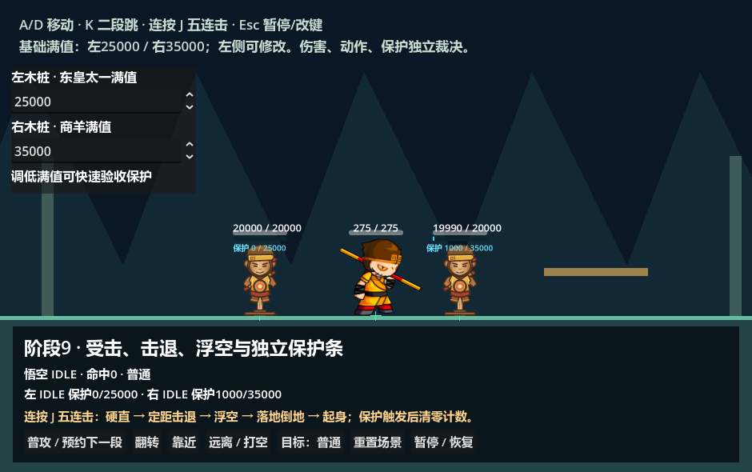
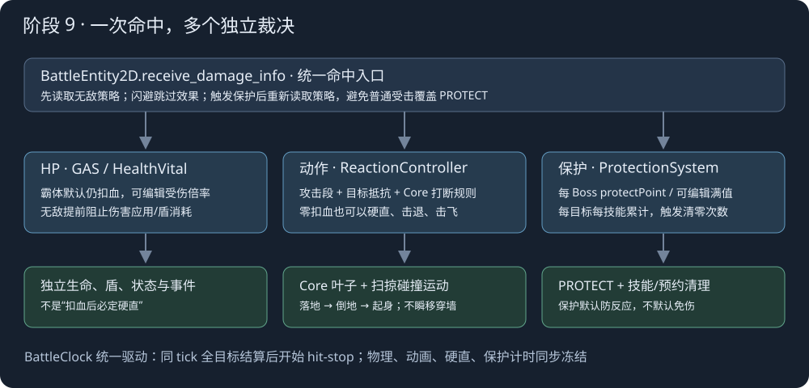
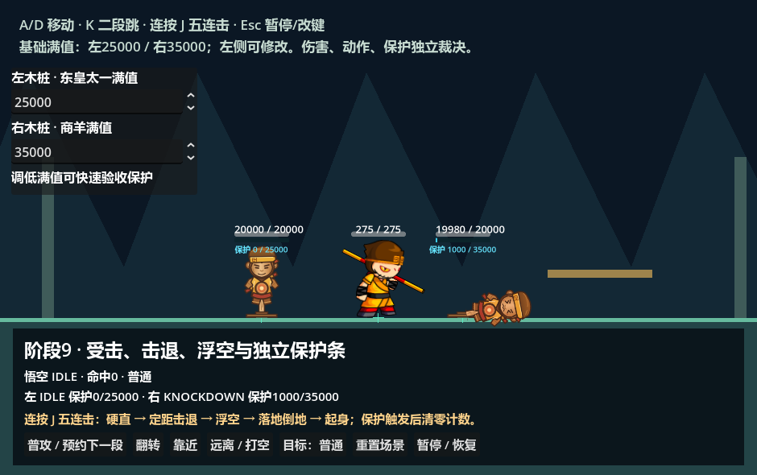
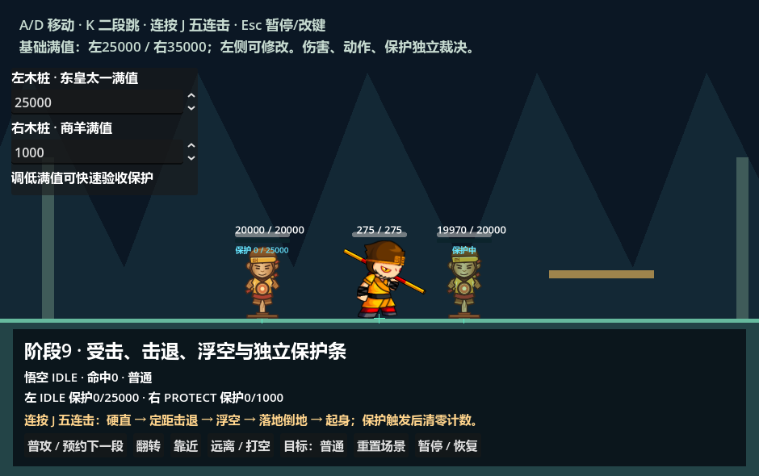

# 阶段 9：受击、击退、浮空与保护条

本阶段复用 GAS 的伤害结果、HealthVital、技能及状态，Core 的动作状态机与事件总线，以及现有扫掠运动控制器。新增独立的目标反应配置与保护条运行系统；不是在伤害公式中直接切换动画。

## 运行与操作

F5 运行 [hit_reaction_demo.tscn](../../../game/levels/biyujing.tscn)。A/D 移动、K 二段跳、连按 J 五连击，Esc 暂停/修改操作键。底部按钮可切换目标模式、转身、靠近或远离木桩、重置及暂停。代码中 `session.set_time_scale()` 可调整慢动作，演示使用普通伤害样例。

左木桩引用东皇太一 `Monster/10001`，基础保护满值 25000；右木桩引用商羊 `Monster/11103`，基础满值 35000。左上两个输入框可分别修改满值，修改时清空该目标的保护运行数据。运行修改不写回 `.tres`，永久配置请在 Inspector 编辑资源。

目标模式用于验收：普通；霸体且伤害乘 0.5；无敌阻止所有配置内效果；免伤但仍允许硬直、击退与浮空。两木桩各自拥有 HP、动作、保护条及命中计数。



## 一次命中的独立裁决



`BattleEntity2D.receive_damage_info()` 组合这些系统，依次读取效果策略、应用 HP、附加状态、累计保护、裁决动作/位移、请求停顿。它不自行计算伤害公式，也不根据“扣血 > 0”决定能否受击。触发保护后重新查询策略，避免本次普通受击覆盖刚进入的 PROTECT。

| 分支 | 实现 | 关键规则 |
| --- | --- | --- |
| 数值伤害 | GAS DamageCalculator → HealthVital | 计算伤害、护盾吸收、实际扣血分别保留；霸体受伤倍率默认 1 |
| 硬直/位移 | BattleHitReactionController2D → Core / Motion | 攻击段参数与目标抵抗共同裁决；HP 可不变 |
| 附加状态 | 现有 GAS Status | 是否允许由无敌/保护策略明确决定 |
| 保护累计 | BattleProtectionSystem | 每目标、每技能累计，独立于技能施放实例 |
| 受击停顿 | BattleSession → BattleClock | 同一 tick 全部目标完成结算后再停顿 |
| 表现 | AnimationAdapter / CombatFeedback | 不决定解锁、扣血或保护阈值 |

闪避不累计保护，不施加动作、位移、状态或停顿。生命耗尽进入 DEAD，清理技能、位移和保护；死亡优先于起身与保护。`single_use` 的同一个 DamageInfo 重复传入不重复应用。外部 GAS 的 GE_ApplyDamage 也会使用宿主统一命中入口；单独调用 HealthVital 只代表扣血，不应代替完整战斗命中。

### 霸体、无敌与保护不是同一开关

角色的 `reaction_profile` 是 [BattleHitReactionProfile](../definitions/battle_hit_reaction_profile.gd)：

| 字段 | 含义 |
| --- | --- |
| armor_blocks_kinds | 霸体抵抗的 `normal/heavy/launch` 种类，默认只有 normal |
| armor_damage_multiplier | 霸体受伤倍率，默认 1；0 才免伤；应用在伤害解析/护盾之后的 HP 应用阶段 |
| armor_blocks_displacement | 被霸体抵抗的命中是否同时禁止位移 |
| knockback/launch/stun_resistance | 对应效果乘 `1 - resistance`，范围 0～1 |
| react_on_zero_damage | 默认 true：全盾吸收或零伤害动作命中也可硬直 |
| invulnerable_blocks_* | 分别控制 reaction、displacement、status、protection、hit_stop，默认全阻止 |
| getup_invulnerable | 起身期间是否启用上述无敌策略，默认 false |

霸体来源包括 `actor.super_armor`、当前技能动作规则、GAS `state.super_armor` 标签，以及保护的护甲模式。无敌来源包括 `state.invulnerable`、damage_rules 的 immune、可选起身无敌。无敌在 HealthVital 前阻止伤害应用，不消耗护盾或触发伤害应用回调；但其他效果是否阻止仍读明确配置。

保护配置的 `blocks_damage/reaction/displacement/status` 与这些策略相交。普通保护默认不免伤，只抵抗动作和位移；也可配置仅抵抗硬直而允许位移。

## 攻击段、方向与碰撞

多段技能编辑 [BattleAttackSegment](../definitions/battle_attack_segment.gd)；旧 FrameEvent 也接受相同 payload。示例五连击使用独立 [hit_reaction/attack1～5](../../../data/characters/sunwukong/skills/normal_attacks/README.md)，不覆盖旧阶段的技能资源。

| 参数 | 用途 |
| --- | --- |
| reaction_type | none 只结算其他分支；auto/hurt/knockback/launch 使用实际速度及硬直决定状态；knockdown 强制标记倒地 |
| hit_stun | 硬直战斗秒；-1 取角色默认，0 无额外硬直 |
| knockback_mode | speed 或 displacement |
| knockback_speed / duration | 水平速度及持续战斗秒 |
| knockback_distance | displacement 模式按 distance/duration 得出速度；持续时间必须正值 |
| knockback_direction | attack_facing、away_from_attacker、target_facing、explicit |
| knockback_sign | explicit 模式用 -1 向左、1 向右 |
| launch_speed | 正值转换为向上 `velocity.y = -launch_speed`，受目标抗性缩放 |
| reset_vertical_velocity | 即使 launch_speed 为 0 也覆写旧竖向速度；用于原版 TargetMove |
| reaction_gravity | -1 沿用目标重力；非负值指定本次受击空中重力，落地恢复 |
| knockdown | 落地后进入倒地/起身流程 |
| interrupt_kind / priority | 同时经过 Core 当前动作的可打断种类与强度门槛 |
| hit_stop_seconds | 当前命中的受击停顿秒数，同 tick 取最大请求 |

速度单位是 Godot 世界像素/秒，距离是世界像素；这些演示运动值不是原 Flash 的单位换算结论。方向由命中上下文中的攻击朝向或相对位置确定，后续转身不会反向修改已经施加的冲量。

悟空基础技能已按原版 TargetMove 单独换算：横向经过 normalToBodyVelocity，竖向直接进入 Nape 物理体。30 FPS、0.1 物理步长、110 重力和当前素材比例 2 对应横向 ×2、竖向 ×6、受击重力 1980；完整依据与每段数值见 [悟空技能说明](../../../data/characters/sunwukong/skills/README.md)。原版火魔斩以相对目标方向配合负速度吸附，霸体仍可阻止位移。

击退使用已有 `BattleMotionController2D.apply_impulse()`，每步通过 `move_and_collide` 扫掠并沿碰撞面滑动，不直接修改 X 坐标。定距击退最后一个 tick 只走剩余时间对应距离。重力与击退共同推进；墙体阻止穿越，地面和单向平台提供支撑，平台边缘可正常掉落。场景边界必须有真实碰撞体，不能只依靠摄影机范围；本演示左右墙为高碰撞体，覆盖浮空路径。连续新命中的冲量替换旧冲量，不叠加为无限速度。

## 动作生命周期

新增六个真实 Core 叶子，总计十五个；原九个枚举顺序不变。`BattleActionState2D` 仍查询 Core 当前状态，没有第二份状态机。

```text
地面命中 → HURT ──硬直与击退结束──→ 待机/移动
             └─跨出平台→ AIR_HURT
击飞 → LAUNCHED ──到达顶点──→ AIR_HURT
                  实际接地 ↓
                         HIT_LAND
                       /          \
              不需倒地              KNOCKDOWN → GETUP
                ↓                       ↓
             普通移动/待机 ←───────────────┘
保护触发 → PROTECT ──保护时长结束──→ 普通地面/空中状态
任何活状态 ──生命耗尽──→ DEAD
```

LAUNCHED、AIR_HURT、HIT_LAND、KNOCKDOWN、GETUP 默认禁止移动、跳跃、转向和普通攻击。地面硬直计时结束但击退未结束时保留 HURT；跨平台边缘不会提前返回可操控的跳跃。倒地或起身时再次失去支撑会重新进入受击下落。

落地缓冲、倒地、起身时长分别来自目标配置，默认 0.1、0.65、0.35 战斗秒；动作由 Core 计时和实际接触驱动，不等待动画结束信号。木桩新增 [reaction_animations.tres](../../../data/battle2d/dummy/reaction_animations.tres) 的六个可预览动画，AnimationPlayerAdapter 自动查找 `reaction/动作名`。没有这些动作的 Spine 角色暂用 hurt/idle 回退，不改变物理或状态逻辑。



## 独立保护条

### 每个 Boss 的满值与显示

给角色指定 [BattleProtectionProfile](../definitions/battle_protection_profile.gd)，不指定则不启用保护。运行条和次数存在 `actor.protection`，不会写进共享 Resource。

`original_boss_key` 使用“表名/BossID”，避免不同配置表 ID 冲突；`maximum_override=-1` 读取该 Boss 的 protectPoint，正整数覆盖满值。示例的两份资源设置 `resource_local_to_scene=true`，运行调参不会串到另一实例。

`inherit_original_display=true` 默认继承原版 showProtect，再与资源的 show_protect 相交；可以关闭继承显式显示隐藏 Boss 的条。显示隐藏只影响 UI，不关闭累计。条的最大值和触发阈值一致，进度限制在 0～1。

多人/P2 敌方模式需显式打开 `multiplayer_enemy`，满值为 `int(base × (1 + multiplayer_bonus))`，默认 bonus=0.8。它不是自动检测玩家人数，也不应对 PvP 目标盲目开启。

### 普通 PvE 增量与累计命中次数

原版数据来自用户指定 [机制说明](D:/UserData/Downloads/game/Speculum-4399-master/exports/zmhj_protection/机制说明.md)，本地导入 1308 条 Boss、6411 条技能，详见 [数据与来源](../../../data/protection/README.md)。公式为：

```text
target.skill_counts[count_key] += 1
n = isProtectPointAdd == 0 ? 1 : target.skill_counts[count_key]
raw = min(protectPoint + protectPointB × (n - 1), cap)
increment = int(int(raw) × attacker_protection_multiplier)
target.score += increment
```

Max 缺失、null 或 0 都按原版视为未设限（999999999），不是条满值。原版中间量为 int，因此先截断原始上限结果，再乘攻击方倍率，最后截断。基础增量为零时撤回本次累计次数。计数键属于目标，不属于施放实例或攻击者；同技能不同释放、甚至不同攻击者打同目标会继续累计。不同目标各自从 1 开始。

保护技能 ID 优先使用 payload 的 protection_skill_id/original_skill_id，否则通过导入表将 sub_skill_id/ability_id 映射到原技能。合并规则：1103122～25 → 1103121；1101622 → 1101620；其他按正值 addXpBySkillId。可显式设置 protection_count_key；protection_parameters 覆盖原版字段用于定制。

示例普通攻击第一段 base=1000、B=1000，同目标连续八次增量合计 36000，可触发商羊 35000 保护。第四段两次命中按同技能分别累计，不能简单把第四段配置值当总增量。

PvP/PK/QC/arena/tongtian/countdown 上下文选择 pvpProtectPoint 系列字段；PvP/QC 额外增加 `int(actual_hp_loss / max_health × 50000)`。50000 是这项额外公式的系数，不是所有 Boss 满值。本阶段提供计算入口，不包含联网对战模式。

### 触发、结束与重置

达到实际满值后记录 previous_score、清空当前与被动累计、清空该目标所有技能计数，然后尝试保护动作。成功进入 PROTECT，取消正在执行的技能和连击预约、清除冲量；protect_seconds 到期结束。保护中默认不继续累计，counts_while_active 可配置。

普通模式下三战斗秒没有收到可累计命中，清空当前、被动及次数；暂停、停顿期间这三秒不前进。use_as_armor 模式不采用该超时清空；保护动作成功填满条，失败恢复触发前 score，但命中计数仍已清空。

protect_ability_id 留空使用内建 Core PROTECT；填入 ID 时必须有能激活的 GAS 技能，否则明确返回启动失败。原版 Boss protectSkillId 保存于数据，不自动当成项目可用的 GAS 技能。本阶段尚无原版 Boss AI，因此只实现现有技能/预约取消与可配置保护技能入口，不声称已移植全部 Boss 保护 AI、特殊 Buff 或被动保护来源。passive_score 保留独立字段与清理语义，当前没有自行产生被动累计的规则。



## 时钟、事件与验收

所有反应、冲量、保护超时及动画使用 BattleClock 的 combat delta；输入仍使用未缩放时间。受击停顿请求在同 tick 所有实体结算后合并，避免第一个目标的停顿让范围内后续目标漏伤。暂停冻结停顿剩余时间，慢动作按同一战斗时钟推进，不修改全局 Engine.time_scale。

Core 新事件：battle.hit.reaction、battle.protection.changed/triggered/ended/reset；原 battle.attack.hit 附带 reaction_applied、displacement_applied、protection_increment 等结果。保护启动失败通过 triggered.action_started=false 报告。

```powershell
# 一项阶段9验收
& '<带 Spine 的 Godot 路径>' --headless --path . res://tests/suites/verify_hit_reaction.tscn
# 阶段9 + 已有战斗、动画、Core/GAS/输入回归，正常退出并检查 PASS/错误日志
& .\tools\verify_stage_nine.ps1 -Godot '<带 Spine 的 Godot 路径>'
```

验收驱动真实 GAS 施放、Core 叶子、HealthVital 与墙/平台碰撞，检查每 Boss 满值、原版累计/合并/重置、伤害与动作分离、霸体/无敌效果策略、五段差异、超大 delta 双向墙体、平台边缘、完整击飞倒地起身、死亡与多目标受击停顿。场景启动前后检查节点树一致，保护 UI 和动画均预置。

2026-10-08 使用项目 Godot 4.7.2 custom Spine 引擎，阶段9 headless 验收通过 199 项；另 13 套既有回归全部通过，包含木桩37、攻击特效267、原版伤害90、跳字78、单段64、多段117、属性65、五连击222、输入145、Core 动作机52，以及 Core 事件、插件与阶段1。

同一引擎 D3D12 / Forward+ 图形验收通过 204 项（另含截图夹具及四张实际渲染截图）；日志无 SCRIPT ERROR/ERROR。截图过程中临时隐藏 Panku 日志浮层，完成后恢复可见性，不修改其持久化设置。
