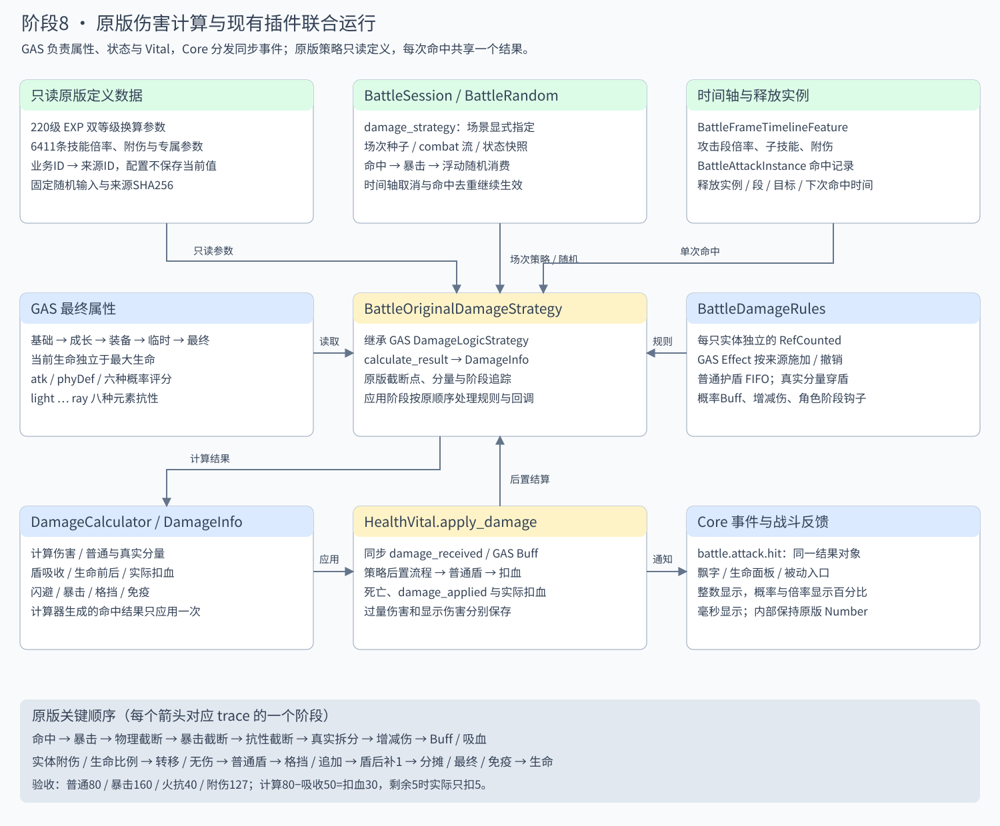
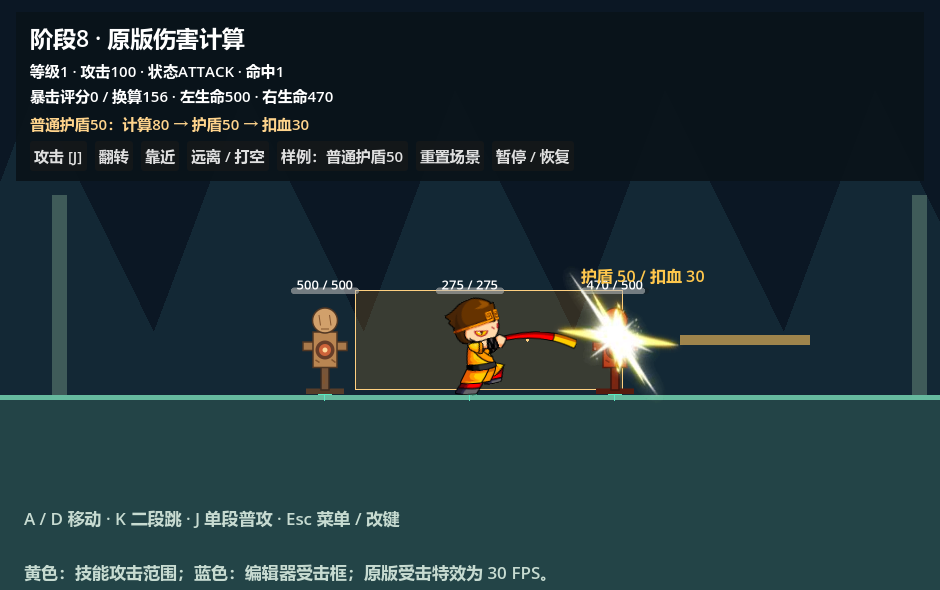

# 阶段 8：原版伤害结算

按 F5 运行 [原版伤害预置场景](../../../game/levels/biyujing.tscn)，分辨率 940×590。J 攻击，点击“样例”循环普通、暴击、火抗、附伤、真实伤害、护盾、闪避和免疫；“翻转”检查左侧木桩。“重置”重新加载整套编辑器场景，包括已死亡的木桩。场景继承已搭建的单段场景，启动不会创建角色、地形、判定框或界面节点。五连击平台和三段技能场景也选择同一原版策略。





## 插件如何联合运行

`BattleFrameTimelineFeature` 按原素材帧开启攻击窗口，`BattleAttackInstance` 按释放、段、目标记录命中。一次重叠尝试只调用一次 `DamageCalculator.calculate_damage()`，返回同一个 `DamageInfo`；随后 `HealthVital.apply_damage()` 处理同步 Buff、后置规则、护盾和扣血。Core `battle.attack.hit` 携带该结果，反馈读取实际扣血、闪避、暴击和吸收量。闪避也占用本段的命中记录，持续重叠不会不断重掷随机数。

GAS 策略基类新增 `calculate_result()`，旧策略只实现 `calculate()` 仍可使用。插件默认示例仍使用 `SimpleDamageLogic`；业务场景通过 `BattleSession.damage_strategy` 指定 [原版策略资源](../../../data/damage/original_strategy.tres)。GAS 没有反向依赖 Battle Foundation 或业务数据。二维、三维宿主都提供随机、策略和规则接口，`GE_ApplyDamage` 与时间轴共享入口。策略只计算，护盾和生命在 Vital 应用时才改变。

`BattleDamageRules` 是每只实体独占的运行对象。评分、抗性、攻防仍来自 GAS 属性计算链；规则对象管理 Buff 额外概率、增减伤、被动参数、按来源保存的普通护盾和角色回调。`GE_BattleDamageRules` 可挂到现有 GAS 状态，状态到期/主动移除会撤销对应来源的规则与残余盾。示例 [normal_shield.tres](../../../data/damage/normal_shield.tres) 提供持续 8 秒的 100 点普通盾；暂停、慢动作和受击停顿继续使用已有战斗时钟。

会话注册 `state.invulnerable`、`state.super_armor`。免疫影响伤害，霸体影响动作打断；两者规则分别管理。伤害 Effect 不再把本次倍率或策略写回共享资源。

## 原版数据与等级换算

[离线导出工具](../../../tools/export_original_damage.py) 从 `Speculum-4399-master/exports/zmhj_damage_formulas` 导入完整 **220 级 EXP 换算表、6411 条技能伤害参数**。项目内的 [数据说明](../../../data/damage/README.md) 和 [来源哈希](../../../data/damage/provenance.json) 可核查来源；运行游戏不依赖外部仓库。人物/技能业务 ID 保持 `孙悟空`、`sunwukong_attack1` 等名称，数值来源编号仅在 [映射表](../../../data/damage/skill_mapping.json) 中使用。

一级 `hitAttribute/dodgeAttribute/criticalMax/toughnessMax/luckyMax/guardianMax` 均为 **156.25**，二级为 **281.25**，不能因整数显示而把分母变成 156。未知等级返回带 `invalid_level` 的零伤害结果，不偷偷改用一级数据。技能实例等级取 `context.skill_level`，其次实体 `damage_rules.skill_levels[ability_id]`，默认 1；`buff_level` 独立相加，不修改技能定义。

命中用 `x = 有效命中 / 目标等级hitAttribute − 目标闪避 / 攻击者等级dodgeAttribute`，判定率为 `clamp(clamp(1 + x/(abs(x)+1) − fixedDodgeRate, 0, 1) + hitPercent, 0, 1)`。先消费命中随机，随机大于概率才闪避；概率零时随机零仍闪避。不可闪避和道具仍消费这次随机。

核心暴击率为 `clamp(有效暴击 / 目标等级criticalMax − 目标韧性 / 攻击者等级toughnessMax + addBaoJiRate + hurtBaoJiRate, 0, 1)`，随后追加 `criticalRatio` 等概率，追加后不再次截断；暴击随机严格小于判定率才暴击。幸运与守护决定总暴击倍率：`1 + clamp(1 + 有效幸运 / 目标等级luckyMax − 守护 / 攻击者等级guardianMax, 0, 2)`，范围 1—3，幸运守护评分相等时为 2。

`secret_bonus` 支持原版 `hit/critical/lucky/atk/phyDef` 入口，所需基础评分使用 `get_layer_value(id, false)`（基础+成长+装备），最终属性包括临时 Buff。

## 结算顺序与截断点

| 顺序 | 实现 |
| --- | --- |
| 1 | 攻击前角色回调；命中/闪避；暴击与幸运守护 |
| 2 | `int(max(有效攻击−防御,1) × (.95+.1×随机) × 技能倍率 + 等级附伤 + 专属附伤)` |
| 3 | 暴击再 `int(基础伤害 × 总暴击倍率)`；连击被动 |
| 4 | 抗性：正值 `100/(抗性+100)`，负值 `1−抗性/100`，乘后再 `int()` |
| 5 | 技能额外倍率、嗜血被动增伤，核心最低 1；角色计算后回调 |
| 6 | 按比例拆普通与真实伤害；背击/刺杀 |
| 7 | 增减伤差值：`dmgRate−atkDmgRate`，原式计算倍率并向下保留三位；真实分量乘 `max(倍率,1)` |
| 8 | GAS 伤害 Buff 同步通知、吸血、实体额外伤害、双方生命比例回调、转移与无伤 |
| 9 | 普通盾按添加顺序吸收普通分量；格挡；固定追加倍率；特殊双倍；Boss 限制 |
| 10 | 原版盾后补 1、分摊、目标最终伤害、伤害转治疗、純真实普通尾数清理、免疫、攻击者最终回调 |
| 11 | Vital 扣血并限制至当前生命；Core/本地伤害后通知与死亡 |

普通技能倍率为 `skillDefault + skillAdd × min(有效等级−1, 正数增长上限) + skillAdd × Buff.skillAdd`；上限为 0 表示普通分支不封顶。`skillType=3` 使用角色等级，其普通分支上限 0 会限制成长为 0，且不计 Buff 技能等级。普通零倍率补为 1。固定附伤 `skillCountAdd` 使用有效等级索引，超出时取最后一项。

真实分量使用 `真实比例 × (最终攻击 × 真实分支技能倍率 + 固定附伤) × 暴击倍率 × realDamageRatio × (1+skillDefaultRatio)`。不使用减法防御、浮动、元素抗性和攻击秘卷附加。类型 3 的真实分支仍计 Buff 技能等级，且只有正数增长上限才封顶；真实零倍率保留零。真实比例包括技能、动态比例和原版 138 类型 Buff 对应的规则来源。

时间轴 `damage_multiplier` 已经是该段基础倍率，覆盖基础 `skillDefault`，不会把第三段 120% 再乘一次 120%。`fixed_damage` 加入该段固定附伤。新角色可使用 `BattleFrameEvent.payload.skill_config` 配置原字段；子技能通过 `sub_skill_id` 查映射，或提供 `original_skill_id` 读取原版参数后用 `skill_config` 覆盖，业务技能ID仍保持名称，无需修改结算器。

**原版例外：** `DamageControl.as` 在普通盾之后、分摊之前再次将普通伤害补到 1。因此普通 80 被盾全部吸收时，结果是“吸收80、实际扣血1”；50% 真实分支的普通 40 被吸收后，仍可能留下 1 点普通伤害。纯真实比例达到 100% 时末尾清掉这一普通尾数。这里保留源码行为，没有把一般护盾理解为必然零扣血。

**吸血顺序：** 原版吸血先于盾和最终免疫。`lifeStealRatio` 的通用入口以该阶段伤害治疗；需要按实际扣血触发的新被动应监听伤害后事件的 `actual_hp_loss`，不要混用两者。

## 结果字段与整数显示

| 字段 | 含义 |
| --- | --- |
| `base_damage` | 第一次物理截断后的基础伤害 |
| `calculated_damage` | 普通/真实拆分、背击与增减伤后，尚未消费盾和后置回调的计算值 |
| `normal_damage` / `true_damage` | 最终两个分量 |
| `shield_absorbed` | 普通盾在原位置吸收的数值，不包含后续格挡或免疫 |
| `final_damage` / `resolved_damage` | 最终请求扣血数值，可大于当前生命 |
| `actual_hp_loss` | 实际生命差；过量伤害只计剩余生命 |
| `hp_before` / `hp_after` | 实际生命应用前后值 |
| `is_dodged/is_crit/is_blocked/is_immune` | 独立结算标记 |
| `trace` / `damage_trace` | 随机消费、分母/倍率、截断、回调与生命结果的逐步记录 |

计算器生成的包只能应用一次；旧插件手工创建的包保留可复用行为。结果通过 `damage_info` 保留同一对象，监听器可在 `damage_received` 同步改伤害；旧监听器只改 `final_damage` 时也会同步调整普通/真实分量。

面板、生命标签、伤害、坐标、技能倍率和概率均显示整数：倍率/概率用整数百分比，短时长用整数毫秒。内部仍保留原版 Number 精度；原版 `UserVO.updateHP` 直接加减 Number，只有公式指定的步骤截断。后置倍率造成的小数只在显示时四舍五入，不反写生命；需要精确核查时读取结果/trace。计算 80、盾吸收 50、实际扣血 30，或计算 80、目标仅剩 5、实际扣血 5 都可明确解释。

## 规则与角色扩展入口

```gdscript
# 每个实体独立；移除状态来源不会影响其他来源。
entity.damage_rules.set_source(&"equipment.example", {"atkDmgRate": 20.0})
entity.damage_rules.skill_levels[&"sunwukong_attack1"] = 3
entity.damage_rules.grant_shield(&"status.example", 100.0)
entity.damage_rules.remove_source(&"status.example")
```

常用规则包括 `fixedDodgeRate/hitPercent/criticalRatio/luckyRatio/skillAdd/realDamagePercent/atkDmgRate/dmgRate`。`subDamage` 为原版格挡剩余比例，默认按目标正面位置判断；`block_omnidirectional` 可明确配置全方向。`no_damage` 在盾前置零；`immune` 或 GAS 无敌标签在末尾阻止扣血。`fixedAdditional/fixedAdditional2` 在格挡后追加，`exclusiveDamage` 在物理截断前附加，`extraDamage` 在后置实体附伤位置附加。

角色钩子 `damage_rules.hooks[stage]` 存放 `Callable(info, target, context)` 数组，修改 `normal_damage/true_damage`；概率钩子可改 `crit_rate`。同阶段先攻击者、后目标，按数组顺序调用。阶段名见 trace：`before_calculate`、`crit_rate`、`after_core`、`back_hit`、`damage_buffs`、`lifesteal`、`extra_damage`、`hp_ratio`、`damage_transfer`、`no_damage`、`shields`、`block`、`fixed_additional`、`special_double`、`boss_cap`、`sharing`、`last_damage`、`damage_to_healing`、`immunity`、`attacker_final`。

已接通第五段必暴、嗜血参数、25次连击加成、背击、刺杀/特殊双倍和防御转附伤分支。原版各职业、召唤关系、联盟/世界Boss、多人转伤/分摊、百余类Buff的完整实体语义仍需在对应阶段钩子移植；导入参数不表示6411条技能对象已经全部实现。当前通用 Boss 上限规则与分摊/转移钩子提供结算入口，不创建尚不存在的联机/召唤实体系统。

## 验收与来源

伤害样例现已恢复 `sunwukong_attack1` 至 `sunwukong_attack5` 五连击；第四段两次命中。原版跳字按盾后普通伤害与真实伤害分别显示，并保留暴击/闪避贴图、普通固定位置、闪避/真实伤害随机位置及上飘淡出；过量伤害跳字和实际生命差分别保留。窗口放大后的重复拉伸已修复。编辑器 AnimationPlayer 预览、屏幕定位、源码依据与78项检查见 [跳字说明](../../../data/effects/README.md)。

[verify_original_damage.tscn](../../../tests/README.md) 使用固定随机手算黄金值：攻击100、防御20、浮动1时普通80；暴击160；火抗100为40、火抗−50为120；150%倍率加7附伤为127；45%倍率加3附伤先截断39，再火抗100截断19。另测双等级分母、边界比较、原随机消费顺序、定义共享安全、Effect复用、真实穿盾、盾后补1、状态到期、免疫、吸血顺序、死亡与整数反馈。

当前 **90 项阶段8检查通过**，包括八种完整时间轴样例和本次技能等级快照。阶段6共64项、阶段7共117项、移动连招222项、属性链65项、操作145项、Core动作机46项，以及Core事件、插件资源和阶段1回归通过。原生Spine/GPU场景及SVG排版已检查。

```powershell
./tools/verify_stage_eight.ps1 -Godot '<支持项目Spine的Godot可执行文件>'
python tools/export_original_damage.py '<Speculum-4399-master>/exports/zmhj_damage_formulas'
```

依据是仓库导出的《伤害计算公式.md》及同目录 `sources/models/managers/BattleModelManager.as`、`sources/prefabs/controls/DamageControl.as`、`sources/models/vo/UserVO.as`、`SkillConfigVO.as`、`SkillParam.as`、`MathUtils.as`。导出工具读取引用仓库、仅写本项目数据目录。
