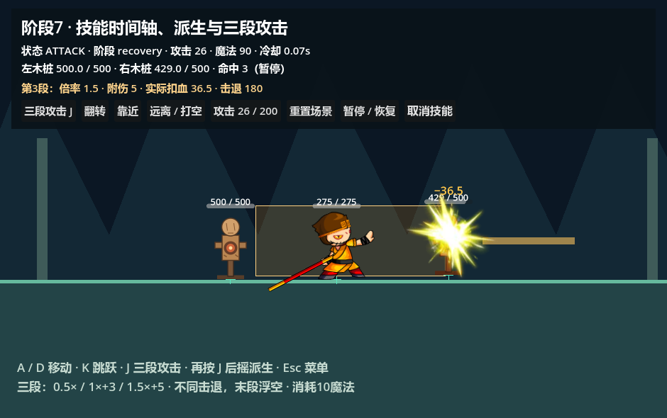
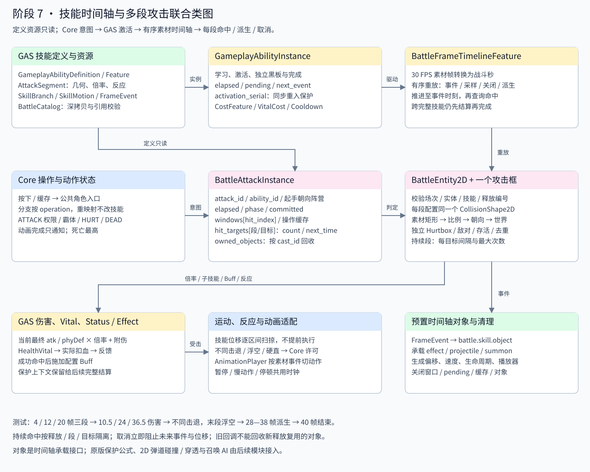

# 阶段 7：技能时间轴、连招与多段攻击

> 阶段8已为实际场景接入原版伤害策略；本文数值表是显式选择 SimpleDamageLogic 的阶段7验收夹具结果。实际场景按原版浮动、截断、概率与抗性结算；显示统一整数。详见 [原版伤害说明](original-damage.md)。

打开 [skill_timeline_demo.tscn](../../../tests/fixtures/skill_timeline_demo.tscn)，用现有带 Spine 模块的 Godot 按 **F6**。场景沿用原版 940×590，角色、地形、木桩、GAS 组件、操作控制器、HUD 和技能对象均预置；启动和施放不创建节点。F5 现打开阶段8原版伤害场景。

A/D 移动，K 跳跃，J 三段攻击，Y 技能槽 1，Esc 菜单与改键。第 28—38 素材帧再次按 J 派生单段普攻，可从第 20 帧提前缓存。按钮可取消技能、翻转、移动木桩以打空、增加攻击、暂停或重载场景。两个木桩各有 500 生命、防御 5；三段倍率、反应、消耗和冷却是**阶段 7 测试配置**，不代表原版某个技能。





## 复用现有插件

没有新增一套技能容器。GAS `GameplayAbilityDefinition` / `GameplayAbilityInstance` 继续管理学习、激活、实例黑板与完成；`BattleFrameTimelineFeature` 增加攻击段、派生窗口和位移窗口。Core 负责操作意图、动作状态和全部战斗事件；DamageCalculator、HealthVital、GameplayStatus / Effect 继续负责伤害、生命与 Buff。BattleClock 仍是唯一战斗时间入口。

| 定义 | 用途 | 本次施放的运行数据 |
| --- | --- | --- |
| `GameplayAbilityDefinition` | 技能 ID、Feature、消耗、基础冷却 | `GameplayAbilityInstance` 的独立黑板与激活编号 |
| `BattleFrameTimelineFeature` | 素材 FPS、总时长、事件、攻击段、派生与位移 | 黑板中的 elapsed、pending、next_event |
| `BattleAttackSegment` | 每个命中段的几何、数值与反应 | `BattleAttackInstance.windows` 和目标记录 |
| `BattleSkillBranch` | 操作名称、目标技能、窗口、缓存时长、优先级 | 本次施放的 buffered_operations |
| `BattleSkillMotion` | 起止帧、世界速度 | 按已处理时间区间计算位移，不累加到定义 |
| `BattleFrameEvent` | 素材帧、Core 事件名称与配置 payload | pending 中按顺序消费的事件项 |

BattleCatalog 为实体复制完整资源图；技能执行不写回上述定义。`BattleAttackInstance` 为每次释放重新建立 attack_id、攻击者弱引用、起手阵营/朝向、elapsed、phase、资源提交标志、窗口、命中历史、操作缓存和拥有对象。关闭后保存命中历史供反馈查询，清空所有活动状态。GAS 的 activation_serial 防止完成回调重新激活同一技能时，旧更新继续结束或重置新施放。

## 编辑攻击段

在 [three_hit.tres](../../../data/battle2d/skill_timeline/three_hit.tres) 的 Timeline Feature 中展开 Attack Segments。无需增加攻击 Area2D，每个角色继续只有一个 AttackHitbox / CollisionShape2D，检查各段时临时读取相应资源配置同一个形状。

| 字段 | 约定 |
| --- | --- |
| segment_id / hit_index | 当前技能内均唯一；对应命中记录和可视化选择 |
| start_frame / end_frame | 原素材帧号；持续窗口 `[start/fps, end/fps)`，相等表示瞬时攻击 |
| sub_skill_id | 可选关联已登记 GAS 子技能；保留到命中上下文，段数值显式配置，不自动再施放子技能 |
| action | 编辑器预览使用的语义动作名称 |
| hit_rect / spawn_offset | 右向素材坐标；乘角色 display_scale，按脚底镜像、转换世界多边形 |
| damage_multiplier / fixed_damage | 本段倍率和固定附伤；每次命中读取当前最终攻击/防御 |
| hit_interval / maximum_hits | 每目标重复间隔和最大次数；interval=0 仅一次，正间隔至少 0.001 秒，最大次数必须为正 |
| knockback_speed / knockback_duration | 世界像素/秒与战斗秒；水平速度按本次起手朝向镜像 |
| launch_speed | 正值表示向上浮空的初速度，单位世界像素/秒 |
| hit_stun | 战斗秒；-1 沿用角色默认硬直，非负值覆盖当前 HURT 锁定 |
| interrupt_kind / interrupt_priority | 交给 Core 状态权限和霸体规则判断能否触发受击反应 |
| protection_value | 传入命中结果并累积到目标 received_protection，供后续保护结算使用 |
| status_ids | 成功扣血且目标存活后调用现有 GAS Status，继而应用 Effect、修改最终属性 |
| has_hit_effect | 保留普通原版受击闪光的开关 |

AttackHitbox 的 Preview Abilities 引用新技能资源；选择 Preview Action 和 Preview Time 可以查看该动作对应攻击段。矩形为 Local To Scene，每个实体独占。范围数据仍经过有效性检查，无效时清空几何，不沿用上一个攻击段。

当前临时伤害公式是：

```text
max(1, 最终 atk − 最终 phyDef)
× damage_multiplier × damage_multiplier_modifier
+ max(0, fixed_damage)
```

固定附伤在倍率之后加入；实际扣血继续经过 HealthVital 的伤害接收/应用流程，反馈使用扣血前后生命差。暴击、幸运、原版保护阈值、伤害属性与减免公式属于后续完整结算；这里没有用测试数值冒充这些公式。

## 三段场景时间线

本例 30 FPS，总长 40 帧（1⅓ 秒）。源攻击 26、木桩防御 5，未换装或加 Buff 时：

| 素材帧 | 行为 | 倍率 / 附伤 | 伤害 | 击退 / 浮空 / 硬直 |
| --- | --- | --- | --- | --- |
| 0—3 | 起手位移 90 世界像素/秒，共 9 像素 | — | — | 位移经过墙体扫掠 |
| 0 / 8 / 16 | 播放 attack_1 / attack_2 / attack_3 | — | — | 只改变动画命令 |
| 2 / 26 | 激活预置 SkillTrail | — | — | 随本次施放登记与回收 |
| [4,6) | 第一攻击段 | 0.5 / 0 | 10.5 | 60 × 0.08秒 / 0 / 0.12秒 |
| [12,14) | 第二攻击段 | 1 / 3 | 24 | 120 × 0.12秒 / 0 / 0.20秒 |
| [20,22) | 第三攻击段 | 1.5 / 5 | 36.5 | 180 × 0.16秒 / 220 / 0.30秒 |
| 22—40 | 后摇 | — | — | 判定已关闭，ATTACK 持续至结束或派生 |
| [28,38) | attack 操作派生到 sunwukong_attack1 | — | — | 可提前8帧缓存 |
| 40 | 完成并回到移动/待机/空中状态 | — | — | 清空窗口、对象、缓存与待执行事件 |

前摇持续到首个攻击段开始，之后 phase=active；默认在最后攻击段 end_frame 切换 recovery，也可以设置 recovery_start_frame 为更晚的帧。后摇仍不能仅凭 AnimationPlayer 播完而结束。技能动作的移动、跳跃、转向权限来自 Feature.action_rules 与 Core 当前叶子；死亡始终最高优先级。不同段之间的动画通过 battle.skill.animation 事件切换，战斗许可不由动画完成事件裁决。

## 低帧率、持续命中和取消

时间轴把帧事件、段采样、窗口关闭、派生入口与后摇入口合并为有序队列。跨过多项事件时按素材秒依次执行，当前 tick 跨过整个技能也会先结算命中再结束。相同时间的普通事件先按资源列表顺序执行，随后处理配置的攻击段与其他边界。技能位移也推进到每个事件时刻后再判定；某个回调取消时，不提前执行取消时刻以后的位移。

默认单次段按素材帧采样并在普通战斗 tick 检查持续重叠；可重复段额外按 hit_interval 生成定时采样，保证低帧率跨过多个间隔仍结算预期次数。窗口结束为排他边界。仅对当前相交、敌对、存活、可受击的目标登记命中。

```text
BattleAttackInstance（attack_id）
└─ hit_targets["hit_index/target_entity_id"]
   ├─ count
   └─ next_hit_time
```

记录属于释放实例，因此键中无需再次存储 attack_id。同段不同目标各自管理次数和时间；同目标不同段重新计数，下一次释放也重新计数。先登记再扣血，避免同步反馈回调重入造成重复伤害。晚进入目标从进入后的首次查询开始计时，不补发其进入前的伤害。

取消、受击、死亡、替换、离树、遗忘技能和直接 GAS cancel_ability 均关闭对应释放：清空 windows、pending、buffered_operations，回收本次拥有对象，清空并隐藏攻击框。Core 事件每次校验 battle_id、实体、ability_id 和 attack_id；旧释放事件不能命中新释放。回收对象同样校验 cast_id，旧回调不能隐藏新施放复用的对象。

低帧率重放保证时间轴事件与间隔次数，查询使用当前物理场景里的目标位置，未实现目标历史位置回放。重力与受击速度仍通过原运动控制器按不大于 1/60 秒的碰撞步长推进；这里没有网络回滚或跨实体历史轨迹重建。

## 派生、资源与时钟

BattleSkillBranch 使用操作意图名称，按键重映射无需修改技能或角色逻辑。窗口内可立即预约；窗口前 buffer_frames 范围内按键进入本次施放缓存，超过范围不接受。多个符合条件的分支按 priority 选择，优先级相同保留配置顺序。到达派生点先检查目标技能已学习、消耗和冷却，再取消旧施放。

新技能在当前实体的 GAS 更新循环结束后起手，下一 tick 推进时间；避免它在同一个循环重复获得旧 delta。这里不把跨过派生点后的余量重新分配给新技能。菜单、失焦、暂停和控制权释放继续走原操作系统，清空连招预约与分支缓存。

本例由时间轴在首次有效战斗更新（素材帧0）调用 **CostFeature / VitalCost**，一次扣除10魔法并启动 **CooldownFeature** 的0.8秒冷却。起手检查不足资源立即拒绝；提交时再次支付检查。提交前取消无消耗；提交后取消不退款，不清空冷却。冷却在技能非活跃期间仍由 GAS 推进。

Feature 顺序为 Cost → Timeline → Cooldown，让提交所在更新也推进本次冷却。含行为树的技能继续由树中的 Commit Cost/Cooldown 节点提交，不得同时启用 commit_resources；BattleCatalog 拒绝双重提交配置。VitalCost 每次解析当前宿主，定义资源不缓存第一个使用者的 Vital 组件。

技能、派生缓存、命中间隔、位移、硬直、Buff、对象和冷却全部使用 BattleClock 的 combat delta。暂停和受击停顿冻结，慢动作一起缩放；输入识别仍使用原操作系统的未缩放时间。

## 弹道、召唤与特效事件接口

BattleFrameEvent 保留任意 Core 事件入口，可携带资源 ID、生成偏移、方向和 payload，供现有 GAS 行为树或业务对象系统处理。预置对象直接使用以下事件：

```gdscript
event_id = &"battle.skill.object"
payload = {
    "object_path": NodePath("SkillTrail"), # 相对施法者的预置节点
    "spawn_offset": Vector2(65, -110),     # 世界单位，X按朝向镜像
    "lifetime": 0.5,
    "velocity": Vector2(0, 0),
    "animation": &"play"                 # 可选预置 AnimationPlayer
}
```

BattleTimelineObject2D 激活已有 Node2D、设置生成位置/速度，手动推进可选 AnimationPlayer，按实际生成时刻计算本 tick 余下生命周期。effect 随角色移动；projectile / summon 的承载节点采用 top_level，保持独立世界位置。三种种类共享事件、运动、存续和回收机制。本例 SkillTrail 是明确标注的临时几何效果，普通受击仍使用已经导出的原版 hurtEffectAll。

这些节点提供**时间轴对象承载接口**；没有替代 GAS 原来的 Area3D ProjectileBase，也不包含新2D弹道碰撞/穿透或召唤 AI。后续接入这些模块时复用相同 attack_id / 段 ID 上下文及回收协议。原版投射物、召唤和保护公式仍需各自迁移，不在本阶段伪造实现。

## 验收与扩展入口

```powershell
& '<带 Spine 模块的 Godot 路径>' --headless --path . res://tests/suites/verify_skill_timeline.tscn
```

[verify_skill_timeline.gd](../../../tests/suites/verify_skill_timeline.gd) **117 项检查通过**：三段不同倍率与反应、源帧顺序、低帧率跨全技能、持续间隔/最大次数、晚进入/多目标独立计时、真实技能槽意图与菜单、派生窗口/缓存/控制权释放、同步取消、直接GAS取消/遗忘、死亡清理、完成重入、旧编号回收、资源不足、消耗冷却、暂停/慢动作/停顿、资源图隔离、Buff/保护上下文、霸体与浮空许可、内部小数与整数反馈、高速位移碰撞和动画时钟，并检查启动前后预置节点树一致。阶段4原五连击222项、阶段6单段闭环64项、操作145项、属性链65项与插件/阶段1/Core事件回归通过；D3D12实际场景与SVG已检查。

[真实编辑器预览验收](../../../tools/verify_editor_skill_timeline.gd) **11项通过**，覆盖三段切换、同一形状复用、Inspector矩形实时刷新与数据恢复：

```powershell
& '<带 Spine 模块的 Godot 路径>' --headless --path . --editor --script res://tools/verify_editor_skill_timeline.gd
```

编辑器修改技能资源与场景后直接保存。[离线构建工具](../../../tools/build_skill_timeline_scene.mjs) 可重建阶段7基准资源和场景，运行会覆盖本阶段目录及演示场景，日常编辑无需运行它。

| 接口 | 用途 |
| --- | --- |
| entity.try_activate_skill(id, context) | 直接释放已学习技能，统一权限/消耗/冷却检查 |
| entity.request_attack() | 公共普攻意图，旧五连击或新时间轴派生 |
| entity.request_skill_operation(operation, id) | 技能槽、法宝、无双等操作，当前技能可按相同操作派生 |
| entity.cancel_skill(reason) | 主动取消并恢复合适战斗状态 |
| entity.get_attack_instance() | 查询本次编号、阶段、时间、窗口与命中记录 |
| entity.apply_status_definition(id, source) | 复用 GAS Status / Effect 入口 |
| attack.track_object(object) | 登记预置承载对象，关闭时按 cast_id 回收 |

Core 通知包含 battle.attack.started / window_opened / window_closed / impact / hit / finished，battle.skill.committed / recovery / animation / object / object_spawned，以及目标的 battle.hit.reaction。UI 读取最终属性和实际伤害，不根据动画完成推断许可。
