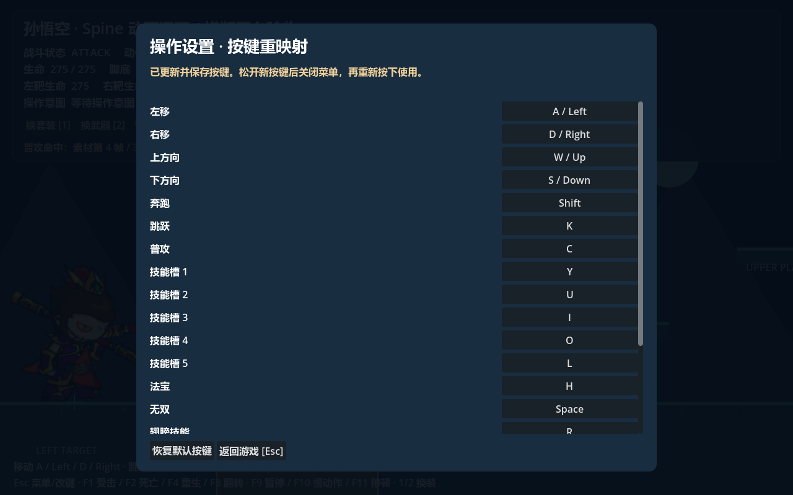
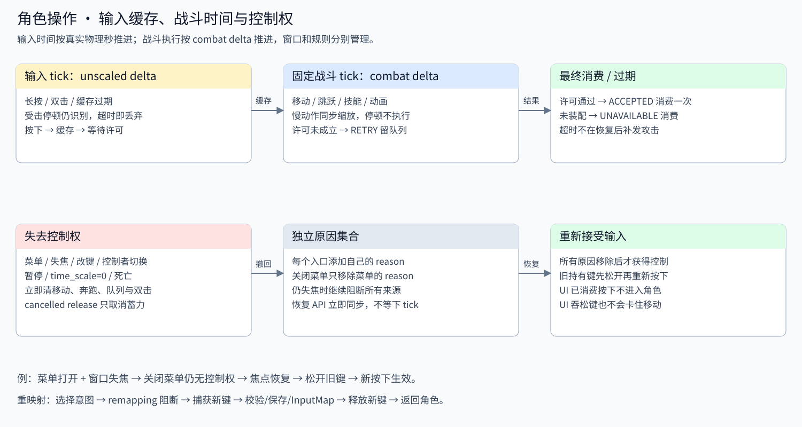

# 可扩展角色操作控制器

角色消费操作名称，按键只存在于 Core 输入适配与用户配置中。孙悟空平台场景已使用本通道驱动移动、奔跑、二段跳和 `sunwukong_attack1` 至 `sunwukong_attack5`；角色由 `孙悟空` 定义生成。

打开 [平台场景](../../../game/levels/biyujing.tscn)，用带 Spine 模块的 Godot 按 F6。Esc 打开设置菜单，可以修改所有操作按键、查看冲突并恢复默认；设置保存到 Core ConfigManager 的 `user://config.cfg`。菜单内的按键不会同时发动攻击。


## 输入、许可、表现的边界

| 层 | 实现 | 职责 |
| --- | --- | --- |
| 配置 | [CoreOperationProfile](../../godot_core_system-0.0.4/source/operation_system/operation_profile.gd)、[业务配置](../../../data/characters/sunwukong/controls/input.tres) | 意图→InputMap 动作、默认物理键、轴规则、缓存/长按/双击参数；共享只读，不写当前按住状态 |
| 重映射 | [CoreOperationBindings](../../godot_core_system-0.0.4/source/operation_system/operation_bindings.gd) | 安装默认 InputMap、捕获新键、检查冲突/保留键、存储事件描述、恢复用户配置 |
| 输入通道 | [CoreOperationController](../../godot_core_system-0.0.4/source/operation_system/operation_controller.gd) | 每个控制者的强度、来源、时间、阶段、双击、缓存和控制权阻断；不施放技能 |
| 缓存 | [CoreOperationBuffer](../../godot_core_system-0.0.4/source/operation_system/operation_buffer.gd) | 缓存每一次按下，按 sequence 精确消费；容量和过期限制 |
| 角色适配 | [BattlePlayerOperations](battle_player_operations.gd) | 按序交付所有阶段的操作意图与技能槽映射；提供角色专属分支钩子 |
| 状态消费 | [BattleActionStateMachine2D](../runtime/battle_action_state_machine_2d.gd)、[BattleActionLeafState2D](../runtime/battle_action_leaf_state_2d.gd) | 当前 Core 叶子受理移动、跳跃、普攻及技能意图，依据自身许可调用实体执行 |
| 菜单 | [BattleOperationMenu](battle_operation_menu.gd) | 模态 UI、控制权占用、改键入口；宿主决定是否同时暂停战斗 |
| 战斗与表现 | [BattleEntity2D](../runtime/battle_entity_2d.gd)、[BattleActionState2D](../runtime/battle_action_state_2d.gd)、GAS、动画适配 | 落地、受击、死亡与冷却决定是否允许操作；动画按动作名播放 |

Core 继续与旧 InputManager 并列。这个角色入口不轮询全局 `Input.is_action_pressed()`，不依赖旧 InputManager 的事件过滤、墙钟缓存或只发出候选事件的 KeyRemapHandler。原模块的实现边界见 [Core 实现分析](../../godot_core_system-0.0.4/docs/implementation-analysis.md)。

空格无双槽已装配 `sunwukong_wushuang`，战斗命中蓄满10000后释放15秒红光、残影与原版移速/伤害/暴击增益；获取和消耗由独立GAS Vital管理，详见 [普通无双说明](../../../data/effects/wushuang/README.md)。

## 默认操作

| 语义意图 | 默认物理键 | 公共行为 |
| --- | --- | --- |
| move_left / move_right | A/左、D/右 | `move` 轴驱动水平移动；相反方向后按优先 |
| move_up / move_down | W/上、S/下 | `vertical` 轴和组合键快照；平台基础角色不自动飞行 |
| run | Shift | 按住奔跑，也可双击同方向后继续按住奔跑 |
| jump | K | 地面和动作许可通过后跳跃；下+跳留给角色专属分支 |
| attack | J | 当前动作规则绑定的 `sunwukong_attack1` |
| skill_1…skill_5 | Y / U / I / O / L | ability_slots 中对应的 GAS 技能 |
| magic_weapon / wushuang | H / 空格 | 法宝 / 无双槽位 |
| wing_skill / ultimate | R / P | 翅膀技能 / 奥义扩展入口 |
| item_1 / item_2 | Q / E | 道具角色分支 |
| pet_toggle / mount_toggle | F / Z | 宠物 / 坐骑角色分支 |

当前样例装配五段普攻，按下调用 `request_attack()`：空闲时发动第一段，攻击中预约下一段；HELD 不自动连击。预约由战斗实例保留到当前段结束，菜单/失焦/暂停会撤回预约。二段跳预算和连击打断由 [运动与动作系统](../movement/README.md) 判断。其余槽位能完整发送按下、持有、释放意图，未配置的槽位消费后报告 UNAVAILABLE。法宝、宠物和坐骑效果由所装配的业务技能决定；无双规则在 BattleWushuangController 与 GAS 中执行。道具也可以配置 GAS 技能或由角色分支接管。

演示保留 Esc、反引号、1/2 和 F1/F2/F3/F4/F8/F9/F10/F11，避免菜单/控制台/换装/调试同时触发业务操作。F1 受击，F2 死亡，F4 重生，F8 镜像，F9 暂停，F10 慢动作，F11 停顿，F3 注册点；1/2 换套装/武器。这些是场景测试入口，实际游戏可以在独立 Profile 中改保留键。



## 按下、持有、松开和缓存

`CoreOperationIntent` 带有 `action`、`phase`、`strength`、`origin`、`device`、单调递增 `sequence`、`input_time`、`held_seconds` 以及独立负载快照。phase 有 PRESSED / HELD / RELEASED / CHANGED：

- 从零到非零生成一次 PRESSED。OS echo 不生成新事件；重复的真实按下/松开分别生成不同 sequence。
- 每个输入 tick 为仍持有的操作生成 HELD。达到默认 0.3 秒时 `long_press_started=true` 只出现一次，此后 `long_pressed=true`；普攻不会因为 HELD 自动连发。
- 最后一个来源释放时生成 RELEASED，带总持有时长。强度改变为 CHANGED，不冒充新按下。
- 失焦、菜单、暂停、控制者切换或退出引起的释放带 `cancelled=true` 和 reason，走取消钩子；不能当作蓄力完成发动技能。

同一意图可以由 A/方向键、手柄、触屏共同贡献，按最大强度聚合；松开一个来源不会清除其他来源。手柄变向按正负精确匹配，原生来源包含设备和物理键/按钮/轴 token。滚轮视为按下/松开的单次脉冲，没有松键事件也不会留下持有状态。`device_filter=-1` 接受全部设备，指定设备时只接受该设备；本地多玩家需要不同映射或过滤并明确分配控制权。

离散操作的 PRESSED 在发信号之前进入队列，默认有效期 0.2 秒、容量 16；同一物理 tick 内按下又松开仍保留请求。角色按 sequence 合并排序按下缓存与 held/released，短按先交给专属按下分支再交给松开钩子，蓄力不会倒序。角色返回 ACCEPTED / RETRY / UNAVAILABLE / NOT_HANDLED：RETRY 留到下个 tick 或超时，其他最终结果只消费对应 sequence。攻击恢复前的短按、落地前的跳跃可以等到许可成立；缓存并不突破许可。队列满时丢最旧请求，不无限积压。

方向双击要求先释放再按同一语义方向，默认间隔严格小于 0.5 秒；第二次按住期间保持奔跑，松开立即结束。交替左右会重置另一方向的双击候选。这个窗口来自原版 KeyVO；原版 InputInstance 还有反向双击状态转移，本组件选择同方向识别，不复刻全部旧引擎的跨方向奔跑状态。

## 时间与控制权

输入链为 `CoreOperationController → BattlePlayerOperations → BattleActionState2D.handle_operation → Core 当前叶子`。连续意图携带聚合后的 `move_axis` / `running` 快照，保留多键与后按优先规则；适配层不再每 tick 直接覆盖角色移动字段。移动字段读取动作机的运行数据。PRESSED 发动或预约操作，HELD / RELEASED / CHANGED 更新连续状态并交给角色扩展。当前叶子返回处理结果，RETRY 保持离散缓存。

IDLE / MOVE / RUN 在地面接收方向意图时转换；全部方向释放后返回 IDLE，并立即发出 `idle` 动画命令。攻击/受击/空中收到释放只更新移动意图，不能跳过动作锁定。每 tick 的行走条件读取意图轴，避免碰撞残余速度或技能位移维持行走动画；攻击结束读取最新意图。菜单与失焦同步调用 `clear_operation_state()`，清移动、奔跑和预约，即使战斗暂停也能显示待机。



BattleSession 每次固定物理更新先调用 `advance_input(unscaled_delta)`，再计算 BattleClock 的 combat delta。输入窗口/长按/双击用未缩放时间，战斗动作/技能/冷却/Buff/动画用战斗时间。0.5× 慢动作不把 0.2 秒缓存变成 0.4 秒。受击停顿仍识别输入，但停顿超过缓存时限时请求失效；恢复时不会补发过期攻击。

暂停、time_scale=0 和 SceneTree 暂停撤回控制并清空缓存；暂停/恢复 API 会立即同步角色控制权，避免等到下一 tick 才恢复接受新按键。菜单本身只管理 UI 控制权，平台宿主同时暂停战斗并在关闭时恢复此前的暂停状态。菜单和改键组件使用 PROCESS_MODE_ALWAYS，使暂停中的设置仍可操作。

控制权使用独立原因集合：menu、focus_lost、remapping、ownership、console、battle_paused、tree_paused、dead 等。撤销某个原因不会覆盖其他原因。占用时清空移动、奔跑、缓存、双击候选和角色蓄力；即使触屏/AI 调 `submit_intent()` 也必须经过这个控制权门。

按下先经过 `_input` 来源记录和释放清理；新操作只由 `_unhandled_input` 接收，UI 先消费按下。即使 UI 吞掉松键，已持有来源也被释放。菜单内按住的键和失焦前的键被隔离，重新获得控制权后必须先松开再重新按下，防止关闭菜单后立刻攻击或持续移动。

## 装配与角色扩展

```gdscript
var operations := BattlePlayerOperations.new()
operations.operation_profile = preload("res://data/characters/sunwukong/controls/input.tres")
# 下列 ID 必须由角色真实学会；各角色替换配置，无需更改键位代码。
operations.ability_slots = {&"skill_1": &"your_skill_id", &"magic_weapon": &"your_weapon_skill"}
actor.operations = operations
actor.add_child(operations)
```

`create_controller()` 会安装默认键与保存的用户绑定，仍由调用方把返回的 Node 挂到角色子树；注册表只有 WeakRef，退出时自动注销。BattlePlayerOperations 已完成这一步并设置 `externally_driven=true`，禁止 Core 自己再推进一次输入时间。

专属角色继承 BattlePlayerOperations：

```gdscript
extends BattlePlayerOperations
func _handle_character_intent(intent: CoreOperationIntent) -> Result:
    if intent.action == &"character_special":
        return Result.ACCEPTED if actor.try_activate_skill(&"your_special") else Result.RETRY
    return Result.UNAVAILABLE

func _after_common_intent(intent: CoreOperationIntent, result: Result) -> void:
    # 公共分支最终消费之后追加角色行为；RETRY 不调用这里。
    pass

func _handle_character_phase(intent: CoreOperationIntent) -> void:
    # 正常 held / released 可用于蓄力；实际战斗许可仍经 actor/GAS 检查。
    pass

func _handle_cancelled_intent(intent: CoreOperationIntent) -> void:
    # 同步取消本地蓄力，只清理，不发动松键技能。
    pass
```

新操作在 Profile 增加 bindings / default_keys / buffered_intents，再由角色分支消费。新设备可继承 CoreOperationController 的原生适配入口；触屏、AI、网络可调用 `submit_intent(action, strength, origin, payload)`，离散按钮可调用 `pulse_intent()`。不把 CoreOperationIntent 再喂给 Input.parse_input_event，避免二次映射。

Core 事件 `battle.operation_intent` 用于记录阶段，`battle.operation_result` 用于记录最终消费结果；都有 battle_id、实体 ID、战斗时间、输入序列，沿用现有 Core EventBus。Panku 控制台显示时，平台宿主另加 console 原因；控制台关闭不会清除菜单或失焦原因。

## 原版入口与验收

[来源索引](../../../data/controls/source_mapping.json) 记录本地原版脚本和 SHA-256：ManFrameControl 负责普通玩家公共读取和角色动作入口；UserVO 提供主键位；KeyboradInput / KeyVO / InputInstance 提供边沿和双击。新实现把公共操作、可重映射输入与角色专属许可拆开。上下飞行、下跳、技能禁用 Buff 等规则可在业务层追加，不能通过修改按键判断来实现。

```powershell
& '<带 Spine 模块的 Godot 路径>' --headless --path . res://tests/suites/verify_player_operations.tscn
```

[自动验收](../../../tests/README.md) 使用真实 Godot 输入分发、Control 消费、GAS 和平台碰撞。覆盖全部操作边沿、短按/长按/连按、缓存序列/容量/过期/快照、同方向双击与别名聚合、摇杆变向/设备过滤/虚拟来源、改键冲突/持久化/重载、菜单捕获不攻击、失焦/暂停/控制权、实际普攻恢复缓存/落地跳跃缓存/技能槽以及角色扩展钩子。验收临时使用独立用户配置，结束恢复原配置；成功打印 PASS，失败返回 1。
