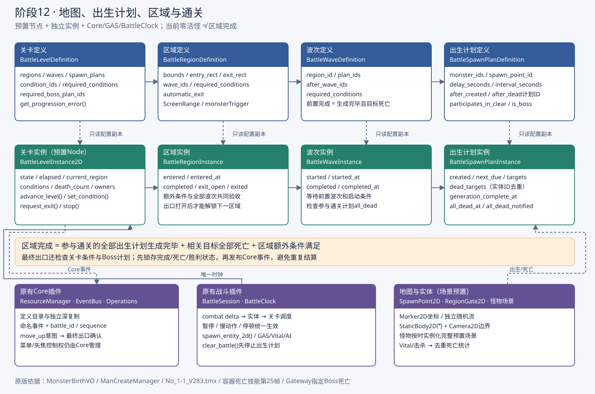

# 地图、出生计划、区域与通关

[原版Boss栏、怪物出场和清屏后提前移镜](../boss/original-presentation.md)已接入F5首关，可在预置场景和区域配置调整。

F5运行 [碧玉径关卡](../../../game/levels/biyujing.tscn)。地图碰撞、平台、人物、出生点、出口、镜头、公共表现与关卡控制器均预置在场景中；怪物按出生计划实例化已有完整角色场景，不动态拼装组件。地图来自原始 `No_1-1_V283.tmx` 的碰撞矩形、单向平台、ScreenRange、monsterTrigger 与 manCreater。场景显示940×590，世界坐标为原版2倍，镜头缩放0.5。旧 [阶段11场景](../../../tests/fixtures/first_level_demo.tscn) 仍是32只预置小怪的独立AI测试，按F6运行。



## 定义与实例

| 定义资源 | 本次运行对象 | 用途 |
| --- | --- | --- |
| BattleLevelDefinition | BattleLevelInstance2D | 关卡图、条件、Boss计划；当前区域、时钟、死亡统计、胜负 |
| BattleRegionDefinition | BattleRegionInstance | 地图/触发/出口矩形、波次、额外条件；进入、完成、开门、离开的一次性状态 |
| BattleWaveDefinition | BattleWaveInstance | 出生计划分组、前置波次、启动条件；启动与全部目标完成时间 |
| BattleSpawnPlanDefinition | BattleSpawnPlanInstance | 怪物有序列表、延迟、间隔、出生点、前置计划；游标、下一截止时间、已生成/已死亡ID |
| 场景中的BattleSpawnPoint2D | 同一个预置Marker2D | 世界出生位置，支持命名独立随机流的矩形随机位置 |
| 场景中的BattleRegionGate2D | 同一个预置StaticBody2D | 未完成时挡住人物，完成时禁用碰撞、显示开启状态 |

配置通过现有 Core ResourceManager/BattleCatalog 读取，GAS负责怪物属性、技能、状态与生命。定义由目录深复制后交给本次关卡，所有时间、游标和目标记录在实例上；不修改多个关卡共用的Resource，不保存悬空尸体引用。目标记录以本次会话的实体ID为键，监听生命耗尽并以Core击杀事件补充；角色皮肤、AI和冷却仍由原有插件管理。

## 何时可以刷怪、完成和开门

1. 玩家进入当前区域的触发矩形。线段/AABB检测允许低帧率跨越狭窄区域，触发一次；尚未解锁的后区域不触发。
2. 波次等待区域进入、额外条件以及所有前置波次完成。波次完成包含参与通关计划出生完毕、目标全死。
3. 计划等待所在波次启动、额外条件、指定计划出生完毕 `after_created_plan_ids`，以及指定出生点目标全死 `after_dead_plan_ids`。
4. **首只等待delay+interval；后续等待interval。**这是原版 `ManCreateManager.createMonsterByBirth` 的规则。生成使用有序列表和实例游标，不对共享数组shift。到期事件按绝对combat时间跨计划排序，遇到大delta补发全部仍需要执行的出生，并正确激活出生完成依赖。
5. `generation_complete = 已开始 && 已生成 == 计划总数`；`all_dead = generation_complete && 去重死亡数 == 计划总数`。只杀掉当前已生成的一只，或第一波杀完但后续计划还等待出生，都不会清区域。
6. 区域完成需要进入过、所有波次完成、区域额外条件满足。随后开出口。最终区域还检查关卡额外条件和指定Boss计划；Boss未出现也不能当作已经死亡。
7. 前四区域进入出口后解锁下一屏。镜头右边界按原ScreenRange推进，左边界保留首屏，允许返回已清理区域。末区沿原Gateway位置按上方向意图确认，默认W/↑、支持Esc改键；通关不是仅由Boss死亡事件直接触发。

暂停、慢动作、受击停顿和SceneTree暂停全部复用BattleClock。出生调度在本tick实体及伤害结算之后运行，接收一次combat delta；不使用引擎Timer、独立_process或延迟Callables。因此离场/失败/胜利后没有旧Timer继续生成下一波。当前方案在低帧率时保持出生顺序和时间记录，新出生实体从下一战斗tick开始运动，不重演过去的AI和物理。

### 一次性结算与异常

出生完毕、计划全死、波次完成、区域进入/完成/开启/离开和胜利均先修改状态，再发布Core事件。重复生命通知、重复击杀或重复出口请求不会再次计数。已死目标销毁后，计划仍保存死亡ID；活着的必要目标离场或被直接释放，会使关卡失败，不能用despawn冒充死亡。

出生资源失效会使关卡失败，游标不计成功、门保持锁定。玩家死亡取消后续调度。`BattleSession.clear_battle()`先停止关卡、断开目标和Core订阅、清空出生状态，再清理实体与表现。重新开始创建独立实例；停止后也可以重新装配同一预置控制器，时钟从当前会话的时间偏移重新起算。定义校验拒绝空/重复ID、无效时间/矩形、缺失怪物或出生点、无归属计划、跨区域倒置依赖，以及计划/波次之间的循环等待。

`participates_in_clear=false`相当于原版includeScreen=false：可选补给/环境目标不阻挡该区域完成；存活时被回收也不会使关卡失败或增加死亡数。当前示例未导入补血罐和NPC，但支持且已验收非通关计划与延迟计划同时存在的情况。已完成区域和开门状态锁存；最终确认仍重新检查关卡条件，设置条件不等同于立即胜利。

## 原版碧玉径图

原始资料、全部TMX对象、出生属性、Boss死亡技能和源文件SHA-256见 [original_source.json](../../../data/levels/biyujing/progression/original_source.json)。数值ID仅用于来源追溯，游戏身份仍用`孙悟空`、`剑舞`、`驭兽使`、`复苏容器`、`巨石灵君`等语义ID。

| 区域 | 出生关系 | 通关参与目标 |
| --- | --- | --- |
| 1 | 出生点1生成2剑舞 → 出生点3间隔生成2驭兽使；1和3全部死亡 → 2/4再生成各2只 | 8 |
| 2 | 5生成2剑舞 → 7生成2驭兽使；5和7全部死亡 → 6/8再生成各2只 | 8 |
| 3 | 9生成2剑舞 → 11生成2驭兽使；9和11全部死亡 → 10/12再生成各2只 | 8 |
| 4 | 13生成2剑舞 → 15生成2驭兽使 | 4 |
| 5 | 14/16各2只小怪，17为容器；容器死亡的技能2001001第25源帧生成10601巨石灵君；Gateway要求10601死亡 | 6 |

合计32只普通怪物、1容器、1Boss；5区域、9波次、18计划。前三区第二波按原版间隔等待，零活怪期间门依然锁定。容器至Boss的25/30秒用死亡依赖计划表示，当前出生位置使用预置容器出生点；尚未跟随被位移容器的最终尸体位置。

容器和Boss的图集、原始动作、基本生命/攻击/防御/等级已导出。Boss现已接入[阶段13专属行为](../boss/README.md)：原版三技能、扇形音符、实体石墙、技能霸体、保护、播报和公共血条；初始悟空已完成真实整关战斗验收。容器停留在出生位置作为可击破目标，持续治疗Buff没有移植。TMX平台碰撞及原版地图SWF分层美术已导入，五区域共用一张连续地图。远景、宫殿、动态云层、地板与近景的复用模板/编辑方式见 [连续地图](map-template.md)。NPC互动、补给与联网结算未纳入此版本。

## 编辑关卡与扩展

编辑步骤见 [碧玉径配置](../../../data/levels/biyujing/progression/README.md)。代码扩展使用以下入口：

```gdscript
# 机关、任务、护送等业务在自己完成时提交条件，无需修改刷怪管理器。
session.level_instance.set_condition(&"机关已解除", true)

# 出口使用同一个入口，自动出口与上方向意图共享资格检查。
session.level_instance.request_exit(player)
```

条件ID先在LevelDefinition的`condition_ids`声明，再加到关卡/区域/波次/计划的`required_conditions`。依赖条件满足后才开始计算新计划的首只等待时间，不追溯到几秒前进入区域的时刻。

Core事件：`battle.region.entered/completed/exit_opened/exited`、`battle.wave.started/completed`、`battle.spawn_plan.started/spawned/created_all/all_dead`、`battle.level.target_died/condition_changed/victory/failed`。每条携带现有battle_id、sequence、physics_tick与combat_time；生成还保留scheduled_time、plan_id和实体ID，方便日志与关卡UI。没有新增第二条事件总线。

## 验收

[verify_level_progression](../../../tests/suites/verify_level_progression.gd)使用真实预置地图、碰撞、GAS伤害、Core输入及会话，检查延迟第二波锁门、物理门阻挡、完整五区域、Boss延迟、额外条件、低帧率顺序、暂停/慢动作/停顿、菜单不通关、一次性通知、可选计划、异常出生、死亡/离场清理和关卡实例隔离。

```powershell
& '<带Spine模块的Godot.exe>' --headless --path . res://tests/suites/verify_level_progression.tscn
& './tools/verify_stage_eight.ps1' -Godot '<带Spine模块的Godot.exe>'
```
