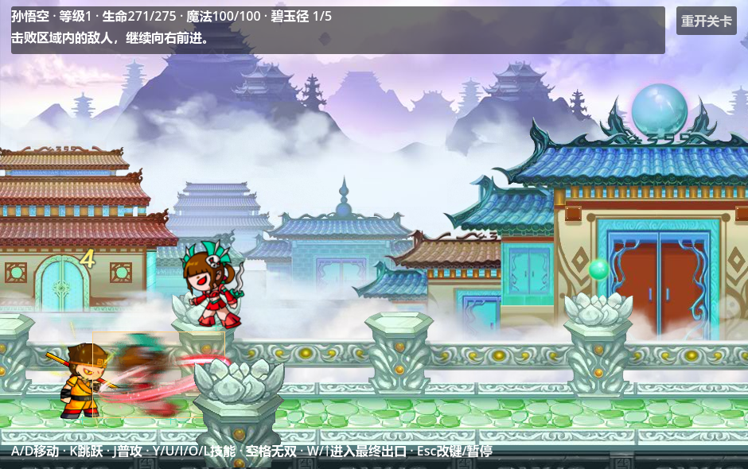

# 连续地图与原版碧玉径视觉

F5运行 [碧玉径](../../../game/levels/biyujing.tscn)。整关只有一张 [map.tscn](../../../data/levels/biyujing/progression/map.tscn)，世界范围为`Rect2(0, 0, 10944, 1216)`，地面顶为1056；五个区域沿同一世界坐标连续相接。区域切换解锁刷怪、门和镜头边界，人物、地形与背景留在原场景中。镜头通过 [Phantom Camera原版跟随适配](../camera/README.md)连续过渡，不直接跳到角色或新区左缘。

地图继承 [基础地图模板](battle_map_template_2d.tscn)，美术继承 [视觉模板](battle_map_visual_template_2d.tscn)。美术、碰撞、出生点、门和动画播放器都预置在场景里，启动只绑定节点；刷怪继续实例化已经制作好的完整怪物场景。



## 编辑现有地图

打开 [map.tscn](../../../data/levels/biyujing/progression/map.tscn)可以在2D编辑器看到整张关卡。编辑原美术请打开独立的 [visual.tscn](../../../data/levels/biyujing/progression/visual.tscn)。不需要运行游戏才能摆放背景和地板。

| 节点 / 资源 | 用途及编辑方法 |
| --- | --- |
| 地图根 `Actors` | `World Bounds`保存整张图的范围，`Ground Y`记录地面高度。实际碰撞由Terrain决定；改变边界后同步修改区域资源及外墙 |
| `Visuals/BiyujingVisual` | 完整美术实例，打开visual.tscn修改贴图、Sprite位置、缩放和层次 |
| `Terrain` | StaticBody2D与CollisionShape2D；平地、外墙、单向平台沿整张图摆放。美术地板本身不产生碰撞 |
| `SpawnPoints` | 带出生点脚本的Marker2D；ID与出生计划对应 |
| `Gates` | 各区域的门与碰撞；ID与区域对应，完成条件通过后解锁 |
| `PlayerBirth` | 玩家出生位置标记，当前为`(256, 984)`，与预置悟空相同。它用于编辑定位；移动预置角色时同步移动标记 |
| `Landmarks` | 留给机关、出口、剧情等编辑标记；具体完成条件提交给关卡实例 |
| [definition.tres](../../../data/levels/biyujing/progression/definition.tres)及`regions/*.tres` | 所有区域在同一地图坐标系中定义Bounds、Entry Rect、Exit Rect，不分别制作五个地图场景 |

显示分辨率940×590；现有素材/碰撞坐标统一换算为原版的2倍，主镜头Zoom为0.5。PNG保留原始大小，Sprite缩放2倍，不能再次把PNG本身放大2倍。编辑器可用“可见碰撞形状”检查美术地面与实际碰撞。

## 原版层次与运动

SWF导出了六种共享贴图；原TMX十一条图层记录对应十六个预置Sprite。来源、注册点、尺寸、逐帧变换及源文件SHA-256见 [视觉来源](../../../assets/maps/biyujing/original_source.json)。

| 原版素材 | 视觉模板节点 | Z Index | 实现 |
| --- | --- | --- | --- |
| 远景 | `FarBackground` | -40 | 原speedX=0.96，Godot Scroll Scale X=0.04 |
| 中景02 | `MiddleBackground` | -30 | 原speedX=0.9，Scroll Scale X=0.1 |
| 中景01 | `FixedMiddle/CloudMotion` | -20 | 原isFixedX，Scroll Scale X=0；三个镜像云Sprite按201个源帧运动 |
| 前景01、前景02 | `GroundArtwork` | -10 | 原“前景”属于角色后面的地板层：前景01重复四次，接前景02 |
| 近景 | `ForegroundOccluders` | 20 | 六处柱子在角色前面，玩家遮挡时透明度降为0.5 |

原版绘制顺序为layer1 → layer2 → layer3 → 角色 → layer4。地板重复段每段997源像素；末段从3987源像素开始，保留原本1源像素搭接。沿全部区域铺设美术，不在切区时替换贴图或重新创建背景。

原TMX计算视差的起点是镜头实际可见左上角。`BattleMapVisual2D`从canvas变换读取该位置，交给预置Parallax2D的Screen Offset，并启用Ignore Camera Scroll，避免镜头Zoom=0.5和限界时出现起点偏移。Scroll Offset仍可以手动编辑；重复背景可使用原生Repeat Size / Repeat Times。参见 [Godot Parallax2D](https://docs.godotengine.org/en/stable/classes/class_parallax2d.html)。首关远、中景遵守原配置，没有添加自动平铺。

云层使用原MovieClip的三个子对象位置、镜像和201帧变换，30源帧/秒，一个循环6.7秒。预置AnimationPlayer可以在编辑器选择`clouds`拖动时间轴预览；运行时由BattleSession经BattleMap2D传入战斗delta手动推进。暂停、慢动作和受击停顿与现有BattleClock一致，渲染刷新只更新视差和遮挡，不重复推进动画。

近景复用`BattleMapOccluder2D`：按原玩家脚底上方80×80源像素的矩形判定，换算为世界矩形`Rect2(-80, -160, 160, 160)`。玩家/友方进入柱子图像范围后立即变为0.5，离开恢复1；敌方不触发。Inspector可以修改Barrier Alpha、Barrier Out Alpha、Actor Probe Rect和Trigger Factions。它仅改变视觉透明度，不参与碰撞。

六种静态Texture资源共享；云动画只改变三个Sprite的位置，不导出201张大图。动画进度和柱子透明度属于实例，地图离场会断开渲染订阅。

## 制作下一张连续地图

1. 在Godot选择“新建继承场景”，基场景选`battle_map_template_2d.tscn`，保存到新关卡目录。修改World Bounds、Ground Y，在Terrain预置全图碰撞。
2. 再从`battle_map_visual_template_2d.tscn`创建继承场景，向各层添加Sprite2D、地板拼接及近景，保存后实例化到地图的Visuals。需要原版遮挡的近景Sprite挂`battle_map_occluder_2d.gd`。
3. 在地图预置玩家场景、出生点、门和机关标记。角色身份、技能与属性仍在角色定义中配置；地图模板不包含固定悟空组件。
4. 使用同一个关卡定义登记所有区域、波次和出生计划，Bounds在全图坐标中连续相接；Spawn Point ID及Region ID对应预置节点。
5. 在演示/关卡宿主中把整张地图实例化到BattleSession下，预置LevelInstance、Camera与BattlePresentation，沿用`register_scene_level(关卡ID,地图根)`接入。默认Session Path适用于`BattleSession/地图/Visuals/视觉`；更换层级时调整此路径。
6. 新增循环动画时预置AnimationPlayer，并将其路径加入视觉根的Animated Player Paths。运行时统一使用战斗时钟；无需添加独立_process。

出生依赖、额外完成条件、死亡统计和出口资格仍使用 [关卡系统](README.md)。不要用当前活怪数量代替区域完成，也不要把各区域改成切换PackedScene。

## 重导入与验收

完整重建顺序及覆盖范围见 [关卡配置](../../../data/levels/biyujing/progression/README.md)。只重新导出地图视觉可以运行：

```powershell
python tools/import_biyujing_map_visual.py --original-root 'D:/UserData/Downloads/game/Speculum-4399-master'
& './tools/verify_stage_eight.ps1' -Godot '<带Spine模块的Godot.exe>' -Suites map_visual
```

视觉导入需要Python、Java及原仓库FFDec库，覆盖六种贴图、visual.tscn和来源记录；对map.tscn只接入模板/视觉、同步原出生标记、去掉旧地形纯色显示，对演示场景去掉旧背景。它不重建战斗、刷怪、角色或Boss技能。日常手工编辑不用重新导入。

[verify_map_visual.gd](../../../tests/suites/verify_map_visual.gd)检查预置节点、全部区域连续性、原始素材/云帧、地板拼接、层序、三种Zoom及镜头限界、原生重复偏移、遮挡、暂停/慢动作/停顿、实例隔离和离场清理。现有完整关卡与Boss验收继续验证刷怪及通关。

2026-10-09使用带Spine模块的Godot 4.7.2验证：地图83项检查通过，默认27套回归全部通过，实际D3D12画面确认首区与Boss区美术正确显示。文档预览使用初始悟空属性；完整关卡战斗验收仍以初始等级1、生命275、攻击26的五连击打通34个目标，剩余生命92。
