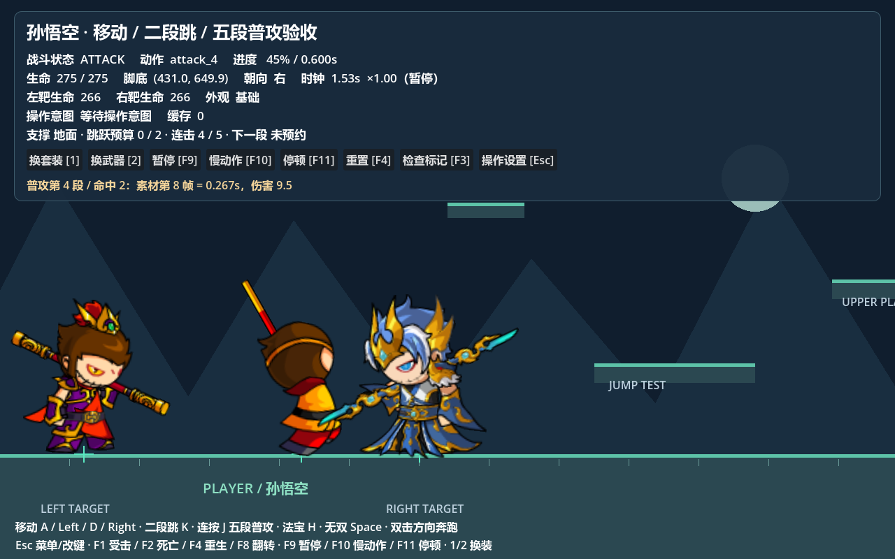
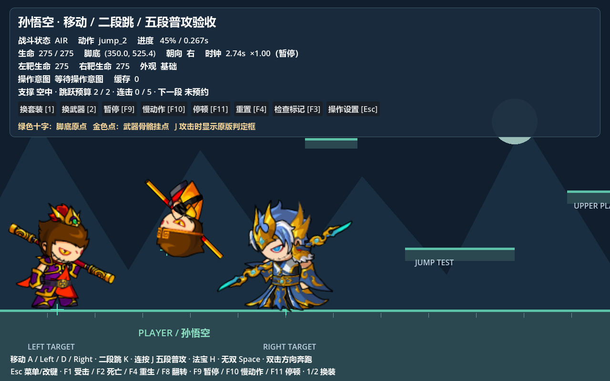

# 阶段四：运动、动作状态与孙悟空五段普攻

运行 [横版验收场景](../../../examples/wukong_platform_demo.tscn)，使用项目现有带 Spine 模块的 Godot 按 F6。A/D 或方向键行走，Shift 或同方向双击奔跑，K 地面跳 / 空中二段跳，J 连按预约五段普攻。Esc 菜单与改键，F1 普通受击，F2 死亡，F4 重生。地面、高台、黄色单向平台、墙和低天花板用于测试。面板显示动作状态、支撑、跳跃预算、连击段号与预约情况。

复用现有 Battle Foundation、Core 操作/事件与 GAS 属性/Vital/技能系统。本阶段扩展 Battle Foundation，不另建重复的输入、技能或时钟插件。





## 系统联合与资源边界


| 脚本 | 责任与运行状态 |
| --- | --- |
| [BattleMotionController2D](../runtime/battle_motion_controller_2d.gd) | 每实体独立的速度、地面/墙/顶接触、跳跃预算、落地与起跳序号；使用 CharacterBody2D 做扫掠碰撞 |
| [BattleActionState2D](../runtime/battle_action_state_2d.gd) | 当前战斗状态、状态时间、当前技能权限覆盖；死亡终态 |
| [BattleActionProfile2D](../definitions/battle_action_profile_2d.gd) | 共享只读重力、跳跃、锁定时间、状态条件表、判定框与连击定义 |
| [BattleComboDefinition](../definitions/battle_combo_definition.gd) / [BattleAttackStep2D](../definitions/battle_attack_step_2d.gd) | 共享只读五段 ID、动作名、时长、跳取消、霸体、打断强度与技能位移窗口 |
| [BattleComboState](../runtime/battle_combo_state.gd) | 每实体独立段号、下一段预约、施放序号和每次命中的目标去重集合 |
| [BattleEntity2D](../runtime/battle_entity_2d.gd) | 将输入、运动、状态、GAS、动画与命中查询联合起来；不写共享配置 |

Core 将按键转换为语义意图，BattlePlayerOperations 调用 `request_attack()` / `try_jump()`；运动控制器读取 GAS 的 `walkSpeed` / `runSpeed`，生命读取 HealthVital。GAS 技能实例和帧时间线拥有独立计时，状态组件仍接收统一战斗时间。霸体可来自实体开关、技能规则或 GAS 标签 `state.super_armor`。动画层只接收 `idle`、`run`、`jump_2`、`attack_5` 等动作名称；完成通知不会自行切换死亡、落地或攻击许可。

## 运动与时间规则

BattleSession 在固定物理更新中先识别未缩放输入，再计算战斗 delta。运动、状态时间、GAS、动画统一消费 combat delta；暂停和受击停顿不推进，慢动作同步缩放。运动控制器使用 `move_and_collide()` 与法线滑移；大 delta 切成不超过 1/60 秒的子步，避免重力积分跨度过大。与直接位移相比，整段行走、跳跃和第四段技能位移都会经过碰撞扫掠。[Godot 物理文档](https://docs.godotengine.org/en/stable/tutorials/physics/physics_introduction.html)

本控制器自己维护 `motion.grounded`，不读取由 `move_and_slide()` 更新的 `is_on_floor()`。地面法线夹角上限默认 45°；墙体不能恢复跳跃，顶头清除向上速度。已有支撑、未上升时才允许最多 3 像素的地面吸附，跨过边缘立即进入空中。StaticBody2D 单向平台由 CollisionShape2D 的 `one_way_collision` 配置。

默认重力 1500 px/s²、跳跃速度 -620 px/s、最大落速 900 px/s；二段跳重置向上速度。地面起跳消耗第一跳；起跳态短暂拒绝再次起跳，避免同 tick 重复消费。空中最多补一跳；走下边缘也消耗地面额度。仅实际着地重置预算，并经过 LAND 状态，再回待机/行走/奔跑。原版两次跳跃额度已保留，像素运动参数为本测试地图校准值，没有将原版 `jump=-178` 直接当作 Godot 速度。

## 明确的条件与优先关系

状态表在 `BattleActionProfile2D.state_rules` 中配置；激活技能可以通过 `active_rules` 覆盖。AIR 的内部枚举沿用 `JUMP`，以兼容先前调用。

| 状态 | 移动 | 跳跃 | 转向 | 默认打断门槛 | 退出条件 |
| --- | --- | --- | --- | --- | --- |
| IDLE / MOVE / RUN | 是 | 是 | 是 | 0 | 方向/奔跑意图、离地、攻击、受击或死亡 |
| TAKEOFF | 是 | 否 | 是 | 10 | 起跳 2 素材帧后进入 AIR，或实际着地 |
| AIR | 是 | 有剩余额度 | 是 | 10 | 着地、受击或死亡 |
| LAND | 是 | 是 | 是 | 10 | 1 素材帧后进入地面运动状态；可直接跳/攻击 |
| ATTACK | 默认否 | 默认否；本普攻允许 | 默认否 | 30；可由每段覆盖 | GAS 当前段结束、允许的跳取消、离地、受击或死亡 |
| HURT | 否 | 否 | 否 | 60 | 8 素材帧硬直结束后按支撑决定下一状态 |
| DEAD | 否 | 否 | 否 | 最高优先，终态 | 只能销毁并生成新实体 |

打断判定依次检查死亡、霸体、攻击种类与优先级。普通攻击 `normal` 被霸体挡住硬直，但仍扣生命；`heavy` / `launch` 需要属于允许集合，且强度不低于当前状态/技能的门槛。技能可设置 `interrupt_kinds`、`interrupt_priority`、`super_armor`。死亡由 Vital 耗尽触发，越过霸体和技能门槛，取消全部 GAS 技能及预约；死亡落地仍受重力与碰撞约束，动画结束不能复活。

## 孙悟空原版五段普攻


来源为 Speculum 的 `Skill.json`、角色 DragonBones 30 FPS 动作时长和 `CharEntity.toAttack/toNextAttack`。完整路径、原始编号、SHA-256、命中帧、偏移与迁移边界记录于 [combo_source_mapping.json](../../../data/battle2d/combo_source_mapping.json)。运行时角色 ID 为 `孙悟空`，技能 ID 为 `sunwukong_attack1` 至 `sunwukong_attack5`。

| 段 | 语义动作 | 原素材总帧数 / 秒 | 命中帧 | 单次伤害倍率 |
| --- | --- | --- | --- | --- |
| 1 | attack_1 | 10 / 0.333 | 4 | 1.0 |
| 2 | attack_2 | 10 / 0.333 | 4 | 1.0 |
| 3 | attack_3 | 12 / 0.400 | 2 | 1.2 |
| 4 | attack_4 | 18 / 0.600 | 0、8 | 每次 0.45 |
| 5 | attack_5 | 20 / 0.667 | 6 | 2.0 |

首次按下发动第一段；当前段期间再次按下，只预约下一段，重复按下不会预约多段或跳过当前动画。GAS 当前段结束才推进一次；没有预约立即回运动状态，第五段结束不自动循环。长按不自动连击。已受理的预约保留至当前段结束，未受理的输入仍遵守 Core 的 0.2 秒缓存；菜单、失焦、暂停与死亡会撤销预约。受击和允许的跳取消会同时取消当前 GAS 技能、未来命中和后续预约。

第四段前 16 素材帧按朝向施加 300 px/s 的技能位移（原单位 150 × 场景缩放 2），整段位移仍被墙挡住；玩家移动/转向输入不能覆盖它。第 8 帧的第二击保留原配置 `scaleX=-1`、偏移 `(-17,-4)`：先在角色局部计算反向区域及偏移，再整体按朝向镜像。其他段固定角色位置。帧 0 在激活后首个战斗 tick 发出，所有事件仍以 30 FPS 计时；例如第 8 帧为 0.267 秒，在 60 Hz 中对应约第 16 次物理更新。

每次命中通过 Core `battle.attack.impact` 发出，宿主按阵营查询区域，按“当前施放 + hit_index + 目标 ID”去重，然后经 GAS DamageCalculator 与 HealthVital 扣血。第四段两次命中是不同 hit_index，可各伤害一次。`battle.combo.started` / `finished`、`battle.motion.jump` / `landed` 用于观察，均带场次/实体信息。普通攻击仍使用现有简单伤害公式 `max(1, atk-phyDef) × 倍率`；原版暴击、保护值、击退、持续 sensor 生命周期和额外特效尚未移植。

原素材没有独立落地动画，LAND 映射 `idle`；第二跳映射原生 `jumpTwo`。五段原生 Spine 动作、附件层序和装备挂点继续由独立动画适配层维护，换装不修改战斗段时长或角色位置。

## 扩展与验收

```gdscript
# 输入接入层调用，攻击中会预约一段。
actor.request_attack()
actor.try_jump()
# 技能可以拥有自己的动作许可/门槛；业务只使用语义技能 ID。
actor.try_activate_skill(&"my_skill", {"action_rules": {
    "animation": &"my_action", "move": false, "jump": false,
    "turn": false, "interrupt_priority": 80, "super_armor": true
}})
# 默认普通伤害强度 60；重攻击显式携带类型及强度。
actor.receive_damage(10, attacker, &"heavy", 90)
```

添加角色时建立其独立动作规则与连击 Resource，指定各段 GAS ID/动作名；实例状态由宿主新建。修改 `state_rules` / 每段规则即可调整移动、转向与跳取消，无需将按键写入角色代码。

[verify_stage_four.tscn](../../../examples/verify_stage_four.tscn) 已通过 132 项真实 Godot PhysicsServer、GAS 和 Spine 检查：稳定支撑、行走/奔跑、二段跳预算、平台边缘、单向平台、顶头、大 delta 不穿墙、五段六事件、第四段位移/镜像及前后实际命中、优先级/霸体、跳取消、暂停/慢动作/死亡，以及五次短按、长按和菜单清预约。通过打印 PASS，失败退出码为 1。原有 [输入](../../../examples/verify_player_operations.tscn)、[动画](../../../examples/verify_wukong_animation.tscn)、[阶段一](../../../examples/verify_stage_one.tscn)、[属性](../../../examples/verify_base_attributes.tscn) 和 [Core 事件](../../../examples/verify_core_events.tscn) 验收继续运行。

```powershell
# 在 Godot 项目根目录重建资源；仅生成时需要原版项目，游戏运行无需它。
node tools/import_wukong_combo.mjs D:/UserData/Downloads/game/Speculum-4399-master
node tools/generate_battle_docs.mjs
```
