# Gameplay Ability System：完整实现分析

当前插件使用 **技能配置 → 技能实例 → 行为树 → 效果** 的执行结构。技能决定执行顺序，效果执行具体操作，状态负责持续时间与重复触发，Cue 负责表现。下面的分析以当前 `.gd` 实现为准；源码中部分注释描述的是设计意图，实际差异在文末列出。

本文覆盖插件的全部模块。每节说明配置、运行状态、入口、更新及清理路径；类图列关键成员，完整字段和公开方法见 [全部源码索引](docs/source-index.md)。图内的 `AttributeComponent`、`AbilityDefinition`、`AbilityFeature`、`MovementStrategy` 等短名分别指带 `Gameplay` 或 `Projectile` 前缀的对应基类。图中的组合和聚合表示代码中的持有方式，不代表 Godot 会自动销毁所有引用。

| 模块 | 独立 SVG | 本文说明 |
| --- | --- | --- |
| 技能组件、实例与激活 | [核心类图](docs/ability-core.svg) | [核心类图](#核心类图)、[一次技能怎样执行](#一次技能怎样执行) |
| 技能定义及五种模板 | [定义类图](docs/ability-definitions.svg) | [技能定义与模板](#技能定义与模板) |
| 全部技能 Feature、冷却与消耗 | [Feature 类图](docs/ability-features.svg) | [Feature 与消耗系统](#feature-与消耗系统) |
| 行为树及所有基础节点 | [行为树类图](docs/behavior-tree.svg) | [行为树系统](#行为树系统) |
| 全部技能动作节点 | [动作类图](docs/ability-actions.svg) | [技能动作节点](#技能动作节点) |
| 属性、修改器、等级成长 | [属性类图](docs/attribute-system.svg) | [属性系统](#属性系统) |
| Vital、生命、法力与伤害策略 | [Vital 类图](docs/vital-system.svg) | [Vital 与伤害系统](#vital-与伤害系统) |
| 状态、Feature、持续时间、四种堆叠 | [状态类图](docs/status-system.svg) | [状态系统的独立实现](#状态系统的独立实现) |
| 全部九种 Effect 与上下文修改器 | [Effect 类图](docs/effect-system.svg) | [效果与状态类图](#效果与状态类图)、[效果运行流程](#效果运行流程) |
| 目标选择、预览、物理命中 | [目标类图](docs/targeting-system.svg) | [目标选择与预览系统](#目标选择与预览系统) |
| 投射物、移动与命中策略 | [投射物类图](docs/projectile-system.svg) | [投射物系统](#投射物系统) |
| 魔法场、区域选择、计时器 | [魔法场类图](docs/magic-field-system.svg) | [魔法场系统](#魔法场系统) |
| 标签、过滤器、Core 事件及四个自动加载 | [服务类图](docs/services-system.svg) | [标签过滤器与事件服务](#标签过滤器与事件服务) |
| Cue 与全部视觉组件 | [Cue 类图](docs/cue-system.svg) | [Cue 表现系统](#cue-表现系统) |
| UI、调试、Shader 与素材 | [UI 类图](docs/ui-system.svg) | [UI 调试与配套资源](#ui-调试与配套资源) |
| 各系统共同运行 | [联合结构](docs/systems-integration.svg)、[联合流程](docs/systems-runtime.svg) | [系统如何联合运行](#系统如何联合运行) |

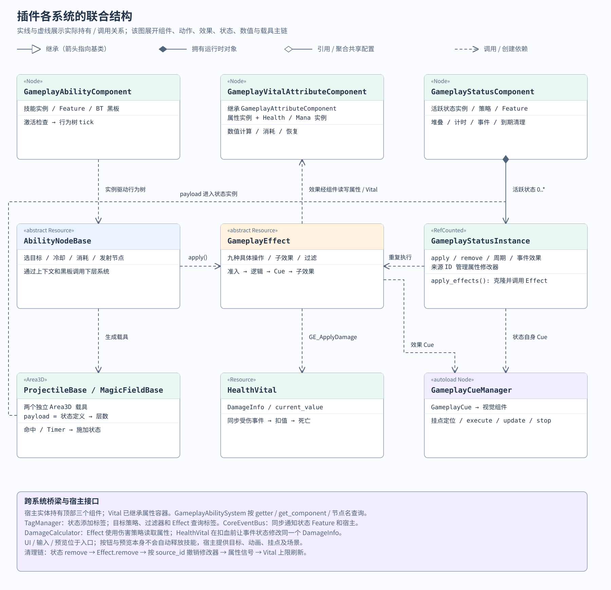

## 核心类图

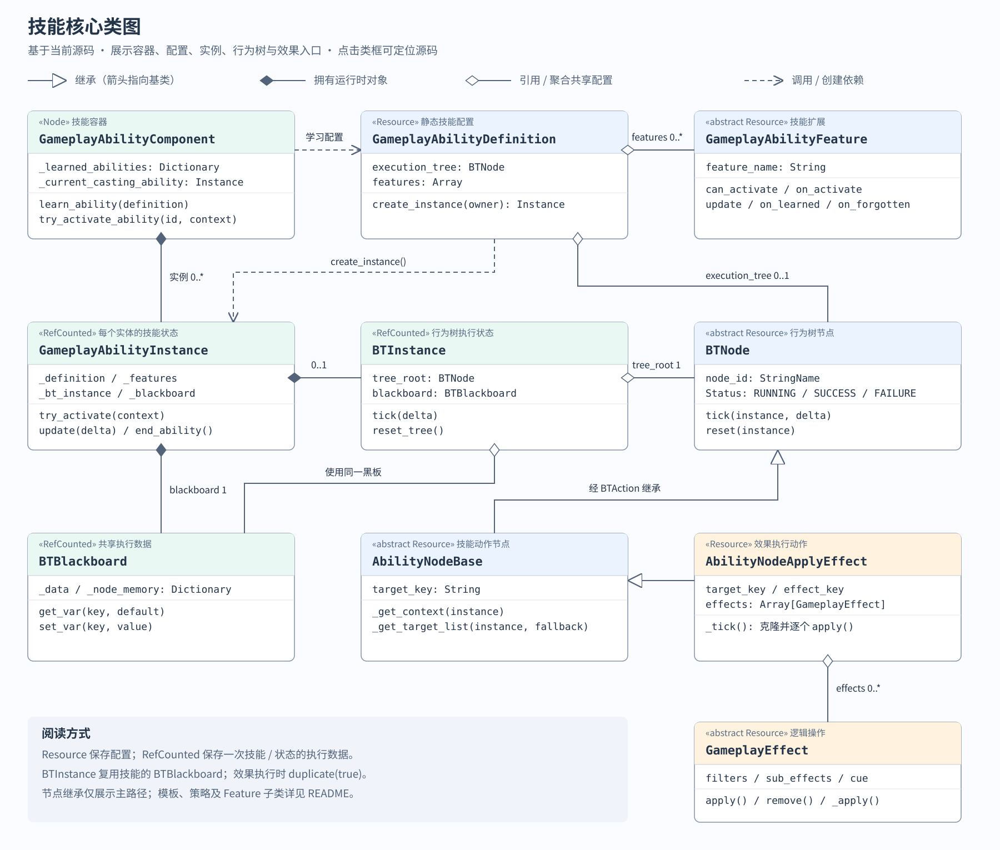

[打开原尺寸 SVG](docs/ability-core.svg)。实心菱形表示拥有运行时对象，空心菱形表示引用或聚合，空心三角指向基类，虚线表示调用或创建依赖。为了便于阅读，图中只展开核心路径，`Instance` 是 `GameplayAbilityInstance` 的简写。

| 层次 | 核心类型 | 实际职责与关系 |
| --- | --- | --- |
| 实体组件 | [GameplayAbilityComponent](scripts/components/gameplay_ability_component.gd) | 保存已学习技能；调用定义的工厂创建实例；逐帧更新实例并处理激活、预览、完成。组件自身不保存技能配置中的冷却计时。 |
| 静态定义 | [GameplayAbilityDefinition](scripts/abilities/gameplay_ability_definition.gd) | `Resource`，保存技能 ID、图标、Feature、预览策略、执行树及黑板默认值；`create_instance(owner)` 构造实例并注入配置。 |
| 运行实例 | [GameplayAbilityInstance](scripts/abilities/gameplay_ability_instance.gd) | `RefCounted`，保存所属实体、Feature 引用、激活状态、行为树实例与黑板。 |
| 技能扩展 | [GameplayAbilityFeature](scripts/abilities/features/gameplay_ability_feature.gd) | 提供激活条件、激活、更新、完成、学习、遗忘钩子；冷却、消耗、输入、切换、被动状态等通过子类组合。 |
| 行为资源 | [BTNode](scripts/behavior_tree/bt_node.gd) | 树的静态节点，返回 `RUNNING`、`SUCCESS` 或 `FAILURE`；组合、装饰和动作节点描述执行顺序。 |
| 行为执行 | [BTInstance](scripts/behavior_tree/bt_instance.gd) / [BTBlackboard](scripts/behavior_tree/bt_blackboard.gd) | 实例保存节点状态、活动路径与执行历史；黑板保存业务变量和节点内部存储。技能实例和树实例使用同一个黑板。 |
| 技能动作 | [AbilityNodeBase](scripts/abilities/ability_nodes/ability_node_base.gd) | 经 `BTAction` 继承 `BTNode`，提供读取施法上下文和目标的公共接口。 |
| 具体效果 | [GameplayEffect](scripts/effects/gameplay_effect.gd) | `Resource`，统一组织准入检查、子类逻辑、Cue 和递归子效果。效果本身没有逐帧计时器。 |

`Resource` 通常用于共享模板；实例、黑板和 Feature 的实例存储保存运行状态。这个边界并非自动保证：部分效果会修改自身字段，所以执行入口通过 `duplicate(true)` 克隆效果，不能把共享资源直接当作可重复使用的执行实例。

### 模板、Feature 与其他模块

| 模块 | 当前实现 |
| --- | --- |
| 技能模板 | `ActiveAbilityDefinition` 自动生成常见执行树；`ComboAbilityDefinition`、`ProjectileAbilityDefinition`、`ToggleAbilityDefinition`、`SacrificeAbilityDefinition` 提供连击、投射物、切换和献祭模板。 |
| 技能 Feature | `CooldownFeature`、`CostFeature`、`AbilityInputFeature`、`ToggleFeature`、`PassiveStatusFeature`、`DynamicIconFeature`、`EffectModifierFeature`、`ProjectilePayloadModifierFeature`。 |
| 行为树 | `BTSequence`、`BTSelector`、`BTSwitch`；反转、重复、观察者等装饰器；等待、信号、变量和技能专用动作。 |
| 选目标 | `TargetingStrategy` 及自身、区域、地面、方向、光标、碰撞检测策略；`AbilityPreviewStrategy` 管理预览表现。 |
| 属性 | `GameplayAttributeSet` → `GameplayAttributeInstance`；`GameplayAttributeComponent` 管理属性，`GameplayVitalAttributeComponent` 扩展生命/法力资源。 |
| 载具 | `ProjectileData` / `ProjectileBase` 与 `MagicFieldData` / `MagicFieldBase`；携带的 payload 是 `GameplayStatusData → 层数` 字典，命中或区域触发时施加状态，再由状态执行效果。 |
| 表现与 UI | `GameplayCue` 组合 `CueParticle`、`CueAttachedParticle`、`CueTrail`；技能按钮/技能栏、状态图标和技能树/状态/标签调试面板。 |

插件启用时注册四个自动加载服务：`GameplayAbilitySystem` 查询实体组件，`DamageCalculator` 调度伤害策略，`TagManager` 管理标签、继承、互斥和引用计数，`GameplayCueManager` 执行及更新 Cue。总线事件直接依赖 [CoreSystem 的 event_bus](../godot_core_system-0.0.4/source/event_system/event_bus.gd)，需启用 Core 插件及该模块；项目先初始化 CoreSystem。近战调试绘制动态查找可选的 `DebugDraw`。

## 一次技能怎样执行

1. `GameplayAbilityComponent.learn_ability(definition)` 调用 `definition.create_instance(entity)`，保存实例并调用 Feature 的 `on_learned()`；被动状态可在学习时施加。
2. `try_activate_ability(id, context)` 注入 `ability`、`ability_component`、`ability_id`、`instigator`，再调用实例的 `try_activate()`。
3. 实例先询问各 Feature 的 `can_activate()`；未激活分支清理黑板，写入 `context`、`ability_instance` 和 `target = context.input_target`，执行 `on_activate()`，最后设置 `is_active = true`。这里尚未支付消耗或应用效果。
4. 组件每帧调用实例的 `update(delta)`。实例更新 Feature，再 tick 行为树；冷却提交、消耗提交、选目标和应用效果都由树节点实际执行。
5. 树返回 `SUCCESS` 或 `FAILURE` 时，实例调用 `end_ability()`，通知 Feature、发出完成信号并重置树进度。`RUNNING` 则继续下一帧。

`ActiveAbilityDefinition` 默认树的顺序为：播放动画（可选）→ 前摇 → 提交冷却 → 支付消耗 → 查询目标 → 应用效果 → 后摇。零时长、空配置步骤会省略；显式配置 `execution_tree` 时优先使用该树。

`AbilityNodeTargetSearch` 把查询结果写到黑板 `targets`；`AbilityNodeApplyEffect.target_key` 默认也读 `targets`。直接输入目标只写入 `target`，因此自定义树应设置 `target_key = "target"`，或配置查询节点。示例中的治疗技能采用前者。

## 效果与状态类图

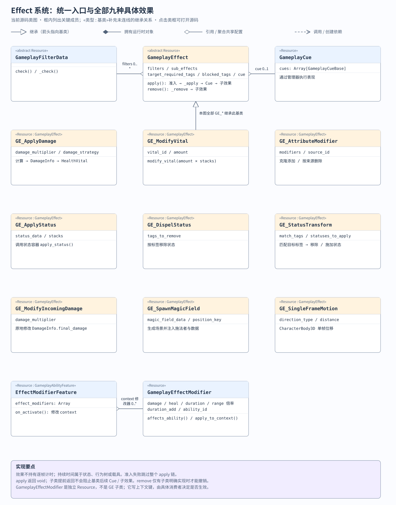

独立类图列出当前全部九个 `GameplayEffect` 子类，以及不属于该继承树的 `GameplayEffectModifier`。下面的联合类图进一步展开典型效果与属性、生命、状态的关系。

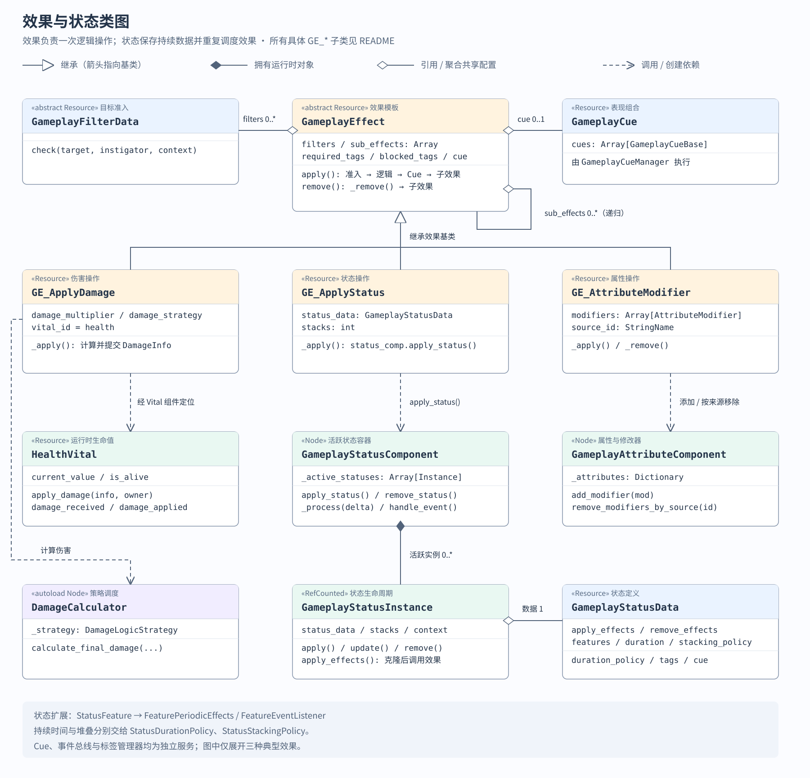

[打开原尺寸 SVG](docs/effect-status.svg)。图中展开伤害、施加状态和属性修改三条典型分支。`HealthVital` 也是 `Resource`，由 Vital 组件从模板复制为运行实例；`DamageCalculator` 是自动加载节点名，没有同名 `class_name`。

| 具体效果 | 运行行为 | 关键输入 |
| --- | --- | --- |
| [GE_ApplyDamage](scripts/effects/ge_apply_damage.gd) | 默认阻止无敌标签；计算伤害、构造 `DamageInfo` 并提交给 `HealthVital`。 | `damage_multiplier`、`damage_strategy`、`stacks`。 |
| [GE_ModifyVital](scripts/effects/ge_modify_vital.gd) | 调用 Vital 组件增减指定资源；正数为治疗，负数直接扣值。 | `vital_id`、`amount`，上下文 `stacks`。 |
| [GE_ApplyStatus](scripts/effects/ge_apply_status.gd) | 查找状态组件并调用 `apply_status()`。 | `status_data`、`status_stacks`。 |
| [GE_AttributeModifier](scripts/effects/ge_attribute_modifier.gd) | 复制修改器并添加到属性组件；移除时按来源 ID 批量清理。 | `modifiers`、`source_id`、`stacks`。 |
| [GE_ModifyIncomingDamage](scripts/effects/ge_modify_incoming_damage.gd) | 在事件中修改同一个 `DamageInfo.final_damage`。 | `damage_info`，倍率为 `damage_multiplier ^ stacks`（多层时）。 |
| [GE_DispelStatus](scripts/effects/ge_dispel_status.gd) | 移除包含任意指定标签的状态。 | `tags_to_remove`。 |
| [GE_StatusTransform](scripts/effects/ge_status_transform.gd) | 检查标签，按配置移除旧状态并施加新状态。 | `match_tags`、`require_all_tags`、`statuses_to_apply`。 |
| [GE_SpawnMagicField](scripts/effects/ge_spawn_magic_field.gd) | 实例化魔法场场景，注入数据和施法者，挂载到目标或场景。 | `magic_field_data`、上下文位置键（默认 `projectile_impact`）。 |
| [GE_SingleFrameMotion](scripts/effects/ge_single_frame_motion.gd) | 对 `CharacterBody3D` 做一次位移，按方向和距离配置计算运动。 | `direction_type`、`distance`、方向上下文。 |

`GameplayEffectModifier` **不继承** `GameplayEffect`，它修改执行上下文。`EffectModifierFeature.on_activate()` 先筛选技能 ID，再调用修改器的 `apply_to_context()`；倍率累乘、`duration_add` 累加。之后具体效果或节点必须读取这些键，才会产生实际影响。

具体效果还有以下实现细节：

- `GE_ApplyDamage.vital_id` 虽可配置，查询结果仍按 `HealthVital` 使用，不是任意 Vital 的通用扣除器；缺目标组件或有效生命对象没有统一保护。默认无敌标签在 `_init` 时加入 blocked 数组，后改 invulnerable_block_tag 不自动同步数组。上下文可覆盖 damage_strategy，效果会把该资源和合并倍率写入自身字段，所以应按执行入口克隆。
- `GE_ModifyVital` 只处理 amount×stacks 与指定 Vital；`GE_AttributeModifier` 克隆修改器，三种修改器的 value 都按 stacks 缩放。来源优先取 context.source_id，否则是 `"effect." + 导出的source_id`；空来源会得到相同的 `effect.`，不同直接效果的来源清理可能互相影响，不是自动使用资源路径或生成独立句柄。
- `GE_ApplyStatus` 可通过 context.status_data/status_stacks 覆盖资源与层数。`GE_DispelStatus` 检查各状态配置 tags 的直接交集；`GE_StatusTransform` 则先用 TagManager 判断目标标签的 ANY/ALL，按配置移除标签匹配的旧状态，再施加新映射。这两阶段分别用继承查询和直接数组匹配，父标签匹配不保证移除到所有子标签状态。
- `GE_ModifyIncomingDamage` 需要 context 中有 DamageInfo：层数>1 时用 `pow(multiplier, stacks)`，否则用普通倍率，然后原地乘 final_damage；它不直接扣 Vital，也不返回新的伤害对象。
- `GE_SpawnMagicField` 的数据、位置和生命周期见魔法场一节。`GE_SingleFrameMotion` 只操作 CharacterBody3D：FORWARD 取 facing_angle 或 body basis.z，INPUT 读 move_* action 并按摄像机转换，MOUSE 读 mouse_direction，CUSTOM 读 direction；INPUT 模式才额外阻止 rooted/stunned。一次移动距离为 distance，不乘 delta，空中可额外下移 0.5，再做 move_and_collide 及碰撞余量滑动。方向缓存只属于当前效果副本，周期入口每次克隆不会保持跨周期锁向。

## 效果运行流程

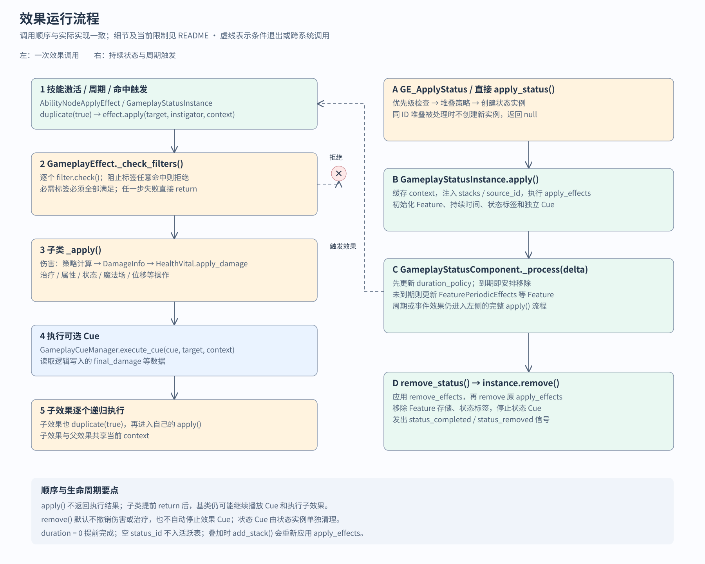

### 统一入口：apply 与 remove

`GameplayEffect.apply(target, instigator, context)` 严格依次执行：

1. 所有 `filters.check()` 必须通过。
2. 目标不能含任何 `target_blocked_tags`，并且必须含全部 `target_required_tags`。
3. 调用子类 `_apply()` 执行逻辑。
4. 若配置了 `cue`，调用 `GameplayCueManager.execute_cue()`。
5. 依次深复制 `sub_effects` 并调用其 `apply()`；每个子效果也重新执行完整准入流程。

准入失败会跳过后续全部步骤。父效果、兄弟效果和子效果接收的是同一个上下文字典；例如伤害效果写入的 `final_damage` 能被紧随其后的 Cue 读取，也可能影响后续子效果。

`remove()` 只调用 `_remove()` 并递归移除子效果，不执行准入检查。多数效果的 `_remove()` 是空实现；移除伤害效果不会返还生命值，移除治疗效果不会扣回治疗量。属性修改效果通过同一个 `source_id` 识别需要清理的修改器。

行为树的效果动作、状态执行器和递归子效果都会深复制效果模板。直接调用一个 `.tres` 效果时，也应先 `duplicate(true)`，并为独立结算准备独立上下文。

### 伤害与治疗怎样结算

当前默认 `SimpleDamageLogic` 的实际公式为：

```text
候选伤害 = max(1, 施法者.atk - 目标.phyDef)
         × 本效果 damage_multiplier × 输入 context.damage_multiplier
         × context.damage_multiplier_modifier × context.stacks
```

上下文缺省倍率/层数为 1。`DamageCalculator` 在乘层数前对策略结果取 `max(0, result)`；暴击字段当前未参与默认公式。

`GE_ApplyDamage` 用该值创建 `DamageInfo`，随后 `HealthVital.apply_damage()` 同步发出 `damage_received` 信号及全局事件。事件监听状态可通过 `GE_ModifyIncomingDamage` 修改这个引用对象；`HealthVital` 随后读取修改后的 `final_damage` 扣血，发出 `damage_applied`，并在归零时处理死亡。效果把结果写回上下文 `final_damage`。这里的“最终伤害”是提交的伤害值，可能大于目标实际损失的剩余生命值。

`GE_ModifyVital` 直接调用 `modify_vital(vital_id, amount * stacks)`，不走伤害策略或 `damage_received` 减伤事件链。负数超过当前资源值时，组件拒绝整次修改；正数治疗经 `HealthVital.heal()` 限制到生命上限，且无法治疗已经死亡的目标。

### 持续状态、叠加和清理

`GameplayStatusData` 定义进入效果、移除效果、Feature、持续时间策略、堆叠策略、标签和 Cue。`GameplayStatusComponent` 按 `status_id` 保存活跃的 `GameplayStatusInstance`：高优先级替换旧状态，低优先级拒绝，同优先级交给堆叠策略。

新实例应用时缓存上下文、注入当前 `stacks` 和来源 ID（通常为 `status.<实例ID>`），复制并执行 `apply_effects`。持续状态随后初始化持续时间、处理互斥标签、添加标签，并执行专属于该状态的 Cue 副本。

每帧先检查持续时间；过期则安排移除，不再更新本帧的 Feature。未过期时，`FeaturePeriodicEffects` 以 `period` 累积计时，触发后调用 `instance.apply_effects(periodic_effects)`；`FeatureEventListener` 监听指定事件，调用同一个执行器。两者最后仍进入统一的 `GameplayEffect.apply()`。

| 堆叠策略 | 当前行为 |
| --- | --- |
| `StackingRefreshDuration`（默认） | 仅刷新持续时间，不增加层数。 |
| `StackingIntensity` | 增加层数并刷新持续时间。 |
| `StackingRefreshAndStack` | 先刷新，再增加层数。 |
| `StackingAccumulateDuration` | 累加持续时间，不增加层数。 |

`add_stack()` 在达到上限前，会先应用 `remove_effects`、移除原 `apply_effects`，增加层数，再重新应用 `apply_effects`。因此一次性伤害或治疗放在进入效果中，也可能在叠加时再次触发；当前实现与“不会重新触发应用时效果”的源码注释不同。

状态移除顺序是：应用 `remove_effects` → 对 `apply_effects` 调用 `remove()` → 清理 Feature 与存储 → 移除标签 → 停止状态 Cue → 发出完成和移除信号。

`duration = 0` 的实例在执行进入效果和 Feature 初始化后立即完成，跳过持续时间、标签和状态 Cue 初始化。空 `status_id` 不入活跃表；即使配置了正持续时间，也不会由组件持续更新，应当用于一次性效果包装。正常堆叠被策略处理时，`apply_status()` 返回 `null`，不能仅用返回值判断是否生效。

### 上下文键与数据流

| 键 | 写入者 / 使用者 |
| --- | --- |
| `instigator`、`ability_component`、`ability_id` | 技能组件注入，Feature 和动作使用。直接调用效果时，仍需传入有效的 `instigator` 参数。 |
| `input_target` | 激活时转存为黑板 `target`；查询节点把解析结果写入黑板 `targets`，这不是上下文字典内自动创建的字段。 |
| `stacks`、`source_id` | 状态执行器注入；伤害、Vital、属性修改及移除逻辑使用。 |
| `damage_multiplier`、`damage_multiplier_modifier` | `GE_ApplyDamage` 和默认伤害策略读取；前者也被伤害效果写回。 |
| `damage_info` | 生命值伤害事件传递同一个引用，事件效果可修改其 `final_damage`。 |
| `final_damage` | 伤害效果输出，供 Cue 或后续效果读取。 |
| `status_data`、`status_stacks` | 覆盖 `GE_ApplyStatus` 的配置。 |
| `hit_position`、`hit_direction`、`field_position` | 投射物与区域提供命中位置、方向和场位置。`GE_SpawnMagicField` 默认读取 `projectile_impact`；对接投射物时应改为 `position_key = "hit_position"`，或显式补入默认键。 |
| `heal_multiplier`、`duration_multiplier`、`duration_add`、`range_multiplier` | 通用修改器可写入，但是否生效取决于具体消费者；并非效果系统统一自动处理。 |

## 当前演示：一次伤害与治疗

示例对象已经配置 `GameplayVitalAttributeComponent`，初始生命 100、攻击 20、防御 5，且没有无敌标签。以下代码可放到演示节点中运行，`target` 指向该对象：

```gdscript
var damage_template := GE_ApplyDamage.new()
damage_template.damage_multiplier = 2.0
var context := {"damage_multiplier": 1.5, "stacks": 2}
var damage := damage_template.duplicate(true) as GameplayEffect
damage.apply(target, target, context)
# (20 - 5) × 2 × 1.5 × 2 = 90；生命值 100 → 10。

var heal := GE_ModifyVital.new()
heal.vital_id = &"health"
heal.amount = 25.0
heal.apply(target, target, {})
# 生命值 10 → 35；这是直接效果，没有技能冷却。
```

项目的 [plugin_showcase.gd](../../examples/plugin_showcase.gd) 把治疗配置成 `GameplayAbilityDefinition`，组合 `CooldownFeature` 与 `BTSequence(AbilityNodeCommitCooldown, AbilityNodeApplyEffect)`，用技能按钮触发；这条路径会施加 25 点治疗并进入 3 秒冷却。

当前 [burn_status.tres](examples/burn_status.tres) 只配置叠加、持续时间和标签，**没有周期伤害或粒子 Cue**。名称“燃烧演示”本身不会造成伤害；要做持续伤害，需添加 `FeaturePeriodicEffects` 并配置其 `periodic_effects`。

## 阅读源码时需要注意的实现边界

这些是当前代码的行为说明，本次文档工作没有修改运行逻辑。

- `AbilityNodeApplyEffect.use_instigator_as_fallback` 虽然是导出属性，但 `_tick()` 实际传入 `_get_target_list(instance, false)`，所以该选项目前不生效。目标列表为空时不应用任何效果，节点仍返回 `SUCCESS`。
- `GameplayEffect.apply()` 返回 `void`，没有统一的“成功 / 失败”结果。子类 `_apply()` 因缺少组件或数据提前返回时，基类仍可能继续执行 Cue 与子效果；后续步骤不是事务式回滚。
- `GE_ApplyDamage` 修改自身倍率，并把合并倍率写回共享 `context`。复用同一实例或同一字典，可能让多目标、多次周期及兄弟伤害效果意外累乘；深复制效果不等于隔离字典。
- `GE_ModifyVital` 当前不读取 `heal_multiplier`；状态持续时间初始化读取 `status_data.duration`，也没有统一应用 `duration_multiplier` / `duration_add`。修改器写入这些字段并不保证效果落地。
- `GameplayStatusComponent` 默认订阅全局事件；可开启 `filter_events_by_owner` 并由宿主实现 `accepts_status_event()`。伤害上下文现在包含 `entity=owner_entity` 和原始 DamageInfo；Battle Foundation 实体已开启宿主过滤，普通 GAS 示例默认仍保持广播行为。
- `FeaturePeriodicEffects` 每次更新最多触发一次，没有用循环补齐一帧跨过多个周期的次数。`duration = 0` 或空 ID 状态不适合需要组件驱动的持续效果。
- 效果自己的 `remove()` 不调用 `stop_cue()`；只有状态实例保存并停止自己的 Cue 副本。`GameplayCueManager` 也会把每次执行的组件加入持续更新列表，并不自动按“瞬时 / 持续”分类。
- Cue 挂点查询依赖目标的 `get_attachment_point(name)`，返回的对象必须是 `Node3D`。未实现时位置返回 `Vector3.INF`，当前没有自动退回目标坐标的逻辑。
- 创建技能实例时写入的 `blackboard_defaults` 会在首次非激活分支的 `try_activate()` 中被 `clear()` 清掉；当前不能假定默认键跨激活保留。

## 技能定义与模板

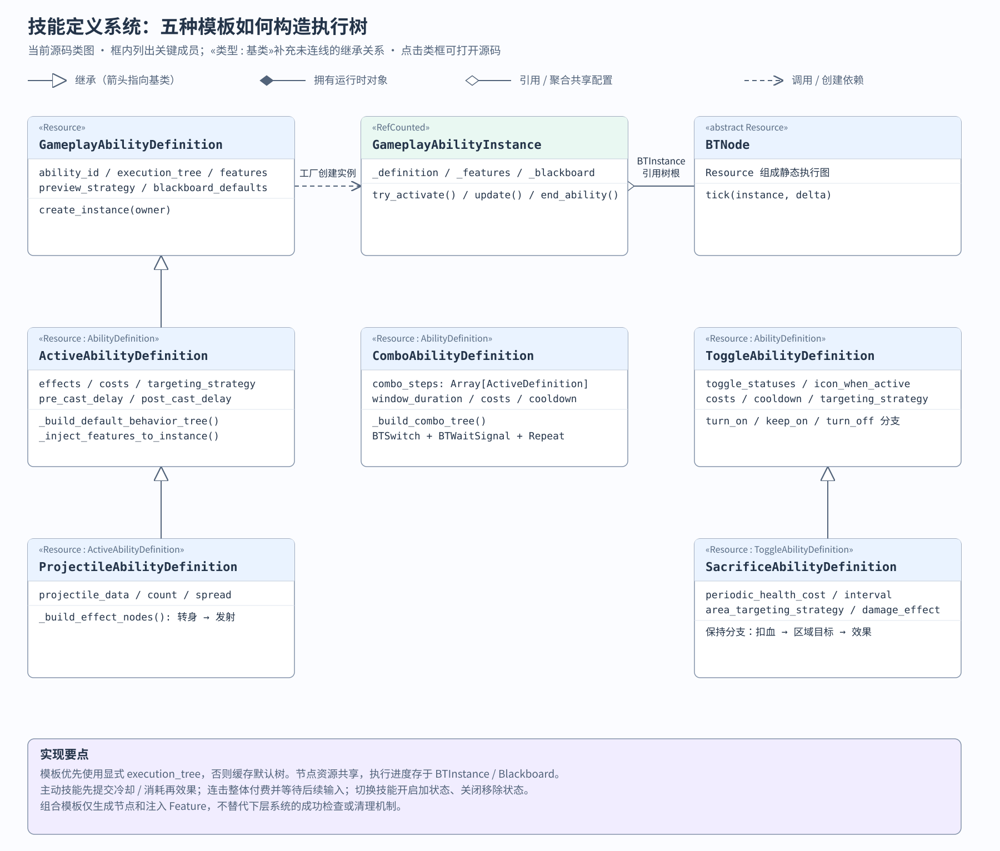

`GameplayAbilityDefinition` 是资源工厂，包含 ID、显示数据、`disabled`、技能标签、预览策略、Feature、执行树和黑板默认值。`create_instance(owner)` 创建独立实例与黑板，再写默认键、添加 Feature；配置中的 Feature 直接传引用，不统一深复制。没有执行树也能学习技能，但激活后没有树来完成，实例可以一直处于 active 状态。定义中的 `tags` 也不是自动添加到施法者的状态标签。

| 模板 | 生成逻辑与实例配置 | 当前约束 |
| --- | --- | --- |
| [ActiveAbilityDefinition](scripts/abilities/definitions/active_ability_definition.gd) | 动画 → 前摇 → 冷却 → 消耗 → 目标查询 → 效果 → 后摇；按配置注入冷却、消耗和输入 Feature。 | 可选步骤按配置省略；用户树优先。`target_key` 决定效果读取位置，自定义键还需要与查询输出一致。 |
| [ComboAbilityDefinition](scripts/abilities/definitions/combo_ability_definition.gd) | 整体消耗 → `RepeatUntilFailure(BTSwitch(combo_index))` → 整体冷却。每段执行主动子树；中间段 `BTWaitSignal` 等待输入后推进索引，末段用不存在的键使分支失败来结束循环。注入动态图标。 | 默认段树构造时省略段内冷却和消耗；手工段树只递归删除冷却节点，手工消耗节点仍可能重复支付。`combo_index` 的初始化键会被首次激活 clear，默认读取 0 才让首段继续执行。 |
| [ProjectileAbilityDefinition](scripts/abilities/definitions/projectile_ability_definition.gd) | 继承主动模板，把效果阶段替换为可选面向落点 → 发射投射物，沿用前后摇、冷却与消耗。 | 配置 `ProjectileData`、正确类型的场景、目标位置；此阶段不会自动再执行主动模板的普通 effects 数组。 |
| [ToggleAbilityDefinition](scripts/abilities/definitions/toggle_ability_definition.gd) | 选择目标后循环运行关闭、开启、保持三个选择器分支。开启付费并加状态，保持等待输入，关闭移除状态、恢复图标并提交冷却。注入 Toggle/Cost/Cooldown/Icon Feature。 | 再次输入由 `ToggleFeature` 写 `turn_off` 并重置树；直接强制结束技能不会自动执行关闭分支。 |
| [SacrificeAbilityDefinition](scripts/abilities/definitions/sacrifice_ability_definition.gd) | 继承切换模板，把保持阶段改成周期序列：选择自身 → `AbilityNodeApplyCost` 扣生命 → 区域查询 → 周期伤害 Effect。 | 必须实际配置区域策略和伤害效果；`damage_radius`、`periodic_damage_multiplier` 当前只声明或校验，没有自动生成检测器或伤害倍率。保持分支支付不足后的结束也不等价于正常关闭清理。 |

模板缓存默认树供实例共享，创建实例时临时设置定义的 `execution_tree` 再恢复。配置变更后已有缓存不自动重建；不要依赖运行时改导出字段立即改变已经生成的树。参数验证会把部分负值改成默认值，因此也不是严格只读工厂。

技能组件逐帧更新所有已学习实例，允许不同技能各自执行；`_current_casting_ability` 只记录最近一次激活，组件完成回调只对该指针发完成通知，不能把它当作所有活动技能的集合。实例的已激活分支会先发送黑板输入，即使 Feature 检查不通过也返回 `true`，这使连击能收到输入，但这个返回值不表示重新释放了效果。

取消路径调用 `end_ability(FAILURE)`，实际执行的是 `on_completed()`；基类提供的 `on_cancel()` 当前没有被该路径调用，`final_status` 也没有传给完成信号。无参数取消还会直接读取当前施法实例，调用前应确认其有效。`can_activate_ability()` 检查 `disabled`，`try_activate_ability()` 没有相同检查；实例 `disabled` 在创建时从定义复制，enable/disable 只修改该实例。BattleEntity 的技能入口先检查 can_activate_ability；直接调用 try_activate_ability 的宿主仍需自行检查禁用状态。

## Feature 与消耗系统

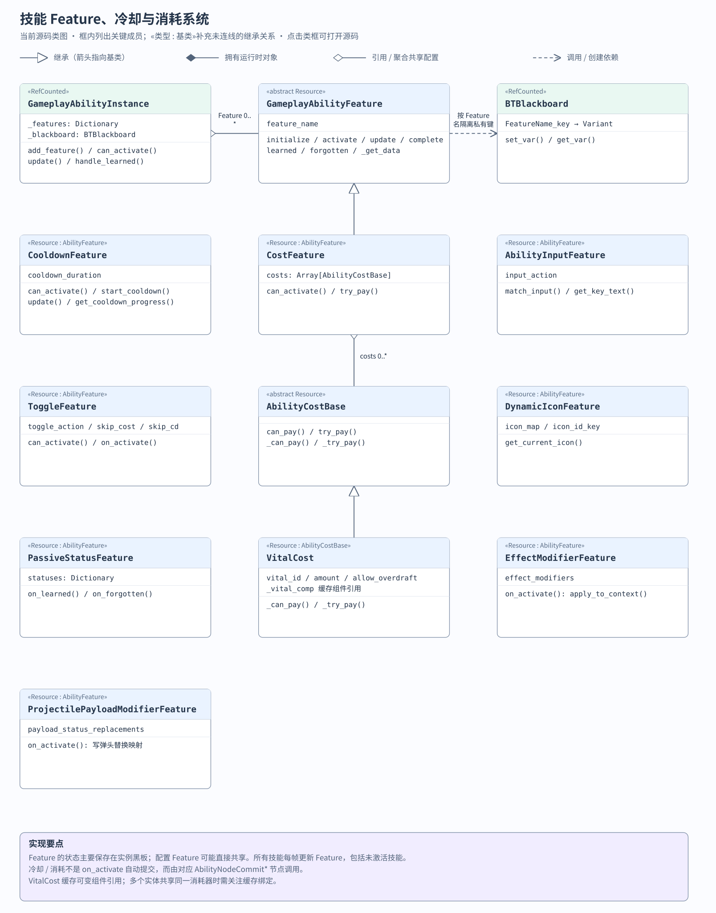

`GameplayAbilityFeature` 提供初始化、检查、激活、完成、取消、更新、学习和遗忘钩子。实例按 `feature_name` 保存 Feature，重名拒绝添加；`_get_data/_set_data` 使用 `feature_name + "_" + key` 访问实例黑板。这样共享 Feature 可以把计时保存在实例中，不过首次非激活释放会清空整个黑板，不能把这些键当作永久存储。

| Feature | 钩子与实际作用 | 数据和边界 |
| --- | --- | --- |
| [CooldownFeature](scripts/abilities/features/cooldown_feature.gd) | `can_activate` 检查剩余时间；`update` 递减；`start_cooldown` 由提交节点调用。UI 读取进度。 | `skip_cooldown` 跳过检查；提交节点自身不读取该标志。剩余值存在黑板 `CooldownFeature_cooldown_timer`。 |
| [CostFeature](scripts/abilities/features/cost_feature.gd) | 检查所有有效消耗器；`try_pay` 按数组顺序支付。 | `skip_cost` 跳过检查与支付；多个消耗器中后一个失败，不回滚前面已支付的资源。 |
| [AbilityInputFeature](scripts/abilities/features/ability_input_feature.gd) | 将输入事件与 InputMap action 匹配；未注册 action 时用物理键文字回退；提供快捷键文字。 | 只是匹配器；组件 `match_input` 返回首个匹配技能 ID，不自行接收输入或释放技能。 |
| [ToggleFeature](scripts/abilities/features/toggle_feature.gd) | 已激活检查写跳过消耗/冷却标志；首次激活写 `turn_on`，再激活写 `turn_off` 并重置树。 | 激活实例会先让全部 Feature 预检查一遍，再进行真正检查；自定义检查钩子应考虑被调用两次。 |
| [DynamicIconFeature](scripts/abilities/features/dynamic_icon_feature.gd) | 读 `current_icon_id`（可配置）并查 `icon_map`。 | 未找到图标时实例回退定义图标；图标变化由黑板信号驱动 UI。 |
| [PassiveStatusFeature](scripts/abilities/features/passive_status_feature.gd) | 学习时施加配置状态，黑板记录状态 ID；遗忘时按 ID 移除。 | 激活 clear 会丢失已应用 ID；按 ID 移除也不区分该状态后来是否被其他来源替换。 |
| [EffectModifierFeature](scripts/abilities/features/effect_modifer_feature.gd) | 激活时遍历外部注入的 `GameplayEffectModifier`，按技能 ID 筛选并组合上下文参数。 | `ability_id` 为空表示影响所有技能，否则只匹配该 ID；消费者不读取的字段不会自动生效。源码文件名 `modifer` 是现有拼写。 |
| [ProjectilePayloadModifierFeature](scripts/abilities/features/projectile_payload_modifier_feature.gd) | 激活时把 `{旧状态ID: 新状态资源}` 合并到 `projectile_payload_replacements`。 | 发射节点按旧 ID 替换弹头并保留层数；不会直接改目标已有状态。 |

`AbilityCostBase` 把检查和支付分开，`try_pay()` 会再次检查再调用 `_try_pay()`；目前唯一具体资源消耗器是 `VitalCost`。它查询 `GameplayVitalAttributeComponent`，默认扣 `mana`，也可配置 `health` 或自定义 Vital ID。`allow_overdraft` 只把准入放宽到当前值大于 0，实际仍调用组件的不足拒绝接口，却忽略其返回值并返回成功，因此没有真正实现透支。该资源缓存 `_vital_comp`，跨实体共享时还可能继续操作第一个有效组件。主动/切换模板对 costs 调用 `Array.duplicate(true)` 只复制集合和嵌套集合，Resource 项仍共享；连击模板直接引用 costs 也共享，因此自动注入 Feature 不等于消耗器已经按实体隔离。

## 行为树系统

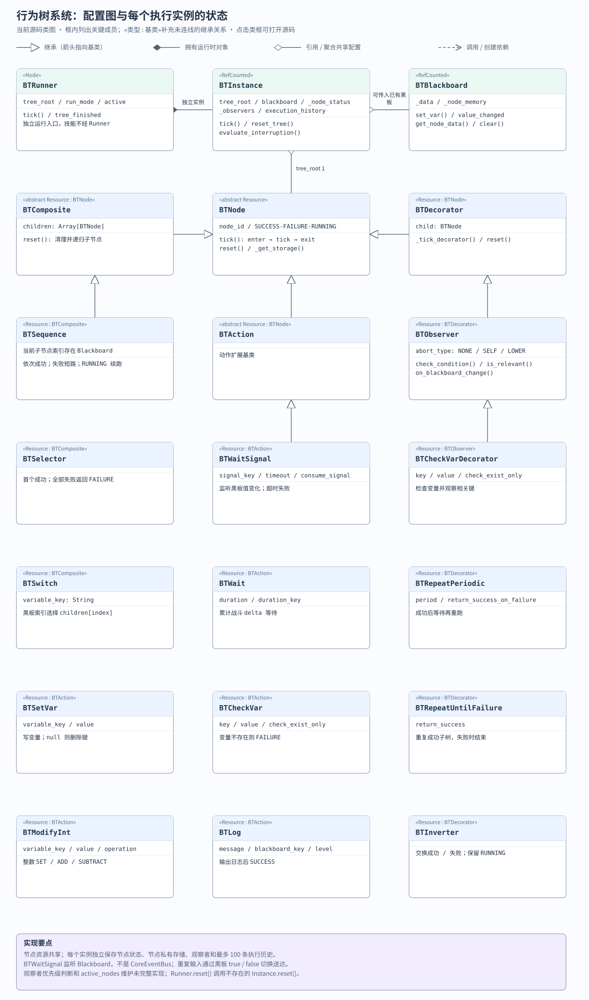

`BTNode` 是共享资源，`BTInstance` 是执行状态，`BTBlackboard` 保存两类数据：字符串键的公共变量，以及以节点资源为键的私有存储。节点 `tick` 在首次进入时调用 `_enter`，执行 `_tick`；结束时调用 `_exit` 并删除自身状态/存储，`RUNNING` 则保留进度。节点计时和索引应存入实例，不应写共享节点字段。

`BTInstance` 保存节点状态、观察者及最多 100 条执行历史，相邻相同节点/状态记录更新最后时间戳。`reset_tree()` 调用树根的递归 reset。技能实例直接驱动 `BTInstance`；`BTRunner` 是可选独立入口，用父节点作为 agent，支持普通帧、物理帧或手工 tick。树完成后 Runner 只发信号，没有自动停机，下一帧还能再次执行。

| 基础节点 | 具体语义 |
| --- | --- |
| `BTComposite` / `BTSequence` | 组合基类保存 children；Sequence 依次执行，失败即结束，遇到 RUNNING 保留子节点索引，下帧续跑。 |
| `BTSelector` | 从当前分支开始尝试，首个成功结束，全部失败才失败；RUNNING 分支保存索引。并非每帧自动从最高优先级重评估。 |
| `BTSwitch` | 用黑板整数索引选择一个孩子；键为空或索引越界失败。 |
| `BTDecorator` / `BTInverter` | 装饰器持一个 child；Inverter 交换 SUCCESS 与 FAILURE，保留 RUNNING。 |
| `BTRepeatUntilFailure` | child 成功则 reset 并继续 RUNNING；失败时按 `return_success` 决定循环整体成功还是失败。 |
| `BTRepeatPeriodic` | child 成功后进入间隔等待，下次重跑；child 正在运行时继续 tick；失败按配置转换结果。实际 `_enter` 总是从不等待开始，所以 `execute_immediately = false` 目前仍首帧执行。 |
| `BTObserver` / `BTCheckVarDecorator` | 检查条件，并可订阅相关键变化请求 SELF 或 LOWER_PRIORITY 中断；具体装饰器支持等值/存在性。 |
| `BTAction` / `BTCheckVar` | 动作扩展基类；变量检查不存在就失败，存在时按配置检查值或只检查存在。 |
| `BTSetVar` / `BTModifyInt` | 前者写变量，value 为 null 时删键；后者对整数 SET、ADD、SUBTRACT，默认当前值 0。 |
| `BTWait` | `_enter` 保存等待秒数，`_tick` 累计传入 delta；`duration_key` 仅接受 float。外部战斗时钟可统一控制暂停、慢动作和停顿。 |
| `BTWaitSignal` | 注册黑板观察者；匹配键变为真或入场时已为真即成功；可消费信号；超时按 delta 累积，负数无限等待；退出注销观察者。 |
| `BTLog` | 输出 agent、文字与可选黑板值，支持 INFO/WARNING/ERROR；无论日志等级均返回成功。 |

观察者实现有明确限制：`active_nodes` 当前没有节点进入/退出维护，`_is_higher_priority()` 恒为 true，中断动作只是重置整棵树；组合/装饰器 reset 重写也未统一调用基类的退出清理，不能把它当作已经完整实现的优先级中断行为树。`BTRunner.reset()` 调用不存在的 `_instance.reset()`，当前有效实例接口是 `reset_tree()`。

黑板 `set_var` 只在 `old != new` 时写入并发 `value_changed`，首次写 null 不会创建键；`erase_var/clear` 不发值变化信号，`value_cleared` 声明了但 clear 未 emit。字典/数组原地改内容也不是自动通知机制，需要显式设计可观察的数据变化。`BTWaitSignal` 的“信号”就是这种黑板变化，与全局事件总线不同。

## 技能动作节点

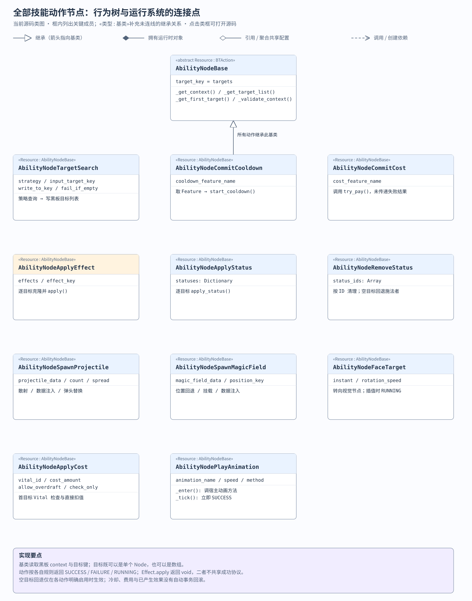

这些节点经 `AbilityNodeBase → BTAction → BTNode` 继承行为树生命周期。基类从黑板 `context` 读取执行字典，从可配置 `target_key`（默认 `targets`）读取一个 Node 或 Node 数组；调用方显式选择是否空目标回退到 instigator。

| 节点 | 执行操作与返回规则 |
| --- | --- |
| `AbilityNodeTargetSearch` | 用策略解析黑板 `target` 和 context，把结果写入黑板 `targets`（输入输出键均可配置）；缺策略失败，空结果根据 `fail_if_empty` 决定结果。 |
| `AbilityNodeCommitCooldown` | 从黑板取技能实例、按 Feature 名取冷却器并 `start_cooldown()`；任一缺失失败。 |
| `AbilityNodeCommitCost` | 查询 CostFeature 并调用 `try_pay()`；当前忽略支付结果，总返回 SUCCESS，后续树可能继续产生效果。 |
| `AbilityNodeApplyCost` | 从目标列表取首个，允许空目标回退施法者；可只检查，或直接 `vital.modify_value(-cost_amount)`。与 VitalCost 不同，直接操作 Vital 绕开组件的不足拒绝，允许透支时会钳到 0。 |
| `AbilityNodeApplyEffect` | 静态数组或 `effect_key` 指定的黑板资源/数组；对每个目标深复制效果并 apply；没有目标也成功。所有目标和效果仍共享当前 context。 |
| `AbilityNodeApplyStatus` | 对每个目标施加 `{状态配置: 层数}`；缺组件跳过，返回 SUCCESS，不按状态实例返回值判定失败。 |
| `AbilityNodeRemoveStatus` | 按 ID 移除目标状态，可回退到施法者；无目标也成功。 |
| `AbilityNodeSpawnProjectile` | 验证场景/施法者，计算挂点和散射，生成多个投射物，替换弹头、注入数据和激活上下文；内层单个生成失败不统一传播到外层节点结果。 |
| `AbilityNodeSpawnMagicField` | 位置优先取黑板指定键中的 hit_position 字典，再取 context.hit_position、target_position、黑板 targets 和施法者坐标；挂载目标或当前场景。 |
| `AbilityNodeFaceTarget` | context/黑板坐标或 input_target 决定朝向；调用宿主 `get_visuals()`，没有则用 agent；瞬转或 lerp_angle 插值，未达到角度返回 RUNNING；无落点成功。 |
| `AbilityNodePlayAnimation` | `_enter` 对施法者或目标调用配置的方法，默认 `play_animation(name, speed)`；不等待动画结束，tick 立即 SUCCESS，缺接口只警告。 |

详细导出字段和源码链接见 [动作节点源码索引](docs/source-index.md#scriptsabilitiesability_nodes)。动作节点、Effect 和 Status 返回语义不同，当前没有统一事务、付费回滚或全链路成功结果；自定义树需按每个节点的实际结果设计分支。

## 属性系统

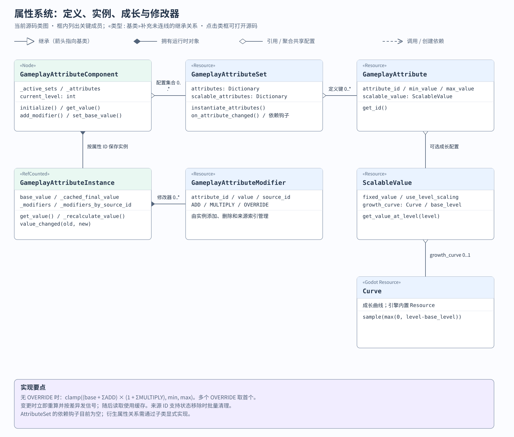

属性是可重算数值，不承担“当前生命值”这类消耗资源的生命周期。`GameplayAttribute` 描述 ID、显示数据、数值上下限、隐藏/百分比显示和可选成长；`GameplayAttributeSet` 保存属性定义到固定值或 `ScalableValue` 的映射；`GameplayAttributeInstance` 保存实体自己的基础值、等级、修改器和缓存；`GameplayAttributeComponent` 是按 ID 查询及转发信号的 Node 容器。

初始化先处理 `scalable_attributes`，同一资源同时出现在固定映射时忽略固定项。固定映射也会把属性定义自身的 `scalable_value` 传给实例，因此定义有成长配置时，成长值仍优先于传入固定值。随后组件设置实例等级、注册信号，再调用全部 Set 的 `resolve_dependencies()`。这些依赖钩子当前为空，没有自动的力量转攻击或体质转生命公式；要扩展应继承 Set 实现初始化和 `on_attribute_changed`，并防止依赖环。

实际计算规则为：

```text
存在 OVERRIDE：final = 第一个 OVERRIDE.value
否则：final = (base_value + ΣADD.value) × (1 + ΣMULTIPLY.value)
最后：final = clamp(final, attribute.min_value, attribute.max_value)
```

MULTIPLY 的 0.1 表示增加 10%，多条按加法合并。例如基础 100、ADD +20、MULTIPLY +0.1 和 +0.2 得到 156。多个覆盖器只取第一条并警告；当前没有覆盖器优先级排序。修改基础值、等级或添加/移除修改器后，实例立即标脏并重算，新旧值非近似相等才 emit；之后的读取复用缓存，并非等到下一帧批量更新。

修改器本身是 `Resource`，含 `attribute_id`、类型、值和运行来源 ID；实例按类型分组，另以 source_id 建索引。`GE_AttributeModifier` 在状态作用下克隆修改器、按层数缩放，用 `status.<实例ID>` 标记来源；状态结束通过 source_id 批量移除，其他来源修改器继续参与计算。

等级成长使用 `ScalableValue`：未开启或缺曲线取 fixed_value，否则 `Curve.sample(max(0, level-base_level))`。这是直接采样曲线的横坐标，不会把等级自动归一化到 0..1；应配置合适的 Curve 域。`get_max_value(max_level)` 只是指定等级的值，不是扫描整条曲线求最大值。组件等级至少 1，传递到所有实例；成长重新计算会覆盖之前手工设置的 base_value。

属性信号链是 `Instance.value_changed → Component.attribute_value_changed → 每个 Set.on_attribute_changed`。外部 Vital 监听会先收到原始变化，之后才运行衍生依赖钩子。`initialize()` 不清空已注册实例，重复 ID 会拒绝新实例，不能作为彻底重置。直接改已添加 modifier.value 不会让属性缓存失效；`remove_modifier` 还没有同步清来源索引，随后按来源清理才能抹去这些残留引用。

## Vital 与伤害系统

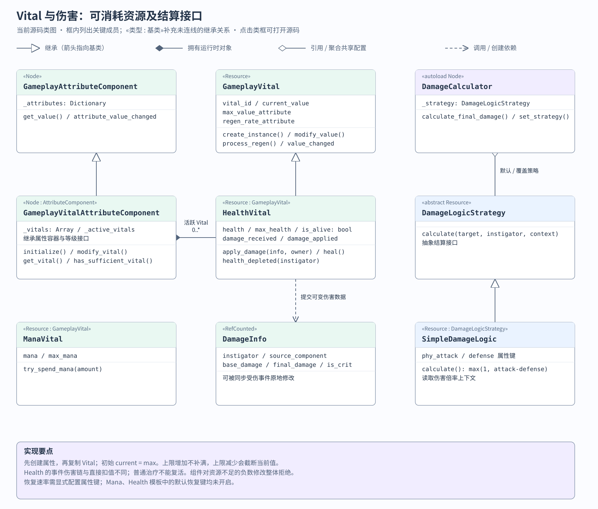

`GameplayVitalAttributeComponent` **继承**属性组件，一个 Node 同时管理普通属性和 Vital。`hpMax` 是可重算属性，`health.current_value` 是可消耗值：二者分别存放。初始化先建属性，再检查各 Vital 的 ID 与上限属性，深复制模板为实例，绑定 owner，初始化当前值为上限，并转发变化/耗尽信号。`_ready` 仅开启更新，不自动完成数值初始化；宿主需调用 initialize。

| 类型 | 数值和生命周期 |
| --- | --- |
| [GameplayVital](scripts/attributes/vitals/gameplay_vital.gd) | 保存 vital_id、current_value、上限属性键、恢复属性键及 owner。`_modify_value` 刷新上限，钳到 0..max，变化发信号，正值到 0 发 depleted，未满到满发 full。 |
| [HealthVital](scripts/attributes/vitals/health_vital.gd) | 默认 health / hpMax，存活判定为 current > 0。正向 modify 调用 heal，死后不接受普通治疗；伤害提交额外执行事件与死亡流程。 |
| [ManaVital](scripts/attributes/vitals/mana_vital.gd) | 默认 mana / mpMax；`try_spend_mana` 经 owner 检查是否足够再扣除，恢复机制沿用基类。 |
| [DamageInfo](scripts/damage/damage_info.gd) | RefCounted，含 instigator、source_component、base_damage、final_damage 和 is_crit；构造器只设基础伤害，final_damage 默认 0，手工提交时需要显式赋值。 |
| [DamageLogicStrategy](scripts/damage/damage_logic_strategy.gd) | 抽象 Resource，仅定义 `calculate(target, instigator, context)`；可替换公式。 |
| [SimpleDamageLogic](scripts/damage/simple_damage_logic.gd) | 查询双方 Vital 属性组件，读取 atk 和 phyDef，使用 `max(1, attack-phyDef)` 与上下文倍率；目前没有暴击分支。 |
| [DamageCalculator](scripts/singletons/damage_calculator.gd) | Autoload Node 选每次调用的覆盖策略，否则用全局策略，再将结果钳到非负；不负责扣血。 |

每帧恢复量为 `owner.get_value(regen_rate_attribute) × delta`。Health 和 Mana 的默认恢复键在源码中被注释，需显式配置；负恢复率也可以造成扣值。Health 的正向路径转到 heal 时未保留 is_regen，恢复事件可能被报告为普通治疗；活着但已满的 Health 仍可发 health_restored。

上限属性变化时 Vital 刷新缓存：上限增加不补满、不按比例缩放，减少时把超过上限的当前值截断。缓存更新先发一次变化，随后截断再发一次，所以监听者可能先收到短暂超过 100% 的比例；该截断路径不发 depleted，不能假设“任意方式归零”都走死亡链。

三种扣值接口需要区分：组件 `modify_vital(-amount)` 不足时整次拒绝；直接 `vital.modify_value(-amount)` 钳到 0，但跳过 Health 伤害事件和 `_die`；`HealthVital.apply_damage()` 允许伤害大于剩余生命，依次发受伤事件、读可变 final_damage、扣值、发结算事件、加入 death 分组并发 health_depleted。组件修改返回 true 仅表示走了修改调用，死者治疗或上限钳制可能仍无数值变化。

当前默认伤害公式和治疗入口见 [伤害与治疗怎样结算](#伤害与治疗怎样结算)。属性修改器影响 attack/phyDef，从而影响下一次策略读取；事件减伤修改 DamageInfo，从而影响当前一次扣血。这是两个不同阶段的扩展点。

## 状态系统的独立实现

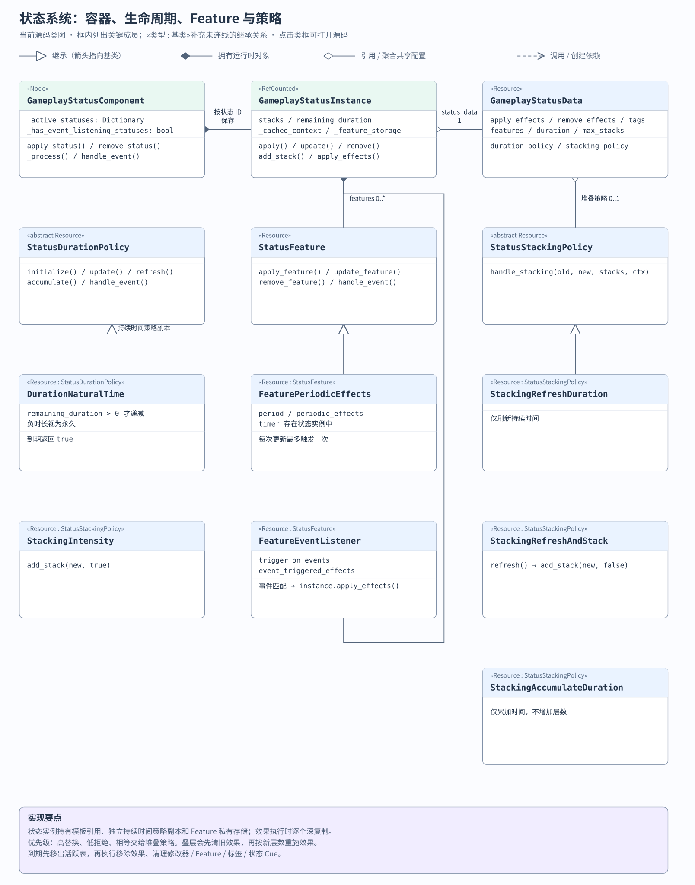

状态是效果的持续载体。`GameplayStatusData` 保存配置；`GameplayStatusComponent` 按 ID 管实例、优先级、堆叠和事件订阅；`GameplayStatusInstance` 保存施法者、层数、剩余时间、上下文浅副本、持续时间策略副本、独立 Cue 和 Feature 私有存储。状态数据自身仍引用模板，不能假设修改模板只影响未来状态。

| 扩展接口 | 实现和调度 |
| --- | --- |
| `StatusFeature` | 普通 Resource，源码虽称抽象类，实际没有 @abstract。`apply_feature/update_feature/remove_feature/handle_event` 转交默认空钩子；可通过实例按 Feature 资源索引的 storage 存运行数据。 |
| `FeaturePeriodicEffects` | 应用时 timer = 0；更新积累 delta，达到 period 就减一次并执行 periodic_effects；每次调用最多触发一次，不能补齐所有跨过周期。 |
| `FeatureEventListener` | `trigger_on_events` 声明事件，`event_triggered_effects` 声明反应效果；数据报告事件可触发后，实例把事件 context 合并进缓存再执行。 |
| `StatusDurationPolicy` | 抽象 Resource，分离 initialize、update、refresh、accumulate、handle_event；update 返回是否到期。状态实例持有独立副本。 |
| `DurationNaturalTime` | 正 duration 倒计时，<=0 初始化为 -1，刷新重新赋时长，累加增加剩余时间；duration=0 的状态在到策略前已短路。 |
| `StatusStackingPolicy` | 抽象 Resource，已有同 ID 且相同优先级时调用；四个具体策略与进入/清理顺序见 [持续状态、叠加和清理](#持续状态叠加和清理)。 |

事件处理先用 Data 的 Feature 判定是否可触发，再通知 duration_policy 和 Feature；只有 duration_policy 自己有事件钩子、没有事件型 Feature 时，当前实例入口可能根本不会转交事件。组件依赖全局总线，未按事件实体筛选。

叠加使用旧实例的施法者及缓存上下文，组件传给堆叠策略的是新空字典，来袭 context 没有带入；不同施法者追加同一 ID 状态时不会自动改归属。状态执行效果前统一覆盖 `stacks` 与 `source_id`；旧来源 ID 不是后续属性修改器的最终来源。Feature 触发的兄弟效果复用缓存字典，前一个效果写入的键会继续存在。

组件声明了 `status_stacked` 信号，但当前堆叠调用链没有 emit，UI 不应只靠它更新层数。duration=0 虽初始化 Feature 后立即完成，却不走普通 remove 的 Feature 清理；空 ID 不入活跃表也不会逐帧更新。移除按 ID 操作，组件在调用实例 remove 前先从表中 erase，以避免清理效果再次查到旧实例，但它不提供独立的多来源同 ID 状态句柄。

## 目标选择与预览系统

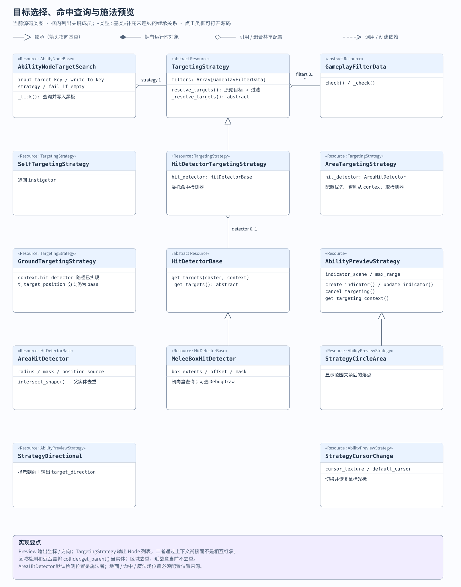

预览阶段只负责收集释放意图，查询阶段才决定实际实体。`AbilityPreviewStrategy` 创建指示场景、夹紧平面距离并返回 `target_position/target_type`；实例管理指示器生成、更新、确认和释放。组件 `request_ability_preview()` 先做激活检查，有预览且未智能施法才进入预览。确认后得到 Dictionary，宿主还需传给激活接口；预览不会自动释放效果。

| 策略/检测器 | 当前实现 |
| --- | --- |
| `StrategyCircleArea` | 将指示器移到经 max_range 夹紧后的落点，确认输出位置。 |
| `StrategyDirectional` | 指示器固定在施法者，朝鼠标方向；输出位置和方向。先归一化再把 y 归零，没有再归一化平面方向。 |
| `StrategyCursorChange` | 改鼠标图标，不创建 3D 指示节点；确认/取消恢复显式配置的默认光标，未读取操作系统当前光标。 |
| `TargetingStrategy` | 子类先生成原始目标，再执行所有有效过滤器；没有 filters 时直接返回原数组。 |
| `SelfTargetingStrategy` | 返回有效 instigator；input_target 对该策略不起作用。 |
| `HitDetectorTargetingStrategy` | 使用配置 HitDetectorBase 做物理查询；缺检测器返回空。 |
| `AreaTargetingStrategy` | 配置 AreaHitDetector 优先，也可从 context.hit_detector 读取；配置路径会把检测器写入 context。 |
| `GroundTargetingStrategy` | 目前仅 context.hit_detector 路径实现；只有 target_position 时仍是 pass，不会自动找落点实体。 |
| `HitDetectorBase` | 抽象 get_targets 查询接口，加 is_valid、get_description 扩展钩子。 |
| `AreaHitDetector` | 默认球体，可设 Shape3D、半径、mask、max_results；位置来源为施法者/目标/命中/显式 detection_position；body 和 area 都可查，取 collider 父节点并按实例 ID 去重。 |
| `MeleeBoxHitDetector` | 根据 context.facing_direction 构造盒朝向，半尺寸 box_extents 转成 BoxShape 全尺寸，加旋转 offset 后查询；取 collider 父节点，没有去重。可选动态调用 DebugDraw。 |

`snap_to_ground`、`use_world_position` 等字段当前没有对应的完整执行分支。AreaHitDetector 给自定义 shape 直接写 `.radius`，并非所有 Shape3D 都支持；查询返回父节点的约定也意味着直接把角色本体当 collider 时可能得到场景父节点。需要按真实碰撞层级对接。未提供 facing_direction 的近战盒会警告且存在退化方向，不能依赖自动从角色朝向读取。

目标数据分散在两处：激活 context 的 `input_target/target_position/target_direction`，以及黑板 `target/targets`。查询节点默认只写黑板 targets，没有自动同步为 context.targets，发射节点又读后者作追踪目标。自定义树或宿主应显式桥接；不要仅凭同名键推断字典相同。

## 投射物系统

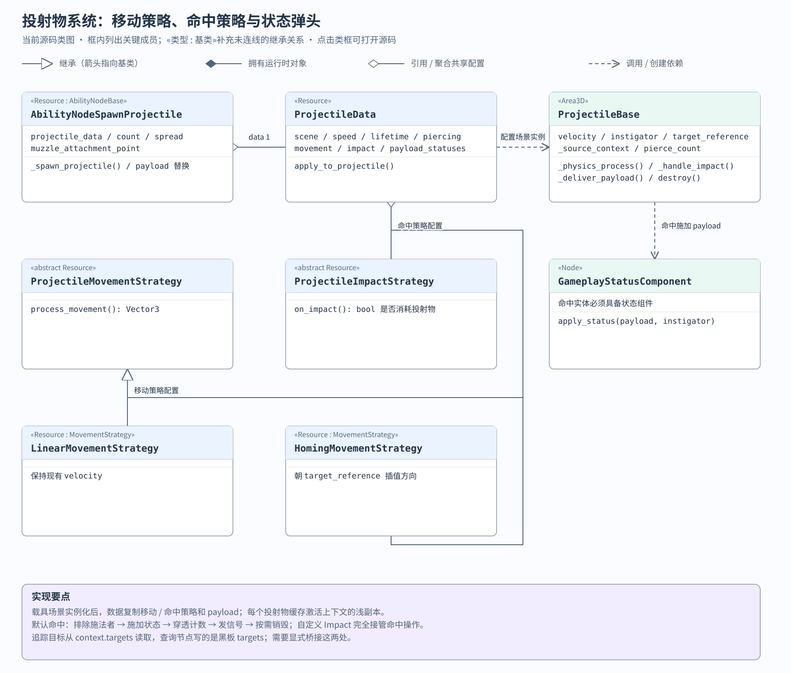

`ProjectileData` 是静态配置：场景、速度、寿命、追踪加速度、穿透、移动/命中策略和 `{GameplayStatusData: 层数}` 弹头。`AbilityNodeSpawnProjectile` 从挂点生成变换，按数量与 extra_projectiles 计算散射，实例化 `ProjectileBase` 场景、注入 instigator 和追踪目标、应用 Data，再保存激活 context 的浅副本。额外弹数缺省 0，实际数量至少 1；多发且未设散射时自动按每间隔 15° 展开。

`ProjectileBase` 是 Area3D，物理帧积累寿命，超时发 timeout_triggered 后销毁；有效移动策略返回 velocity，再按 velocity×delta 移动并朝向速度。`LinearMovementStrategy` 保持速度，`HomingMovementStrategy` 在有有效目标且加速度>0时插值当前方向到目标方向，维持 speed；没有完整的轨道、反弹或弹道重力实现。

命中只监听 body_entered：拒绝自身施法者及没有状态组件的对象，然后处理命中。未设 ImpactStrategy 时把弹头状态施加到目标，按穿透计数决定是否销毁，发 impact_triggered；设 `ProjectileImpactStrategy` 时完全由其抽象 `on_impact()` 实现返回是否消耗，默认投递和穿透逻辑不会再自动调用。当前没有具体 ImpactStrategy 子类，扩展需自行处理载荷。

默认 payload 使用源上下文浅副本，再 merge hit_position、hit_direction、projectile、input_target；merge 未启用覆盖，因此源字典已有这些键时旧值保留。命中信号和 timeout 信号的 context 也不是完整源 context。`max_pierce_count` 按当前计数小于上限时允许穿过，计数后递增，到下一次命中才消耗；没有每目标命中去重表。

发射节点要求有效 target_position；追踪目标读 context.targets 而不是黑板列表。挂点接口存在时直接读取返回节点的变换，没有空返回保护。先 add_child 再注入数据会提前触发场景 `_ready`，自定义投射物 `_ready` 不应假设 instigator/payload 已经设置。Data 对移动和命中策略调用 Resource.duplicate(true)；对 payload 调用 Dictionary.duplicate(true)，其中状态 Resource 键仍共享，并非重新创建所有状态配置。源 context 仍浅复制，里面的 Node/Resource 引用继续共享。

## 魔法场系统

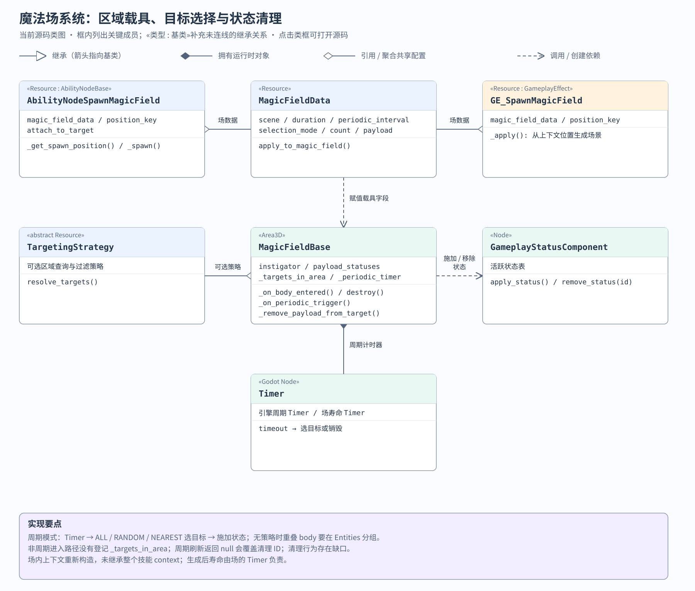

`MagicFieldData` 配置场景、寿命、周期、选目标模式、数量、可选 TargetingStrategy 和状态 payload。`MagicFieldBase` 是 Area3D，连接 body_entered/exited，正寿命启动一次性 SceneTreeTimer，正周期创建循环 Timer。无周期时进入立即施加；有周期时进入登记对象，Timer 每次从 ALL、RANDOM、NEAREST 模式选目标并施加。

查询优先用 targeting_strategy，提供 field_position、detection_position、field、instigator；否则从 overlapping_bodies 读取，要求 body 本身属于 `Entities` 分组。ALL 当前不按 target_count 截断，RANDOM 随机无重复抽取，NEAREST 按距场中心排序；count<0 表示不限制。若区域检测器要使用场中心，应选择 DETECTION_POSITION，其默认仍是施法者中心。

施加 payload 时新建 `{field_position, field}` context，查询目标状态组件后调用 apply_status；只有返回有效新实例才记录状态 ID。body_exited、寿命结束和 destroy 按记录 ID 移除状态、清理 Timer 再 queue_free。这里传输单位是状态，不是 Effect 数组，所以持续治疗、伤害、属性增益仍由状态 Feature 和效果实现。

两种生成入口不同：`GE_SpawnMagicField` 要求 context[position_key] 是 Vector3，默认 projectile_impact，先赋施法者和 Data 再 add_child；`AbilityNodeSpawnMagicField` 有多级位置回退，却先 add_child 再赋 Data。这会让后一条路径的 `_ready` 按默认 duration=5、period=0 建计时器，后赋配置不会自动重建周期或寿命 Timer。图示接口不代表这两条路径行为相同。

清理还存在三个具体限制：无周期进入路径未往 `_targets_in_area` 添加记录，退出/销毁不会清理该状态；周期触发堆叠返回 null 会覆盖已有清理 ID 数组，导致后续丢失句柄；按 ID 移除不能区分别的场或技能后来创建的同名状态。来自策略但未登记的目标也不记录句柄。生命周期敏感的区域效果需要先处理这些路径，当前文档只揭示实现，不修改逻辑。

## 标签、过滤器与事件服务

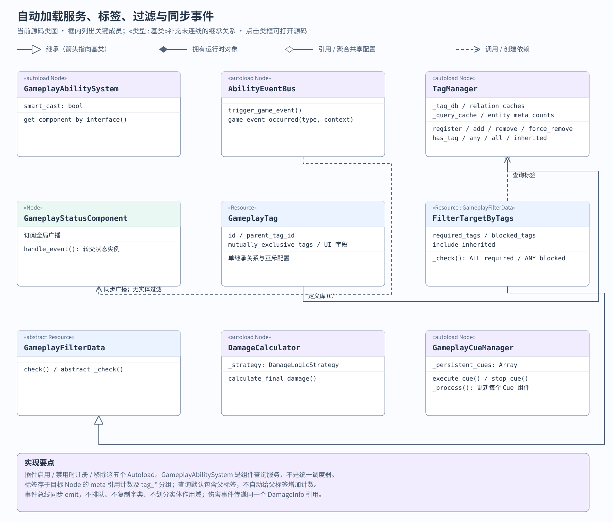

[plugin.gd](plugin.gd) 在编辑器启用时注册四个自动加载节点，退出时移除。CoreSystem 由 Core 插件管理。`GameplayAbilitySystem` 只提供组件查询和全局 smart_cast：按 `get_<组件名snake_case>()`、`get_component(name)`、同名子节点顺序查找，第一个接口存在就直接返回结果，即使返回 null 也不继续尝试；不会遍历所有子节点按 class_name 自动发现。宿主可实现 getter 或确保组件节点名称一致。

`GameplayTag` 是资源定义，含 ID、显示信息、单个 parent_tag_id 和互斥 ID 数组。`TagManager` 管定义库、父链和互斥缓存、按实体 ID 的查询缓存。添加标签前要求注册；计数保存在目标 meta `tag_ref_<安全ID>`，第一次添加才进入 `tag_<ID>` 分组并发 added，最后一次移除退出分组并发 removed。多个状态引用相同标签可以保持计数。

`has_tag` 默认包含继承：拥有子标签即可满足父标签查询，但不会给父标签额外增加引用计数；仅直接计数看 get_tag_count。互斥信息继承父配置，添加标签时强制移除对方直接标签，不会自动恢复被挤掉的标签，也不会删除持有对方标签的状态；状态初始化另有互斥状态移除过程。互斥查询和强制删除直接标签之间仍需注意父子差异。

当前关系缓存不做循环父链检测；配置父标签环会使构建循环不能结束。meta 安全化把点替换为下划线，`a.b` 和 `a_b` 可冲突，应避免此类 ID。标签库改变会重建关系缓存，却未统一清除已有实体查询缓存；直接改 Node 的分组或 meta 也绕过缓存失效。`remove_tag` 对计数 0 仍执行减计数和 removed，调用方不能把重复移除当作严格幂等信号。

`GameplayFilterData` 定义抽象 check；当前具体实现只有 `FilterTargetByTags`，全部 required 必须满足，任一 blocked 命中就拒绝，可控制是否包含父标签。它同时可供 TargetingStrategy、GameplayEffect 使用；Effect 自己还有额外 required/blocked 标签准入，因此目标查询通过不意味着最终效果一定通过。

全部总线发布使用 `CoreSystem.event_bus.push_event(event_name, [context], true)`。事件名为 String，单个 Dictionary 是 Core 的一个回调参数；显式 `true` 保持同步，字典及其中的 DamageInfo 不被总线复制。重要事件如下：

| 来源 | 事件及字典 |
| --- | --- |
| 技能组件 | ability_learned / forgotten / activated / completed / cancelled，带 entity、ability_id。 |
| 状态组件 | status_applied / status_removed 带 entity、status_id；本地 status_applied 信号另外携带实例，不能与总线字典混为一谈。 |
| HealthVital | damage_received / damage_applied，携带 entity（受伤目标）与同一个 damage_info。 |
| AbilityBar | ability_button_pressed，只带 ability_id，宿主需绑定自己控制的组件。 |

状态组件在 `_enter_tree()` 连接 Core 的 `event_pushed`，只接受 `[Dictionary]` 形状的负载，转给相关状态实例；`_exit_tree()` 对原总线退订，再入树时恢复。统一信号支持未知的宿主事件及自定义 StatusFeature，无需固定事件名白名单。它在 Core 的按名订阅回调之前执行，不参与这些回调的优先级排序；Core 的 `subscribe(name, callback)` 则让宿主或 TriggerManager 直接接收同一事件，不需要跨总线转发。

同步可变 DamageInfo 使状态效果和 Core 同步订阅者的减伤都能在当前扣血之前生效。事件底层继续广播；BattleEntity 开启 filter_events_by_owner，普通 GAS 宿主可实现 accepts_status_event 来明确作用域；GAS 状态实例仍会将事件字段合并到自己的上下文缓存。BTWaitSignal、属性信号和组件本地信号都是独立通知路径，不会自动被转成总线事件。

```gdscript
func _ready() -> void:
    CoreSystem.event_bus.subscribe("damage_applied", _on_damage_applied)

func _on_damage_applied(context: Dictionary) -> void:
    print(context.damage_info.final_damage)

func _exit_tree() -> void:
    CoreSystem.event_bus.unsubscribe("damage_applied", _on_damage_applied)
```

事件迁移验证见 [回归场景](../../examples/verify_core_events.tscn)，覆盖全部 GAS 资源和 10 类事件，以及共享伤害对象、完全减伤、死亡、自定义事件、离树/销毁退订和再入树。无需保留旧事件脚本或注册旧单例。

另外两个服务分别是 `DamageCalculator` 和 `GameplayCueManager`，详见 Vital 与 Cue 两节；可选 DebugDraw 是外部独立插件的调试辅助，不在这四个 GAS 自动加载服务中。

## Cue 表现系统

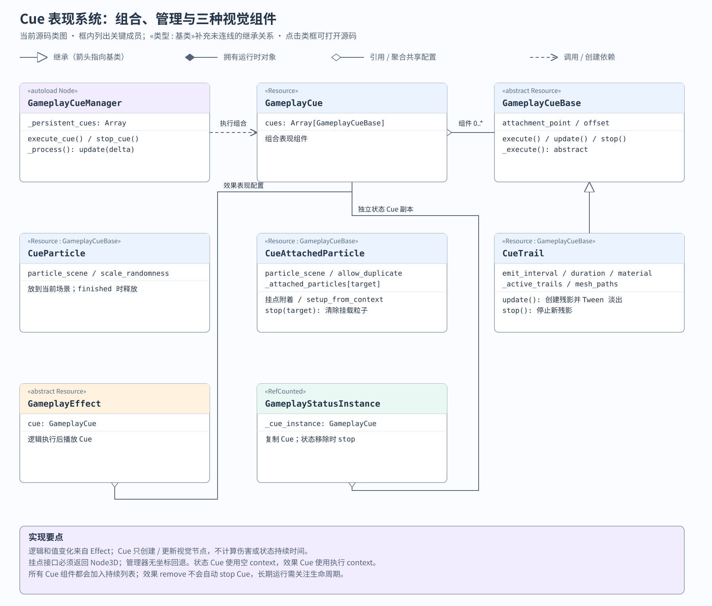

`GameplayCue` 只组合 `Array[GameplayCueBase]`。基类包含挂点和 offset，提供 execute/update/stop 包装与抽象 `_execute`。管理器查目标 get_attachment_point 返回的 Node3D 世界坐标，加 offset 后执行组件，并把每个组件加入 `_persistent_cues` 每帧更新。没有挂点时返回 Vector3.INF，没有目标坐标回退。

| Cue 组件 | 视觉节点与清理 |
| --- | --- |
| [CueParticle](scripts/cues/cue_particle.gd) | 实例化场景放到 current_scene，设世界位置及随机缩放；有 finished 信号才连接 queue_free，没有统一超时兜底。没有读取 context 或调用 setup_from_context。 |
| [CueAttachedParticle](scripts/cues/cue_attached_particle.gd) | 可挂到目标指定挂点，按目标记录实例，可禁止重复；节点支持 setup_from_context 时传入上下文；stop 移除挂载节点。未附着的场景分支不记录对应实例，stop 不清理。允许重复时字典仍仅存最后一个引用。 |
| [CueTrail](scripts/cues/cue_trail.gd) | 递归找 MeshInstance3D 或指定路径，立即生成一次残影，再按 emit_interval 生成共享 mesh 的视觉节点，复制材质并 Tween 淡出后释放；stop 只停止新增，已有残影自然消失。 |

Effect 执行逻辑后把原 context 传给 Cue；状态则复制 Cue 保存到 `_cue_instance`，执行时用空字典，移除时明确 stop。因此状态表现不自动拿到状态的 stacks 等缓存键。管理器对瞬时组件也登记持续更新列表，不自动移除“已播放完”的有效 Resource；重复 execute 同一个组件可以登记多次，stop 只 erase 一次。Effect.remove 默认不 stop 自身 Cue。

Trail 直接对 Node3D 调用 get_rid 作为键，普通 Node3D 没有该通用接口；ghost_material 缺失时后续材质 Tween 也可能无有效对象。这是当前实现的适配限制，不能仅根据类图把任意 Node3D 都当作已经支持的残影目标。

## UI 调试与配套资源

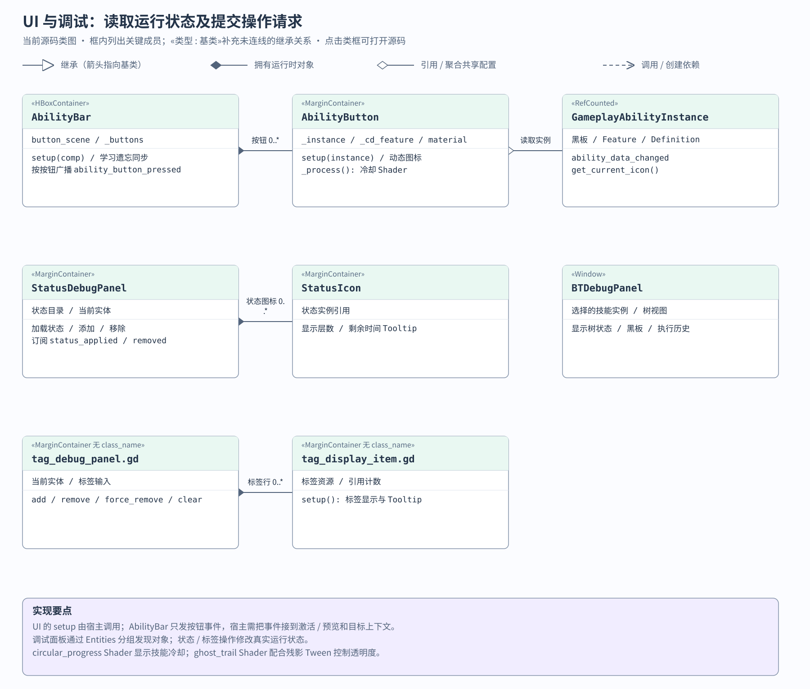

| 脚本/资源 | 数据来源与操作 |
| --- | --- |
| [AbilityBar](ui/ability_bar.gd) / [AbilityButton](ui/ability_button.gd) | setup 后订阅学习/遗忘，初始化现有技能按钮。Button 显示图标、Input Feature 文字和 Cooldown Feature 剩余比例，黑板值变化更新图标。Bar 按下只广播事件，不直接激活技能。 |
| [StatusIcon](ui/status_icon.gd) | setup 设图标/层数，每帧更新 Tooltip 中剩余时间、层数、标签；层数字体显示依靠 update_stack_display，非每帧自动刷新。Tooltip 当前使用带 BBCode 的普通 tooltip_text，不保证富文本渲染。 |
| [StatusDebugPanel](ui/status_debug_panel.gd) | 扫描 Entities 分组，选择状态组件，显示活跃实例；从配置目录加载 `<ID>_status.tres`，添加/移除真实状态并监听组件信号。默认目录改成插件 examples。 |
| [tag_debug_panel.gd](ui/tag_debug_panel.gd) / [tag_display_item.gd](ui/tag_display_item.gd) | 扫描实体，读 TagManager 的直接标签/计数，显示定义信息；提供增、减、强制移除、清空，订阅标签信号并筛选选中实体。这两个脚本无 class_name。 |
| [BTDebugPanel](ui/bt_debug_panel.gd) | Window 扫描技能组件并关注当前/激活实例，显示树、节点状态、黑板、节点存储、active_nodes 和历史；可清历史。active_nodes 的空缺来自执行器实现，非面板不刷新。 |
| [circular_progress.gdshader](shaders/circular_progress.gdshader) | canvas_item 按 UV 角度与 value 绘制扇形遮罩，value 是剩余比例，1 全遮、0 透明；AbilityButton 使用该材质。 |
| [ghost_trail.gdshader](shaders/ghost_trail.gdshader) | spatial 无光照透明材质，颜色/发光/Fresnel 与 alpha_factor 组合，供 CueTrail Tween 消散。 |
| [theme.tres](assets/theme.tres)、[circular_progress.tres](assets/circular_progress.tres)、[effect_icon.svg](assets/effect_icon.svg) | 插件内的 UI 主题、冷却材质和默认效果图标；不再依赖原业务 HUD 路径。 |

UI 对应 `.tscn` 负责控件层级和唯一节点名 `%Button`、`%Icon` 等；替换场景时须保留脚本读取的节点。主题和材质资源不会自动提供输入、摄像机射线或施法上下文。Button 源码注释提到独立材质，但 `_ready` 实际只读取 material，未调用 duplicate；多个按钮共享材质时需保证资源 scene-local 或外部复制。

状态面板订阅了 status_stacked，但组件当前不发该信号，所以叠加后图标层数可能需主动刷新。各调试面板的 toggle_action 需宿主配置 InputMap；发现对象依赖 Entities 分组，不能默认扫描所有 Node。反复 setup 更换对象还需要处理旧信号连接；它们是插件演示/调试工具，不是自动接管所有宿主生命周期的 UI 管理器。

插件有四个独立示例：test_attribute 演示基础数值、成长和修改器；test_vital_system 演示生命/法力和恢复；test_effect_basic 演示直接伤害/治疗；test_status_component 演示状态堆叠/标签/计时。数据由 [example_data.gd](examples/example_data.gd) 和 [burn_status.tres](examples/burn_status.tres) 提供。根目录综合演示同时连接技能按钮、控制台、背包和 DebugDraw。这些场景与资产全部列在 [源码与资源索引](docs/source-index.md)。

## 系统如何联合运行

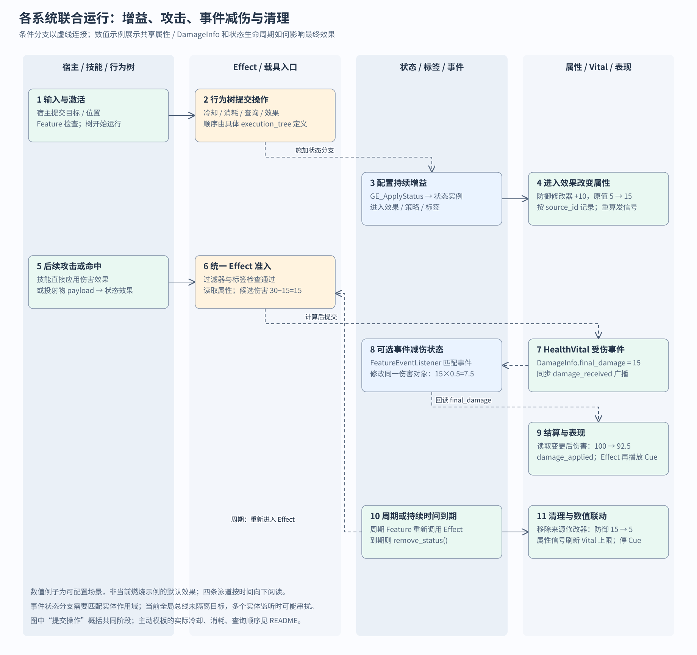

通常一个实体包含 GameplayAbilityComponent、GameplayVitalAttributeComponent、GameplayStatusComponent。第一个持技能实例和黑板，第二个同时持属性与生命/法力，第三个持持续状态。它们通过组件查询服务和上下文协作；当前没有一个统一的组件注册表或全局调度循环替代各 Node 的更新。

初始化推荐先注册需要的标签，再 initialize 属性与 Vital，再学习技能（学习可能立即施加被动状态），最后绑定 UI/输入。宿主提供 getter/get_component 或同名组件节点，加入 Entities 分组供区域/调试使用；使用相关动作时提供 `play_animation`、`get_visuals`、`get_attachment_point` 和正确碰撞层级。基础属性与 Vital 模板必须在使用伤害、消耗前初始化。

联合图用一个可配置的算例说明不同阶段：

1. 目标基础防御 5，生命 100；持续增益的 apply_effects 放 GE_AttributeModifier(ADD +10 phyDef)。状态实例给修改器来源 ID，防御重算为 15；若修改的是 hpMax，Vital 也会收到上限变化。
2. 后续攻击者 atk=30，普通伤害倍率和 stacks 均 1。行为树选中目标，GE_ApplyDamage 通过标签/过滤准入，DamageCalculator 读取当前属性得候选 15。
3. HealthVital 同步广播 damage_received。若配置了事件减伤状态，FeatureEventListener 执行 GE_ModifyIncomingDamage(0.5)，同一个 DamageInfo.final_damage 改为 7.5。此算例只按一个目标监听说明；当前全局事件未隔离实体，多个监听者场景需要额外作用域控制。
4. HealthVital 回读数据扣血到 92.5、发送变化和伤害结算事件；Effect 写 context.final_damage 后播放 Cue，再执行子效果。没有事件减伤状态时本次直接扣 15。
5. 持续增益到期，状态组件先移出实例，实例应用 remove_effects，再让原属性效果 remove 按 source_id 删除修改器，防御恢复 5；清理 Feature、标签和自己的 Cue。对下次攻击策略而言防御已经回到 5。

另外两条入口复用后半段：投射物命中 → payload 状态 → 状态进入/周期 Effect；魔法场 Timer/进入 → payload 状态 → Effect。生命/法力消耗则由技能 Feature 或 ApplyCost 动作直接进入 Vital，通常不经过 damage_received；恢复由 Vital `_process` 的 regen 进入。UI 监听值或事件显示变化，不参与数值计算。

清理责任随模块划分：技能结束重置执行树；状态结束清理来源修改器、Feature、标签和状态 Cue；投射物/场 destroy 清自身节点与已记录数据；Effect.remove 只做子类明确支持的逆操作。伤害/治疗没有自动撤销，付费与后续效果也没有事务回滚。因而联合图表示实际调用关系，不能推断“任意中断会自动还原所有系统”。

## 阅读与验证

推荐顺序：技能组件 → 定义/实例 → 行为树实例/黑板 → `AbilityNodeApplyEffect` → `GameplayEffect` → 具体效果 → 状态实例/Feature → Cue 管理器。

在项目根目录运行：

```powershell
& '<Godot 可执行文件路径>' --headless --path . res://examples/verify_plugins.tscn
```

该场景覆盖资源加载、伤害/治疗、冷却、通用修改器、叠加/标签、背包、控制台及调试绘制；上面列出的全部边界情况并不都由该场景覆盖。

SVG 无需额外依赖。核心布局在 [generate_diagrams.mjs](docs/generate_diagrams.mjs)，各模块布局在 [system_diagrams.mjs](docs/system_diagrams.mjs)。在项目根目录执行以下命令重新生成全部 19 张图及源码索引：

```powershell
node addons/gameplay_abiltiy_system/docs/generate_diagrams.mjs
```

这些图是按源码整理的手工布局；代码结构改变后，应同时更新生成器中的类框、连线和本文说明。目录原有 `.drawio` / `.png` 保留供历史参考，当前分析以本页 SVG 为准。

## 阶段一外部战斗时钟接入

[Battle Foundation](../battle_foundation/README.md) 在物理更新中统一驱动技能、状态和 Vital。三个组件新增 externally_driven / advance_simulation 接口，默认关闭外部驱动以保留独立示例。该插件同时提供配置与实例隔离、原素材帧 Feature、Core 战斗上下文、随机入口和目标事件过滤；完整规则与验收见对应 README。
