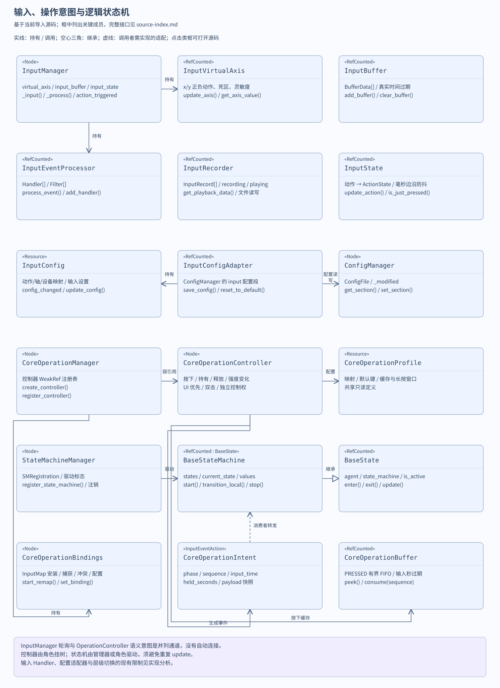
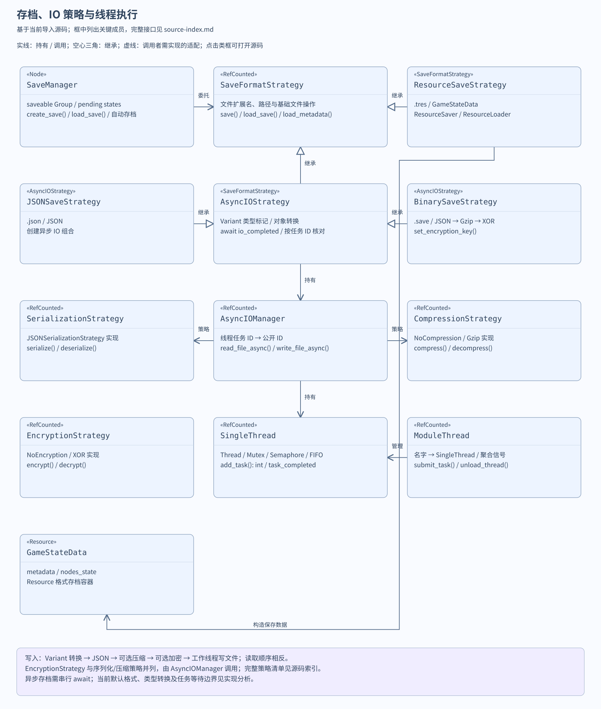
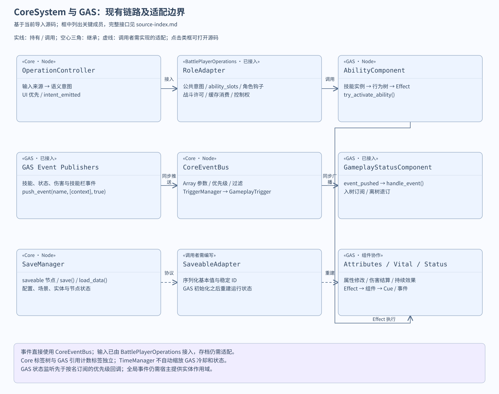

# Godot Core System：当前项目实现分析

这份说明基于本项目导入的源码，覆盖全部 14 个模块、工具、策略和示例。上游使用介绍见 [中文 README](../README_zh.md)；每个脚本的类型、接口和信号见 [完整源码索引](source-index.md)。名称相近的功能需要区分：本插件的状态机是角色/流程逻辑状态机，技能插件的 Status 是增益/减益实例；两者不共用生命周期。

目录名是 `godot_core_system-0.0.4`，但当前 [plugin.cfg](../plugin.cfg) 声明版本为 `0.0.1`、描述提到 Godot 4.2，上游 README 标注 4.4+。本分析按实际代码解释功能；本项目使用 Godot 4.7.2 验证。当前插件已在 `project.godot` 启用，`CoreSystem` 已注册为 Autoload，主场景仍是原来的插件效果演示。

## 总入口、初始化与模块开关


[plugin.gd](../plugin.gd) 在编辑器 `_enter_tree()` 中添加项目设置、注册 `CoreSystem` 并保存项目。禁用插件走 `_disable_plugin()`，移除 Autoload 和设置。它依赖 [FileDirHandler](../source/utils/file_dir_handler.gd) 根据插件脚本路径确定入口目录。

[core_system.gd](../source/core_system.gd) 没有 `class_name`，`CoreSystem` 名称来自 Autoload。它 preload 各模块脚本，通过 `_module_scripts` 按 ID 查找；`_create_module()` 执行 `script.new()`，先登记 `_modules`，再 `add_child()`。节点成为单例的子节点，由场景树驱动帧、物理帧和输入。

各模块的公开属性同时有 `@onready` 初始化与 getter：入口 ready 时会访问这些属性并创建默认启用的模块；之后 getter 在引用为空时再尝试取模块。因此它包含按需查询机制，但默认启动会初始化全部公开模块，不能理解成所有模块都等到第一次业务调用才加载。模块自身还会访问日志、配置、资源等依赖。

模块开关读取 `godot_core_system/module_enable/<module_id>`；设置缺失时视为启用，关闭开关不卸载已经创建的节点。大多数 ID 与设置键相同，但有两处不一致：设置脚本声明 `state_machine` / `gameplay_tag_manager`，入口查询的是 `state_machine_manager` / `tag_manager`。所以单独关闭前两个设置不能阻止对应模块创建。若关闭 logger，其他模块仍可能调用日志；入口的关闭分支也调用 `logger.warning()`，需要处理这项依赖才能安全禁用。

| 模块属性 | 实现职责 | 主要依赖 |
| --- | --- | --- |
| `logger` | 分级、彩色、文件日志 | setting.gd |
| `resource_manager` | 同步/线程资源加载、缓存、节点池 | logger |
| `audio_manager` | 音乐、音效、语音、总线音量 | config_manager、logger |
| `event_bus` | 动态事件、优先级、过滤、一次订阅 | Godot 信号、Callable |
| `input_manager` | 动作状态、虚拟轴、缓冲、录制 | InputMap、配置模块 |
| `operation_manager` | 独立控制器、语义意图通道 | Profile、Controller、Intent |
| `config_manager` | ConfigFile 的内存配置与显式落盘 | logger |
| `scene_manager` | 场景栈、加载与转场 | resource_manager、logger |
| `time_manager` | 模块内缩放、暂停、命名计时器 | 场景树 delta |
| `save_manager` | 节点状态收集、存档与自动存档 | 格式策略、config_manager、logger |
| `state_machine_manager` | 集中驱动多台逻辑状态机 | BaseStateMachine、BaseState |
| `entity_manager` | 实体 ID、场景缓存、创建与回收 | resource_manager |
| `trigger_manager` | 事件/周期触发、条件工厂 | event_bus、GameplayTrigger |
| `tag_manager` | 标签树、对象索引、容器 | CoreGameplayTag、GameplayTagContainer |

## 事件系统

[event_bus.gd](../source/event_system/event_bus.gd) 用动态用户信号保存订阅连接，用 `_event_metadata` 保存优先级、once 和过滤器。`subscribe()` 避免完全相同的 Callable 重复订阅；`subscribe_unique_script()` 先移除同一脚本其他实例的连接，适用于仅保留最后一个实例的监听者。

`push_event(name, payload, immediate)` 的顺序是：把非 Array 负载包装成数组 → 可选记录历史 → 发 `event_pushed` → 读取连接 → HIGH/NORMAL/LOW 排序 → 执行过滤器 → 逐个 `callv(payload)` 或延迟调用 → 移除一次性连接 → 发 `event_handled`。过滤器收到整个数组，订阅回调收到数组拆开的参数。例如：

```gdscript
func _ready() -> void:
    CoreSystem.event_bus.subscribe("core_demo_hit", _on_hit)
    CoreSystem.event_bus.push_event("core_demo_hit", [self, 12.0])

func _on_hit(target: Node, amount: float) -> void:
    print(target.name, " received ", amount)

func _exit_tree() -> void:
    CoreSystem.event_bus.unsubscribe("core_demo_hit", _on_hit)
```

`immediate=false` 使用 `call_deferred`；`event_handled` 表示调度完成，此时回调可能还没运行。没有订阅者时提前返回，不发 handled。历史记录及返回副本是浅复制，负载内的可变对象仍共享。一次性订阅在回调之后才断开，回调内递归推送同名事件可能再次进入。

当前元数据键只使用“对象 ID + 方法名”，不同 bind 参数的 Callable 可能共享元数据；`unsubscribe_unique_script` 也按脚本而非角色 ID 去重。`clear_subscriptions()` 使用所有非 pushed/handled 信号列表，范围还包含 Node 的继承信号。它不是线程事件队列，也不会自动按实体隔离事件。

## 输入、虚拟轴、缓冲与录制



[input_manager.gd](../source/input_system/input_manager.gd) 创建 `InputVirtualAxis`、`InputBuffer`、`InputRecorder`、`InputState` 和 `InputEventProcessor`。ready 设置 `PROCESS_MODE_ALWAYS`，连接虚拟轴变化；每帧清过期缓冲、更新注册轴、轮询全部 InputMap 动作；输入事件路径处理按下/松开、追加缓冲和录制，并发 `action_triggered`。输入管理器在场景树暂停时仍处理，角色控制器的暂停规则与它不同。

| 脚本 | 算法与数据 | 使用边界 |
| --- | --- | --- |
| [InputState](../source/input_system/input_state.gd) | 每个动作一个 ActionState：pressed、just 边沿、strength、按下/松开时间；可配置毫秒边沿防抖 | 再次 update 会重算并清除 just 边沿；事件路径与帧轮询有顺序影响，不是独立的永久事件缓存 |
| [InputVirtualAxis](../source/input_system/features/input_virtual_axis.gd) | 为每个 Vector2 的 x/y 分量保存正负动作；差值经过死区重映射与灵敏度，实际改变才发信号 | 使用 `Input.is_action_pressed()`，不是模拟摇杆连续强度；对角线不归一化，死区参数需避开 1 |
| [InputBuffer](../source/input_system/features/input_buffer.gd) | 按动作追加 BufferData；基于 `Time.get_ticks_msec()` 的真实时间过期，默认 0.1 秒 | 查询不消费，取最早匹配记录；要避免重复发动必须 `clear_buffer()`；它不使用 time_manager 的缩放 |
| [InputRecorder](../source/input_system/features/input_recorder.gd) | 保存动作、pressed、strength、真实时间；限制容量；JSON 文件读写；回放按时间取一条记录 | start_playback 会平移内部时间戳；每次 get_playback_data 最多返回一条，消费者要轮询并执行；InputManager 没有自动把回放注入输入 |
| [InputEventProcessor](../source/input_system/features/input_event_processor.gd) | 按注册顺序调用 Handler；内置键盘、鼠标、手柄、触摸，以及可选重映射、组合键和手势 Handler | 默认 Handler 全返回 false；InputManager 却在 false 时提前退出，所以默认事件路径被拦住，轮询轴/状态路径仍可工作 |
| [InputConfig](../source/input_system/config/input_config.gd) | Resource 保存动作/轴/设备映射与输入设置，变化时发 config_changed | `Dictionary.merge()` 默认不覆盖，已有默认 input_settings 键的更新不会按注释描述覆盖；它本身不把映射写到 InputMap |
| [InputConfigAdapter](../source/input_system/config/input_config_adapter.gd) | 在 ConfigManager 的 input 段与 InputConfig 之间转存；提供保存、重置和各项代理方法 | `_init()` 调用 ConfigManager 中不存在的 `is_loaded()`；需补齐接口才可完整使用，不应把示例当成验证结果 |

EventProcessor 声明 `_filters` 和 KeyFilter/ActionFilter，但 `process_event()` 未执行这些过滤器。KeyRemapHandler 发出选中事件，不直接修改 InputMap；组合键用当前按下列表的顺序拼字符串，所以顺序影响匹配；GestureHandler 的首次方向追加条件要求已有轨迹，空轨迹无法正常开始。这些属于已有实现边界，本次只增加折叠注释与文档。

## 操作意图系统

这是与原 InputManager 并列的语义通道，现由 [BattlePlayerOperations](../../battle_foundation/input/battle_player_operations.gd) 接入真实平台角色。完整 API、键位、控制权、原版对应及验收见 [操作文档](../../battle_foundation/input/README.md)。

[CoreOperationProfile](../source/operation_system/operation_profile.gd) 保存意图/InputMap/轴与输入窗口的共享定义；[CoreOperationIntent](../source/operation_system/operation_intent.gd) 含 PRESSED、HELD、RELEASED、CHANGED、序列、输入时间、持有时长和负载。强度变化和 OS echo 不冒充按下；长按阈值只通知一次。

[CoreOperationController](../source/operation_system/operation_controller.gd) 在 _unhandled_input 接收新操作，_input 只记录来源/清理释放。多物理键、设备和虚拟来源按最大强度聚合；相反方向可后按优先，摇杆正负精确匹配。同方向双击在配置窗口内识别，第二次持有期间查询奔跑方向。

新增 [CoreOperationBuffer](../source/operation_system/operation_buffer.gd) 缓存按下快照，按 sequence 消费、按输入时间过期、有界 FIFO；角色通过许可后消费，RETRY 保留直至过期。输入时间不受战斗慢动作或停顿缩放，暂停撤回控制并清队列。

[CoreOperationBindings](../source/operation_system/operation_bindings.gd) 安装默认 InputMap、恢复用户配置，捕获并校验冲突/保留键，保存物理键/鼠标/手柄描述。重映射实际修改 InputMap，保存失败保持原映射；共享 Profile 不改写。绑定服务 Always 运行，菜单暂停时仍可使用。

控制权是独立原因集合：菜单、失焦、暂停、改键、控制者切换、死亡等。reset 清強度/缓存/双击并发 cancelled 释放；恢复后持有键先松开。submit_intent/pulse_intent 也经过控制权门。clear_native_sources 只移除原生来源，set_profile 先 reset。

[CoreOperationManager](../source/operation_system/operation_manager.gd) 通过 WeakRef 和 tree_exited 管理注册表，持有绑定服务，改键清理受影响控制器。create_controller 不执行 add_child，角色负责挂树；externally_driven 由 BattleSession 推进，禁止双驱动。角色适配器负责公共行为与专属钩子，不自动向 GAS 或状态机转发。

## 逻辑状态机

[BaseState](../source/state_machine/base_state.gd) 是 RefCounted，具有 ready/dispose 一次准备与清理，以及 enter/exit、update/physics_update/handle_input 活跃周期。子类实现 `_enter/_exit/_update/_physics_update/_handle_input`；不会作为 Node 自动获得引擎回调。

[BaseStateMachine](../source/state_machine/base_state_machine.gd) 继承 BaseState，因此可以放入另一台状态机。它保存 states、current_state、previous_state 与 values 黑板；`add_state()` 绑定 agent、state_machine 和 ID。`start()` 选初始状态并进入；`transition_local()` 先退出旧状态，再进入新状态并发 state_changed。每次更新先委托当前子状态，再调用本机钩子。暂停只停更新，不退出当前状态；stop 才退出并清空 current_state。

叶子 BaseState 的 `transition_to()` 沿所属 state_machine 切换；BaseStateMachine 自己的 `transition_to()` 等价于本机 `transition_local()`。嵌套机要切外层，应明确调用 `state_machine.transition_local()`；要切内层，调用本机 `transition_local()`。部分 BaseState 与所属机互持引用，需要通过生命周期管理打断不再使用的对象关系。

[state_machine_manager.gd](../source/state_machine/state_machine_manager.gd) 为每台状态机保存 `SMRegistration`，分别控制 update、physics 和 input 三个驱动开关。注册会调用 ready，可带初始状态启动；注销先 stop 再 dispose。角色自己驱动状态机时，应关闭对应集中驱动标志，避免一帧更新两次。注册不自动随 agent 退出而注销；多根状态机时 `get_current_state()` 应指定 root_id，省略参数返回最后一条活跃链的叶子，语义容易混淆。

它不参与 GAS 的 GameplayStatusInstance 计时、叠加和属性修改。适合状态机选择“何时尝试发动技能”，再交给 GAS 管理实际执行。

## 触发器与条件

[GameplayTrigger](../source/trigger_system/gameplay_trigger.gd) 是带运行状态的 Resource，包含触发类型、条件、概率、周期、计数和上下文。activate 后，IMMEDIATE 尝试执行一次；ON_EVENT 注册到 TriggerManager；PERIODIC 加入每帧更新列表。执行顺序是次数上限 → 概率 → 条件 all → 加计数 → triggered。max_triggers 只有 >0 才限制，0 与负值都不限次数；persistent 字段当前没有持久化处理。

[TriggerManager](../source/trigger_system/trigger_manager.gd) 按事件名保存数组，第一次注册某事件时订阅 CoreEventBus，并把一个 Dictionary 负载转交触发器。周期触发每帧累计 delta，每帧至多执行一次；多周期延迟不会同帧全部补偿。deactivate 注销并清空保存的上下文，reset 只清计数和计时，不注销。配置 Resource 若用于多个实体，应复制或明确共用计数的含义。

| 条件 | 实际判定 |
| --- | --- |
| [TriggerCondition](../source/trigger_system/trigger_confition.gd) | 基础 evaluate 恒 true；文件名 `trigger_confition.gd` 是源码中的拼写 |
| [EventTypeTriggerCondition](../source/trigger_system/conditions/event_type_trigger_condition.gd) | context.event_type 必须等于配置 |
| [StateTriggerCondition](../source/trigger_system/conditions/state_trigger_condition.gd) | 匹配 state_name 时比较 state_value；不匹配名称直接 true |
| [CompositeTriggerCondition](../source/trigger_system/conditions/composite_trigger_condition.gd) | AND/OR/XOR/NAND/NOR；XOR 为 true 数量奇数；构造配置内子条件当前直接 new 基类，未走类型工厂 |

CoreEventBus 向 TriggerManager 推送时应传 `[context_dictionary]`，符合 callback 的单 Dictionary 参数。注销最后一个事件触发器会退订，但保留空事件键；之后重新注册不会进入首次订阅分支。直接 execute 不检查 `_is_active`；计数达到上限也不自动 deactivate。立即触发类型在 `_context` 赋值之前执行，回调依赖的是当次参数。

## 核心标签系统

[CoreGameplayTag](../source/tag_system/gameplay_tag.gd) 是 RefCounted 树节点，保存短 name、parent 与 children；完整路径沿父节点递归拼接。[tag_manager](../source/tag_system/gameplay_tag_manager.gd) 对未知点分路径自动创建全部祖先节点，并保存“标签路径 → 对象 WeakRef”和“对象 ID → 容器 WeakRef”。ready 创建 30 秒清理 Timer，查询时也清理失效索引。

[GameplayTagContainer](../source/tag_system/gameplay_tag_container.gd) 是 Resource，保存实际标签对象并发添加/移除信号；由 manager 创建且传 owner 时，容器信号用于建立对象索引。调用者须持有容器，manager 的 WeakRef 不保证其存活。get_tags 返回短 name，get_full_path 才返回完整路径；get_all_tags 还会枚举所持标签的所有后代，不能视为对象显式拥有的标签列表。

exact=false 的 matches 在两方向检查祖先关系：持有 `state` 可以匹配 `state.stunned`，持有 `state.stunned` 也可以匹配 `state`。这与技能插件的标签引用计数、元数据、Group 及其继承查询语义不同。核心容器重复添加会去重，没有按状态来源引用计数；移除一次即去掉标签。get_objects_with_all_tags 直接读取首个查询项，传空数组会越界；手工建立树也没有循环检查。

## 资源、实体与对象池

[ResourceManager](../source/resource_system/resource_manager.gd) 的 IMMEDIATE 用 `ResourceLoader.load()` 同步加载并缓存；LAZY 用 threaded_request，缓存先存 null，默认每秒轮询状态，再 threaded_get 并发 resource_loaded。get_cached_resource 遇到未完成资源会转同步加载。因此“懒加载返回值”通常是 null，需要监听信号；它不是 await 异步返回接口。

对象池按 ID 保存 Node 数组。recycle_instance 把节点从父节点移除后保存；get_instance pop_back 返回节点，调用者重新配置和挂树。缓存清理不等于实例销毁；clear_instance_pool 只清数组，没有逐个 queue_free，已脱树 Node 可能遗留。线程加载中的同路径重复请求、清缓存与 `_loading_count` 的一致性也未全面处理；已存在但为空的池仍会 pop_back。

[EntityManager](../source/entity_system/entity_manager.gd) 保存实体 ID 到场景路径与 PackedScene 的映射，订阅资源加载信号。load_entity 登记路径后加载；create_entity 先取池，否则 instantiate，挂到指定父节点，然后调用 initialize(config)；缺少 initialize 时会提前返回，没有 created 信号，即使已经创建/挂树。destroy_entity 调用可选 destroy 后回收到路径对应的池，如果 destroy 自己 queue_free 则不适合回池。当前 unload_entity 只有存在检查，没有卸载逻辑；clear_entities 也只清池。

同步首次加载可能从资源信号回调和 load_entity 本身各发一次 entity_loaded；多个 ID 映射同一路径时回调 find_key 只找到第一个。该模块没有自动把实例注册为 GAS 的实体，也不会自动初始化技能、属性或 Vital。

## 场景栈与转场

[CoreSceneManager](../source/scene_system/scene_manager.gd) 通过 ResourceManager 加载 PackedScene。change_scene_async 用 `_is_switching` 阻止并发切换：先找栈中同路径实例，否则尝试节点池/同步资源加载 → 遮罩转场开始 → 新场景加到 root 并延迟指定 current_scene → 按参数保存旧场景或 queue_free → init_state → 等待帧 → scene_changed 和回调 → 转场结束 → 刷新 2D 相机 → loading_finished。

`push_to_stack=true` 保存旧实例、scene_file_path 和可选 save_state() 数据，然后脱树；pop_scene_async 取出原实例，调用 restore_state(data)，重新入树。它保留真实 Node，而不是只保存可序列化快照；退出管理器时 clear_scene_stack 释放栈中孤儿节点。SceneBase 提供 init_state、save_state、restore_state 的扩展入口，业务子场景自行实现。

| 转场类 | 实际效果 |
| --- | --- |
| [BaseTransition](../source/scene_system/transitions/base_transition.gd) | 保存 ColorRect 引用，start/end 发信号并委托钩子 |
| [FadeTransition](../source/scene_system/transitions/fade_transition.gd) | Tween 遮罩透明度 |
| [SlideTransition](../source/scene_system/transitions/slide_transition.gd) | 根据方向 Tween 遮罩位置 |
| [DissolveTransition](../source/scene_system/transitions/dissolve_transition.gd) | 当前同样 Tween 透明度，没有噪声溶解 Shader |

CUSTOM 根据名字登记/查询策略。遮罩 mouse_filter=IGNORE，因此视觉遮挡不阻止点击。change_scene_async 名称虽有 async，未预加载时资源加载仍同步；初始化时需保证资源有效，当前代码可能在 null PackedScene 上调用 instantiate。完成预加载会把路径从 `_preloaded_scenes` 移除，所以之后 clear_preloaded_scenes 不覆盖全部已完成缓存。以上是当前实现，不意味着本次新增了场景接入。

## 配置与日志

[ConfigManager](../source/config_system/config_manager.gd) 在构造时加载 ConfigFile；缺文件清空内存并返回成功，取值使用调用者默认值。set_value 比较数组/字典及近似浮点，实际变化才置 `_modified`；set_section 只覆盖提供的键，不删除旧键。get_section 返回浅副本。reset 清内存，save_config 创建目录并落盘，成功后才清 modified。

auto_save 属性目前未在 set/reset 路径触发保存，调用者必须显式 save_config；p_path 只对该次读写生效，没有改变项目设置中的默认路径。ConfigManager 管用户配置，不等同于 SaveManager 的角色/关卡存档。

[CoreLogger](../source/logger/core_logger.gd) 分 DEBUG/INFO/WARNING/ERROR/FATAL，用项目设置颜色和 print_rich 输出，附时间与上下文字典。启用文件日志后用 WRITE 打开 `user://logs/game.log`；重新打开会截断旧内容，没有轮转。warning/error/fatal 还会调用引擎 push_warning/push_error；error/fatal 打印堆栈，fatal 不自动退出。等级过滤只作用 `_log`，引擎警告/错误调用仍会执行。

## 音频、总线与播放器池

[AudioManager](../source/audio_system/audio_manager.gd) 将 MUSIC、SOUND_EFFECT、VOICE、AMBIENT 映射到 Music、SFX、Voice、Ambient 总线；ready 时补建缺失总线，从 ConfigManager 的 audio 段读取主音量与分类音量。播放器按类型放在数组中，每次复用未播放的 AudioStreamPlayer，没有空闲者就创建并挂到 audio_node_root；音频资源按路径缓存。

play_music 切换当前音乐，旧播放器 Tween 淡出并停止，新播放器按需要淡入；loop=true 连接 finished 后重新 play。导入资源本身已设置循环时，loop=false 不能关闭资源循环。play_sound/play_voice 选分类播放器、设置 stream/bus/volume_db 并播放，返回播放器便于调用者控制。stop_all 停止池内全部播放器，不移除缓存和节点。

set_volume/set_master_volume 只改模块内数值和 AudioServer 总线，不自动更新 ConfigFile，持久化需要调用者写配置再 save_config。分类音量同时用于总线和播放器幅度，因而播放时可能产生两次分类衰减；改变总线后旧播放器的自身衰减仍保留。AMBIENT 有总线/音量/池配置，但当前没有独立 play_ambient 公共方法；播放器是普通 AudioStreamPlayer，不提供 2D/3D 空间定位。切歌过程中重复请求也没有专门的 Tween 取消/串行机制。

## 时间与计时器

[TimeManager](../source/time_system/time_manager.gd) 保存自身 time_scale、paused、game_time 和命名 GameTimer。每帧以 `delta * _time_scale` 推进；计时完成先调 callback，再发 timer_completed；循环计时器 elapsed 归零，非循环计时器在遍历结束后移除。重复 ID 覆盖旧计时器，单个计时器可暂停、恢复、重置、移除。

它没有设置 Engine.time_scale 或 SceneTree.paused，故只影响自己的 game_time 与 timers；也不改变 GAS 冷却、状态 delta、InputBuffer 的真实时间或 Timer 节点。循环计时器会丢弃超出一周期的余量，每帧最多一次；回调若修改同一计时器表，需要调用者注意遍历及同 ID 替换的顺序。

## 存档、格式策略与异步 IO



[SaveManager](../source/save_system/save_manager.gd) 从 saveable Group 找实现 save() 的节点，给返回 Dictionary 加 node_path，和 save_id/timestamp/date/version/playtime 元数据一起传给当前格式策略。create_save、load_save、get_save_list 等包含 await，调用者应 await 结果。加载通过路径查节点并调用 load_data；尚未出现的路径缓存到 `_pending_node_states`，稍后 register_saveable_node 时应用。

自动存档只在已有 `_current_save_id` 后开始累加；达到间隔生成带前缀的 ID，成功后按时间倒序删除超过数量上限的自动存档。路径是节点稳定性协议，不是实体 GUID；改场景层级后不会自动迁移状态。playtime 目前固定写 0，未读取 TimeManager；新加载前也没有清空旧的 pending 表。

| 策略 | 格式与处理 |
| --- | --- |
| [SaveFormatStrategy](../source/save_system/save_format_strategy/save_format_strategy.gd) | RefCounted 接口与同步目录遍历/删除基础方法 |
| [ResourceSaveStrategy](../source/save_system/save_format_strategy/resource_save_strategy.gd) | `.tres`；创建 [GameStateData](../source/save_system/game_state_data.gd)，ResourceSaver 保存，ResourceLoader 恢复 |
| [JSONSaveStrategy](../source/save_system/save_format_strategy/json_save_strategy.gd) | `.json`；AsyncIOStrategy 类型转换 + JSON + 单工作线程 |
| [BinarySaveStrategy](../source/save_system/save_format_strategy/binary_save_strategy.gd) | `.save`；类型转换 + JSON 序列化 + Gzip + XOR，并不是原生 Variant 二进制格式 |
| [AsyncIOStrategy](../source/save_system/save_format_strategy/async_io_strategy.gd) | 对 Vector、Color、NodePath、类型数组/字典和对象属性增加类型标记，加载时重建对象 |

[AsyncIOManager](../source/utils/async_io_manager.gd) 为每个 IO 实例创建 SingleThread。写入依次序列化 → 压缩 → 加密 → FileAccess；读取逆向解密 → 解压 → 反序列化；整数线程任务 ID 映射到公开字符串 ID，主线程收到 io_completed(id, success, result)。序列化、压缩、加密各自有策略接口，当前具体实现为 JSON、NoCompression/Gzip、NoEncryption/XOR。XOR 是重复密钥异或，没有完整性验证；这描述已有文件格式，不代表新的安全存档实现。

当前设置表给默认格式 `""`，但 `_set_save_format()` 的未知格式兜底是字符串 `"resource"`，不是 ResourceSaveStrategy 实例。编辑器注册默认设置之后首次构造 SaveManager 可能因此失败；可在项目设置中明确选 `resource`、`json` 或 `binary`，本次不改配置。默认未写入这个设置时，SaveManager 的 getter 自身兜底为 `resource`，是另一条路径。

AsyncIOStrategy 直接 await 全局 io_completed，一旦先完成其他任务就返回失败/空结果；它不是按 ID 持续等待，因此调用同一实例时应串行 await。类型转换也有现有限制：Rect2 高度写成 size.x；普通 JSON 字典键不保留所有 Variant 类型；对象恢复可重新加载同一个共享 Resource 再写属性；Node 转 NodePath，不自动恢复场景实例。Binary 密钥从配置读取/生成并保存，换配置文件会影响旧 `.save` 的可读性。

## 通用工具与线程

| 工具 | 实现 | 清理与限制 |
| --- | --- | --- |
| [FrameSplitter](../source/utils/frame_splitter.gd) | 主线程按数量/毫秒预算处理数组、范围、迭代器和批量函数，每批 await process_frame；动态调整批量并发进度 | 不是后台线程，单项长调用不能抢占；同实例并发任务共享计数；应使用有效正预算 |
| [RandomPicker](../source/utils/random_picker.gd) | 把数据规范成 data/weight，构建 Alias 概率表；重建 O(n)，单次抽取 O(1)，可抽后移除 | 批量修改若传 rebuild=false，要显式 rebuild；移除抽取会重建，浅副本仍共享物品字典 |
| [SingleThread](../source/utils/threading/single_thread.gd) | Thread + Mutex + Semaphore；FIFO Callable 队列；结果通过 call_deferred 返回主线程；任务 ID 为 int | stop 唤醒并 wait_to_finish，未开始任务可被放弃；thread_finished 实际表示结果回调时队列为空，不表示工作线程已停止 |
| [ModuleThread](../source/utils/threading/module_thread.gd) | 按名字维护多个 SingleThread，聚合完成信号；卸载时 stop | 当前接口把 SingleThread 的 int ID 当 String，绑定信号断开时未使用相同 bind Callable；需调整才能按其接口承诺使用 |
| [FileDirHandler](../source/utils/file_dir_handler.gd) | 静态取 Object 脚本资源所在目录 | 插件注册路径使用它，调用者须提供有脚本的对象 |

线程任务应操作适合后台执行的数据；信号 deferred 到主线程不意味着 Callable 中任意场景树操作都安全。停止线程等待当前 Callable 结束，没有任务取消或超时协议。

## 全部示例的定位

示例是接口展示，部分会触及上述未完成路径。它们的全部脚本列于 [源码索引](source-index.md)，没有把运行成功与“存在示例文件”混为一谈。

本次逐个加载 GDScript 时确认两处原有示例解析错误：[scene_demo.gd](../examples/scene_demo/scene_demo.gd) 引用不存在的 `CoreSystem.SceneManager`（入口实际提供 `CoreSceneManager`）；[issue44_push_stack_demo.gd](../examples/scene_demo/scene_push_stack_issue44/issue44_push_stack_demo.gd) 仍 preload 未带版本号的 `res://addons/godot_core_system/` 路径。它们的源码除折叠注释外保持原样；需要修正引用后才能运行这两个示例。

资源检查还发现 [issue40_reset_to_default_demo.tscn](../examples/config_demo/issue40_reset_to_default/issue40_reset_to_default_demo.tscn) 引用了导入包中不存在的示例脚本，并使用旧目录名。这是第三处已确认的示例引用问题。

| 示例目录 | 展示内容 |
| --- | --- |
| audio_demo | 音乐/音效和音量设置 |
| config_demo | ConfigFile 设置、保存与重置 |
| event_bus_demo | 订阅、优先级、过滤与历史 |
| input_demo/basic、virtual_axis、input_state | 动作、二维轴、组合动作与边沿状态 |
| input_demo/input_buffer、input_recorder | 输入窗口、录制与回放数据 |
| input_demo/event_processor、settings_ui | 可扩展 Handler 和配置操作 |
| input_demo/edge_debounce_issue50 | 边沿防抖回归演示 |
| random_picker_demo | 权重池、抽取与移除 |
| save_demo | save()/load_data() 节点协议和存档列表 |
| scene_demo、scene_push_stack_issue44 | 场景状态、转场、推栈与返回 |
| state_machine | BaseStateMachine 扩展与事件驱动切换 |
| tag_demo | 核心标签容器与对象查询 |
| time_demo | 模块内计时、时间缩放与暂停 |
| trigger_demo | 条件、概率、周期及事件触发器 |

## 与技能系统如何联合



当前 GAS 总线事件已直接迁移到 `CoreSystem.event_bus`，没有第二条事件总线或转发适配器。输入、标签、存档和时间尚无自动联动。图中的虚线表示仍需调用者编写的适配器，实线包含已接入的事件路径与 GAS 内部调用。

1. 角色把 CoreOperationController 挂为子节点，绑定 intent_emitted；移动意图查询轴，技能意图找到 GAS 的 GameplayAbilityComponent，再调用 try_activate_ability。状态机选择是否发起调用，GAS 自己管理技能 Feature、行为树和消耗。
2. 技能行为树选目标、应用 Effect、生成投射物或魔法场。Effect 进入 GAS 属性/Vital/Status/Cue，继续使用 GAS 的 TagManager；技能、状态、伤害和技能栏共 10 类总线事件则直接调用 `CoreSystem.event_bus.push_event(name, [context], true)`。
3. GAS 状态组件入树时连接 Core 的 `event_pushed`，只接收单 Dictionary 负载，离树退订并支持再入树。它先于 Core 按名订阅的优先级回调处理，两个同步阶段都在 HealthVital 扣血之前完成。Core GameplayTrigger 可直接订阅 damage_received / damage_applied 等事件；同一字典和 DamageInfo 保留引用。伤害负载新增 entity 目标字段；Battle Foundation 宿主通过 GAS 的可选过滤接口实现本实体/本场作用域，普通 GAS 默认仍广播。
4. 存档节点 save() 输出基本数据，例如等级、当前生命、技能 ID、可重建的状态 ID/剩余时间；load_data() 在 GAS 组件初始化之后重建。两个插件没有现成的 GAS 存档协议，不应直接保存缓存组件、BT 运行节点或全部共享 Resource 图。
5. 场景/实体创建协议负责初始化 GAS 组件，卸载时清理状态、Cue 和订阅。标签要选定角色层的同步协议：Core 的路径树和 GAS 的带来源引用计数标签不能直接互换。

| 看起来相同的功能 | CoreSystem | GAS | 接入时的含义 |
| --- | --- | --- | --- |
| 事件 | CoreEventBus，Array 参数、优先级/过滤/延迟 | 全部总线事件直接使用 Core；状态连接 event_pushed | 已共享一条总线；保持 `[Dictionary]` 与同步语义，仍需实体过滤 |
| 标签 | CoreGameplayTag 树与 Resource 容器 | GameplayTag 定义与 TagManager 引用计数 | 同一路径字符串不代表同一个运行时状态 |
| 状态 | BaseStateMachine 当前逻辑状态 | GameplayStatusInstance 多个持续效果 | 可以“状态机触发技能，技能附加 Status” |
| 时间 | TimeManager 自己的 delta 缩放与计时器 | 冷却/Status/行为树各自更新 | 当前没有全局联动暂停和缩放 |
| 实体 | EntityManager ID、场景和节点池 | 场景中的组件查找与 Entities Group | 创建实例后仍需配置组件 |

## 分区约定与复现

项目 `.gd` 使用 Godot 原生 `#region 名称` / `#endregion`，按实际声明顺序分为类型与常量、内部类型、配置与运行状态、信号、生命周期、公共接口、信号回调、内部实现。没有为了分区改变方法顺序，原有命名分区保留；只出现某一类声明的小脚本只保留对应分区。JS/MJS 与 Shader 使用注释分区，是否折叠取决于其编辑器支持；Godot 的脚本编辑器折叠主要用于 GDScript。

在项目根目录执行：

```powershell
node tools/add_script_regions.mjs --check
node tools/generate_core_docs.mjs
node addons/gameplay_abiltiy_system/docs/generate_diagrams.mjs
& '<Godot 可执行文件路径>' --headless --path . res://examples/verify_plugins.tscn
```

不带 `--check` 的分区工具会补充未分区的脚本并验证注释外源码一致性，修改前副本放在 `.cleanup-backup/script-regions-*.json`。文档生成重建本插件 4 张 SVG 和全部脚本索引。验证场景检查原有插件效果；它不穷举新增核心插件的存档、场景、输入等全部接口。

本次验证结果：Godot CodeEdit 识别全部 330 个 GDScript 的折叠分区，修改过的 329 个 GDScript 与修改前副本对比，仅增加分区注释；另一个脚本原有分区完整。主演示可以启动，验证场景的伤害/治疗、冷却、状态/标签、背包、控制台和调试绘制断言通过；资源扫描仍报告上面列出的旧示例引用错误，因此不将该输出中的 PASS 当作全项目资源编译通过。
