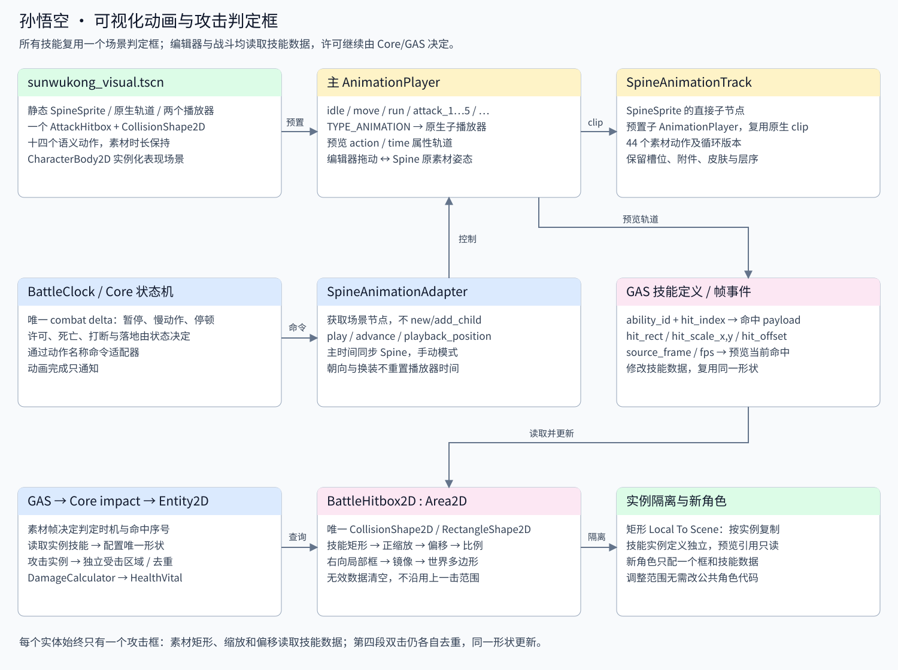

# 角色动画预览与单一攻击判定框

角色运行组件已预置到物理角色场景，动画适配器与判定框仍在 visual 子树中编辑；详见 [角色组件说明](../components.md)。

## 悟空四倍高清资源

当前 `wukong.png` 的所有图集区域已使用用户提供工具中的 Real-ESRGAN
`realesrgan-x4plus-anime` 做四倍超分。1,646 个区域对应 1,389 张独立碎图，
共用图片的区域继续共用同一位置；最终图集由 4049×1560 变为 **16196×6240**。
保留原旋转、裁切偏移、图集边缘填充及预乘透明格式；独立碎图采用双三次透明通道，
颜色使用超分模型。图片以无损方式导入，启用 mipmaps，关闭对预乘图集的透明边缘再修复。

`wukong.skel` 保留 Spine 4.3.23、35 根骨骼、34 个槽、206 套皮肤和44段动画。
骨骼坐标/长度、附件尺寸/偏移、动画位移及位移曲线控制值同步扩大四倍，
旋转、缩放关键帧、时间、事件和绘制顺序保留。

- `SpineVisual.scale` 从 `Vector2(2, 2)` 改为 `Vector2(0.5, 0.5)`，脚底位置不变。
- `sunwukong_profile.tres` 的 `display_scale` **仍为 2**，保持技能判定、原特效和快照坐标。
  新字段 `skeleton_geometry_scale=4` 表示骨架文件的尺寸倍率，
  `get_visual_scale()` 返回实际身体渲染比例 `display_scale / skeleton_geometry_scale`。
- 骨骼挂点返回的变换基向量由 C# 配置资源补偿；原挂点位置和调用方偏移保持一致。
- 无双与霸体快照节点的编辑器初始比例为0.25，运行中仍通过源角色姿态及原单位比例更新。
- 判定框、移动、碰撞、攻击倍率与技能释放时序没有乘四；攻击特效使用其原来的独立骨架。

原始图集及骨架在项目根目录 `.cleanup-backup/spine-hd4x/original/`，
原场景与配置在 `original-config/`。要恢复原画，恢复 `wukong.png/.atlas/.skel`、
`wukong.png.import` 以及这两个角色场景/配置和无双场景，再重新导入资源。

可编辑包位于 `.cleanup-backup/spine-hd4x/editable/`：在匹配版本的 Spine 中导入
`wukong_hd4x.skel`，其 `images/` 按原名称保存未旋转、还原裁切画布的高清碎图。
它没有加入游戏资源导入，避免额外加载一份所有碎图。

离线工具为 `tools/upscale_spine_atlas.py` 和 `tools/scale_wukong_spine_binary.mjs`。
超分工具与官方 Spine 4.3 解析库位于本机工具/缓存目录，不属于游戏运行依赖。
处理来源、哈希和尺寸见 [处理记录](../../../../assets/characters/sunwukong/animation/hd4x_processing.json)。
四倍宽高使未压缩纹理像素量增加16倍，mipmaps 还会额外占用纹理内存。

已完成骨架数据/姿态核对、C#编译和Godot资源导入；没有启动游戏进行功能测试。
游戏验证测试被自动审批拒绝，理由是用户此前要求“不需要测试”。

[sunwukong_visual.tscn](sunwukong_visual.tscn) 保存角色与攻击特效 SpineSprite、SpineAnimationTrack、主与原生子 AnimationPlayer，以及**一个** AttackHitbox / CollisionShape2D。[角色物理场景](../character.tscn) 实例化此表现场景。所有技能、所有命中序号复用同一节点与矩形形状，运行时不创建额外判定框。五段普攻的原版触发帧、特效编辑和跳跃/移速调参见 [孙悟空配置说明](sunwukong-config.md)。

动画结构参考本机 `godot-spine-example/test_sunwukong.tscn`，来源与哈希见 [visual_source_mapping.json](visual_source_mapping.json)。主 AnimationPlayer 的 Animation 类型轨道控制原生子播放器，通过 SpineAnimationTrack 驱动姿态。[Spine 官方说明](https://esotericsoftware.com/spine-godot#SpineAnimationTrack)

```text
AnimationAdapter                 SpineAnimationAdapter：语义动作接口
├─ SpineVisual                   SpineSprite：骨架、注册点、皮肤
│  └─ SpineAnimationTrack         原生辅助节点
│     └─ SpineVisual Track 0      原生 AnimationPlayer：素材动作及循环版本
├─ AnimationPlayer               主播放器：22 个语义动作
├─ WushuangEffect                预置红光与6个GPU快照槽，独立于动作播放器
├─ AttackHitbox                  BattleHitbox2D：所有技能共用
│  └─ CollisionShape2D           唯一 RectangleShape2D，由技能数据填充
└─ AttackEffects                 2 倍素材比例，随角色朝向镜像
   ├─ Primary                    五段普攻、跑攻、跳攻原版特效，各自原生轨道与子播放器
   ├─ Secondary                  第四段第8帧特效，偏移(-17,-4)、缩放(-1,1)
   ├─ SkillPrimary               五个主动技能的主特效、射线
   ├─ SkillSecondary             眼部、火魔斩砸地等第二特效
   └─ BeamEnd                    火眼金睛末端特效
```



跑攻 `run_attack` 与跳攻 `jump_attack` 也已预置身体、特效与单一攻击框轨道；原帧号、独立状态和第四段转身规则见 [上下文攻击说明](../skills/context-attacks.md)。

`skill1/2/3/4/4_1/8` 同样在主播放器预览。主动技能的攻击框读取 `BattleFrameTimelineFeature.attack_segments`，字段、原帧时机、射线转向及火魔斩尾帧见 [基础技能说明](../skills/README.md)。技能循环片段由主动画选择原生 `_looped` clip，动作是否结束仍由技能时间轴决定。

## 编辑技能判定并预览

打开 [attack1.tres](../skills/normal_attacks/attack1.tres)～[attack5.tres](../skills/normal_attacks/attack5.tres)，展开 `features → BattleFrameTimelineFeature → events`，编辑对应 `battle.attack.impact` 事件的 payload。这是攻击范围的唯一配置来源：

| 字段 | 含义 |
| --- | --- |
| `action` | 语义动作名，如 attack_4；用于编辑器动作匹配 |
| `hit_index` | 此技能的命中序号；第四段为 1、2 |
| `hit_rect` | 右朝向、角色脚底局部坐标的原素材 Rect2(x,y,宽,高) |
| `hit_scale_x/y` | 正值缩放位置与尺寸；负值仅表示原版显示镜像，不重复翻转伤害框 |
| `hit_offset` | 正缩放后添加的素材局部偏移 |
| `source_frame`（事件属性） | 命中时机；使用时间线 source_fps，不能直接当物理 tick |

在 Godot 打开 `data/characters/sunwukong/animation/sunwukong_visual.tscn`，进入 2D 视图，选择根节点下的 **AnimationPlayer**，播放或拖动 idle/move/attack_1～attack_5 等动作。主轨道传递预览动作和时间；AttackHitbox 从 `preview_abilities` 中查找相应技能，并按技能的素材帧时间选择当前命中数据。第四段到第 8 帧时，同一个框更新为第二击的偏移，向后拖动会恢复第一击。修改技能命中帧后，预览切换时间会跟着变化，无需再编辑独立的切框轨道。攻击动作在首个命中帧之前也显示第一击的范围，方便对齐；非攻击动作隐藏判定框。

选择 `AttackHitbox/CollisionShape2D` 可检查位置和尺寸；这些值由技能数据自动更新。要调整攻击范围，请修改上表的技能字段，直接拖动形状的修改会在下次刷新时被技能数据覆盖。也可在 AttackHitbox Inspector 设置 preview_action / preview_time，预览某动作的指定时刻。保存技能资源，在 [横版平台演示](../../../../game/levels/biyujing.tscn) 按 F6，J 测试连击、F3 显示实际范围、F8 检查镜像。

## 运行时判定

Core 的 battle.attack.impact 携带技能 ID、攻击编号、命中序号与素材时间。BattleEntity2D 查找自己的 GAS 技能实例，通过 get_definition() 读取对应事件的 hit_rect、hit_scale_x/y 和 hit_offset，更新同一个 AttackHitbox 形状，再进行阵营过滤、独立 Hurtbox 查询、BattleAttackInstance 每击目标去重与 GAS 伤害。事件中的临时几何载荷不覆盖实例技能定义。第四段两次命中仍各有独立的命中序号与去重记录，几何节点始终只有一个。

转换顺序为：素材矩形 → 正缩放 → 局部偏移 → 素材单位比例 → 朝向整体镜像 → 世界坐标。孙悟空比例为 2，运行时取动画配置 display_scale；编辑器使用 AttackHitbox.source_unit_scale。镜像围绕角色脚底进行，矩形包含身后部分时也完整翻转。皮肤、武器图片与骨架包围盒不改变攻击范围。

缺少命中数据或矩形无效时，查询返回空范围并清理有效标记，不沿用前一技能/前一击的形状。Area2D 物理监测关闭、CollisionShape2D 为 disabled，实际判定主动读取几何，不依赖物理 overlap。编辑器预览不执行伤害或授予战斗许可。原五连击仍为六次素材帧事件的瞬时查询；阶段 6 可使用 hit_window_frames 配置有限持续窗口，见 [单段战斗说明](../../../../addons/battle_foundation/combat/README.md)。原版 sensor 完整生命周期尚未迁移。

## 动画时钟与实例隔离

普通无双的红光与残影由 GAS 状态驱动，角色继续播放当前动作。表现节点在身体前绘制、在地形之后绘制，避免负 z_index 被背景遮盖。快照冻结已解算骨骼、朝向和皮肤，只消费一次战斗 delta，配置与原版规则见 [普通无双说明](../../../effects/wushuang/README.md)。

战斗通过 play_action(&"attack_1") 等语义动作调用适配器，主播放器的 play/advance 选择原生 clip，并把播放时间同步到 Spine。游戏中播放器和 Spine 使用手动模式，唯一推进来源为 BattleClock 的 combat delta；编辑器由原生辅助节点处理时间轴预览。

初始主动画按素材时长生成；编辑器可调整语义动作长度，并在同一原生动画轨道编排多个 clip。适配器读取当前关键帧的局部时间驱动原生子播放器，不再因语义时长与单个素材不同而拒绝整个动画层初始化。idle/move/run 与二段跳 jump_2 循环，其余单次播放并保持终帧。二段跳按原 `jumpTwo` 的8帧、30FPS及 `playTimes=0` 循环翻身，上升期间重复播放；竖向速度转为向下后，由动作状态选择 `fall/jumpDown`，不在二段跳时间轴中提前插入下落动作。[原始配置与控制来源](double_jump_source.json) 保存来源和哈希。AnimationPlayer 完成只通知动作系统，攻击许可、死亡、落地与连击仍由 Core 状态机和 GAS 决定。换皮肤不改变角色位置、语义时长或进度。

动画库与骨架共享只读定义，播放器和姿态独立。矩形启用 resource_local_to_scene，各实体有自己的唯一形状；更新角色 A 的框不影响 B。GAS 实例使用独立的技能定义资源图；读取并更新形状不写回共享技能资源。

## 添加新角色

复制表现场景和 [动作配置](sunwukong_profile.tres)，替换骨架、语义动作映射、皮肤、固定脚底偏移与显示比例，并同步 SpineVisual 的位置和比例。保持原生轨道和预置子播放器结构，主 AnimationPlayer 为每个语义动作选择相应原生 clip，时长与循环方式匹配素材。

新角色只保留一个 BattleHitbox2D + CollisionShape2D，形状启用 Local To Scene；配置 preview_abilities 引用新角色技能资源，source_unit_scale 匹配素材比例。主播放器添加 AttackHitbox:preview_action 属性轨道，以及从 0 到动作时长的 AttackHitbox:preview_time 连续线性轨道。无需为每个技能增加攻击框或手工填写命中序号切换时间。

在新技能时间线配置命中帧和 payload 字段，将表现场景实例化为角色的 AnimationAdapter；更改节点名称时更新主动画轨道及角色 attack_hitbox_path。公共角色代码不需要增加每技能的矩形分支。

[离线构建工具](../../../../tools/build_wukong_visual.gd) 专门生成孙悟空初始场景；已有场景默认保留，仅显式 --force 才覆盖重建。日常修改技能资源和主动画轨道即可。

## 验证

```powershell
& '<带 Spine 模块的 Godot 路径>' --headless --path . res://tests/suites/verify_animation_authoring.tscn
& '<带 Spine 模块的 Godot 路径>' --headless --editor --path . --script tools/verify_editor_animation_authoring.gd
```

[运行时验收](../../../../tests/README.md) 检查单一节点/形状复用、技能数据生效、实例隔离、正缩放/偏移/镜像、无效数据清理和真实 GAS 伤害；[编辑器验收](../../../../tools/verify_editor_animation_authoring.gd) 打开真实编辑场景，验证十四个动作前后拖动和技能数据驱动的统一框。既有动画、连击、输入和状态机验收保留。
