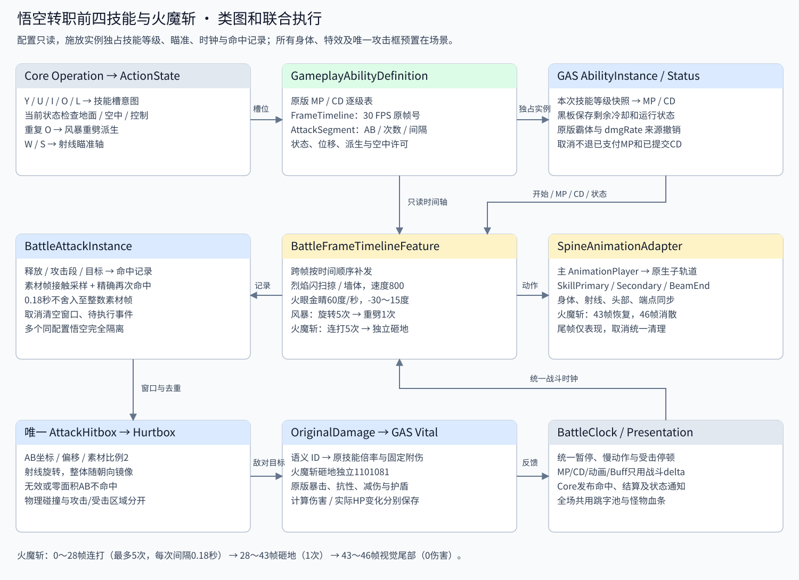

# 悟空基础技能、原版技能面板与装配

当前未转职悟空初始学习升龙斩、烈焰闪、火眼金睛、烈焰风暴、重击和悟空无双，等级均为1。火魔斩素材与技能定义保留，但当前未学习，GAS不会保留可释放实例，默认第五槽为空；旧存档也不能把火魔斩装回当前阶段。原版身体、特效与单一攻击框均预置在 [孙悟空表现场景](../animation/sunwukong_visual.tscn)，游戏启动时不创建组件或技能特效节点。

从大地图进入关卡或打开 [碧玉径](../../../../game/levels/biyujing.tscn) 按 F6。A/D移动、Shift奔跑、K二段跳、J五连击。点击底栏技能打开原版940×590面板：主动技能、特殊技能、学习/升级弹窗与每0.5秒一笔的连续升级。转职与秘技保留原版入口，当前尚未开放。

点击“按键设置”，拖动已学技能到出战格装配，也可先点击技能再点击格子。重复技能会移到新格而不会复制；双击出战主动技能或道具卸下。释放中或冷却中不能更换技能。点击下方键名可改键，Esc取消；装配变化立即更新战斗HUD、提示与实际语义输入。被动仅装配一个，重击使普攻第五击必定暴击，不改变其余攻击。Q/E槽支持背包中的生命/魔法补给，成功使用后才扣数量。

面板场景在 [data/ui/skills.tscn](../../../ui/skills.tscn)，C#显示逻辑在 [OriginalSkillPanel.cs](../../../../addons/battle_foundation/ui/OriginalSkillPanel.cs)，角色预置组件在 [BattleSkillLoadout.cs](../../../../addons/battle_foundation/runtime/BattleSkillLoadout.cs)。[panel_rules.json](panel_rules.json) 保存原版Skill/SkillInit/SkillLev升级要求、灵魂消耗、MP、CD与素材来源哈希；升龙斩二级要求人物6级、75灵魂。战斗MP/CD/伤害仍读取原技能定义与每角色独立的 `damage_rules.skill_levels`，不改写共用 `.tres`。若手工调平衡，应同时维护面板表与实际技能表。

造1跨关存档的 `character.state.skills` 保存技能等级、五主动槽、被动、无双和两道具槽；学习、升级和装配后保存，返回地图、重开与通关也保存。没有skills字段的旧存档采用当前阶段默认技能，其余成长和装备不被重置。

| 按键 / 槽位 | 技能与语义 ID | 一级 MP / 冷却 | 攻击窗口（30 FPS，零起始帧） | 每目标上限 |
| --- | --- | --- | --- | --- |
| Y / skill_1 | 升龙斩 `sunwukong_skill1` | 22 / 2.6 秒 | [3,10)，动作结束于 12 | 1 次 |
| U / skill_2 | 烈焰闪 `sunwukong_skill2` | 28 / 3.4 秒 | [0,15)，持续冲刺 0.5 秒 | 1 次 |
| I / skill_3 | 火眼金睛 `sunwukong_skill3` | 39 / 5.1 秒 | [5,72)，动作结束于 74 | 10 次，间隔 0.2 秒 |
| O / skill_4 | 烈焰风暴 `sunwukong_skill4` | 56 / 3.7 秒 | [0,30)，持续旋转 1 秒 | 5 次，间隔 0.2 秒 |
| L / skill_5 | 默认空槽，可装配已学主动技能 | — | — | — |

火眼金睛仅允许地面施放；其余三个当前主动技能按原版允许空中施放。按下技能可以按原版 `breakActionNames` 打断普通五连击，升龙斩还可打断烈焰闪；魔法、冷却或动作限制不满足时不取消当前攻击。

火眼金睛改为按住技能键施放（默认I），松开立即取消；最长仍为74帧、每目标最多10次命中。按住不会重复支付魔法或重启技能；取消后保留已提交的魔法消耗和冷却。松开、菜单、失焦或控制权丢失会清理射线、攻击框、待执行事件和头部瞄准，未受理的按下缓存也不会在松开后补放。配置在 `skill3.tres` 的 Timeline `cancel_on_input_release`，释放匹配本次施放的语义操作槽，支持按键重映射。

## 各技能运行方式

**升龙斩**：第 3 帧开启挑斩，使用原版 AB `Rect2(-125, -249.05, 273.05, 262.05)`，命中后挑飞。身体播放 12 帧；技能自带 0.4 秒霸体。

**烈焰闪**：采用原版 type5 参数，原速度 800 换算为世界速度 1600、持续 0.5 秒，施放期间关闭重力并清除原垂直速度。8 帧短身体与特效重复播放到第 15 帧。运动控制器逐步扫掠，撞墙停止，不通过直接改位置穿墙；攻击接触以素材帧采样，途中才进入范围的目标也会被命中。同一目标本次冲刺只受伤一次。自带 0.5 秒霸体。

**火眼金睛**：第 5 帧生成眼部、射线及终点特效；射线原坐标 `(57,-43)` 加人物脚底校准 `(0,-4.2384)`，编辑器坐标为 `(57,-47.2384)`，AB 高度 11.4，长度按原版 `Skill31Control.ray()` 覆盖为 1200。W/S 持续按住分别抬高/压低射线，角速度 60 度/秒，范围 -30～15 度；眼部、射线、终点、头部骨骼与唯一伤害框同步转动。原版此技能未启用 `collideGround`，因此这里同样不额外添加地形遮挡。按项目要求总施放时间由原37帧延长为74帧（约2.47秒），每目标上限由5次改为10次；前摇仍为5帧，伤害和循环特效于72帧关闭，保留2帧收招。身体使用原施法末姿态保持，不重复播放起手；MP、冷却和每次命中倍率不变。

头部参照 `Wk.onRaySkill()` 使用相对当前动画的绝对瞄准偏移。每次采样前撤销上次偏移，再读取本次动画基础姿态；同一角度反复采样不会累积旋转。瞄准仅在第 5～72 帧射线生命周期内推进，生成前不转头，第 72 帧射线销毁即恢复头部。Spine 局部角度取反，左向由骨架镜像处理；取消、结束、受击或死亡切换动作时恢复头部基础姿态。

**烈焰风暴**：12 帧短动作循环至第 30 帧，使用原版特效 `scaleX=1.2` 与吸附/浮空参数；自带 1 秒霸体。旋转期间再次按 O，走原版角色分支，切换独立子技能 [skill4_1.tres](skill4_1.tres)，不重复支付 MP 或提交父技能冷却。重劈身体 18 帧，第 7 帧开启独立的一次命中，18 帧随动作结束清理。空中由父技能进入重劈也被允许，不把该派生入口误当成地面独立施放。

**火魔斩**：身体播放 43 帧。两个原版特效从第 0 帧播放，各自的正面积 AB 决定伤害阶段；零面积 AB 不产生伤害。前段最多 5 次，间隔严格保留 0.18 秒，不舍入到 6 个素材帧；第 28 帧开始的砸地改用独立的 `sunwukong_skill8_slam` / 原 1101081 倍率和固定附伤。升空和下落已经烘焙在原版身体骨骼中，因此角色脚底保持碰撞锚点，避免叠加一次物理跳跃导致高度翻倍。第 43 帧恢复操作，原版非 `linkParentState` 特效保留至第 46 帧自然结束；这 3 帧仅表现，不再命中。新攻击、受击、死亡或显式取消会清理旧表现，避免残留。

火魔斩自带 1.5 秒霸体和原版 1.5 秒 `dmgRate=50` 状态。原公式为 `1 - 50/(50+100)`，约承受 2/3 伤害，不能解释成直接减伤 50%。技能状态由 GAS Status 管理，到期或死亡撤销其来源，不写入永久属性。

## 原版击退、击飞与吸附的物理换算

`CharEntity.TargetMove()` 的横向速度进入 `GameFrame.normalToBodyVelocityWeak()`，竖向速度则直接由 `SetBodyVelocity()` 写入 Nape，二者不能使用相同换算。原版素材/逻辑帧率 30、Nape 每帧物理步长 0.1、Common 配置重力 110，当前角色素材显示比例 2。因此 `r=30×0.1=3`，横向世界速度为 `targetMove.x×2`，竖向初速度为 `-targetMove.y×r×2`，受击重力为 `110×r²×2=1980`。

| 技能段 | 原版 targetMove | 世界横向 / 向上速度 | 位移时长 |
| --- | --- | --- | --- |
| 升龙斩 | 48;200 | 96 / 1200 | 1 秒 |
| 烈焰闪 | 20;40 | 40 / 240 | 0.2 秒 |
| 火眼金睛射线 | 0;0 | 0 / 0；覆写旧竖向速度 | 0.3 秒 |
| 烈焰风暴 | -20;60 | -40 / 360 | 0.5 秒 |
| 风暴重劈 | 40;200 | 80 / 1200 | 1.2 秒 |
| 火魔斩连打 / 砸地 | -150;60 | -300 / 360 | 0.3 / 0.6 秒 |

横向值结合原版 `attackedMoveDir` 选方向：1 随攻击者方向，2 取目标相对攻击者的位置。火魔斩的 2 配合负速度使左右目标都被拉向悟空；每次命中重新选方向并替换旧位移计时，不把多次冲量累加。保持原版按命中更新速度的机制，没有加入吸附到固定点的强制位置锁定。目标可能越过中心，再由后续命中重新拉回。

`BattleAttackSegment.reset_vertical_velocity` 保留原版即使 Y=0 也覆写竖向速度的行为；`reaction_gravity=1980` 在目标受击空中阶段生效，落地后恢复自身运动配置。普通玩家跳跃继续使用动作配置的重力与跳跃速度。目标的霸体、无敌、抗性及保护策略继续裁决是否允许位移。

## 联合结构与时间规则



玩家按键 → Core OperationIntent → Core 当前动作叶子 → `BattleEntity2D.request_skill_operation()` → GAS 技能实例。MP 入场检查使用本次技能等级快照，首次更新时间提交 Cost、Cooldown 和原版技能状态。剩余冷却、消耗快照、瞄准角、命中记录和事件游标均属于实例。

`BattleFrameTimelineFeature` 按时间顺序推进位移、攻击段和派生；低帧率跨过多个事件也依次重放。接触检测每个原素材帧采样，并额外安排目标的精确再次命中时刻，目标命中记录以“释放实例 / 攻击段 / 目标”区分。唯一 AttackHitbox 按当前段更新位置、尺寸、旋转与镜像，查询独立 Hurtbox，最后走已移植的原版 DamageStrategy、护盾、HealthVital 与公共跳字。

MP、冷却、身体、特效、Buff 和位移均接受 BattleClock 的战斗 delta；暂停、慢动作和受击停顿使用现有统一规则。技能窗口使用 30 FPS 原素材时间，不将第 12 帧理解为第 12 个物理 tick。动画播放完成只作表现通知，技能可操作性仍由 Core/GAS 动作规则决定。

## 如何配置

| 修改内容 | 入口 |
| --- | --- |
| 角色生命、魔法、攻击、防御、等级 | [sunwukong_2d.tscn](../character.tscn) 的 GameplayVitalAttributeComponent；见 [属性配置说明](../../../../addons/battle_foundation/attributes/README.md) |
| 跳跃高度、重力、行走/跑步速度 | [sunwukong_actions.tres](../actions.tres)；字段说明见 [悟空运动配置](../animation/sunwukong-config.md) |
| 五个技能槽指向的技能 | 角色场景 PlayerOperations 的 `ability_slots` |
| 实际按键 | Esc 菜单重映射或 Core 输入配置；无需修改角色技能代码 |
| MP 等级表 / 冷却等级表 | 本目录技能 `.tres` 的 `features → CostFeature → costs → amounts` / `BattleSkillCooldownFeature → durations` |
| 持续时间、可空中使用、打断对象、霸体 | `BattleFrameTimelineFeature` 的 `duration_frames / can_use_in_air / interrupt_actions / initial_status_ids` |
| 范围、时机、次数、浮空、击退 | `BattleFrameTimelineFeature → attack_segments`，对应段的 `hit_rect / spawn_offset / start_frame / end_frame / hit_interval / maximum_hits / knockback_speed / launch_speed / hit_stun` |
| 特效位置、缩放、动作编排 | 表现场景主 AnimationPlayer 的 `skill1/2/3/4/4_1/8`；原生子播放器驱动 Spine |
| 射线旋转、终点与头部骨骼 | skill3 时间线 `aim_*` 字段 |
| 技能倍率、成长、固定附伤 | [原版伤害数据](../../../damage/original_skills.json) 的对应原技能条目；[映射](../../../damage/skill_mapping.json) 关联语义 ID |

只有一个攻击框，所有技能读取各自数据。不要直接拖动 CollisionShape2D 保存数值：预览与运行时会按技能资源重算。范围坐标为原素材坐标，孙悟空 `display_scale=2`，注册点为脚底；范围、局部偏移与受击速度按显示比例换算，左右翻转围绕同一原点。烈焰闪原速度800按2倍地图换算为世界速度1600；BattleSkillMotion保存换算后的世界速度，运行层不再重复缩放。火眼眼部、射线、末端和判定框统一补齐人物脚底原点偏移，校准由导入器读取sunwukong_profile.skeleton_offset。

特效显示比例统一由父节点 `AttackEffects.scale=(2,2)` 应用一次。子特效与主动画轨道保存原素材比例，通常 `(1,1)`，风暴 `(1.2,1)`；射线原始原点 `(57,-43)` 加上身体校准后为 `(57,-47.2384)`、长度 1200、纵向比例 1，运行时世界长度为 2400。不要在子节点再次乘 2，否则特效及偏移会重复放大。头部瞄准在原生 Spine 动画应用之后、绘制网格生成之前执行，保证骨骼角度与实际画面同步。

Spine 辅助播放器在编辑器重新生成后，可能仅保存 `loop` 属性轨道而不设置 Godot Animation.loop_mode。手动姿态采样同时读取原生循环轨道，使烈焰闪、烈焰风暴的短身体片段继续循环，不会停在末帧。

技能等级默认 1，与人物等级分开。运行时升级技能可以写入该角色独占的 `player.damage_rules.skill_levels[&"sunwukong_skill1"] = 2`；下次施放统一使用该等级的 MP、CD 和伤害。代码或 AI 也可调用 `try_activate_skill(id, {"skill_level": 2})` 指定本次快照。不要修改实例共用的 `.tres` 来保存当前冷却或技能等级。

原版 MP/CD 表包含等级 0，因此采用 `[level]`；固定附伤表采用 `[level-1]`，伤害策略保留其原有索引。所有展示数值为整数，底层时间与倍率仍保留必要精度。公共伤害显示、血条和特效反馈位于 BattleSession/BattlePresentation，不挂在悟空身上。

## 原版依据与导入

按键设置界面编辑 `data/ui/skills.tscn`，显示与拖动逻辑在 `addons/battle_foundation/ui/OriginalSkillPanel.cs`。`tools/refine_skill_keyboard_ui.py` 根据原版 `KeyboardSetModule.as`、`TipsManager.as` 和 `BasicViewNumPage.as` 还原道具格、选中标签、圆形分页、底部说明与自适应技能提示；重导技能资源工具会自动调用它。图标上的额外技能等级数字已移除，装备按键与实际道具数量继续显示；主动技能提示保留原版必要数值，被动和无双只显示名称、描述。

[original_source.json](original_source.json) 保存七条原技能、五条原 Buff、全部 AB、原帧率、控制器出处和源文件 SHA-256；数字编号仅用于追溯，业务调用使用语义 ID。

来源均为本地 `Speculum-4399-master`：

- `exports/zmhj_role_stats/原始配置/Role.json`：角色 2001 转职前 skill1～4。
- `exports/zmhj_role_stats/原始配置/Skill.json`：1101010、1101020、1101030、1101040、1101041、1101080、1101081；`Buff.json`：6000101、6000201、6000301、6000501、19000101。
- `out/zmhj-equip-skill-diag/prefabs/scripts/roles/Wk.as`：烈焰风暴追加重劈、火眼金睛头部瞄准。
- `exports/zmhj_character_state_control/sources/com/wdcgame/engine/entitys/controls/skill/SkillControl.as`、`Skill31Control.as`、`Skill8Control.as` 与同来源的 `model/SkillConfigVO.as`：技能生命周期、射线、火魔斩、等级表。
- `exports/zmhj_character_state_control/sources/com/wdcgame/engine/core/GameFrame.as`、`out/zmhj-equip-skill-diag/com/wdcgame/engine/nape/Nape.as` 与 `cg1` 配置库的 Common.gravity：横/竖速度换算、0.1 物理步长与 110 重力；已将数值和源文件哈希保存至 original_source.json。
- `games/zmhj-g5/cache/assets/man/2001/skill1V427.swf`、`skill8V427.swf`：实际 AB 判定，不使用 UI 的 `atkRange` 代替攻击框。
- `exports/character_2001_dragonbones/1_V427/skeleton.json`：身体帧数及已烘焙运动。特效复用项目已有 `wukong_skills.skel`，无需重复导出贴图。

本次采用普通 PvE 转职前技能数据，加上指定的 skill8；不混入转职技能、奥义、世界 Boss 专用 CD 或 PvP 替代参数。

```powershell
# 离线重导数据与增量追加缺少的技能动画；游戏运行不依赖原工程
python tools/import_wukong_basic_skills.py 'D:/UserData/Downloads/game/Speculum-4399-master'
# 原生 Spine Godot 验收
& '<带 Spine 模块的 Godot>' --headless --path . res://tests/suites/verify_wukong_skills.tscn
# 完整 23 套回归
./tools/verify_stage_eight.ps1 -Godot '<带 Spine 模块的 Godot>'
```

导入工具更新本目录定义、角色技能清单、伤害映射与相关资源索引；已有语义主动画保留，缺少的新动画才追加，避免覆盖用户编辑过的普攻/二段跳。重导技能资源会恢复原版数据，因此自定义改动请先备份或保存为新的技能资源。

[技能验收](../../../../tests/README.md) 覆盖实际按键、一级及高等级 MP/CD、空中限制、逐目标命中次数、0.18 秒精确间隔、低帧率、冲刺扫掠与墙体、射线转向、旋转派生、火魔斩独立砸地、尾帧、取消、暂停、死亡与双悟空实例隔离。首次接入时完整 23 套回归已在原生 Spine Godot 4.7.2 通过。缩放修复后，技能验收扩展到 218 项，另通过普攻特效 299 项、动画编辑 100 项和上下文攻击 86 项；明确检查子层素材比例、父层唯一缩放、左右镜像以及射线世界原点/长度。其他角色的 AI、Buff、属性、伤害和跳字由已有回归套件验证；已重新检查 D3D12 实际画面的五技能、左右射线、重劈和结束帧。

头部与原版 TargetMove 修复后，技能验收扩展至 267 项：增加前摇不转头、松键/重复采样不累积、左右瞄准、射线销毁和取消复位、原生短身体循环、横竖物理单位换算、无霸体目标真实击飞、双侧火魔斩吸附/浮空、完整 12 次命中以及霸体抵抗位移。完整 23 套回归再次通过，最终射线生命周期和原生循环调整另经技能时间轴、动画编辑、上下文攻击及普攻特效验收；已检查原生 D3D12 渲染。
