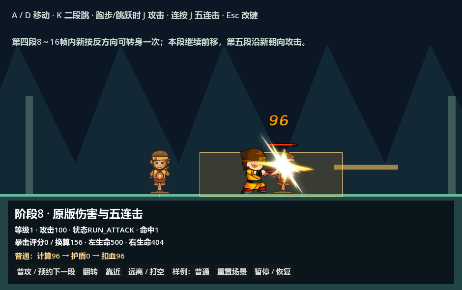
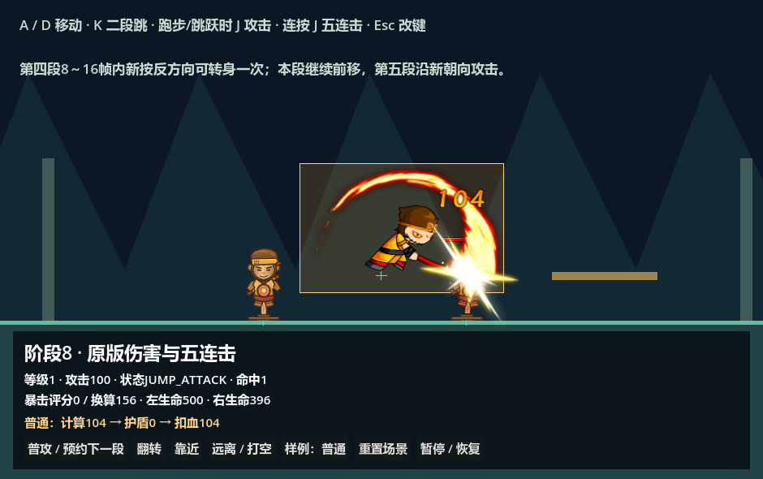
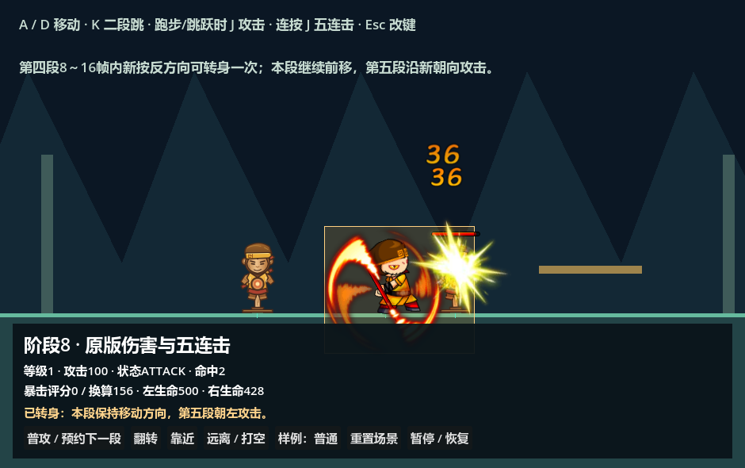

# 孙悟空跑攻、跳攻与第四段转身

打开 [原版伤害场景](../../../../game/levels/biyujing.tscn) 或 [平台场景](../../../../game/levels/biyujing.tscn)，按 F6 运行。A/D 移动，Shift 或同方向双击进入奔跑，K 跳跃，J 攻击：奔跑时发动跑攻，起跳或空中时发动跳攻，其他可攻击的地面状态开始原有五连击。所有入口消费 Core 操作意图，改键无需修改角色代码。

## 原素材与技能时间

身体和棍影均使用项目已有 Spine 素材，新增语义动作已经保存在 [visual 场景](../animation/sunwukong_visual.tscn) 的主 AnimationPlayer 中。原配置、身体帧数、SWF 攻击框及 SHA-256 见 [来源映射](context_attack_source_mapping.json)；数字来源编号仅用于伤害和保护数据追溯，业务技能使用名称 ID。

| 动作 / Core 状态 | 技能 ID | 原生动画 | 总时长（30 FPS） | 命中窗口 | 特效窗口 | 基础倍率 |
| --- | --- | --- | --- | --- | --- | --- |
| run_attack / RUN_ATTACK | sunwukong_run_attack | runAttack | 12 帧 / 0.4 秒 | [3, 12) 帧 | [3, 12) 帧 | 1.2 |
| jump_attack / JUMP_ATTACK | sunwukong_jump_attack | jumpAttack | 13 帧 / 约 0.433 秒 | [5, 12) 帧 | [5, 12) 帧 | 1.3 |

每次施放独立保存攻击编号、攻击段与目标命中记录；持续重叠对每个目标只结算一次。伤害仍经过 GAS 原版策略，倍率由对应原版技能映射进入计算。单一 AttackHitbox 从技能攻击段读取 ABRect：跑攻 `Rect2(-98, -84.95, 290, 90.95)`，跳攻 `Rect2(-100, -137.95, 251, 158.95)`，再按现有素材比例及角色朝向转换。

跑攻锁定常规移动、跳跃与转向，时间轴按起手朝向施加 480 世界像素/秒的冲刺（原 240 素材单位 × 2），无碰撞时共移动 192 像素。位移经过物理扫掠，撞墙不会穿透；失去地面支撑会取消跑攻并进入空中。结束后根据当前方向与奔跑意图返回 RUN、MOVE 或 IDLE。

跳攻保持重力和原 `canWalk` 的横向移动许可，锁定转向及再次跳跃。动画结束后若仍在空中，回到 AIR（枚举 JUMP）；提前落地会先取消当前技能、未执行命中与特效，再进入 LAND。受击、死亡和显式取消同样清理旧时间轴。动画完成通知不会自行绕过战斗状态许可；暂停、慢动作和受击停顿仍使用统一战斗时钟。

## 第四段的一次性反向窗口

[sunwukong_combo.tres](combo.tres) 中 Step4 新增 `turn_window_start_frame = 8`、`turn_window_end_frame = 16`。默认窗口为 **[8, 16) 素材帧**，约 0.267～0.533 秒，第 8 帧允许、第 16 帧不允许。这是本次需求新增的可配置规则，原版来源数据不提供这一窗口。

窗口内新按下与当前朝向相反的方向键，可以转身一次。提前按住后进入窗口、持续按住、松开，以及菜单或失焦产生的取消释放，都不会消耗或触发转身机会。用过一次后，本次第四段不能再次翻转。

转身时身体、特效和后续攻击查询使用新朝向，AnimationPlayer 继续原进度；不重新播放动画、不重建施放或命中记录。当前速度与第四段位移方向保留起手快照，后续 tick 继续沿原方向移动。第四段结束后，如果已经按 J 预约第五段，第五段按转身后的朝向释放，即使此时又按另一方向，也不会覆盖该连招朝向。取消或新段开始会清除本段转身额度。

```text
第四段起手向右 → 第8帧新按左 → 身体/特效向左，仍向右移动
                               → 再按右不二次转身
                               → 预约第五段 → 第五段向左攻击
```

当前 Step4 的 `root_motion_speed = 100`、`root_motion_frames = 16` 保留已有配置。可单独调整速度和位移窗口；转身窗口与位移窗口是两项配置。其他段默认两个转身字段均为 -1，表示禁用。

## 编辑入口

| 调整内容 | 资源及字段 |
| --- | --- |
| 角色接入跑攻、跳攻 | [sunwukong_actions.tres](../actions.tres)：run_attack_skill_id / jump_attack_skill_id；其他角色默认留空 |
| 跑攻命中、倍率、硬直、位移 | [run_attack.tres](normal_attacks/run_attack.tres)：features → Timeline → attack_segments / motion_windows / action_rules |
| 跳攻命中、倍率、硬直、移动许可 | [jump_attack.tres](normal_attacks/jump_attack.tres)：features → Timeline → attack_segments / action_rules |
| 第四段转身帧数及推进速度 | [sunwukong_combo.tres](combo.tres)：steps → Step4 → turn_window_start_frame / turn_window_end_frame / root_motion_speed / root_motion_frames |
| 身体与特效预览 | [sunwukong_visual.tscn](../animation/sunwukong_visual.tscn)：选择主 AnimationPlayer 的 run_attack / jump_attack / attack_4 |
| 跳高、重力、行走与奔跑速度 | [悟空运动配置说明](../animation/sunwukong-config.md#调整移动跳跃与动作规则) |

主播放器同时驱动预置身体、特效原生子播放器和攻击框预览，可前后拖动时间轴。新动作切换或重复播放仍先恢复 Spine Setup Pose，避免前一段附件残留。伤害范围以技能资源为准，修改后同步检查实际命中与预览；不需要再增加攻击框节点。

## 实现与验证

Core 现在包含 17 个动作叶子，新增 RUN_ATTACK / JUMP_ATTACK；[BattleEntity2D](../../../../addons/battle_foundation/runtime/battle_entity_2d.gd) 按当前状态选择技能。第四段的 `try_turn_combo()` 由当前 [Core 叶子](../../../../addons/battle_foundation/runtime/battle_action_leaf_state_2d.gd) 消费方向 PRESSED 意图调用。[BattleComboState](../../../../addons/battle_foundation/runtime/BattleComboState.cs) 与 [BattleAttackInstance](../../../../addons/battle_foundation/runtime/battle_attack_instance.gd) 分别保存位移朝向和攻击朝向，实例间互不污染。

离线 [导入工具](../../../../tools/import_wukong_context_attacks.py) 读取 Speculum 原始数据，追加资源索引和语义动画；已有技能资源及已存在的语义动画保留编辑结果。运行游戏无需 Speculum 或 Python。

```powershell
& '<Spine-Godot.exe>' --headless --path . res://tests/suites/verify_wukong_context_attacks.tscn
& '<Spine-Godot.exe>' --headless --editor --single-window --path . --script res://tools/verify_editor_wukong_attack_effects.gd
```

新增验收覆盖真实按键、原版帧号/范围/倍率、双向跑攻、跳攻落地、碰撞、暂停、受击和死亡取消、菜单阻断、重映射、窗口边界、一次转身、速度与动画进度保留及第五段方向。编辑器验收覆盖七个攻击动作的前后拖动、原生姿态及特效显示。既有运动、操作、五连击、伤害与受击回归通过。






