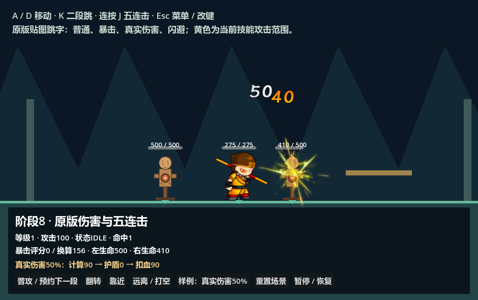
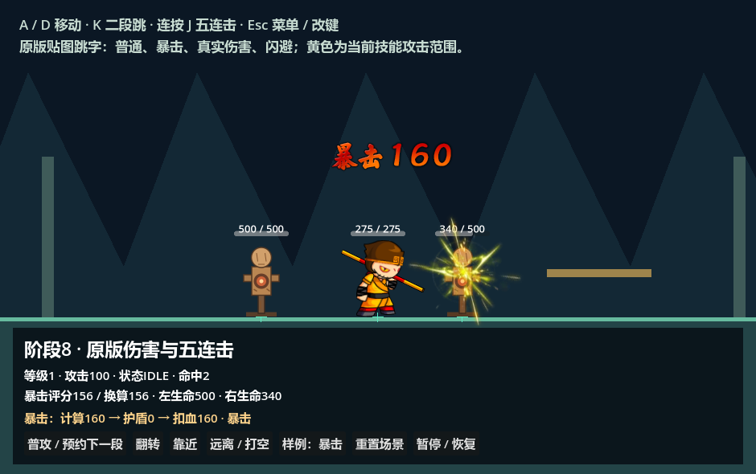

# 原版受击与伤害跳字

角色自身的普通无双红光与残影见 [无双表现](wushuang/README.md)：空格预览、原版颜色与时序、预置 GPU 快照池和配置入口。

原版霸体红黄描边见 [霸体表现](super_armor/README.md)：复用统一霸体规则、独立GPU轮廓、无双优先，不覆盖受击染色与装备外观。

头顶生命条已换为原版怪物样式，出生隐藏、受伤显现、残血补间与两秒隐藏规则，以及跳字Tween性能实测见 [原版怪物血条与补间说明](monster-health-bar.md)。大量跳字的图集、缓存与GPU压力结果见 [高并发性能](damage-number-performance.md)。

F5 运行 [伤害样例场景](../../game/levels/biyujing.tscn)，J 开始普攻，再次按 J 预约下一段，完成五连击；第四段有两次命中，长按不自动连招。“普攻 / 预约下一段”按钮使用同一个入口。“靠近”按当前朝向摆放木桩，保证正面木桩进入第四段较短的第一击范围；第三段原范围也可能打中身后木桩。木桩已死亡时按“重置”重新加载预置场景。

伤害样例通过 [独立索引](../levels/biyujing/progression/manifest.json) 引用原五段技能与连击资源，仅覆盖继承场景的行动配置；[单段场景](../../game/levels/biyujing.tscn) 仍保持阶段六单段普攻。角色、木桩、地图、反馈层均预置在场景中，运行时每次命中取得独立跳字状态，节点到期后隐藏复用。

样例面板预置在画面底部，为原版上飘轨迹留出空间。





## 编辑器预览

- 打开 [damage_number.tscn](damage_number.tscn)，在根节点修改 `number` 和 `style` 查看静态数字外观。动画仅由Tween执行，运行伤害样例查看上飘、缩放和淡出；修改轨迹请编辑 [跳字脚本](../../addons/battle_foundation/presentation/battle_damage_number_2d.gd) 的 `_sample_fly()`。
- [damage_number_textures.tres](damage_number_textures.tres) 是共享只读贴图库：14组、115个AtlasTexture别名共用一张图集，原PNG全部保留；原暴击的21个别名保留，不把它们当成动画帧。数字、样式与动画进度保存在各次跳字节点中。
- [combat_feedback_2d.tscn](../../addons/battle_foundation/presentation/combat_feedback_2d.tscn) 的 `DamageNumbers/Rows` 是预置屏幕反馈层，同时管理跳字缓存；默认不预热，活动数量请使用 `get_active_count()`。反馈脚本的 `bleed_offset` 控制角色跳字偏移，默认 `(0,-60)`；只镜像X，数字本身不镜像。`hit_effect_unit_scale` 将原素材场景单位换算到当前2倍战斗坐标。
- [hurt_effect_all.tscn](hurt_effect_all.tscn) 保留原版11帧、30FPS、注册点 `(72,73)` 和透明结束帧。

## 原版生成、排列与轨迹

来源为 Speculum 的 `mission2_20250707_1.swf`。所有PNG保留透明边距和原像素，导出时逐像素对照原图集；源包、图片及AS代码哈希见 [来源映射](../../assets/effects/damage_numbers/source_mapping.json)。

原版 `DamageControl` 普通/暴击主分支在目标场景坐标添加固定 `(0,-60)`，**普通伤害没有随机出生偏移**；闪避分支才添加 `(random*20, -60-random*20)`。转到屏幕坐标后再加目标方向对应的 `bleedOffset`，配置缺省为 `(0,-60)`。`BattleTopLayer.showHurtReal` 对真实伤害追加横向正负随机 `0～60`、纵向 `-10～-40` 的屏幕偏移。项目使用独立 `damage_numbers` 随机流，跳字数量与样式不会改变伤害随机序列。

`NewBleedNumber.setNum` 使用数字0～9拼接，每个字宽后减2像素，再按原 `rePos` 公式定位。`NewBaoJiNumber` 与 `NewRealBaoJiNumber` 使用各自暴击标识和数字组；其非对称定位也保留。原 `Image` 是 Bitmap，以完整位图左上角显示，**未使用 Texture.pivot**，因此这里不会再次扣除贴图枢轴或裁边偏移。

`showHurt` 和 `showHurtReal` 均调用 `fly()`，包括暴击；并未调用另一个 `flyBao()`：

| 时间 | 位移、缩放与透明度 |
| --- | --- |
| 0～0.2秒 | 左移20像素、上移100像素，缩放0.8→1，Quad.easeOut |
| 0.2～0.3秒 | 保持位置、缩放和不透明度 |
| 0.3～0.9秒 | 横向回到出生X，纵向回落40像素至出生Y−60，透明度1→0.2，Quad.easeOut |
| 0.9秒 | 隐藏并回收当前跳字实例，独立状态结束 |

运行时通过 `Tween.interpolate_value` 和战斗时钟delta精确执行上述连续二次缓出曲线，不为每条实例分配Tween/Tweener对象。跳字场景只包含根节点与Glyphs，不再提供采样动画或播放器预览。原代码没有随机旋转。数字出生在命中时的屏幕位置，目标之后移动、转向或死亡均不拖动旧数字。动画手动接收 BattleSession 的战斗delta，暂停、慢动作和受击停顿沿用统一时钟；低帧率跨过结束时间也会清理。

窗口缩放时，出生点先通过 `get_canvas_transform()` 转到逻辑视口，再通过跳字容器的 `make_canvas_position_local()` 转入反馈层。窗口拉伸只在渲染时应用一次；避免把包含最终窗口拉伸的 `get_viewport_transform()` 结果直接作为 CanvasLayer 子节点位置，否则放大窗口后数字会偏移到画面外。940×590、1880×1180、1280×720及640×480均有回归检查，同时覆盖反馈层的偏移与缩放。坐标API见 [Godot CanvasItem 文档](https://docs.godotengine.org/en/stable/classes/class_canvasitem.html#class-canvasitem-method-get-viewport-transform)。

## 数字与实际扣血的关系

| 样例第一击 | 原版跳字 | 面板实际扣血 |
| --- | --- | --- |
| 普通 | 普通80 | 80 |
| 暴击 | 暴击160 | 160 |
| 火抗100 | 普通40 | 40 |
| 固定附伤7 | 普通87 | 87 |
| 真实伤害50% | 普通40与真实50，分别跳字 | 90 |
| 护盾50 | 盾后普通30，另有文字解释护盾50 | 30 |
| 闪避 | 原版“闪避”图片 | 0 |
| 免疫 | 文字“免疫”，无虚构原素材跳字 | 0 |

跳字使用盾后 `normal_damage` 和 `true_damage`，按原 `setNum(int)` 截断成整数。过量伤害仍显示结算值：目标剩5生命时，跳字80，面板实际扣血5；不会把结算数值误当生命变化。生命面板继续按既有规则四舍五入，底层伤害和生命保持原精度。根节点也能预览玩家受伤、第二样式、特殊伤害、秒杀与回血贴图；这些资源入口不代表对应未移植的业务机制已完成。

验收 [verify_damage_numbers.tscn](../../tests/README.md) 共78项，覆盖原版资源、动画、八个实际命中样例、普通固定与闪避随机位置、真实暴击双数字、独立实例、暂停、随机隔离、过量伤害、左右五连击、到期清理及窗口/反馈层坐标转换。窗口修复后阶段六64项、阶段八90项回归通过；此前阶段七117项与移动连招222项也已通过。

```powershell
./tools/verify_stage_eight.ps1 -Godot '<支持Spine的Godot>' -Suites damage_numbers,original_damage,single_attack,skill_timeline,stage_four
```

重新导出使用已有 Pillow 环境：

```powershell
python tools/export_original_damage_numbers.py '<Speculum-4399-master根目录>'
```

导出器读取引用仓库的已还原PNG并逐像素核对原AMF图集，只写当前Godot项目的素材、来源映射、资源库及动画场景。
