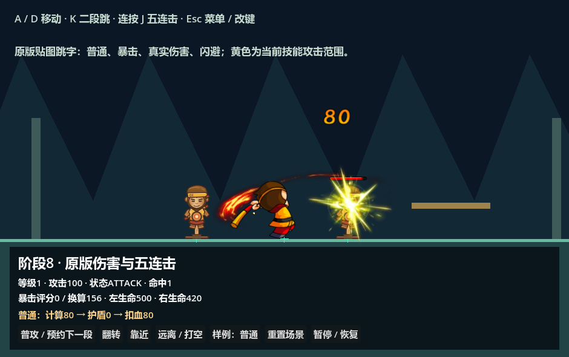

# 原版怪物头顶血条与跳字补间

当前 [原版伤害场景](../../examples/original_damage_demo.tscn)、单段和多段样例都复用 [怪物血条场景](monster_health_bar.tscn)，不再使用灰色 ProgressBar 或常驻生命数字。悟空默认不显示怪物头顶血条，生命值继续显示在业务面板。



## 原版显现条件

依据本地反编译 `prefabs/scripts/ManEntity.as`：

| 入口 | 原版行为 |
| --- | --- |
| `Awake`，816～822 行 | 仅 `showHP=true` 时建立血条；`alwaysShowHP=false` 则出生隐藏 |
| `ShowBleedBar`，6840～6879 行 | 默认使用 mission 的 `monsterBleedBar`，缺省 `hpBarOffset=(0,-100)`；另有 PvP 与 hpBarLink 自定义分支 |
| `onDamage`，5854～5897 行 | 扣血流程之后调用 `showHpBar()`；原版的负伤害也可表示恢复 |
| `showHpBar`，6005～6041 行 | 先显示；若遮罩比例等于原始 `hp/hpMax`，直接返回；否则修正比例、更新前景、启动残血补间与隐藏计时 |
| 非零低生命 | 0～4%的生命比例显示成4%，生命为零显示0，上限为100% |
| 残血 `mcBar2` | 从左端缩放到新比例，持续0.6秒；原版 TweenLite 默认 easeOut 为二次缓出 |
| 普通非队友 | 清除旧计时并调用 `setTimeout(hideBleedBar,2000)`；后续不同血量比例会重新计时 |
| `hideBleedBar`，6057～6063 行 | `alwaysShowHP=false` 才隐藏 |
| 队友 `doIn1Second` | 每秒调用 `showHpBar`，血量更新不创建2秒隐藏计时 |
| 死亡，5589～5592 行 | 立即隐藏血条 |
| `SetDirection` / `scaleTo` | 朝向影响偏移X；原版身体缩放还有 bodySize 的Y补偿 |

**同值提前返回的细节**：原版先将血条设为可见，再比较未经限幅的血量比例。因此相同比例不会续上2秒计时；若旧计时已经结束，相同比例调用甚至可能让血条一直显示。这不是“任何命中都重设两秒”。低于4%时，显示比例与原始比例不同，仍可进入更新分支。`DamageControl.as:1719` 的通用分支也会调用零伤害 `onDamage`，所以零伤害有效命中可以触发上述边界。

本地 Monster 表的突木桩条目1024001使用 `showHP=1`、`alwaysShowHP=0`、`hpBarOffset="0;-100"`；Role表的悟空2001没有提供这些头顶血条字段。编号仅用于来源证明，业务ID保持“木桩”和“孙悟空”。

本次移植的是**通用怪物头顶条**。Boss头像/多管血条、PvP条、自定义hpBarLink、E71101等死亡倒计时条是独立原版入口，当前样例没有这些实体，未用通用条替代它们。

## 原图与节点布局

直接从原版 `mission_20260406_1.swf` 的符号179导出位图原字节，未重绘、放大或修改颜色：背景bitmap173为62×6，生命bitmap175为60×4。SHA-256、源包与AS证据见 [来源映射](../../assets/ui/monster_health_bar/source_mapping.json)。

- 背景以 `(0,0)` 为中心，范围 `(-31,-3)～(31,3)`。
- 生命前景位于 `(-30,-2)`，用原遮罩范围裁切，保持贴图宽度不变。
- 遮罩原点 `(-31,-3.55)`，完整尺寸 `(63,7.1)`；只将其宽度乘显示比例。
- 残血层使用同一生命贴图，RGB乘0.5，左端缩放；与前景裁切相互独立。
- 预置场景根节点按2倍战斗单位显示，当前0.5倍摄像机恢复原素材像素大小，采用Nearest过滤。

打开 [monster_health_bar.tscn](monster_health_bar.tscn) 可编辑原图节点。在角色的 `CombatFeedback` 中设置 `health_bar_enabled`、`always_show_health_bar`、`show_player_health_bar`；在 `HealthBar` 中设置 `source_offset`、`unit_scale`、`is_team`。默认偏移为 `(0,-100)`，换算后挂在角色脚底上方200个战斗单位。角色转向只镜像偏移X，血条和填充方向不反向。

`show_health_values` 只用于需要整数数值的调试；默认关闭。生命属性、治疗、最大生命和GM修改仍走现有GAS快照，反馈只读取结果。父场景初始化属性及补满生命不触发出生显现；出生同帧真实伤害仍及时显示。

原版2秒隐藏使用 Flash `setTimeout`。Godot实现按本项目阶段一约定，残血补间与隐藏倒计时都使用 BattleClock，因此菜单暂停、慢动作和受击停顿同步影响它们。这是项目统一时间规则，不是复制原版的独立墙钟定时器。

## 跳字：AnimationPlayer 与 Tween

[Godot官方Tween文档](https://docs.godotengine.org/en/stable/classes/class_tween.html) 将 Tween 定义为更轻量、适合数值补间的动画对象；AnimationPlayer更适合需要编辑器关键帧和多轨编辑的动画。性能收益依实际轨道数、实例数和渲染负载而变。

项目原来的跳字 AnimationPlayer 有3条轨道，各28个30FPS采样点。现在 [运行时跳字](damage_number.tscn) 只有根节点和 Glyphs，使用战斗时钟直接采样 `Tween.interpolate_value`，精确复刻原 `NewBleedNumber.fly()` 的连续 `Quad.easeOut`：

| 时间 | 轨迹 |
| --- | --- |
| 0～0.2秒 | 位移 `(0,0)→(-20,-100)`，缩放0.8→1，二次缓出 |
| 0.2～0.3秒 | 位置、缩放和透明度保持 |
| 0.3～0.9秒 | 位移 `(-20,-100)→(0,-60)`，透明度1→0.2，二次缓出 |
| 0.9秒 | 删除当前实例 |

跳字只接受 `advance_number(BattleClock.delta)`，SceneTree不会自行推进。共享图集减少贴图切换，有界节点池回收到期实例，取消/卸载会清理活动节点及缓存；不创建每条数字的Tween/Tweener对象。普通、暴击、真实伤害和闪避仍使用原贴图和原出生位置规则，没有加入随机旋转。多次命中保持独立跳字，窗口坐标修复和战斗随机流隔离继续保留。

跳字仅保留Tween逻辑，不提供采样动画与AnimationPlayer预览。打开 [damage_number.tscn](damage_number.tscn) 编辑 `number/style` 可查看静态外观；动画在伤害样例中查看，轨迹在 [跳字脚本](../../addons/battle_foundation/presentation/battle_damage_number_2d.gd) 的 `_sample_fly()` 中修改。连续曲线在非30FPS采样点也按原公式精确插值。

## 历史性能对比与当前真实跳字基准

使用项目 Godot 4.7.2 `ed1daf0bf`，每轮1000个相同Node2D目标、54次1/60秒更新，预热后交替5轮，统计中位数。基准仅比较动画侧，不加载数字贴图或测绘制/整场帧率。

| 指标 | AnimationPlayer | Tween |
| --- | ---: | ---: |
| 创建1000个动画 | 19.882 ms | 13.556 ms |
| 1000个动画×54次推进 | 76.098 ms | 40.495 ms |
| 静态内存增量 | 10,566,984 B | 9,224,152 B |
| 每次跳字额外AnimationPlayer节点 | 1 | 0 |

这组实现中，Tween更新耗时约降低47%，创建耗时约降低32%，内存增量约降低13%。这是此前本机微基准，不能推导游戏帧率也提高47%；它未包含数字绘制和贴图切换。当前已完成图集与节点池重构，此表只保留历史参考。完整5轮数据见 [实测JSON](../../addons/battle_foundation/docs/feedback-animation-benchmark.json)，当前 [benchmark_feedback_animation.tscn](../../tools/benchmark_feedback_animation.tscn) 已改为测量真实跳字的缓存复用、曲线推进与内存开销，结果输出到 `.cleanup-backup/feedback-tween-benchmark.json`。历史对比记录不再依赖任何预览场景或AnimationPlayer测试分支。包含GPU绘制及完整帧的当前测试见 [高并发性能说明](damage-number-performance.md)。

## 验证与重新导出

[verify_original_feedback.tscn](../../examples/verify_original_feedback.tscn) 覆盖原素材尺寸、原遮罩、出生隐藏、有效伤害、重复命中、2秒计时、0.6秒残血补间、4%最低显示、同值提前返回、常显/队友/死亡、朝向、实例隔离、初始化、暂停、慢动作，以及非采样点连续跳字和低帧率清理。现有跳字八种伤害样例、左右五连击、单段攻击及技能时间轴回归继续通过。

```powershell
./tools/verify_stage_eight.ps1 -Godot '<支持Spine的Godot>' -Suites original_feedback,damage_numbers,original_damage,single_attack,wooden_dummy,skill_timeline
# 动画性能微基准：
& '<支持Spine的Godot>' --headless --path . res://tools/benchmark_feedback_animation.tscn
# 无损重新导出原版血条；需要Java17和引用仓库已有JPEXS库：
python tools/export_original_monster_health_bar.py '<Speculum-4399-master根目录>'
```
