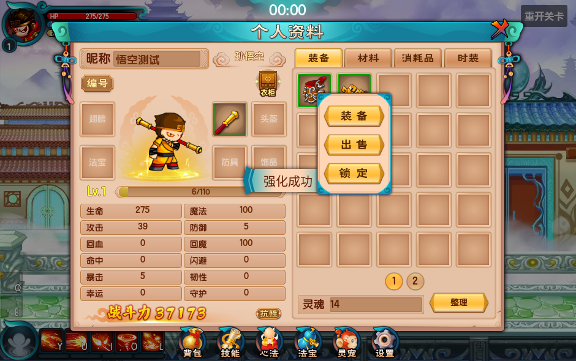

# 原版背包面板细节

初次面板改造按当时要求未运行测试。2026-10-10 报错修复已使用项目的 Spine Godot 4.7.2 实际导入、启动关卡并运行回归。

报错来自 `$ComparisonTooltip` 的动态节点类型，`visible` 无法通过 `:=` 推断；现显式声明 `bool`。同时修复场景导出属性顺序：菜单、时装开关和页码贴图必须在 `script` 绑定之后赋值，否则 Godot 会丢弃这些脚本属性。重导出脚本同步处理顺序，避免再次生成错误场景。

`verify_original_battle_ui` 包含95项检查，覆盖实际悬浮单卡、双卡对比、GAS装备数值、锁定菜单、原文字帧、抗性提示、时装开关、编号展开/收回、动态光效、直接卸装、昵称与图标边框。日志保存于忽略目录 `.cleanup-backup/`。

本轮背包与镜头修正通过5组回归、437项检查：loot_growth 54、original_battle_ui 95、camera_follow 58、level_progression 189、original_boss_presentation 41。GPU截图确认图标、品质边框、描边与菜单，实际向昵称框发送B键也不会关闭背包。掉落拾取失败重试不会弹提示，物品仍保留。



| 内容 | 实现与配置入口 |
| --- | --- |
| 人物比例 | `inventory.tscn → RolePortrait` 外层缩放0.5，抵消战斗视觉内部2倍缩放。脚底保留原 `BodyView.createRole` 的 `(270,280)`；预览是独立Spine实例，换装备只同步皮肤。 |
| 后方动态光效 | 原背包SWF57号符号30帧，以30FPS循环，在 `(165,158.35)` 播放。静态底图拆出动画层、衣柜按钮、编号与时装开关，防止重复叠加。`PortraitGlow` 开包播放、关包停止。 |
| 昵称与编号 | 昵称框为预置LineEdit，输入即时调用 `Inventory.set_display_name()`，最多15个Unicode字符；在框内输入B不会关闭背包。初始昵称与编号在角色 `Inventory` 填 `Display Name`、`Player Number`。编号不使用战斗实体ID替代；留空显示“未设置”并禁用复制。图标悬浮0.5秒滑出，离开0.2秒收回，复制成功接公共通知。 |
| 抗性悬浮 | 仅展示非零最终抗性。正值按 `round(v/(v+100)×100)%` 显示减伤，负值按绝对值显示增伤；依据 `ResistView.getTips`。提示不截获鼠标，离开按钮关闭。 |
| 装备/道具卡 | 原品质颜色与黑色描边、类型、角色、强化名称、当前GAS装备修正、未镶嵌孔、说明、出售价值。260像素卡片按内容调整高度。背包同部位有已装备物品时，两卡并排，左卡带原“装备中”标记。阶段14的强化/洗练事务在插件中，背包不提供成长按钮。 |
| 物品图标与边框 | 初始与掉落装备统一使用原Resource.icon2，地面仍使用icon1。原 `PropBody.addProp` 按quality+2定位源帧：空格用slot_0、普通用slot_1、优秀用slot_2；已导入10种品质边框，卸装和切页也会重新显示正确品质。 |
| 点击菜单 | 插件 `get_context_actions` 决定条目与可用性，原按钮文字贴图显示。背包装备只有装备/出售/锁定，道具为使用/出售；点击已装备物品直接经插件卸下，无选择弹层。容量满或战斗限制仍拒绝卸装并保留物品。无额外关闭按钮，移开或外部点击关闭；出售确认期间不能替换操作目标。 |
| 衣柜与时装 | 衣柜图标只有一个原图层，调用独立 `wardrobe_requested`；完整衣柜解锁、购买和试穿模块尚未移植，无接入时显示公共提示。时装页“显示时装”独立调用 `set_show_fashion`，只改变外观，不改变装备及属性。 |

`OriginalInventory` 管理物品、事务和菜单规则；`OriginalItemPresenter` 负责展示模型与抗性公式；`OriginalInventoryTooltip` 负责260像素卡片。界面不直接修改物品或GAS最终属性，所有弹层、编号、动画节点均在场景中预置。

`Presentation Rules` 使用 [presentation_rules.json](presentation_rules.json)，强化名称来自原 `EquRefine.refineName`。素材来源与SHA256、帧数、坐标记录在 `assets/ui/original/inventory_details_source.json`。原始规则依据包括 `BodyView.ItemUid`、`BodyView.checkFashion`、`ResistView.getTips`、`TipsManager.BackpackTips/BackpackTwoTips`、`MenuManager.BackpackMenu` 和 `PropColor`。

重导出细节（此命令只导出/生成文件）：

```powershell
python tools/refine_inventory_details.py --original-root D:/UserData/Downloads/game/Speculum-4399-master
```

`--author-only` 使用已有素材重新生成细节节点。基础UI生成器会通过 `refine_original_inventory_ui.py` 接回此步骤；手工修改生成器负责的节点后，应同步到生成脚本或另建业务场景，避免重导出覆盖布局。

重新生成基础/细节场景后，运行 `python tools/author_stage_fourteen.py` 应用昵称输入及移除旧成长菜单的补丁。
