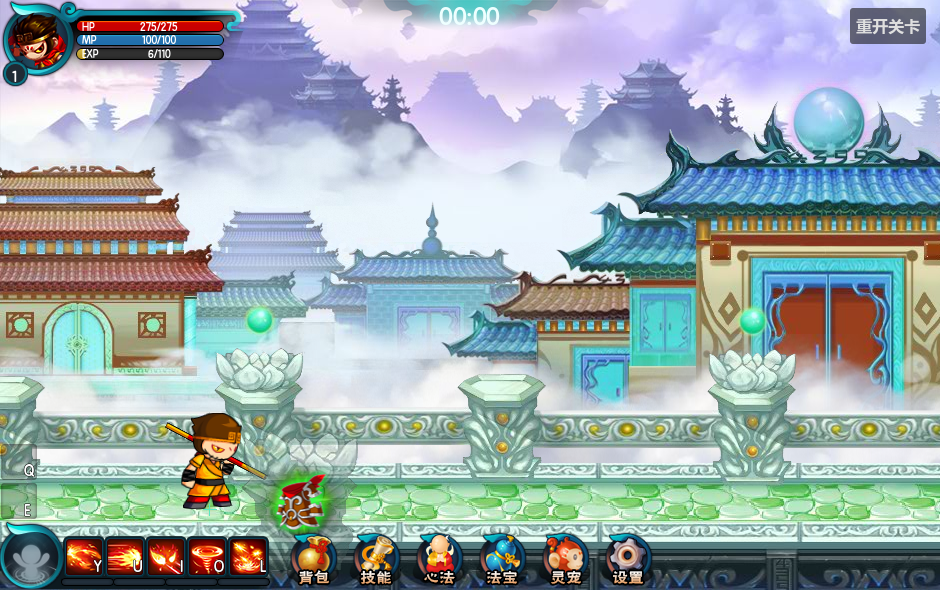
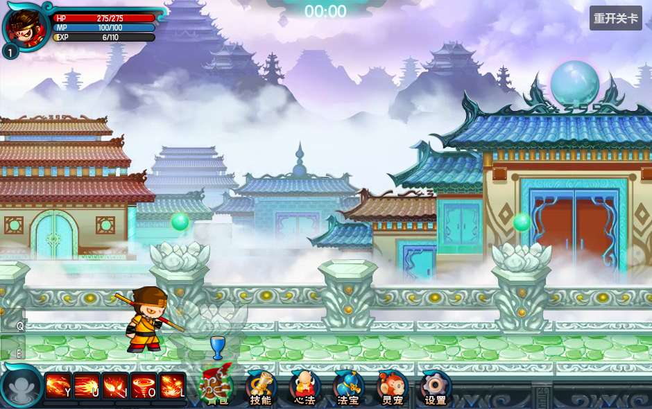
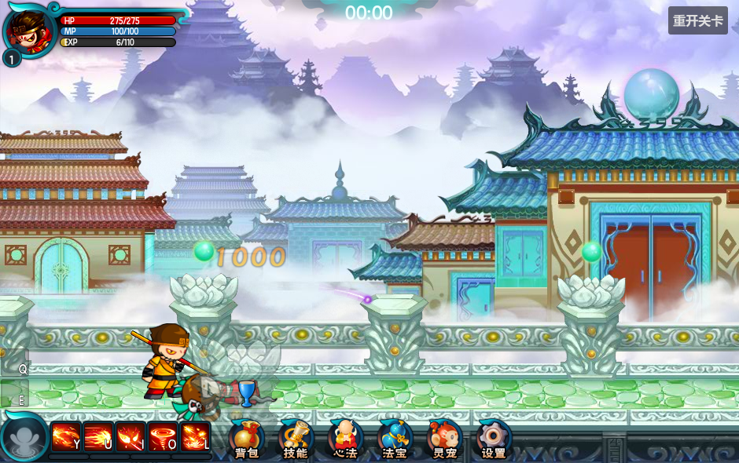
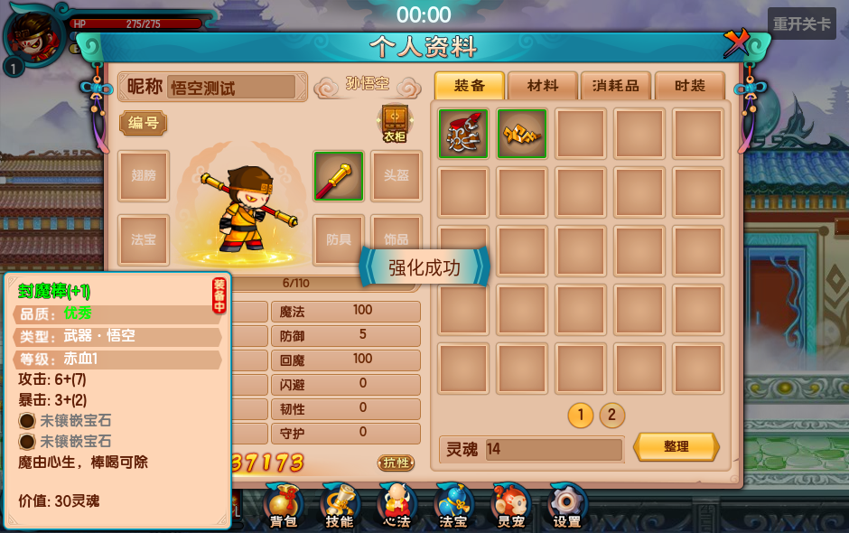

# 阶段14：背包、掉落、装备与成长

F5运行 `game/levels/biyujing.tscn`。掉落节点已预置在 **BattleSession/Loot**；不属于悟空，初始化不会为角色补建组件。Simple Inventory管理物品、容量、穿戴和成长事务，GAS计算最终属性，原动画适配器处理装备皮肤，Core传递战斗事件。

## 在游戏里操作

击杀剑舞或驭兽使获得经验与灵魂；地面装备接近后拾取，材料按原 `isAutoPick` 规则在落地后自动拾取，萝卜和药瓶直接按最大生命/魔法比例回复。拾取不弹公共问题提示；背包满时安静保留掉落，释放容量后可再次拾取，不会部分入库或丢失。背包可以穿戴、卸下、出售、锁定；点击已装备格直接卸下。

补给按本项目当前要求判断对应Vital：回血补给在生命满时保留，回魔补给在魔法满时保留，两者互不影响。仍在接触范围内的补给在缺值后的下一30FPS源帧即可拾取；不设置满背包的一秒重试，也不弹提示。此项是当前操作规则，原 `getCanPickUpDrop` 对1014补给直接放行；恢复比例仍使用原配置。

地面装备与非1014道具按原 `DropDownEntity.Awake` 在icon1后方叠加 `mission2.qualitybg[quality]`。已经无损导出112个原品质索引图，保留94×94等原画布与注册点；品质选择是静态帧，不能当时间轴循环播放。`BattleSession/Loot → Quality Glows / Quality Glow Pivots`在场景中预置，补给品不添加装备光晕。

装备/材料成功入库后，Core的 `battle.loot.picked_up` 让预置的 `HUD/BattleHUD/PickupEffects` 播放原FlyItemEntity图标飞行：屏幕坐标从拾取点到背包按钮 `(27,29)`，耗时为距离÷200，Cubic.easeOut；原中间控制点与起终点共线，因此使用等效线性路径加三次缓出。大小、旋转、透明度不变，补给直接恢复，不飞入背包。飞行独立于镜头后续移动与战斗暂停，不再次入库或发奖；容量失败不播放。离开关卡的 `battle.loot.cleared`清空表现。所有飞行由一个Control绘制，不逐件建立Tween、AnimationPlayer或节点。

背包装备菜单只有 **装备/出售/锁定**，强化/洗练按钮已移除，后续由专门成长面板调用 `get_growth_quote()` 和 `apply_growth()`。成长计算和原子扣费服务保留：材料或灵魂不足不会扣费。封魔棒等初始装备 `isReset=0`，原版不允许洗练。强化需要原强化石 **101005001/101005002**；第一关并不掉这些石头，可以在角色 `Inventory → Initial Items` 中配置材料，或通过后续关卡掉落获取；不为演示免费发材料。测试目录额外导出原版允许洗练的悟空武器 `110101013`（不放入第一关掉落表）。

## 定义与本次运行实例

`Item` / `BattleInventoryEquipment`资源只保存名称、图标、装备限制、属性区间和外观规则。`create_instance()`复制展示数据，保留只读 `definition` 引用，并创建独立 `InventoryItemState`：

| 字段 | 含义 |
| --- | --- |
| unique_id | 128位随机唯一ID，跨背包不重复；不使用战斗随机流 |
| enhancement_level | 本件装备的强化等级 |
| rolled_attributes | 原Equipment区间生成的基础属性；洗练重新抽取 |
| random_affixes | 独立词条属性，由词条/任务业务配置 |
| additional_attributes | GM、任务或镶嵌等附加属性，按来源整体替换 |
| owner_inventory_id | 当前持有背包；防止同一实例重复拾取 |

数量和锁定属于运行物品。`Item.get_save_data()`及 `InventoryItemState.to_dictionary()/from_dictionary()`提供独立快照；本阶段没有增加跨会话存档界面。世界掉落用 `try_add_item()`的成功返回值决定是否移除；入库保留原实例UID、随机属性和强化等级。

## 装备计算与外观

基础＋等级成长＋每个装备位的基础/强化/词条/附加属性＋已满足套装门槛＋临时Buff，最终交给GAS。升级、Buff和场景基础值继续使用原属性入口。

穿戴、卸下、强化、洗练和附加属性统一发出 `equipment_changed`，属性组件在一个GAS事务中替换全部 `equipment.<slot>` 和 `equipment.sets` 来源。外观监听 `appearance_changed`，从 `appearance_skin/appearance_skins` 选择皮肤。保留原 `equip_changed` 兼容普通库存视图，不额外叠加属性。

例如封魔棒基础攻击6、`atkAdd=7.4`；一级强化按 `ItemVo.getLevelAdd` 四舍五入为7，合计13攻击。装备卡显示 `6+(7)`，角色面板和下一击使用同一个结果。洗练保留强化等级和UID，只替换可随机的基础属性。装备最大生命改变沿用已有Vital策略：保留当前生命，超过新上限时截断；升级按原流程回满基础、成长和装备生命/魔法，死亡不能因升级复活。

原 `Resource.normal` 映射身体部位：行者三件使用 `armor0/helmet0/weapon0`，封魔系列使用 `armor1/helmet1/weapon1`。地面使用 `icon1`，背包使用 `icon2`。装备数值和皮肤分别配置，换皮肤不修改角色位置、动作时间轴、骨骼挂点或单一攻击判定框。

## 新增物品、套装和掉落

1. 复制 `data/inventory/*.tres`，设置唯一 `item_id`、`battle_definition.attribute_modifiers` 和 `original_data` 的 `part/roleConditions/userLevel/isCanChangeInBattle/refineMax/series/isReset`。图标 `icon`用于背包，`pickup_icon`用于地面。可以为每个角色设置 `appearance_skins`，避免同一装备硬编码悟空外观。
2. 角色 `Inventory → Initial Items` 可填预置装备/材料；运行奖励走 `try_add_item()`。世界掉落用定义资源填 **Loot → Item Definitions**，然后在 `original_first_level.json` 的 `drops` 中引用其ID，同ID资源会覆盖默认JSON物品定义。
3. 新怪物在 `monster_drops` 配置掉落行ID。原版怪物用 `original_monster_id` 元数据，新怪物没有此元数据时可直接用其语义 `definition_id` 作键。`type=0`按权重每次抽一个（包含-1空掉落）；`type=1`逐个独立判定。`itemMaxNum/equMaxNum`控制抽取次数，`equip_<role>`按角色筛选装备。
4. 套装使用 `InventoryEquipmentSet`资源，在 `Inventory → Equipment Sets` 配置 `item_ids` 与多个 `{pieces,attributes}` 门槛，门槛累计生效。原FashionSuit已经导出并按 `fashionSuitId/fashionNum/attr/value` 接入；封魔系列没有原套装配置，不凭空添加套装加成。
5. 任务/GM新增属性调用 `set_item_additions(item, values)`；词条属性传第三参数 `true`。替换而非累加旧值，经同一装备通知应用到GAS。新的随机词条业务应使用独立命名随机流并调用这一入口。

`growth_rules.json`直接导出原 `EquRefine/EquReset/FashionSuit`；强化/洗练按 `consume_type/subType/count` 扣费，支持逗号多种材料和加号合并材料。实际主线此阶段按离线成本规则完成操作，不连接原服务器；原服务器独有的词条生成、账号持久化和特殊成长协议不冒充已还原。

## 奖励、灵魂与死亡

| 当前怪物 | 原掉落行 | 经验 | 灵魂 |
| --- | --- | ---: | ---: |
| 剑舞、驭兽使 | 1、2 | 6 | 8 |
| 复苏容器 | -1 | 0 | 0 |
| 巨石灵君（玉石琵琶精） | 1001 | 44 | 57 |

Boss必掉封煞甲；普通怪使用原权重抽取行者装备、萝卜/药瓶和止血草。第一关原计划尚未接入的额外怪物仍保留掉落索引，不自动新增实体。

`battle.entity_died`登记本次死亡，`battle.entity.killed`补充伤害归属；伤害/击杀触发完成后统一结算，一次实体死亡只发一次。经验走 `BattleAttributeComponent.add_experience()`，灵魂走 `OriginalInventory.grant_spirit()`。Boss斩败抽帧或命中停顿即使令本帧战斗delta为0，也不推迟已发生死亡的奖励。

飞行复用原 `prop/spirit_drop.png`：先向上抛、0.3秒后追踪玩家脚底上方60原单位；原速度600/1000、转向力100、到达距离40按 `source_unit_scale=2` 转为世界单位。追踪与白色/紫色拖尾按30FPS子步推进，支持低帧率补算，拖尾沿用约4帧衰减。拖尾辉光由共享绘制近似原Flash GlowFilter；经验和灵魂在死亡时已经到账，飞行是纯表现。

怪物 `hide_after_death=true`，播放一次死亡动作后隐藏，停止运动和碰撞，保留实体ID供出生计划与死亡计数查询；不是继续播放待机的尸体。Boss原斩败动画与召唤清理保留。角色模板默认不隐藏，避免玩家死亡UI失去角色表现。清理关卡会清空物品、飞行、拖尾和奖励记录。地面未拾取物品默认180秒清理，可在Loot的 `Drop Lifetime`调整。

## 验证与源码依据

补给成功拾取已恢复原版跳字：绿色`bleedNumberAdd`回血、蓝色`mpNumberAdd`回魔，显示Vital按上限裁剪后的实际整数恢复量。复用公共跳字池和原Tween曲线，满值不拾取、不跳字，也不播放成功音效；补给仍不进入背包且不弹问题提示。[音频及补给反馈说明](../../addons/battle_foundation/audio/README.md)。

专项场景：`tests/suites/verify_loot_growth.tscn`。检查定义隔离、跨背包UID、保存快照、成本与装备限制、强化实际伤害、洗练区间、套装增减、皮肤与攻击框、立即经验/灵魂、低帧率飞行、容量失败重试、死亡隐藏与离场清理。已纳入 `tools/verify_stage_eight.ps1` 默认回归；`tools/performance/capture_loot_growth.gd`检查实际GPU画面。

补给与拾取表现修正通过68项loot_growth、42项combat_hud和95项original_battle_ui，共205项检查。GPU检查地面品质光晕、拾取起点/半程、完成清理，退出码0。素材可用 `python tools/export_loot_presentation.py` 从本地原图集重新导出；每帧来源、注册点与SHA256见 `assets/effects/loot_quality/source_mapping.json`。

阶段14初次验证：53项专项检查、33组完整回归通过；一级悟空使用五连击打通第一关34个目标，经验成长正常接入。背包后续修正增加安静拾取、三按钮菜单、直接卸装、15字符昵称输入、统一icon2和品质边框检查；成长服务继续保留，UI入口已改为等待独立面板。

原源码：`EntityDeadCmd.as → DropItemCmd.as → FlyDropEntity.as / DropDownEntity.as → PickUpDropItemCmd.as`；配置选择见 `LevelDropVo.as`，强化取整见 `ItemVo.getLevelAdd`，成本见 `EquRefine/EquReset`和 `ConsumeManager`，套装门槛见 `FashionSuitProperty`。原SWF留在参考仓库，离线导出脚本为 `tools/export_stage_fourteen.py`；场景编辑脚本为 `tools/author_stage_fourteen.py`。
