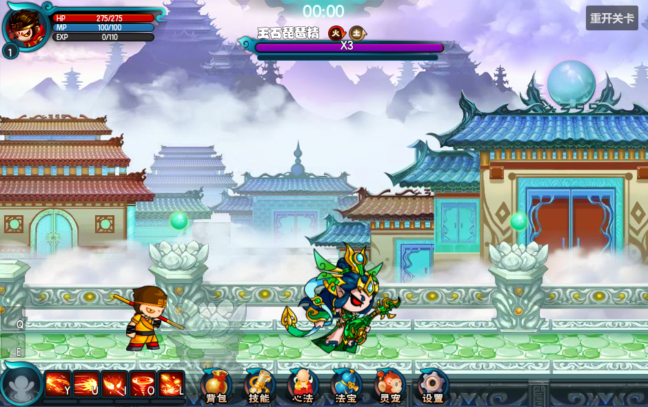
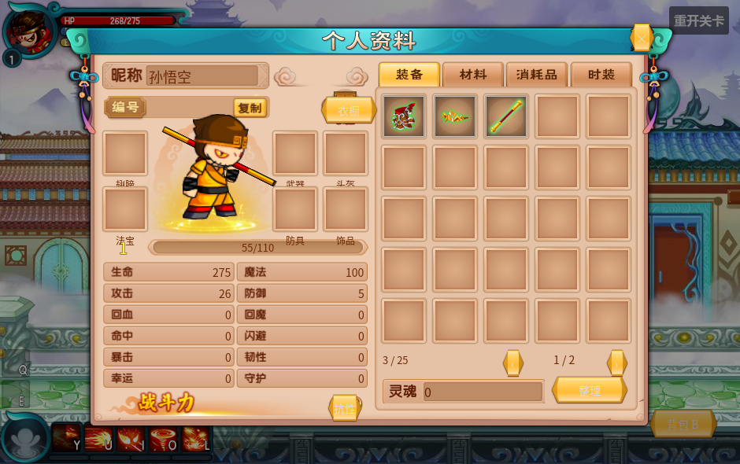
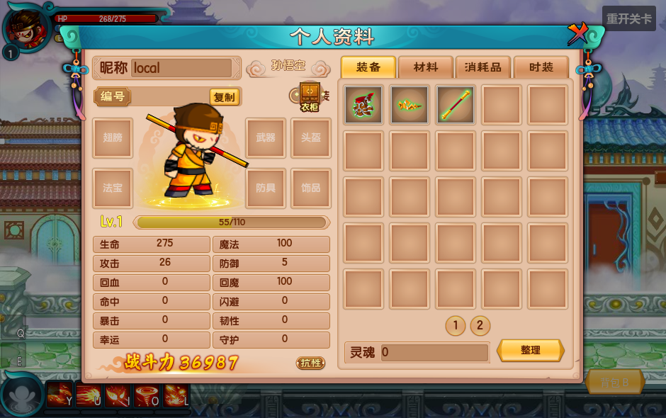

# 原版战斗 UI、Boss 斩败与背包

F5 运行 [碧玉径](../../game/levels/biyujing.tscn)。画面采用原版 940×590；B 或底部“背包”打开背包，Esc 先关闭当前面板，再打开操作设置。背包取得控制权并暂停战斗，关闭后释放控制权；提示和背包人物预览使用独立 UI 时间。技能键名读取 Core/InputMap 的实际映射，改键后无需修改角色或 UI。

底部六个原版点击入口、顶部关卡计时、每种怪物的保护和跑攻结束回待机见 [战斗HUD修正](combat-hud.md)。



## 怪物动画格式

四种现有关卡怪物现已离线转换为 Spine 4.3 附件时间轴，统一通过 SpineAnimationAdapter 和预置 AnimationPlayer 播放。原逐帧图集、XML注册点和AB判定仍保留为来源，运行时不解析XML。转换保留原帧轮廓、脚底原点、层序、特效时间和命中框，未推断缺失的肢体骨骼。木桩仍是独立SVG测试夹具。

新增怪物的配置步骤见 [怪物说明](../monsters/README.md)，不要将战斗状态或伤害逻辑写进动画播放器。

## Boss 修复与通关表现

| 功能 | 原版依据和当前实现 | 编辑位置 |
| --- | --- | --- |
| 石墙、音符偏移 | 图像及负注册点一起缩放 2 倍；生成位置只换算一次；朝向同时镜像 Visual 与 AB | `data/monsters/jushi_lingjun/wall.tscn → Visual/Sprite2D`、wall.tres；音符同结构 |
| 技能播报 | SkillComing：从 (-100,80) 用 7/30 秒到 (350,80)，第 2 秒开始离场，2+8/30 秒隐藏；动作开始后的打断不提前抹掉横幅 | 公共 BossFeedback/HUD/Banner |
| 空保护条 | mission 的 shape1326 深蓝空条放 texture_under；shape1330 青色填充放 texture_progress，不再用填充遮住空底 | `battle_boss_feedback_2d.tscn → HUD/BossBar/Protection` |
| 斩败 | mission 的 zs 原 59 帧、30FPS；地图黑场、演员白剪影；按 SimulateServerFrame.Slow 的原抽帧序列减速战斗 | 公共 BattlePresentation/StageFeedback；[boss_execution.tscn](boss_execution.tscn) |
| 通关光圈 | DungeonItem1001 的原 36 帧循环图集及注册点，包含黄色光圈和 W；计划与目标全完成才显示，斩败期间不能确认出口 | 地图 FinalExit/Gateway；[gateway.tscn](gateway.tscn) |

Boss 死亡事件按实体 ID 去重。斩败完成、离场与会话清理都会恢复材质和玩家控制权；Spine 的四种原生混合材质也会保存/恢复。菜单暂停冻结斩败，命中停顿仍按真实物理时间结束，避免减速导致停顿永久残留。斩败的 UI 动画和战斗动作分别推进，低帧率跨过末帧也会完成清理。

原版“前进”提示 [next_screen.tscn](next_screen.tscn) 预置在共享 HUD 的 NextScreen/Animation。NextScreen 使用锚点布局，四个锚点均为0.5，动画注册点对应原版屏幕 `(940/2,590/2)`，逐帧图片保留原坐标偏移；调整窗口尺寸时随HUD居中。非最终区域全部出生计划和目标完成、出口解锁时，按原 30FPS 播放 60 帧，结束自动隐藏；不再弹出区域完成文字。最终区域继续使用通关光圈。

## 原版基础 HUD 与提示

[battle_hud.tscn](battle_hud.tscn) 全部控件预置；布局、素材和图集来自原 mission、material、backpack SWF。共享 UI 位于关卡 CanvasLayer，不挂在悟空下。

- Player：原头像半径 30、HP/MP/EXP 三条与等级。当前生命/魔法读 Vital，上限及经验读 GAS 快照；整数显示。换装、升级和 Buff 修改后通过统一属性通知刷新。
- Skills：原位置 (0,520)、36px 图标、41px 间隔。五个技能对应升龙斩、烈焰闪、火眼金睛、烈焰风暴和火魔斩。冷却遮罩保留原 cdTime 103 帧及完整画布注册点；进度读取每个技能实例，将 GAS 剩余比例换算为原版已过比例：开始全遮盖，冷却结束清空，不另计一套冷却。
- HP/MP 消耗不足时采用原 Filter.grayFilter 的 0.3086/0.6094/0.082 灰度系数；冷却使用独立遮罩，不因冷却或当前动作将整排图标额外染暗。悬停展示名称、实际映射按键和剩余冷却；魔法不足、技能冷却、斩败结束、胜利/失败使用统一浮动提示；区域解锁使用独立的原版“前进”动画。
- 技能按键在图标内部右下角，用原粗圆字体和黑色描边；Q/E 道具槽标识读取 Core 映射。空怒气圆盘不常驻“空格”文字，蓄满时替换为原15帧火焰动画；原关卡ID≤3显示6帧空格提示，改键后显示实际键名，使用后立即恢复空盘。
- Player/StatusIcons：16 个预置状态槽，原位置 (75,60)、间隔32、图标28×28；仅显示 GameplayStatusData.icon 非空的实际状态，叠层与移除即时同步，悬停使用同窗口提示。现有九种基础 Buff 的原 Resource 没有 icon2，保持原本无小图的行为；新增状态可在资源 Icon 字段配置原版小图，原数据映射见 [status_icons.json](status_icons.json)。
- Notifications：22 个预置复用槽，按 CreateComponent/AutoWarnBar 的规则最多 11 条等待提示，后续用于正在退出的提示。居中、向上堆叠，1.5 秒后用 1 秒 QuadOut 上移 100px 并淡出；打开背包后仍会正常消失。没有创建原生 Windows 子窗口。

无双条读取 GAS `rage` Vital，上限取 `xpMax=10000`；命中获取量按原技能 `addXP/addXPMax` 裁决。显示采用原 `mcMask` 的右锚点（`FILL_RIGHT_TO_LEFT`），保留原渐变图片朝向。原 `TweenMax.to(mcMask,1,{scaleX:percent})` 的 Quad.easeOut 使用固定插值状态复刻，无需在持续扣减时每帧创建Tween；满值动画和UI缓动使用UI时间，怒气消耗与增益使用统一战斗时间。详见 [无双规则](../effects/wushuang/README.md)。法宝技能未配置时也不生成假的技能和冷却。

### 截图对照修复

此前 player_frame.png 含不透明黑色条底，绘制在动态填充上方会把红、蓝、黄压暗。现将底图放在第一层，按原 (76,20/34/48) 放条底，填充偏移 (1,1)，再绘制静态标题和原10px数值字体。头像仍采用原中心 (38,40)、半径30与14px等级字体。快捷键由原 keyCodeMc 的坐标复刻，移回图标内；技能图标继续取角色实际技能定义的 Resource.icon3，切换技能时同步。

实际 GPU 验证采样 HP/MP/EXP 填充像素，防止再次出现“配置有颜色、运行画面被底图遮住”。[截图工具](../../tools/capture_original_battle_ui.gd) 另输出 hud-partial（268/275生命、57/100魔法、55/110经验）和 no-mana，覆盖三条颜色、部分填充及原灰度；这些样例只在工具中经属性入口设置，不改变角色初始配置。HUD验收已扩展为56项，同时通过95项Buff与145项操作控制回归。

## 背包 UI 与插件规则

[inventory.tscn](inventory.tscn) 复刻原 BagView/BodyView 布局，25 格 5×5、四分类标签、分页、品质框、数量、装备位、人物待机预览、12 项属性、等级/经验、灵魂、抗性弹层、物品提示、点击菜单与确认弹层都在编辑器中预置。



数据由 `OriginalInventory extends C_Inventory` 管理，继续使用 Simple Inventory、BattleAttributeComponent 和 GAS，界面只调用插件入口。

| 原版规则 | 插件行为 |
| --- | --- |
| 装备、普通道具、消耗品、时装独立容量 | 初始各 25 格，Common.packMaxNum 上限每类 500；下一页的未开放格显示锁 |
| BagVO 排序 | 品质降序、物品 ID 自然升序；可堆叠物品按定义上限合并，锁定状态不同不合并 |
| 装备条件 | 检查角色、等级、原 isCanChangeInBattle；同装备位原子交换，满背包也不会吞掉旧装备 |
| 卸下 | 检查对应分类容量，通过 equip_changed 撤销同一 GAS 来源，恢复基础皮肤 |
| 锁定、出售 | 锁定/不可售禁止出售；确认数量后按原 price × Common.sellDiscount(0.2) 截断结算灵魂 |
| 扩容 | 点击锁格，累计对应 OpenPack 各格消耗；仙织革不足时整笔失败，不提前扣材料 |
| 使用 | 已接生命/魔法恢复道具；通过现有 Vital 入口，实际生效后扣一件；未支持的效果不会假扣物品 |
| 运行实例 | 入包深复制物品、装备修正与原数据；不同角色不共享数量、锁定或装备状态 |

封煞甲、封戾冠、封魔棒三件原始装备已提供独立定义，封魔棒售价为 150×0.2=30。换装同步实际战斗人物与背包预览的衣服、头盔和武器皮肤，攻击动画与位置不变。[新增装备与配置说明](../inventory/README.md)。

普通装备与幻装显示可切换，八项抗性从最终属性读取。背包不是整套原版联网账户系统：仓库、商城、炼丹炉、时装续费、开箱、服务端战力和账户身份尚未移植，未接入的功能没有伪造成功回调。当前是可以真实换装、出售、扩容、整理和使用基础恢复物品的本地背包；所有物品尚未批量导入，也未增加存档协议。后续接这些模块时仍须通过插件入口完成事务。

## 重导出、编辑与验证

背包细节修正（人物比例、动态光效、编号规则、抗性悬浮、装备对比与点击菜单）及编辑入口见 [背包面板细节](../inventory/panel-details.md)。后续报错修复已运行90项背包/战斗UI检查及两种渲染设置下的正式关卡启动检查。

正常运行无需安装导出工具。需要重新导出时，先准备 Java、Pillow 和参考仓库已有 FFDec20.1，然后在项目目录执行：

```powershell
python tools/import_original_battle_ui.py 'D:/UserData/Downloads/game/Speculum-4399-master'
python tools/build_original_ui_scenes.py 'D:/UserData/Downloads/game/Speculum-4399-master'
```

第一步只读原 SWF/配置，导出贴图、原帧时间轴和定义；第二步生成可编辑的预置场景并接入主关卡。若使用本机 `.cleanup-backup/python-packages` 的 Pillow，请使用安装它的 Python3.12（将命令中的 python 换成 py -3.12）。重建会覆盖生成场景，手工调布局应记录或同步到生成器。源码/素材 SHA256 与注册点见 [source_mapping.json](../../assets/ui/original/source_mapping.json)、[original_rules.json](../inventory/original_rules.json)。原源码主要位于参考仓库 `out/zmhj-equip-skill-diag` 的 RoleInfoViewer、RoleSkillView、SkillComing、BattleMapBase、StageClearCmd、SimulateServerFrame、BagView、BagVO、BodyView、CreateComponent、AutoWarnBar、Unify 和 SellItemCmd。提示文字采用 TipsManager.common 的 #5F1E05，背景用预置 NinePatchRect 实现 Scale9Image 的中间三分之一缩放，边框不随弹层大小拉伸。

[自动验收](../../tests/suites/verify_original_battle_ui.tscn) 检查库存事务与隔离、换装实际攻击/外观、生命恢复、扩容原消耗、菜单与通知时钟、冷却注册点、播报、石墙、斩败去重与恢复、出口隐藏/开启。使用项目自带 Spine Godot：

```powershell
./tools/verify_stage_eight.ps1 -Godot 'D:/路径/Spine-Godot.exe' -Suites original_battle_ui,original_boss_presentation,boss,level_progression,plugins,attribute_pipeline,stage_one
```

真实 GPU 截图脚本 [capture_original_battle_ui.gd](../../tools/capture_original_battle_ui.gd) 输出到忽略的 `.cleanup-backup/battle-ui-*.png`，用于检查颜色、原生 Spine 材质、层级、冷却遮罩、背包外观、播报、斩败和光圈。

## 背包截图修复

[inventory.tscn](inventory.tscn) 使用从原 material SWF Font1 导出的 **方正粗圆简体**（6982字形）。字体、按钮、文字颜色和属性数字定位来自 TextManager、TextAttrManager、PropBody 和 McNextPrevNumBar：属性值在原111px单元格居中；空装备名称位于格内，装备后隐藏；人物名与昵称分开；等级为Lv.，经验条按真实EXP/EXPNext填充。

关闭按钮、衣柜、上一页/下一页和圆形页码保留原三态图片。页码随各分类实际容量变化，最多显示8页，一页时隐藏，超过8页才显示箭头。原版上古天地不同版本的下方仓库/按键设置按钮存在差异；当前本地按钮保留“整理”功能，未用仓库文字冒充整理入口。

战斗力数字采用原 `fight_number` 的10个字形及 NumberCom 的-3像素间距。当前离线展示使用原 `FightPowerManager.getFightPowerByItemVo` / `PowerAttribute[1]` 十二项最终属性加权后四舍五入，权重在 [fight_power_weights.json](fight_power_weights.json)。原联网人物面板战力来自服务端，本项目没有该服务器；此数字是本地基础属性战力，不声称包含未移植的账户系统和服务端额外战力。

基础场景生成后自动运行 [refine_original_inventory_ui.py](../../tools/refine_original_inventory_ui.py)，该步骤可重复执行，使用已有导出资产。所有控件保存于场景，不在打开背包时创建。


